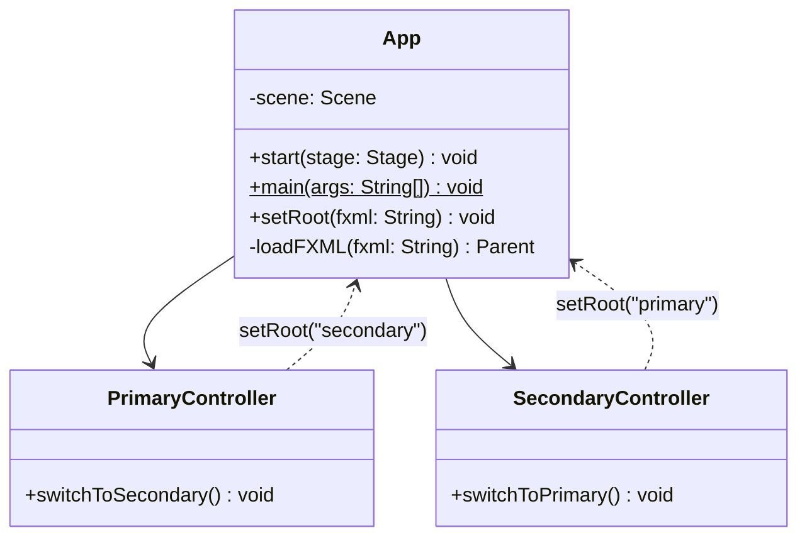

# Proyecto 01 - poo-javafx

Este proyecto corresponde a la introducción a Java, Maven y JavaFX. Su objetivo es verificar que el entorno de desarrollo funciona correctamente y que la aplicación puede ejecutarse sin errores.

## ¿Qué hace?

La clase principal de la aplicación inicia la interfaz JavaFX y carga la vista inicial del proyecto. Su propósito es validar la configuración básica del entorno y comprobar que el proyecto generado con Maven se ejecuta correctamente.

## Diagrama de clases



## Estructura de clases y relaciones

- La clase `App` es la entrada principal de la aplicación JavaFX.
- La aplicación carga la vista `primary.fxml` mediante `FXMLLoader`.
- No hay herencia ni composición compleja en este ejercicio; la lógica principal es iniciar la interfaz y verificar que Java, Maven y JavaFX están correctamente configurados.
- El proyecto sirve como ejemplo inicial para validar que el entorno de desarrollo está funcionando correctamente.

## Requisitos

- Java JDK 21 o superior
- Maven
- IDE compatible con Java (IntelliJ IDEA, VS Code, NetBeans, etc.)

## Crear el proyecto

Si necesitas generar el proyecto desde cero, ejecuta:

```bash
mvn archetype:generate \
  -DarchetypeGroupId=org.openjfx \
  -DarchetypeArtifactId=javafx-archetype-fxml \
  -DarchetypeVersion=0.0.6 \
  -DgroupId=cl.elprofecarreno \
  -DartifactId=poo-javafx \
  -Dversion=1.0-SNAPSHOT \
  -Dpackage=cl.elprofecarreno.app \
  -Djavafx-version=21 \
  -Djavafx-maven-plugin-version=0.0.8 \
  -DinteractiveMode=false
```

## Ejecutar el proyecto

Desde la carpeta del proyecto, ejecuta:

```bash
mvn clean javafx:run
```

## Resultado esperado

Si la configuración es correcta, la aplicación se abre con la ventana JavaFX del proyecto base y el entorno queda verificado para continuar con ejercicios más avanzados.

