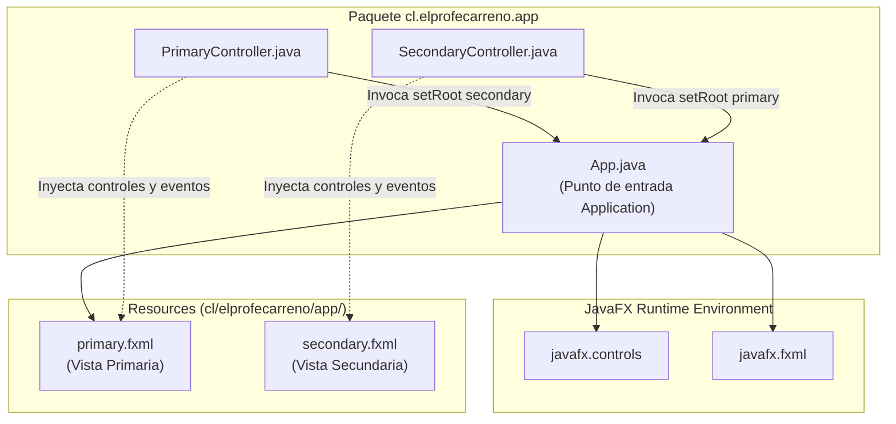
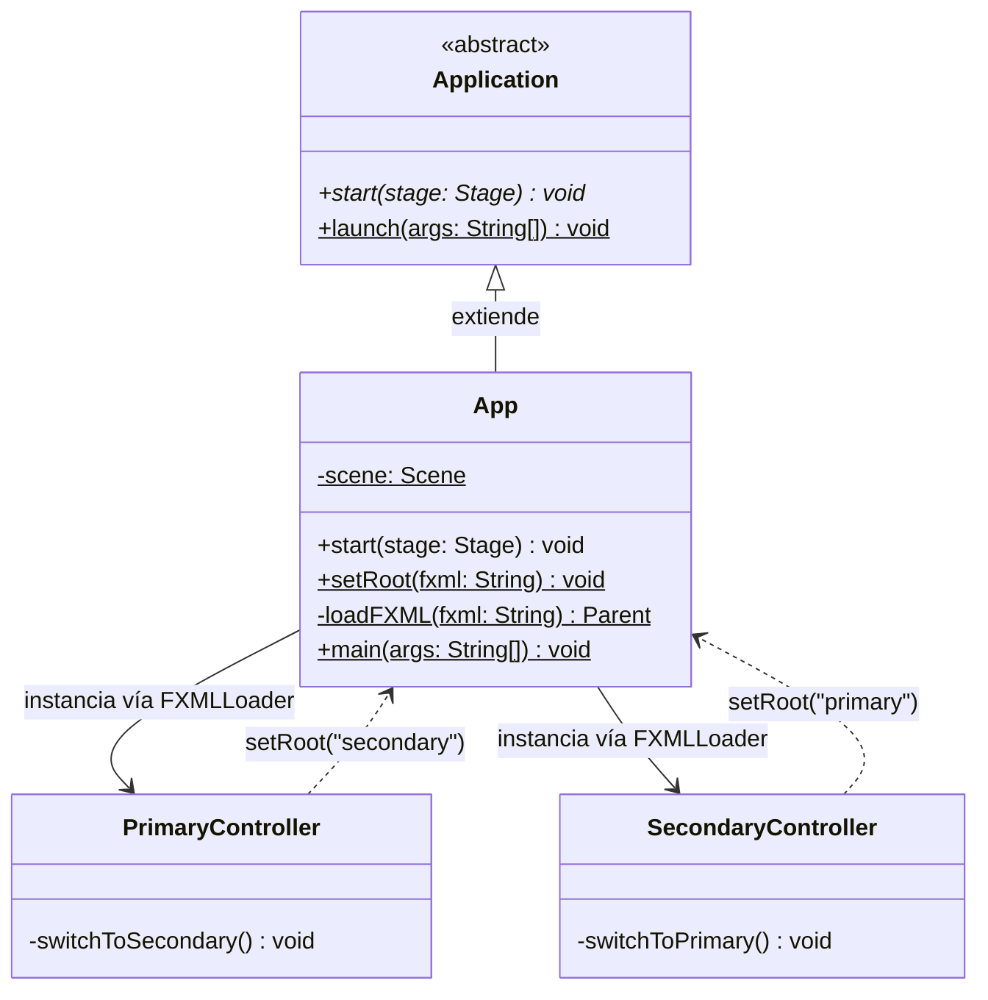
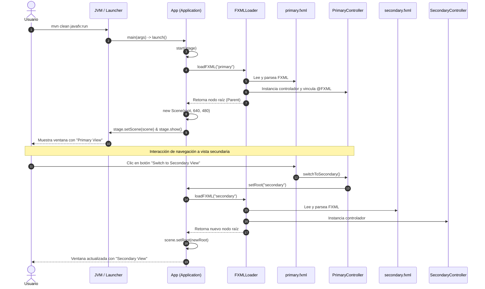
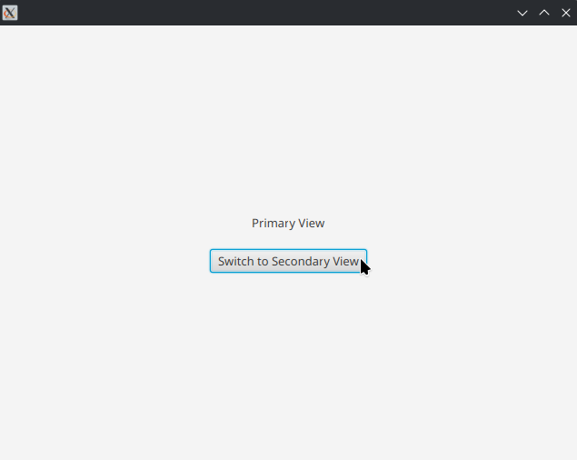

# Proyecto 01 - poo-javafx (Entorno Base y Navegación)

Este proyecto corresponde a la **introducción e inicialización del entorno de desarrollo** para aplicaciones de escritorio en Java utilizando **JavaFX**, **Maven** y el **Sistema de Módulos de Java (JPMS)**. Constituye el **punto de partida (Hito 01)** de una serie de 7 proyectos incrementales sobre Programación Orientada a Objetos y Arquitectura de Software.

El objetivo pedagógico principal es verificar que el entorno de desarrollo (JDK, Maven, JavaFX SDK y herramientas gráficas) funcione correctamente mediante una aplicación con navegación bidireccional entre dos pantallas (`primary` y `secondary`) usando controladores desacoplados.

---

## ¿Qué hace el proyecto?

La clase principal `App` extiende `Application` e inicializa el escenario (`Stage`) y la escena (`Scene`) cargando la vista declarativa `primary.fxml`. Desde esta pantalla, el usuario puede pulsar un botón para alternar a `secondary.fxml` y viceversa. La navegación se realiza mediante un método estático `setRoot` que recarga el nodo raíz de la escena a través de `FXMLLoader`.

---

## Punto de Partida Incremental

Al ser el **Proyecto 01**, funciona como la base inicial de toda la serie:

| Aspecto | Implementación en Proyecto 01 | Propósito en la Serie Incremental |
| :--- | :--- | :--- |
| **Arquitectura** | Monolítica / Controlador de Vista | Validar el ciclo de vida de JavaFX (`Application`, `Stage`, `Scene`). |
| **Vistas FXML** | `primary.fxml` y `secondary.fxml` | Demostrar separación entre diseño declarativo (XML) y comportamiento (Java). |
| **Controladores** | `PrimaryController` y `SecondaryController` | Enlazar eventos de usuario (`@FXML onAction`) con métodos en controladores independientes. |
| **Navegación** | Cambio de nodo raíz (`scene.setRoot(...)`) | Establecer el patrón de navegación limpia sin abrir múltiples ventanas del sistema operativo. |
| **JPMS (`module-info.java`)** | `requires javafx.controls`, `javafx.fxml`; `opens ... to javafx.fxml` | Configurar los permisos reflexivos básicos para que JavaFX pueda inyectar componentes. |

---

## Diagrama de Componentes

El siguiente diagrama muestra los componentes del proyecto, la distribución de paquetes y la integración con el motor de JavaFX:



---

## Diagrama de Clases



---

## Diagrama de Flujo e Interacción de Capas

El siguiente diagrama de secuencia detalla el flujo de inicio de la aplicación y la transición entre vistas al interactuar con el usuario:



---

## Paso a Paso para la Construcción del Proyecto

A continuación se detalla la guía técnica para construir este proyecto desde cero:

### Paso 1: Generación del proyecto con Maven Archetype
Ejecuta el siguiente comando en la terminal para crear la estructura base modular con soporte JavaFX:

```bash
mvn archetype:generate \
  -DarchetypeGroupId=org.openjfx \
  -DarchetypeArtifactId=javafx-archetype-fxml \
  -DarchetypeVersion=0.0.6 \
  -DgroupId=cl.elprofecarreno \
  -DartifactId=poo-javafx \
  -Dversion=1.0-SNAPSHOT \
  -Dpackage=cl.elprofecarreno.app \
  -Djavafx-version=21 \
  -Djavafx-maven-plugin-version=0.0.8 \
  -DinteractiveMode=false
```

### Paso 2: Configuración de `pom.xml`
Asegúrate de que las dependencias de JavaFX y el plugin de compilación estén correctamente definidos:

```xml
<dependencies>
    <dependency>
        <groupId>org.openjfx</groupId>
        <artifactId>javafx-controls</artifactId>
        <version>21</version>
    </dependency>
    <dependency>
        <groupId>org.openjfx</groupId>
        <artifactId>javafx-fxml</artifactId>
        <version>21</version>
    </dependency>
</dependencies>

<build>
    <plugins>
        <plugin>
            <groupId>org.apache.maven.plugins</groupId>
            <artifactId>maven-compiler-plugin</artifactId>
            <version>3.8.0</version>
            <configuration>
                <release>11</release>
            </configuration>
        </plugin>
        <plugin>
            <groupId>org.openjfx</groupId>
            <artifactId>javafx-maven-plugin</artifactId>
            <version>0.0.8</version>
            <configuration>
                <mainClass>cl.elprofecarreno.app.App</mainClass>
            </configuration>
        </plugin>
    </plugins>
</build>
```

### Paso 3: Configuración del descriptor modular (`module-info.java`)
Crea el archivo `src/main/java/module-info.java` para permitir que el cargador de JavaFX acceda por reflexión a las clases del paquete:

```java
module cl.elprofecarreno.app {
    requires javafx.controls;
    requires javafx.fxml;

    opens cl.elprofecarreno.app to javafx.fxml;
    exports cl.elprofecarreno.app;
}
```

### Paso 4: Creación de la clase principal `App.java`
Implementa la lógica del ciclo de vida y navegación dinámica en `src/main/java/cl/elprofecarreno/app/App.java`:

```java
package cl.elprofecarreno.app;

import javafx.application.Application;
import javafx.fxml.FXMLLoader;
import javafx.scene.Parent;
import javafx.scene.Scene;
import javafx.stage.Stage;

import java.io.IOException;

public class App extends Application {

    private static Scene scene;

    @Override
    public void start(Stage stage) throws IOException {
        scene = new Scene(loadFXML("primary"), 640, 480);
        stage.setScene(scene);
        stage.show();
    }

    static void setRoot(String fxml) throws IOException {
        scene.setRoot(loadFXML(fxml));
    }

    private static Parent loadFXML(String fxml) throws IOException {
        FXMLLoader fxmlLoader = new FXMLLoader(App.class.getResource(fxml + ".fxml"));
        return fxmlLoader.load();
    }

    public static void main(String[] args) {
        launch();
    }
}
```

### Paso 5: Creación de las vistas FXML
1. `src/main/resources/cl/elprofecarreno/app/primary.fxml`:
   - Contenedor `VBox` con texto `"Primary View"` y un botón enlazado a `#switchToSecondary`.
2. `src/main/resources/cl/elprofecarreno/app/secondary.fxml`:
   - Contenedor `VBox` con texto `"Secondary View"` y un botón enlazado a `#switchToPrimary`.

### Paso 6: Creación de los controladores
1. `PrimaryController.java`:
   ```java
   package cl.elprofecarreno.app;
   import java.io.IOException;
   import javafx.fxml.FXML;

   public class PrimaryController {
       @FXML
       private void switchToSecondary() throws IOException {
           App.setRoot("secondary");
       }
   }
   ```
2. `SecondaryController.java`:
   ```java
   package cl.elprofecarreno.app;
   import java.io.IOException;
   import javafx.fxml.FXML;

   public class SecondaryController {
       @FXML
       private void switchToPrimary() throws IOException {
           App.setRoot("primary");
       }
   }
   ```

---

## Estructura del Proyecto

```text
01/
└── poo-javafx/
    ├── pom.xml
    └── src/
        └── main/
            ├── java/
            │   ├── module-info.java
            │   └── cl/elprofecarreno/app/
            │       ├── App.java
            │       ├── PrimaryController.java
            │       └── SecondaryController.java
            └── resources/
                └── cl/elprofecarreno/app/
                    ├── primary.fxml
                    └── secondary.fxml
```

---

## Requisitos y Ejecución

### Requisitos
- **Java JDK**: 11 o superior (recomendado JDK 21).
- **Apache Maven**: 3.8 o superior.
- **IDE**: IntelliJ IDEA, VS Code o Eclipse con soporte JavaFX.

### Ejecución
Desde la carpeta del proyecto:
```bash
cd 01/poo-javafx
mvn clean javafx:run
```

O desde la raíz del repositorio:
```bash
mvn -f 01/poo-javafx/pom.xml clean javafx:run
```

### Resultado esperado

Se abre una ventana de 640x480 con la vista primaria. Al pulsar el botón, el contenido cambia de forma fluida a la vista secundaria sin abrir ventanas adicionales.

#### Captura de la aplicación en ejecución:


---

## Objetivos Pedagógicos y Buenas Prácticas

- **Separación Vista-Controlador**: Mantener la interfaz en FXML y el código de control en clases Java.
- **Ciclo de Vida JavaFX**: Comprender las etapas `launch()`, `init()`, `start()` y `stop()`.
- **Navegación Eficiente**: Reutilizar el mismo `Stage` y `Scene` actualizando la raíz gráfica (`scene.setRoot`).
- **Sistema Modular (JPMS)**: Aprender el uso de la directiva `opens ... to javafx.fxml` para permitir reflexión controlada.
