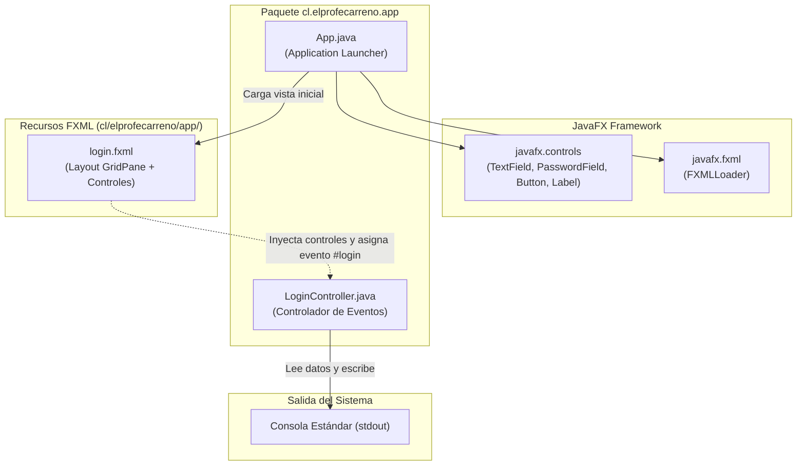
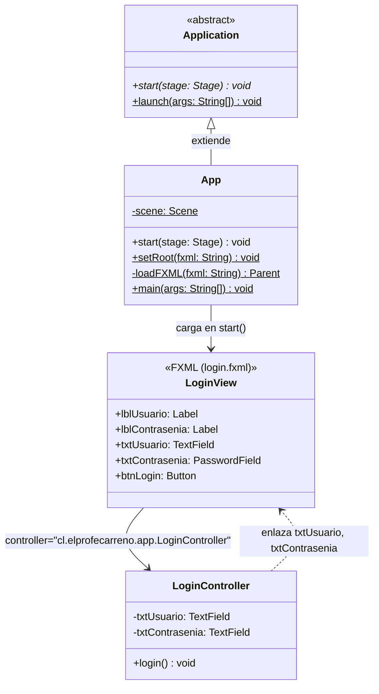
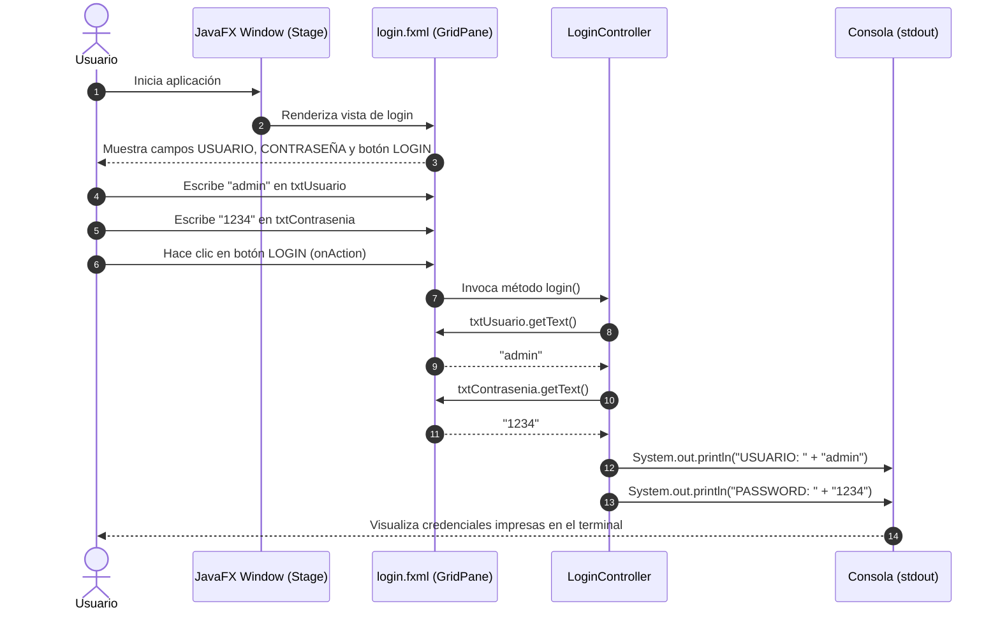
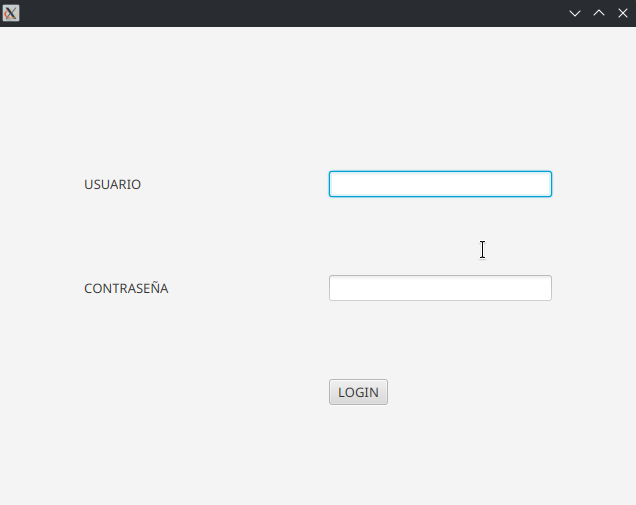

# Proyecto 02 - poo-javafx (Login 1/3: Formulario Base y Captura de Eventos)

Este proyecto corresponde al **segundo hito incremental** del curso. A partir del entorno configurado en el Proyecto 01, se introduce el primer caso de uso interactivo: la **construcción de un formulario de inicio de sesión (Login)** mediante JavaFX y FXML, implementando la captura de datos ingresados por el usuario y el despacho de eventos hacia el controlador.

---

## ¿Qué hace el proyecto?

Al iniciar, la aplicación JavaFX despliega una ventana centrada con el formulario de inicio de sesión (`login.fxml`). La interfaz contiene campos para ingresar nombre de usuario y contraseña, además de un botón de acceso (`LOGIN`). 

Al presionar el botón:
1. El evento es interceptado por el método `login()` del controlador `LoginController`.
2. Se extrae el contenido de los controles visuales mediante el método `.getText()`.
3. Los valores capturados son emitidos por la consola estándar del sistema (`System.out.println`), permitiendo verificar la comunicación bidireccional entre la vista y el controlador.

---

## Diferencias Clave: Proyecto 02 vs. Proyecto 01

A continuación se resumen las diferencias fundamentales antes de abordar la construcción del proyecto:

| Aspecto | Proyecto 01 (Base) | Proyecto 02 (Login 1/3) | Justificación Pedagógica |
| :--- | :--- | :--- | :--- |
| **Vista Principal** | `primary.fxml` (conmutación simple a `secondary.fxml`). | `login.fxml` (formulario estructurado en cuadrícula `GridPane`). | Pasa de una prueba de concepto a una interfaz orientada a un caso de uso real de captura de datos. |
| **Componentes Visuales** | `Label` y `Button` simples dentro de un `VBox`. | `TextField`, `PasswordField`, `Label` descriptivos y `Button` de acción dentro de un `GridPane`. | Manejo de formularios interactivos y controles de captura de texto en JavaFX. |
| **Controlador** | `PrimaryController` y `SecondaryController` (solo conmutaban vista). | `LoginController` vinculado a controles de formulario con inyección `@FXML`. | Enlace de atributos de interfaz (`fx:id`) con variables del controlador Java. |
| **Punto de Inicio (`App.java`)** | Carga `loadFXML("primary")`. | Carga `loadFXML("login")`. | Redirección de la escena inicial al nuevo formulario de acceso. |
| **Manejo de Eventos** | Navegación entre vistas sin procesar datos. | Captura del evento `onAction="#login"`, lectura con `.getText()` e impresión por consola. | Demostrar el flujo de entrada de datos desde la GUI hacia la capa lógica del controlador. |

---

## Diagrama de Componentes



---

## Diagrama de Clases



---

## Diagrama de Flujo e Interacción de Capas

El siguiente diagrama detalla la interacción entre el usuario, la interfaz gráfica, el controlador y la salida en consola:



---

## Paso a Paso para la Construcción Incremental (desde Proyecto 01)

Para transformar el Proyecto 01 en el Proyecto 02, sigue estos pasos:

### Paso 1: Crear la vista FXML del Formulario (`login.fxml`)
Crea el archivo `src/main/resources/cl/elprofecarreno/app/login.fxml`. Estructura un `VBox` que contenga un `GridPane` con etiquetas y campos:

```xml
<?xml version="1.0" encoding="UTF-8"?>

<?import javafx.scene.control.Button?>
<?import javafx.scene.control.Label?>
<?import javafx.scene.control.PasswordField?>
<?import javafx.scene.control.TextField?>
<?import javafx.scene.layout.ColumnConstraints?>
<?import javafx.scene.layout.GridPane?>
<?import javafx.scene.layout.RowConstraints?>
<?import javafx.scene.layout.VBox?>

<VBox maxHeight="-Infinity" maxWidth="-Infinity" minHeight="-Infinity" minWidth="-Infinity" 
      prefHeight="300.0" prefWidth="400.0" 
      xmlns="http://javafx.com/javafx/21" xmlns:fx="http://javafx.com/fxml/1" 
      fx:controller="cl.elprofecarreno.app.LoginController">
   <children>
      <GridPane prefHeight="417.0" prefWidth="600.0">
        <columnConstraints>
            <ColumnConstraints hgrow="SOMETIMES" maxWidth="143.0" minWidth="10.0" prefWidth="71.0" />
            <ColumnConstraints hgrow="SOMETIMES" maxWidth="245.0" minWidth="10.0" prefWidth="235.0" />
            <ColumnConstraints hgrow="SOMETIMES" maxWidth="223.0" minWidth="10.0" prefWidth="213.0" />
            <ColumnConstraints hgrow="SOMETIMES" maxWidth="126.0" minWidth="10.0" prefWidth="70.0" />
        </columnConstraints>
        <rowConstraints>
            <RowConstraints minHeight="10.0" prefHeight="30.0" vgrow="SOMETIMES" />
            <RowConstraints minHeight="10.0" prefHeight="30.0" vgrow="SOMETIMES" />
            <RowConstraints minHeight="10.0" prefHeight="30.0" vgrow="SOMETIMES" />
            <RowConstraints minHeight="10.0" prefHeight="30.0" vgrow="SOMETIMES" />
        </rowConstraints>
         <children>
            <Label fx:id="lblUsuario" text="USUARIO" GridPane.columnIndex="1" GridPane.rowIndex="1" />
            <Label fx:id="lblContrasenia" text="CONTRASEÑA" GridPane.columnIndex="1" GridPane.rowIndex="2" />
            <TextField fx:id="txtUsuario" GridPane.columnIndex="2" GridPane.rowIndex="1" />
            <PasswordField fx:id="txtContrasenia" GridPane.columnIndex="2" GridPane.rowIndex="2" />
            <Button fx:id="btnLogin" mnemonicParsing="false" onAction="#login" text="LOGIN" GridPane.columnIndex="2" GridPane.rowIndex="3" />
         </children>
      </GridPane>
   </children>
</VBox>
```

### Paso 2: Crear la clase controladora `LoginController.java`
Crea `src/main/java/cl/elprofecarreno/app/LoginController.java` para vincular los `fx:id` y gestionar el evento del botón:

```java
package cl.elprofecarreno.app;

import java.io.IOException;
import javafx.fxml.FXML;
import javafx.scene.control.TextField;

public class LoginController {

    @FXML
    private TextField txtUsuario;

    @FXML
    private TextField txtContrasenia;

    @FXML
    private void login() throws IOException {
        System.out.println("USUARIO: " + txtUsuario.getText());
        System.out.println("PASSWORD: " + txtContrasenia.getText());
    }
}
```

### Paso 3: Modificar `App.java` para iniciar con la vista `login`
En `src/main/java/cl/elprofecarreno/app/App.java`, ajusta el método `start` para cargar `"login"`:

```java
    @Override
    public void start(Stage stage) throws IOException {
        scene = new Scene(loadFXML("login"), 640, 480);
        stage.setScene(scene);
        stage.show();
    }
```

### Paso 4: Validar el descriptor modular (`module-info.java`)
Verifica que `module-info.java` mantenga abierta la reflexión para el paquete base:

```java
module cl.elprofecarreno.app {
    requires javafx.controls;
    requires javafx.fxml;

    opens cl.elprofecarreno.app to javafx.fxml;
    exports cl.elprofecarreno.app;
}
```

---

## Estructura del Proyecto

```text
02/
└── poo-javafx/
    ├── pom.xml
    └── src/
        └── main/
            ├── java/
            │   ├── module-info.java
            │   └── cl/elprofecarreno/app/
            │       ├── App.java
            │       └── LoginController.java
            └── resources/
                └── cl/elprofecarreno/app/
                    └── login.fxml
```

---

## Requisitos y Ejecución

### Requisitos
- **Java JDK**: 11 o superior (recomendado JDK 21).
- **Apache Maven**: 3.8+.
- **JavaFX**: 21.

### Ejecución
Desde la carpeta del proyecto:
```bash
cd 02/poo-javafx
mvn clean javafx:run
```

O desde la raíz del repositorio:
```bash
mvn -f 02/poo-javafx/pom.xml clean javafx:run
```

### Resultado esperado

Al ejecutar la aplicación, se despliega la ventana con el formulario de inicio de sesión:

#### Captura de la aplicación en ejecución:


Al ingresar `usuario123` y `secreto` y hacer clic en **LOGIN**, la consola imprimirá:

```text
USUARIO: usuario123
PASSWORD: secreto
```

---

## Objetivos Pedagógicos y Buenas Prácticas

- **Captura de Entradas**: Conectar controles de texto de FXML con variables de instancia del controlador mediante `@FXML`.
- **Manejo de Eventos de Botón**: Declarar manejadores de eventos en FXML (`onAction="#login"`) asociados a métodos Java.
- **Distribución Gráfica con GridPane**: Organizar elementos visuales en filas y columnas (`columnIndex`, `rowIndex`).
