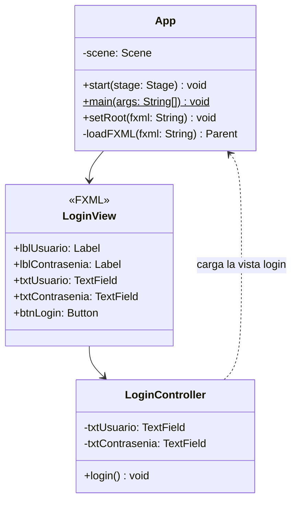

# Proyecto 02 - poo-javafx

Este proyecto corresponde a una aplicación JavaFX enfocada en la autenticación de usuarios mediante un formulario de login. El objetivo es practicar la integración entre Java, Maven, JavaFX y FXML para crear una interfaz gráfica funcional con campos de usuario y contraseña.

## ¿Qué hace?

La aplicación inicia una ventana JavaFX que carga la vista `login.fxml`. En esa pantalla se muestran dos campos de texto para ingresar el usuario y la contraseña, junto con un botón de acceso. La clase `LoginController` conecta esos elementos visuales con la lógica del evento `login`, donde se capturan los valores ingresados y se imprimen en consola.

## Diagrama de clases



## Estructura de clases y relaciones

- La clase `App` es la entrada principal de la aplicación JavaFX.
- En `start()` se carga la vista `login.fxml` mediante `FXMLLoader`.
- La vista contiene los elementos del formulario de inicio de sesión:
  - `txtUsuario`
  - `txtContrasenia`
  - `btnLogin`
- El controlador `LoginController` tiene los atributos `txtUsuario` y `txtContrasenia`, y el método `login()` se ejecuta al presionar el botón.
- La lógica actual es básica: captura los datos ingresados y los muestra por consola, lo que permite verificar la conexión entre la interfaz y el controlador.
- Este proyecto sirve como base para continuar con proyectos más avanzados de autenticación, validaciones y navegación entre pantallas.

## Requisitos

- Java JDK 11 o superior
- Maven
- JavaFX
- IDE compatible con Java (IntelliJ IDEA, VS Code, NetBeans, etc.)

## Ejecutar el proyecto

Desde la carpeta del proyecto, ejecuta:

```bash
cd poo-javafx
mvn clean javafx:run
```

## Resultado esperado

Al ejecutar la aplicación, se abrirá una ventana con el formulario de inicio de sesión. Al ingresar un usuario y una contraseña y presionar el botón `LOGIN`, los datos se enviarán al controlador y aparecerán en la consola.

## Estructura del proyecto

```text
poo-javafx/
├── src/
│   ├── main/
│   │   ├── java/
│   │   │   └── cl/elprofecarreno/app/
│   │   │       ├── App.java
│   │   │       └── LoginController.java
│   │   └── resources/
│   │       └── cl/elprofecarreno/app/
│   │           └── login.fxml
│   └── test/
├── pom.xml
└── README.md
```

## Objetivo del ejercicio

Este ejercicio pretende comprender cómo:

- crear una interfaz de login con JavaFX
- enlazar controles de FXML con un controlador
- capturar datos ingresados por el usuario
- ejecutar una aplicación gráfica con Maven y JavaFX
