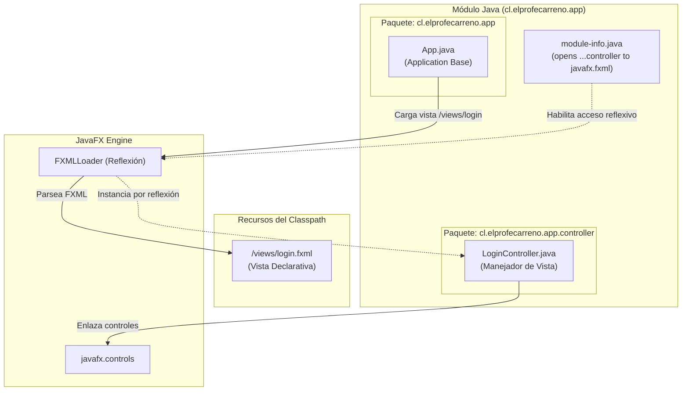
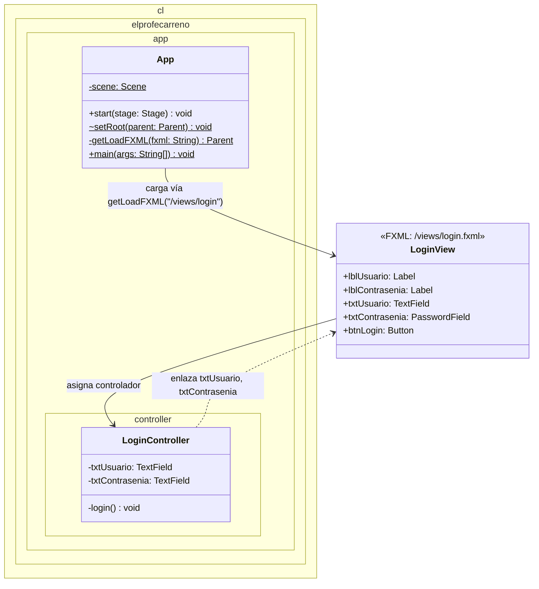
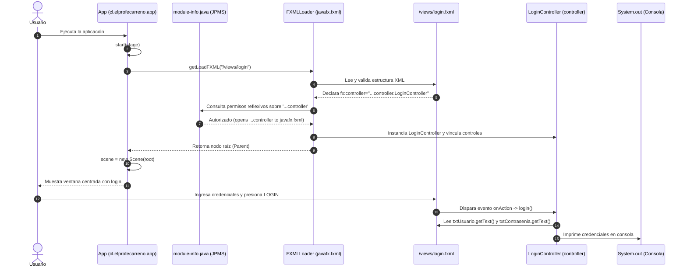
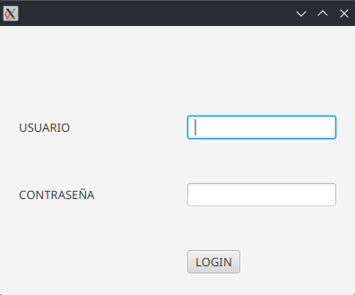

# Proyecto 03 - poo-javafx (Login 2/3: Separación de Responsabilidades y Modularidad JPMS)

Este proyecto corresponde al **tercer hito incremental** del curso. En esta etapa se refactoriza la estructura del proyecto para adoptar una **separación formal de responsabilidades**: se segregan los controladores en un subpaquete dedicado (`controller`), se centralizan los archivos de interfaz gráfica en un directorio exclusivo de vistas (`resources/views/`), se limpia el código de plantillas heredadas y se configura de forma rigurosa el **Sistema de Módulos de Java (JPMS)** en `module-info.java`.

---

## ¿Qué hace el proyecto?

La clase principal `App` inicia la aplicación JavaFX invocando el método utilitario `getLoadFXML("/views/login")`. La interfaz presenta una ventana con el formulario de inicio de sesión centrado mediante un contenedor `GridPane` dentro de un `VBox`. 

El usuario ingresa su nombre de usuario en un control `TextField` y su contraseña en un control `PasswordField` (donde los caracteres se enmascaran visualmente por seguridad). Al pulsar el botón `LOGIN`, el evento es atendido por `LoginController` (ubicado en su propio subpaquete `controller`), el cual extrae los textos y los despliega en la consola.

---

## Diferencias Clave: Proyecto 03 vs. Proyecto 02

A continuación se detallan las mejoras arquitectónicas y estructurales introducidas:

| Aspecto | Proyecto 02 | Proyecto 03 (Refactorizado) | Justificación Pedagógica y Técnica |
| :--- | :--- | :--- | :--- |
| **Ubicación de Controladores** | En el paquete raíz `cl.elprofecarreno.app`. | En el subpaquete dedicado `cl.elprofecarreno.app.controller`. | Principio de Alta Cohesión: agrupar componentes según su rol arquitectónico. |
| **Ubicación de Vistas FXML** | Mezcladas en `resources/cl/elprofecarreno/app/`. | Centralizadas en `resources/views/login.fxml`. | Mantenimiento simplificado y separación neta entre recursos estáticos de vista y código Java. |
| **Carga de Vistas en `App.java`** | Ruta relativa `loadFXML("login")`. | Ruta absoluta del classpath `getLoadFXML("/views/login")`. | Evita errores de resolución de rutas en tiempo de ejecución al modularizar paquetes. |
| **Firma de `setRoot` en `App.java`** | `setRoot(String fxml)` (recibía el nombre). | `setRoot(Parent parent)` (recibe directamente el nodo raíz cargado). | Desacopla la lógica de carga FXML de la actualización de la escena. |
| **Configuración Modular (`module-info.java`)** | Solo abría el paquete raíz: `opens cl.elprofecarreno.app to javafx.fxml`. | Abre explícitamente el subpaquete: `opens cl.elprofecarreno.app.controller to javafx.fxml`. | Obligatorio en JPMS: JavaFX requiere permisos de introspección reflexiva para instanciar controladores en subpaquetes. |
| **Limpieza de Código Muerto** | Conservaba `PrimaryController`, `SecondaryController`, `primary.fxml` y `secondary.fxml`. | Eliminados por completo todos los archivos obsoletos de la plantilla inicial. | Reducción de ruido y deuda técnica en el repositorio. |

---

## Diagrama de Componentes



---

## Diagrama de Clases



---

## Diagrama de Flujo e Interacción de Capas

El siguiente diagrama ilustra la interacción modular y la resolución de permisos reflexivos en JPMS:



---

## Paso a Paso para la Construcción Incremental (desde Proyecto 02)

Sigue estos pasos para aplicar la refactorización arquitectónica sobre el Proyecto 02:

### Paso 1: Reorganizar la estructura de paquetes Java
1. Crea la carpeta `src/main/java/cl/elprofecarreno/app/controller/`.
2. Mueve la clase `LoginController.java` dentro de dicha carpeta.
3. Actualiza la declaración del paquete en `LoginController.java`:
   ```java
   package cl.elprofecarreno.app.controller;
   ```
4. Elimina del paquete raíz los archivos residuales `PrimaryController.java` y `SecondaryController.java`.

### Paso 2: Reorganizar el directorio de recursos de vistas FXML
1. Crea el directorio `src/main/resources/views/`.
2. Mueve `login.fxml` hacia `src/main/resources/views/login.fxml`.
3. Elimina el árbol de carpetas obsoleto `src/main/resources/cl/elprofecarreno/app/`.
4. En `src/main/resources/views/login.fxml`, actualiza el atributo `fx:controller` apuntando al nuevo subpaquete:
   ```xml
   <VBox ... fx:controller="cl.elprofecarreno.app.controller.LoginController">
   ```

### Paso 3: Actualizar `App.java` con carga absoluta
Modifica `src/main/java/cl/elprofecarreno/app/App.java`:

```java
package cl.elprofecarreno.app;

import javafx.application.Application;
import javafx.fxml.FXMLLoader;
import javafx.scene.Parent;
import javafx.scene.Scene;
import javafx.stage.Stage;

import java.io.IOException;

public class App extends Application {

    private static Scene scene;

    @Override
    public void start(Stage stage) throws IOException {
        scene = new Scene(getLoadFXML("/views/login"));
        stage.setScene(scene);
        stage.show();
    }

    static void setRoot(Parent parent) throws IOException {
        scene.setRoot(parent);
    }

    private static Parent getLoadFXML(String fxml) throws IOException {
        FXMLLoader fxmlLoader = new FXMLLoader(App.class.getResource(fxml + ".fxml"));
        return fxmlLoader.load();
    }

    public static void main(String[] args) {
        launch();
    }
}
```

### Paso 4: Configurar los permisos reflexivos en `module-info.java`
Actualiza `src/main/java/module-info.java` abriendo explícitamente el paquete `controller`:

```java
module cl.elprofecarreno.app {
    requires javafx.controls;
    requires javafx.fxml;

    opens cl.elprofecarreno.app to javafx.fxml;
    opens cl.elprofecarreno.app.controller to javafx.fxml;
    exports cl.elprofecarreno.app;
}
```

> [!IMPORTANT]
> Si olvidas la línea `opens cl.elprofecarreno.app.controller to javafx.fxml;`, JavaFX arrojará una excepción `IllegalAccessException` al intentar inyectar el controlador en tiempo de ejecución.

---

## Estructura del Proyecto

```text
03/
└── poo-javafx/
    ├── pom.xml
    └── src/
        └── main/
            ├── java/
            │   ├── module-info.java
            │   └── cl/elprofecarreno/app/
            │       ├── App.java
            │       └── controller/
            │           └── LoginController.java
            └── resources/
                └── views/
                    └── login.fxml
```

---

## Requisitos y Ejecución

### Requisitos
- **Java JDK**: 11 o superior (recomendado JDK 21).
- **Apache Maven**: 3.8+.
- **JavaFX**: 21.

### Ejecución
Desde la carpeta del proyecto:
```bash
cd 03/poo-javafx
mvn clean javafx:run
```

O desde la raíz del repositorio:
```bash
mvn -f 03/poo-javafx/pom.xml clean javafx:run
```

### Resultado esperado

Al ejecutar el proyecto, se despliega el formulario de inicio de sesión refactorizado (400x300):

#### Captura de la aplicación en ejecución:


Al ingresar credenciales y presionar **LOGIN**, la consola reporta:

```text
USUARIO: admin
PASSWORD: miPassword123
```

---

## Objetivos Pedagógicos y Buenas Prácticas

- **Organización Modular**: Agrupar clases en paquetes por funcionalidad (`controller`, `views`).
- **Seguridad en JPMS**: Comprender cómo el encapsulamiento de módulos exige aperturas explícitas (`opens`) para librerías basadas en reflexión.
- **Rutas Absolutas en Recursos**: Utilizar prefijo `/views/` para evitar acoplar la ubicación de los archivos FXML a la estructura de paquetes de Java.
