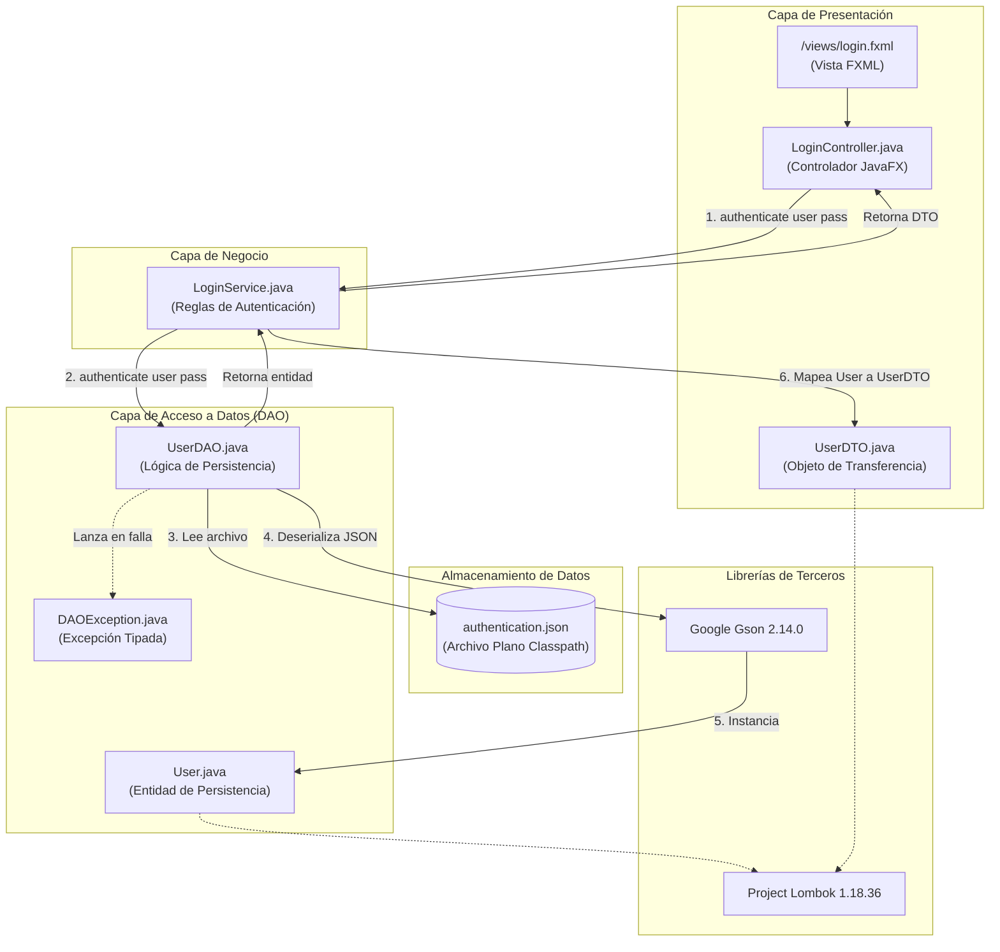
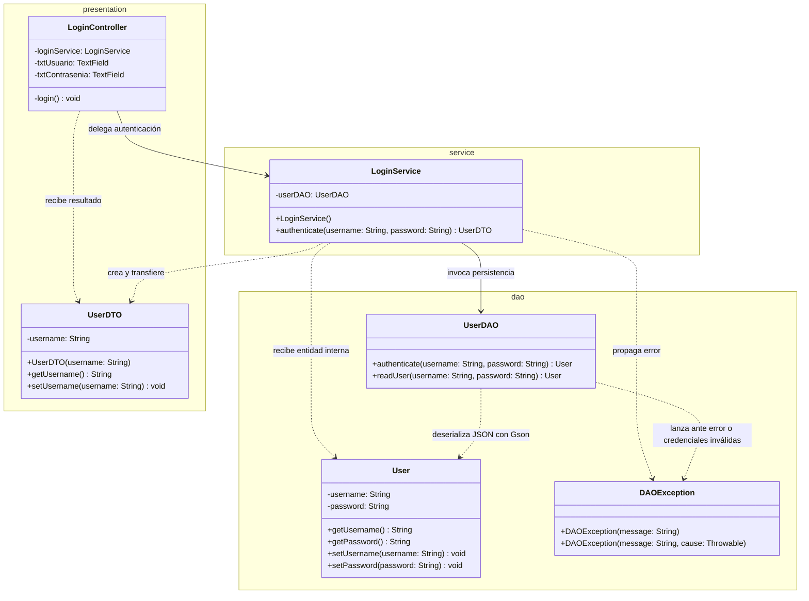
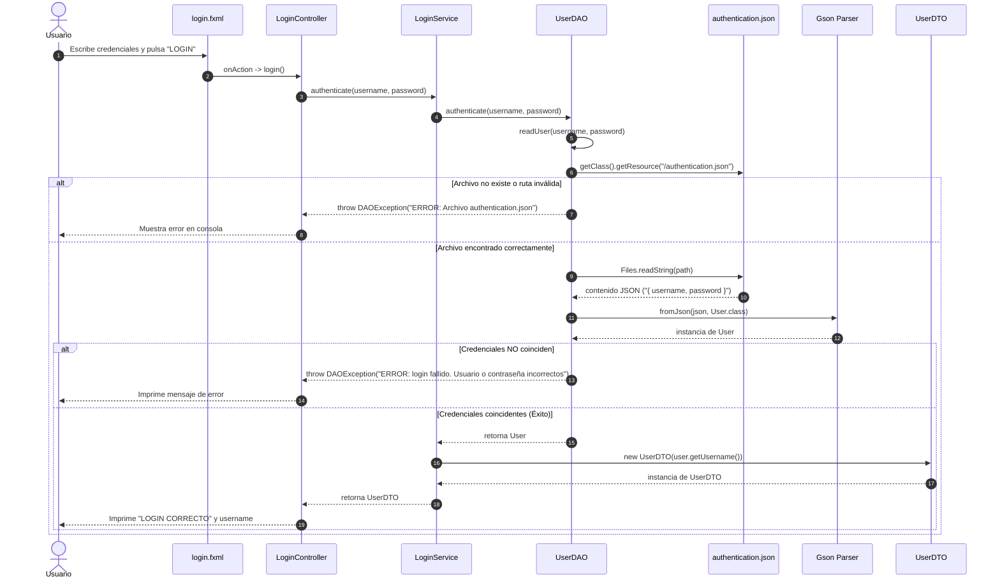
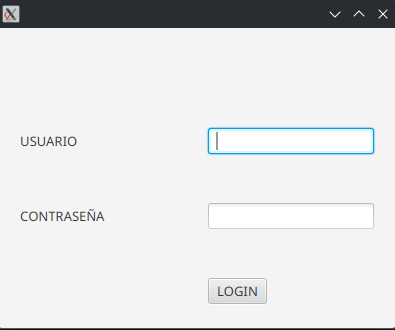

# Proyecto 04 - poo-javafx (Login 3/3: Arquitectura en Capas, DAO, DTO y Persistencia JSON)

Este proyecto representa un **salto cualitativo fundamental** en la formación arquitectónica. La aplicación evoluciona desde un controlador que simplemente imprimía valores por consola hacia una **arquitectura por capas profesional** (Presentación, Negocio y Acceso a Datos), implementando los patrones de diseño **DAO** (*Data Access Object*) y **DTO** (*Data Transfer Object*), persistencia en archivos planos JSON mediante **Google Gson**, manejo de excepciones personalizadas (`DAOException`) y la incorporación inicial de **Lombok**.

---

## ¿Qué hace el proyecto?

La aplicación despliega el formulario de inicio de sesión (`/views/login.fxml`). Al pulsar el botón `LOGIN`:

1. **`LoginController`** (Presentación) delega la validación en la capa de negocio invocando a `LoginService`.
2. **`LoginService`** (Negocio) delega en `UserDAO` la búsqueda y verificación de las credenciales.
3. **`UserDAO`** (Persistencia) localiza el recurso `authentication.json`, lee su contenido y lo deserializa hacia la entidad `User` utilizando **Google Gson**. Compara las credenciales ingresadas con las almacenadas.
   - Si no coinciden o el archivo falla, lanza una excepción comprobada personalizada (`DAOException`).
   - Si coinciden, retorna la entidad `User`.
4. **`LoginService`** transforma la entidad interna `User` en un objeto seguro **`UserDTO`** (que solo expone el nombre de usuario, ocultando la contraseña) y lo entrega al controlador.
5. **`LoginController`** recibe el DTO y confirma el acceso en la consola, o captura la excepción y muestra el error correspondiente.

---

## Diferencias Clave: Proyecto 04 vs. Proyecto 03

Antes de iniciar la construcción, revisa los cambios estructurales entre ambos proyectos:

| Componente / Concepto | Proyecto 03 | Proyecto 04 | Beneficio / Justificación |
| :--- | :--- | :--- | :--- |
| **Arquitectura Global** | 1 Capa (el controlador contenía toda la lógica e imprimía a consola). | 3 Capas: Presentación (`controller`), Negocio (`service`), Datos (`dao`). | Separación de responsabilidades: desacopla la interfaz de las reglas de negocio y del mecanismo de almacenamiento. |
| **Validación de Credenciales** | No existía validación (solo impresión de texto plano). | Validación real contra un archivo persistente en formato JSON (`authentication.json`). | Simula un entorno real de autenticación de usuarios. |
| **Patrón DAO (`UserDAO`)** | Inexistente. | Introduce `UserDAO` para abstraer operaciones de entrada/salida y lectura de archivos. | Si en el futuro se cambia JSON por una base de datos SQL o API REST, solo se modifica el DAO sin alterar el servicio ni la vista. |
| **Patrón DTO (`UserDTO`)** | Inexistente. | Introduce `UserDTO` para transportar solo datos pertinentes a la vista. | Seguridad y encapsulamiento: la capa de presentación jamás debe manipular ni conocer la contraseña del usuario. |
| **Entidad de Dominio (`User`)** | Inexistente. | Clase de entidad mapeada mediante `@SerializedName` de Gson. | Modelado formal del esquema de datos persistido. |
| **Manejo de Errores** | Sin gestión de fallos. | Excepción comprobada propia `DAOException`. | Aísla y comunica fallas técnicas (errores de I/O o credenciales inválidas) de forma tipada y controlada. |
| **Librerías Externas** | Solo JavaFX base. | Incorpora **Google Gson** 2.14.0 y **Lombok** 1.18.36 en `pom.xml`. | Serialización/deserialización JSON automática y reducción de código repetitivo. |
| **JPMS (`module-info.java`)** | Solo abría a `javafx.fxml`. | Agrega `requires com.google.gson`, `requires static lombok`, y `opens ...dao.entity to com.google.gson`. | Autoriza a Gson a inspeccionar y asignar reflexivamente los campos privados de `User`. |

---

## Diagrama de Componentes



---

## Diagrama de Clases



---

## Diagrama de Flujo e Interacción de Capas

El siguiente diagrama de secuencia detalla el flujo completo de autenticación y manejo de errores entre capas:



---

## Paso a Paso para la Construcción Incremental (desde Proyecto 03)

Sigue estos pasos detallados para construir el Proyecto 04 a partir del Proyecto 03:

### Paso 1: Agregar dependencias y procesador en `pom.xml`
Incorpora **Google Gson** y **Lombok** en `pom.xml`, configurando el procesador de anotaciones en el compilador:

```xml
<dependencies>
    <!-- JavaFX -->
    <dependency>
        <groupId>org.openjfx</groupId>
        <artifactId>javafx-controls</artifactId>
        <version>21</version>
    </dependency>
    <dependency>
        <groupId>org.openjfx</groupId>
        <artifactId>javafx-fxml</artifactId>
        <version>21</version>
    </dependency>

    <!-- Lombok -->
    <dependency>
        <groupId>org.projectlombok</groupId>
        <artifactId>lombok</artifactId>
        <version>1.18.36</version>
        <scope>provided</scope>
    </dependency>

    <!-- Google Gson -->
    <dependency>
        <groupId>com.google.code.gson</groupId>
        <artifactId>gson</artifactId>
        <version>2.14.0</version>
    </dependency>
</dependencies>

<build>
    <plugins>
        <plugin>
            <groupId>org.apache.maven.plugins</groupId>
            <artifactId>maven-compiler-plugin</artifactId>
            <version>3.13.0</version>
            <configuration>
                <release>11</release>
                <annotationProcessorPaths>
                    <path>
                        <groupId>org.projectlombok</groupId>
                        <artifactId>lombok</artifactId>
                        <version>1.18.36</version>
                    </path>
                </annotationProcessorPaths>
            </configuration>
        </plugin>
        <plugin>
            <groupId>org.openjfx</groupId>
            <artifactId>javafx-maven-plugin</artifactId>
            <version>0.0.8</version>
            <configuration>
                <mainClass>cl.elprofecarreno.app.App</mainClass>
            </configuration>
        </plugin>
    </plugins>
</build>
```

### Paso 2: Configurar permisos en `module-info.java`
Abre la entidad a Gson y declara las nuevas dependencias:

```java
module cl.elprofecarreno.app {
    requires javafx.controls;
    requires javafx.fxml;

    requires com.google.gson;
    requires static lombok;

    opens cl.elprofecarreno.app to javafx.fxml;
    opens cl.elprofecarreno.app.controller to javafx.fxml;
    opens cl.elprofecarreno.app.dao.entity to com.google.gson;
    exports cl.elprofecarreno.app;
}
```

### Paso 3: Crear el archivo de persistencia `authentication.json`
Crea `src/main/resources/authentication.json`:

```json
{
    "username": "admin",
    "password": "qwerty"
}
```

### Paso 4: Crear la excepción personalizada `DAOException.java`
Crea `src/main/java/cl/elprofecarreno/app/dao/excepcion/DAOException.java`:

```java
package cl.elprofecarreno.app.dao.excepcion;

public class DAOException extends Exception {
    public DAOException(String message) {
        super(message);
    }
    public DAOException(String message, Throwable cause) {
        super(message, cause);
    }
}
```

### Paso 5: Crear la entidad de persistencia `User.java`
Crea `src/main/java/cl/elprofecarreno/app/dao/entity/User.java`:

```java
package cl.elprofecarreno.app.dao.entity;

import com.google.gson.annotations.SerializedName;

public class User {
    @SerializedName("username")
    private String username;

    @SerializedName("password")
    private String password;

    public String getUsername() { return username; }
    public String getPassword() { return password; }
    public void setUsername(String username) { this.username = username; }
    public void setPassword(String password) { this.password = password; }
}
```

### Paso 6: Crear el DTO `UserDTO.java`
Crea `src/main/java/cl/elprofecarreno/app/controller/dto/UserDTO.java`:

```java
package cl.elprofecarreno.app.controller.dto;

public class UserDTO {
    private String username;

    public UserDTO(String username) {
        this.username = username;
    }

    public String getUsername() { return username; }
    public void setUsername(String username) { this.username = username; }
}
```

### Paso 7: Implementar la capa de datos `UserDAO.java`
Crea `src/main/java/cl/elprofecarreno/app/dao/UserDAO.java`:

```java
package cl.elprofecarreno.app.dao;

import java.net.URL;
import java.nio.charset.StandardCharsets;
import java.nio.file.Files;
import java.nio.file.Path;
import com.google.gson.Gson;
import cl.elprofecarreno.app.dao.entity.User;
import cl.elprofecarreno.app.dao.excepcion.DAOException;

public class UserDAO {

    public User authenticate(String username, String password) throws DAOException {
        User user = readUser(username, password);

        if(user == null || !user.getUsername().equals(username) || !user.getPassword().equals(password)) {
            throw new DAOException("ERROR: login fallido. Usuario o contraseña incorrectos");
        }
        return user;
    }

    public User readUser(String username, String password) throws DAOException {
        URL url = getClass().getResource("/authentication.json");
        if(url == null){
            throw new DAOException("ERROR: login fallido. Archivo authentication.json");
        }

        try {
            Path path = Path.of(url.toURI());
            String json = Files.readString(path, StandardCharsets.UTF_8);
            Gson gson = new Gson();
            return gson.fromJson(json, User.class);
        } catch (Exception e) {
            throw new DAOException("ERROR: login fallido. No se pudo leer el archivo authentication.json", e);
        }
    }
}
```

### Paso 8: Implementar la capa de negocio `LoginService.java`
Crea `src/main/java/cl/elprofecarreno/app/service/LoginService.java`:

```java
package cl.elprofecarreno.app.service;

import cl.elprofecarreno.app.controller.dto.UserDTO;
import cl.elprofecarreno.app.dao.UserDAO;
import cl.elprofecarreno.app.dao.entity.User;
import cl.elprofecarreno.app.dao.excepcion.DAOException;

public class LoginService {
    
    private UserDAO userDAO;

    public LoginService() {
        this.userDAO = new UserDAO();
    }

    public UserDTO authenticate(String username, String password) throws DAOException {
        User user = userDAO.authenticate(username, password);
        return new UserDTO(user.getUsername());
    }
}
```

### Paso 9: Actualizar el controlador `LoginController.java`
Modifica `src/main/java/cl/elprofecarreno/app/controller/LoginController.java` para delegar en `LoginService` dentro de un bloque `try-catch`:

```java
package cl.elprofecarreno.app.controller;

import java.io.IOException;
import cl.elprofecarreno.app.controller.dto.UserDTO;
import cl.elprofecarreno.app.service.LoginService;
import javafx.fxml.FXML;
import javafx.scene.control.TextField;

public class LoginController {

    private LoginService loginService;

    @FXML
    private TextField txtUsuario;

    @FXML
    private TextField txtContrasenia;

    @FXML
    private void login() throws IOException {
        loginService = new LoginService();
        try {
            UserDTO user = loginService.authenticate(txtUsuario.getText(), txtContrasenia.getText());
            System.out.println("LOGIN CORRECTO");
            System.out.println(user.getUsername());
        } catch (Exception e) {
            System.err.println(e.getMessage());
        }
    }
}
```

---

## Estructura del Proyecto

```text
04/
└── poo-javafx/
    ├── pom.xml
    └── src/
        └── main/
            ├── java/
            │   ├── module-info.java
            │   └── cl/elprofecarreno/app/
            │       ├── App.java
            │       ├── controller/
            │       │   ├── LoginController.java
            │       │   └── dto/
            │       │       └── UserDTO.java
            │       ├── dao/
            │       │   ├── UserDAO.java
            │       │   ├── entity/
            │       │   │   └── User.java
            │       │   └── excepcion/
            │       │       └── DAOException.java
            │       └── service/
            │           └── LoginService.java
            └── resources/
                ├── authentication.json
                └── views/
                    └── login.fxml
```

---

## Requisitos y Ejecución

### Requisitos
- **Java JDK**: 11 o superior (recomendado JDK 21).
- **Apache Maven**: 3.8+.
- **IDE**: IntelliJ IDEA, VS Code o Eclipse con soporte Lombok.

### Ejecución
Desde la carpeta del proyecto:
```bash
cd 04/poo-javafx
mvn clean javafx:run
```

O desde la raíz del repositorio:
```bash
mvn -f 04/poo-javafx/pom.xml clean javafx:run
```

### Captura de la aplicación en ejecución:


### Casos de prueba

1. **Credenciales Correctas:**
   - Usuario: `admin`
   - Contraseña: `qwerty`
   - **Resultado en consola:**
     ```text
     LOGIN CORRECTO
     admin
     ```

2. **Credenciales Incorrectas:**
   - Usuario: `admin`
   - Contraseña: `123456`
   - **Resultado en consola:**
     ```text
     ERROR: login fallido. Usuario o contraseña incorrectos
     ```

---

## Objetivos Pedagógicos y Buenas Prácticas

- **Arquitectura N-Capas**: Desacoplar la Presentación (controlador) de las Reglas de Negocio (servicio) y del Almacenamiento (DAO).
- **Patrón DTO**: Proteger atributos confidenciales (contraseña) impidiendo que viajen a la interfaz de usuario.
- **Serialización JSON**: Deserializar archivos de recursos mediante Google Gson con la anotación `@SerializedName`.
- **Excepciones de Dominio**: Centralizar el manejo de fallos técnicos en una excepción comprobada específica (`DAOException`).
