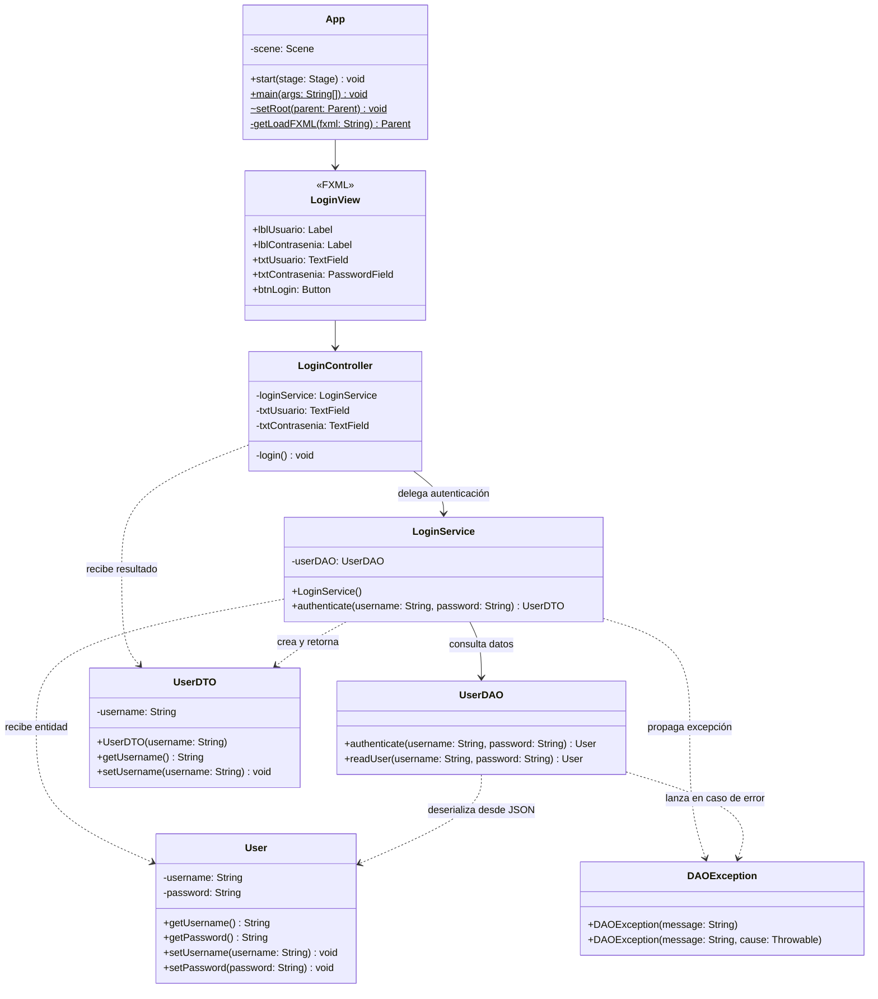

# Proyecto 04 - poo-javafx

Este proyecto implementa una arquitectura por capas (Controlador, Servicio y DAO) para la autenticación de usuarios en una aplicación JavaFX con Maven. A diferencia del proyecto anterior, las credenciales no se procesan de forma estática en la vista ni en el controlador; se validan contra un almacén de datos consistente en un archivo de texto plano en formato JSON (`authentication.json`). Para ello, se incorpora la biblioteca **Google Gson** para la deserialización de datos, la biblioteca **Lombok** para simplificar la creación de clases, y se define un flujo desacoplado mediante el uso de entidades, excepciones personalizadas (`DAOException`) y objetos de transferencia de datos (`UserDTO`).

## ¿Qué hace?

La clase principal `App` inicia la aplicación JavaFX cargando la vista `/views/login.fxml`. La interfaz presenta el formulario de inicio de sesión centrado mediante un contenedor `GridPane` dentro de un `VBox`, con campos para el usuario (`TextField`) y la contraseña oculta (`PasswordField`), junto con el botón `LOGIN`.

Al presionar el botón de acceso, el controlador `LoginController` delega el proceso de autenticación en la capa de negocio:

1. **`LoginController`**: Llama al método `authenticate(username, password)` de `LoginService`.
2. **`LoginService`**: Solicita a `UserDAO` la autenticación de las credenciales ingresadas.
3. **`UserDAO`**: Localiza y lee el archivo de recursos `authentication.json` mediante `Files.readString(...)`, deserializa su contenido a un objeto `User` utilizando `Gson` y valida que el nombre de usuario y la contraseña coincidan.
   - Si las credenciales son válidas, retorna la entidad `User`.
   - Si las credenciales no coinciden o el archivo no puede ser procesado, lanza una excepción personalizada `DAOException`.
4. **Respuesta y Presentación**: `LoginService` convierte la entidad `User` en un objeto `UserDTO` (exponiendo únicamente los datos requeridos, como el nombre de usuario) y lo retorna al controlador. Si la autenticación es exitosa, se imprime la confirmación en la consola; si falla, se captura el error y se notifica el mensaje correspondiente.

## Diagrama de clases



## Estructura de clases y relaciones

- **`App`**: Es la clase principal que extiende de `Application`. En el método `start(Stage stage)` inicializa la escena a partir de `/views/login.fxml` mediante el método auxiliar `getLoadFXML()`.
- **`LoginController`**: Ubicado en `cl.elprofecarreno.app.controller`. Contiene los controles `@FXML` vinculados a la vista (`txtUsuario`, `txtContrasenia`). Al ejecutarse el método `login()`, interactúa con `LoginService` dentro de un bloque `try-catch` para gestionar el resultado o manejar errores en consola.
- **`LoginService`**: Pertenece al paquete `cl.elprofecarreno.app.service`. Actúa como capa de lógica de negocio intermedia entre el controlador y la capa de acceso a datos. Instancia `UserDAO`, invoca su validación y transforma la entidad persistente `User` en un `UserDTO`.
- **`UserDAO`**: Pertenece al paquete `cl.elprofecarreno.app.dao`. Implementa el patrón DAO (*Data Access Object*). En `readUser()` obtiene la URL del recurso `/authentication.json` del classpath, lee su contenido con la API de `java.nio.file.Files` y utiliza la biblioteca `Gson` para convertir el texto JSON a una instancia de `User`. En `authenticate()` valida las credenciales y lanza una `DAOException` si no son válidas o si ocurre una falla de lectura.
- **`User`**: Clase entidad en `cl.elprofecarreno.app.dao.entity` que mapea la estructura del JSON con campos `username` y `password` mediante la anotación `@SerializedName` de Gson.
- **`UserDTO`**: Objeto de transferencia de datos en `cl.elprofecarreno.app.controller.dto`. Permite transportar hacia la capa de presentación únicamente la información que el cliente necesita (en este caso el `username`), desacoplando la entidad de persistencia y resguardando datos sensibles como la contraseña.
- **`DAOException`**: Excepción comprobada personalizada en `cl.elprofecarreno.app.dao.excepcion` que hereda de `Exception`, utilizada para encapsular errores surgidos durante la lectura de datos o la validación del usuario.
- **`authentication.json`**: Almacén de datos ubicado en `src/main/resources/authentication.json`, que contiene las credenciales en formato JSON:
  ```json
  {
      "username": "admin",
      "password": "qwerty"
  }
  ```
- **`module-info.java`**: Configura el sistema de módulos de Java (`JPMS`):
  - Requiere `javafx.controls`, `javafx.fxml`, `com.google.gson` y de forma estática `lombok`.
  - Abre `cl.elprofecarreno.app` y `cl.elprofecarreno.app.controller` a `javafx.fxml` para permitir la instanciación e inyección por reflexión de JavaFX.
  - Abre `cl.elprofecarreno.app.dao.entity` a `com.google.gson` para permitir la deserialización de la entidad `User` desde JSON.
  - Exporta el paquete base `cl.elprofecarreno.app`.

## Requisitos

- Java JDK 11 o superior (compatible con JDK 21)
- Maven
- JavaFX
- IDE compatible con Java (IntelliJ IDEA, VS Code, NetBeans, etc.)

## Ejecutar el proyecto

Desde la carpeta del proyecto, ejecuta:

```bash
cd poo-javafx
mvn clean javafx:run
```

O desde la raíz del repositorio:

```bash
mvn -f 04/poo-javafx/pom.xml clean javafx:run
```

## Resultado esperado

Al iniciar la aplicación, se desplegará la ventana del formulario de login.

### Caso de éxito
Si se ingresan las credenciales definidas en `authentication.json`:
- **Usuario:** `admin`
- **Contraseña:** `qwerty`

Al presionar el botón `LOGIN`, la consola del sistema mostrará:

```text
LOGIN CORRECTO
admin
```

### Caso de error
Si se ingresan credenciales incorrectas, campos en blanco o no coincidentes:

```text
ERROR: login fallido. Usuario o contraseña incorrectos
```

## Estructura del proyecto

```text
poo-javafx/
├── pom.xml
└── src/
    └── main/
        ├── java/
        │   ├── module-info.java
        │   └── cl/elprofecarreno/app/
        │       ├── App.java
        │       ├── controller/
        │       │   ├── LoginController.java
        │       │   └── dto/
        │       │       └── UserDTO.java
        │       ├── dao/
        │       │   ├── UserDAO.java
        │       │   ├── entity/
        │       │   │   └── User.java
        │       │   └── excepcion/
        │       │       └── DAOException.java
        │       └── service/
        │           └── LoginService.java
        └── resources/
            ├── authentication.json
            └── views/
                └── login.fxml
```

## Objetivo del ejercicio

Este ejercicio pretende comprender cómo:

- Diseñar una aplicación modular con arquitectura por capas: Presentación (`controller` y FXML), Negocio (`service`) y Acceso a Datos (`dao`).
- Implementar el patrón **DAO** (*Data Access Object*) para abstraer y desacoplar la fuente de datos del resto del sistema.
- Implementar el patrón **DTO** (*Data Transfer Object*) para transferir información relevante a la capa de presentación sin exponer entidades internas ni credenciales confidenciales.
- Leer y procesar archivos de texto plano en formato JSON ubicados en los recursos del proyecto mediante la librería **Google Gson**.
- Definir y propagar excepciones personalizadas (`DAOException`) para un control de errores robusto.
- Configurar `module-info.java` al interactuar con librerías externas que emplean reflexión como Gson (`opens ... to com.google.gson`).
- Integrar la biblioteca **Lombok** en Maven con su procesador de anotaciones para agilizar la escritura de código.
