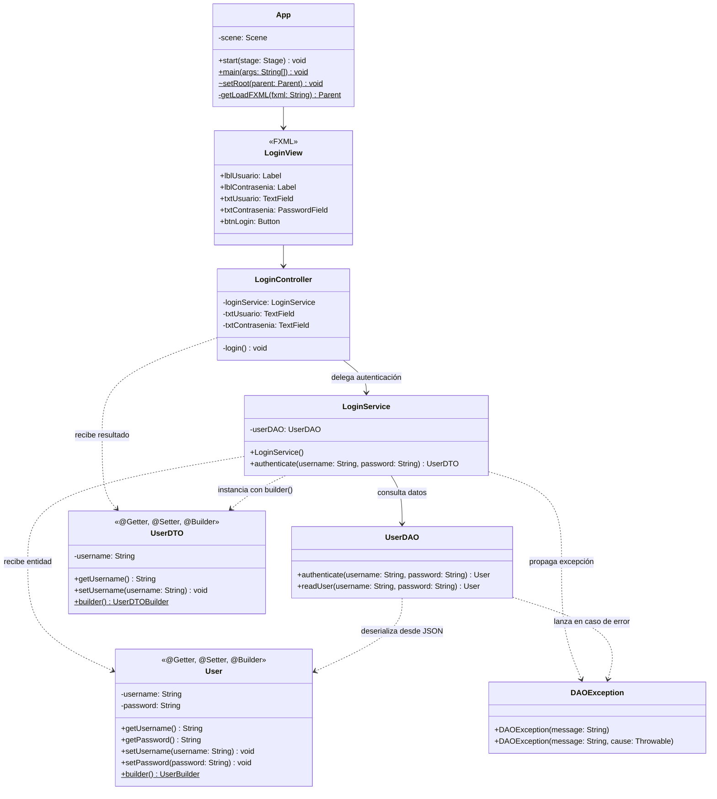

# Proyecto 05 - poo-javafx

Este proyecto corresponde a la evolución, corrección y aprovechamiento integral de la biblioteca **Lombok** y el **patrón Builder** en la arquitectura por capas (Controlador, Servicio y DAO) sobre JavaFX con Maven. En el proyecto anterior (04) se sentaron las bases de la arquitectura por capas, la deserialización de credenciales desde un archivo JSON con Google Gson y el manejo de excepciones personalizadas, pero las clases de modelo (`User` y `UserDTO`) aún conservaban código repetitivo (*boilerplate*) escrito a mano.

En este proyecto 05 se refactorizan las clases de datos mediante las anotaciones de Lombok (`@Getter`, `@Setter`, `@Builder`, `@NoArgsConstructor` y `@AllArgsConstructor`), eliminando código redundante, garantizando la correcta compilación mediante el procesador de anotaciones de Maven y aplicando el **patrón de diseño Builder** en la capa de negocio (`LoginService`) para la construcción del DTO de usuario.

---

## Diferencias clave respecto al Proyecto 04

| Aspecto / Archivo | Proyecto 04 | Proyecto 05 | Beneficio / Justificación |
| :--- | :--- | :--- | :--- |
| **`User.java`** (`dao/entity`) | Getters y setters manuales (`getUsername`, `getPassword`, etc.). Sin constructor completo ni builder. | Decorado con `@Getter`, `@Setter`, `@Builder`, `@NoArgsConstructor`, `@AllArgsConstructor`. Sin métodos manuales. | Elimina código repetitivo (*boilerplate*), asegura compatibilidad con Gson y habilita construcción fluida con Builder. |
| **`UserDTO.java`** (`controller/dto`) | Constructor manual `UserDTO(username)`, getter y setter manuales. | Decorado con `@Getter`, `@Setter`, `@Builder`, `@NoArgsConstructor`, `@AllArgsConstructor`. Sin código redundante. | Clase limpia, concisa y extensible a nuevos campos sin necesidad de reescribir constructores o métodos de acceso. |
| **`LoginService.java`** (`service`) | Instanciación tradicional por constructor:<br>`return new UserDTO(user.getUsername());` | Construcción mediante **patrón Builder**:<br>`return UserDTO.builder().username(user.getUsername()).build();` | Mayor legibilidad, expresividad declarativa y facilidad de mantenimiento si el DTO incorpora más atributos en el futuro. |
| **Compilación y Lombok (`pom.xml`)** | Dependencia Lombok presente, pero sin uso completo de sus anotaciones en las entidades. | Integración total: `maven-compiler-plugin` con `<annotationProcessorPaths>` para procesar Lombok durante `javac` en entorno modular JPMS. | Resuelve problemas de compilación y garantiza que el bytecode generado contenga los métodos y la clase builder interna. |

---

## ¿Qué hace?

La clase principal `App` inicia la aplicación JavaFX cargando la vista `/views/login.fxml`. La interfaz presenta un formulario centrado con campos para usuario (`TextField`), contraseña oculta (`PasswordField`) y el botón `LOGIN`.

Al presionar el botón de acceso, el flujo de ejecución desacoplado se comporta de la siguiente forma:

1. **`LoginController`**: Captura los valores ingresados y solicita la autenticación a `LoginService.authenticate(username, password)`.
2. **`LoginService`**: Invoca el método `authenticate(...)` de `UserDAO`.
3. **`UserDAO`**: Lee el archivo `authentication.json` del classpath con `Files.readString(...)`, deserializa los datos a la entidad `User` usando `Gson` (aprovechando `@NoArgsConstructor` y `@SerializedName`) y comprueba la coincidencia de credenciales.
   - Si las credenciales coinciden, retorna la entidad `User`.
   - Si no coinciden o falla la lectura, arroja una excepción personalizada `DAOException`.
4. **Construcción con Builder**: `LoginService` recibe la entidad `User` y crea la respuesta `UserDTO` mediante el **Builder generado por Lombok**:
   ```java
   return UserDTO.builder()
                 .username(user.getUsername())
                 .build();
   ```
5. **Respuesta en Presentación**: `LoginController` recibe el `UserDTO` con el usuario autenticado e imprime en consola la confirmación o despliega el mensaje de error si captura una `DAOException`.

---

## Diagrama de clases



---

## Estructura de clases y relaciones

- **`App`**: Punto de entrada de la aplicación JavaFX que extiende `Application` y carga la vista principal `/views/login.fxml`.
- **`LoginController`**: Controlador JavaFX (`cl.elprofecarreno.app.controller`) que captura los eventos de la vista y delega la lógica en `LoginService`, controlando las excepciones con bloques `try-catch`.
- **`LoginService`**: Capa de negocio (`cl.elprofecarreno.app.service`). Coordina las consultas a `UserDAO` y efectúa la transformación de `User` hacia `UserDTO` empleando el método estático `builder()` provisto por Lombok.
- **`UserDAO`**: Capa de acceso a datos (`cl.elprofecarreno.app.dao`). Lee el archivo `authentication.json` del classpath y lo convierte a objeto Java mediante `Gson`. Lanza `DAOException` ante cualquier anomalía.
- **`User`**: Entidad del dominio en `cl.elprofecarreno.app.dao.entity`. Mediante las anotaciones `@Getter`, `@Setter`, `@Builder`, `@NoArgsConstructor` y `@AllArgsConstructor` se generan automáticamente en tiempo de compilación todos los métodos de acceso, constructores y su clase builder interna.
- **`UserDTO`**: Objeto de transferencia en `cl.elprofecarreno.app.controller.dto`. Al igual que `User`, utiliza las anotaciones de Lombok para exponer de forma limpia los datos requeridos por la vista sin exponer la contraseña.
- **`DAOException`**: Excepción verificada (`Exception`) personalizada para aislar y reportar fallas en la capa de datos.
- **`authentication.json`**: Recurso en `src/main/resources/authentication.json` que almacena las credenciales de prueba en formato JSON:
  ```json
  {
      "username": "admin",
      "password": "qwerty"
  }
  ```
- **`module-info.java`**: Define la configuración del sistema de módulos de Java (JPMS):
  - `requires static lombok;`: Permite el uso de anotaciones Lombok en tiempo de compilación sin requerir el artefacto en tiempo de ejecución.
  - `requires javafx.controls;` y `requires javafx.fxml;`: Módulos esenciales de la interfaz gráfica.
  - `requires com.google.gson;`: Permite la serialización/deserialización de JSON.
  - `opens cl.elprofecarreno.app.controller to javafx.fxml;`: Otorga acceso reflexivo a JavaFX para enlazar campos y manejadores `@FXML`.
  - `opens cl.elprofecarreno.app.dao.entity to com.google.gson;`: Otorga acceso reflexivo a Gson para instanciar y poblar campos privados de la clase `User`.

---

## Configuración de Lombok en Maven

Para que Lombok genere el código en tiempo de compilación sin errores, el archivo `pom.xml` requiere dos elementos fundamentales:

1. **Dependencia provista (`provided`)**:
   ```xml
   <dependency>
       <groupId>org.projectlombok</groupId>
       <artifactId>lombok</artifactId>
       <version>1.18.36</version>
       <scope>provided</scope>
   </dependency>
   ```

2. **Procesador de anotaciones en el plugin del compilador**:
   ```xml
   <plugin>
       <groupId>org.apache.maven.plugins</groupId>
       <artifactId>maven-compiler-plugin</artifactId>
       <version>3.13.0</version>
       <configuration>
           <release>11</release>
           <annotationProcessorPaths>
               <path>
                   <groupId>org.projectlombok</groupId>
                   <artifactId>lombok</artifactId>
                   <version>1.18.36</version>
               </path>
           </annotationProcessorPaths>
       </configuration>
   </plugin>
   ```

Esta configuración asegura que `javac` procese correctamente las anotaciones antes de generar el bytecode final, resolviendo conflictos comunes en entornos Java modernos y modulares.

---

## Requisitos

- Java JDK 11 o superior (recomendado JDK 21)
- Maven 3.8+
- JavaFX
- IDE compatible con Java y soporte para Lombok habilitado (IntelliJ IDEA, VS Code con extensión Lombok, Eclipse/NetBeans)

---

## Ejecutar el proyecto

Desde la carpeta del proyecto:

```bash
cd 05/poo-javafx
mvn clean javafx:run
```

O desde la raíz del repositorio:

```bash
mvn -f 05/poo-javafx/pom.xml clean javafx:run
```

---

## Resultado esperado

Al iniciar la aplicación, se despliega la interfaz gráfica de inicio de sesión:

### Caso exitoso
Ingresando las credenciales válidas registradas en `authentication.json`:
- **Usuario:** `admin`
- **Contraseña:** `qwerty`

Al presionar el botón `LOGIN`, la consola mostrará:

```text
LOGIN CORRECTO
admin
```

### Caso de error
Ingresando credenciales inválidas o campos vacíos:

```text
ERROR: login fallido. Usuario o contraseña incorrectos
```

---

## Estructura del proyecto

```text
05/
└── poo-javafx/
    ├── pom.xml
    └── src/
        └── main/
            ├── java/
            │   ├── module-info.java
            │   └── cl/elprofecarreno/app/
            │       ├── App.java
            │       ├── controller/
            │       │   ├── LoginController.java
            │       │   └── dto/
            │       │       └── UserDTO.java
            │       ├── dao/
            │       │   ├── UserDAO.java
            │       │   ├── entity/
            │       │   │   └── User.java
            │       │   └── excepcion/
            │       │       └── DAOException.java
            │       └── service/
            │           └── LoginService.java
            └── resources/
                ├── authentication.json
                └── views/
                    └── login.fxml
```

---

## Objetivo del ejercicio

Este ejercicio permite afianzar y comprender:

- La eliminación sistemática de código repetitivo (*boilerplate*) en entidades y DTOs mediante las anotaciones de **Lombok** (`@Getter`, `@Setter`, `@NoArgsConstructor`, `@AllArgsConstructor`).
- La implementación y ventaja del **patrón Builder** (`@Builder`) para construir objetos de transferencia de datos de forma fluida, legible y protegida contra cambios de orden o número de parámetros.
- La configuración técnica requerida en `pom.xml` (`<annotationProcessorPaths>`) y `module-info.java` (`requires static lombok`) para que el procesador de anotaciones opere de manera transparente en proyectos modulares Java (JPMS).
- La convivencia armónica entre bibliotecas de reflexión e inyección: JavaFX FXML, Google Gson y Lombok trabajando en conjunto bajo una arquitectura desacoplada por capas.
