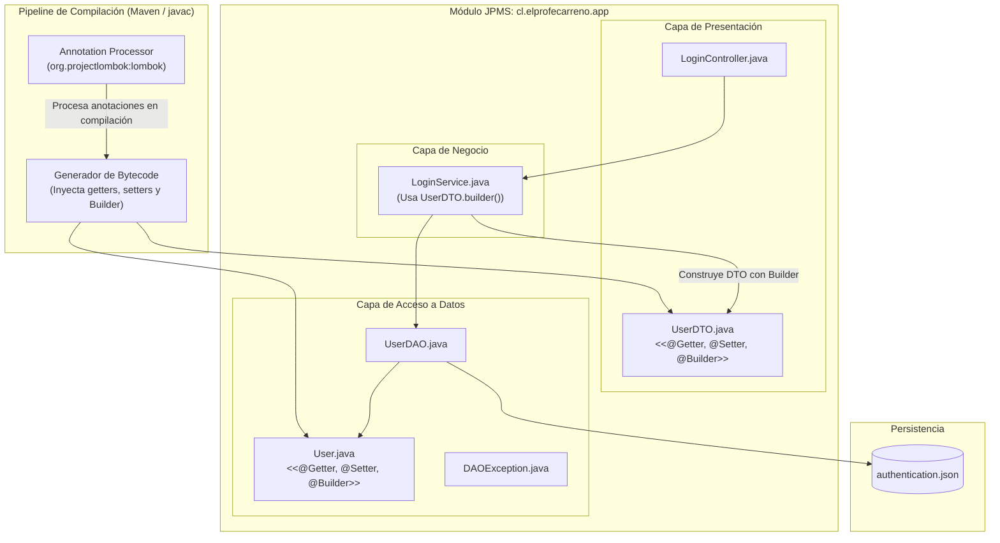
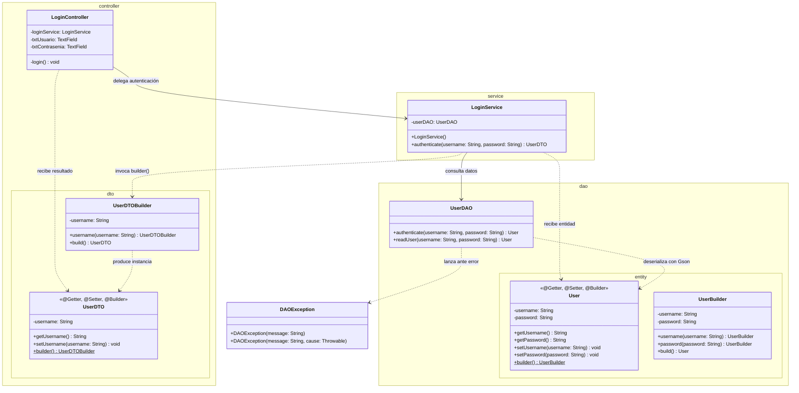
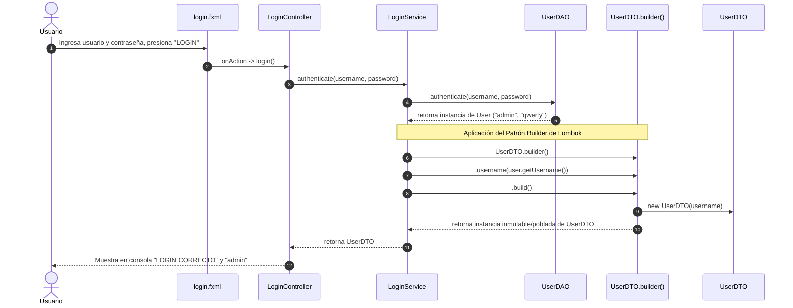
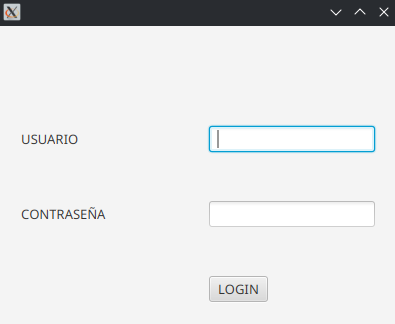

# Proyecto 05 - poo-javafx (Corrección Fix Lombok: Patrón Builder y Reducción de Boilerplate)

Este proyecto corresponde al **quinto hito incremental** del curso. Se centra en la **optimización del código fuente, la eliminación sistemática de código repetitivo (*boilerplate*)** y la aplicación del **patrón de diseño creacional Builder** mediante la biblioteca **Project Lombok**, resolviendo los desafíos técnicos de compilación y procesamiento de anotaciones dentro de un entorno modular Java (JPMS).

---

## ¿Qué hace el proyecto?

A nivel funcional, el proyecto mantiene el flujo de autenticación del Proyecto 04 (formulario de login contra el archivo `authentication.json`). Sin embargo, internamente experimenta una profunda refactorización técnica:

1. Las clases de modelo (`User`) y transferencia (`UserDTO`) se despojan de decenas de líneas de código manual (constructores, *getters* y *setters*).
2. Se implementa el **patrón Builder** provisto por Lombok, permitiendo construir objetos de manera fluida, legible e inmutable.
3. En la capa de negocio (`LoginService`), la conversión entre la entidad y el DTO se ejecuta mediante la API fluida del Builder:
   ```java
   return UserDTO.builder()
                 .username(user.getUsername())
                 .build();
   ```
4. Se asegura la interoperabilidad entre el compilador `javac`, el procesador de anotaciones de Lombok y el sistema modular JPMS.

---

## Diferencias Clave: Proyecto 05 vs. Proyecto 04

| Aspecto / Archivo | Proyecto 04 | Proyecto 05 (Lombok Integral) | Beneficio / Justificación |
| :--- | :--- | :--- | :--- |
| **`User.java`** (`dao/entity`) | Getters y setters escritos a mano. Sin constructor completo ni builder. | Decorado con `@Getter`, `@Setter`, `@Builder`, `@NoArgsConstructor` y `@AllArgsConstructor`. | Código 100% limpio y libre de boilerplate; Gson puede instanciar con el constructor por defecto y el código puede instanciar con Builder. |
| **`UserDTO.java`** (`controller/dto`) | Constructor manual `UserDTO(username)` y métodos accesores manuales. | Decorado con `@Getter`, `@Setter`, `@Builder`, `@NoArgsConstructor` y `@AllArgsConstructor`. | Extensibilidad inmediata: añadir nuevos atributos no requiere tocar constructores existentes ni escribir nuevos métodos. |
| **`LoginService.java`** (`service`) | Instanciación tradicional por constructor: `new UserDTO(user.getUsername())`. | Construcción fluida mediante **patrón Builder**: `UserDTO.builder().username(user.getUsername()).build()`. | Código auto-documentado, mayor legibilidad y protección contra errores de orden en listas de parámetros. |
| **Procesador de Anotaciones (`pom.xml`)** | Dependencia Lombok presente, pero sin uso intensivo de anotaciones. | Configuración explícita de `<annotationProcessorPaths>` en `maven-compiler-plugin`. | Garantiza que `javac` procese las anotaciones de Lombok durante la compilación antes de generar el bytecode final. |
| **Descriptor Modular (`module-info.java`)** | `requires static lombok;` | Se ratifica la directiva `requires static lombok;`. | La cláusula `static` declara que Lombok es una dependencia solo para tiempo de compilación (*compile-time only*), no requerida en runtime. |

---

## Diagrama de Componentes



---

## Diagrama de Clases



---

## Diagrama de Flujo e Interacción de Capas

El siguiente diagrama detalla cómo opera el patrón Builder dentro del flujo de ejecución del servicio:



---

## Paso a Paso para la Construcción Incremental (desde Proyecto 04)

Sigue estos pasos para refactorizar el Proyecto 04 e incorporar Lombok y el patrón Builder:

### Paso 1: Configurar el procesador de anotaciones en `pom.xml`
Asegúrate de configurar `maven-compiler-plugin` (versión 3.13.0) con el bloque `<annotationProcessorPaths>`:

```xml
<plugin>
    <groupId>org.apache.maven.plugins</groupId>
    <artifactId>maven-compiler-plugin</artifactId>
    <version>3.13.0</version>
    <configuration>
        <release>11</release>
        <annotationProcessorPaths>
            <path>
                <groupId>org.projectlombok</groupId>
                <artifactId>lombok</artifactId>
                <version>1.18.36</version>
            </path>
        </annotationProcessorPaths>
    </configuration>
</plugin>
```

### Paso 2: Verificar `module-info.java`
Comprueba que el módulo contemple la directiva estática para Lombok y la apertura para Gson:

```java
module cl.elprofecarreno.app {
    requires javafx.controls;
    requires javafx.fxml;

    requires com.google.gson;
    requires static lombok;

    opens cl.elprofecarreno.app to javafx.fxml;
    opens cl.elprofecarreno.app.controller to javafx.fxml;
    opens cl.elprofecarreno.app.dao.entity to com.google.gson;
    exports cl.elprofecarreno.app;
}
```

### Paso 3: Refactorizar la entidad `User.java`
Reemplaza el código repetitivo en `src/main/java/cl/elprofecarreno/app/dao/entity/User.java` con las anotaciones de Lombok:

```java
package cl.elprofecarreno.app.dao.entity;

import com.google.gson.annotations.SerializedName;
import lombok.AllArgsConstructor;
import lombok.Builder;
import lombok.Getter;
import lombok.NoArgsConstructor;
import lombok.Setter;

@Getter
@Setter
@Builder
@NoArgsConstructor
@AllArgsConstructor
public class User {
    
    @SerializedName("username")
    private String username;

    @SerializedName("password")
    private String password;
}
```

### Paso 4: Refactorizar el DTO `UserDTO.java`
Reemplaza los constructores y métodos en `src/main/java/cl/elprofecarreno/app/controller/dto/UserDTO.java`:

```java
package cl.elprofecarreno.app.controller.dto;

import lombok.AllArgsConstructor;
import lombok.Builder;
import lombok.Getter;
import lombok.NoArgsConstructor;
import lombok.Setter;

@Getter
@Setter
@Builder
@NoArgsConstructor
@AllArgsConstructor
public class UserDTO {
    private String username;
}
```

### Paso 5: Actualizar `LoginService.java` con el Patrón Builder
Modifica el método `authenticate` en `src/main/java/cl/elprofecarreno/app/service/LoginService.java` para construir el DTO con el Builder:

```java
package cl.elprofecarreno.app.service;

import cl.elprofecarreno.app.controller.dto.UserDTO;
import cl.elprofecarreno.app.dao.UserDAO;
import cl.elprofecarreno.app.dao.entity.User;
import cl.elprofecarreno.app.dao.excepcion.DAOException;

public class LoginService {
    
    private UserDAO userDAO;

    public LoginService() {
        this.userDAO = new UserDAO();
    }

    public UserDTO authenticate(String username, String password) throws DAOException {
        User user = userDAO.authenticate(username, password);
        return UserDTO.builder()
                .username(user.getUsername())
                .build();
    }
}
```

### Paso 6: Compilar y validar el procesamiento de anotaciones
Ejecuta la fase de compilación de Maven para comprobar que el procesador genera los métodos correctamente:

```bash
mvn clean compile
```

---

## Estructura del Proyecto

```text
05/
└── poo-javafx/
    ├── pom.xml
    └── src/
        └── main/
            ├── java/
            │   ├── module-info.java
            │   └── cl/elprofecarreno/app/
            │       ├── App.java
            │       ├── controller/
            │       │   ├── LoginController.java
            │       │   └── dto/
            │       │       └── UserDTO.java
            │       ├── dao/
            │       │   ├── UserDAO.java
            │       │   ├── entity/
            │       │   │   └── User.java
            │       │   └── excepcion/
            │       │       └── DAOException.java
            │       └── service/
            │           └── LoginService.java
            └── resources/
                ├── authentication.json
                └── views/
                    └── login.fxml
```

---

## Requisitos y Ejecución

### Requisitos
- **Java JDK**: 11 o superior (recomendado JDK 21).
- **Apache Maven**: 3.8+.
- **IDE**: Soporte para Lombok activado (*Annotation Processing* habilitado en Settings/Preferences).

### Ejecución
Desde la carpeta del proyecto:
```bash
cd 05/poo-javafx
mvn clean javafx:run
```

O desde la raíz del repositorio:
```bash
mvn -f 05/poo-javafx/pom.xml clean javafx:run
```

### Resultado esperado

Al iniciar la aplicación, se despliega la interfaz gráfica del formulario de login:

#### Captura de la aplicación en ejecución:


- Autenticación correcta (`admin` / `qwerty`):
  ```text
  LOGIN CORRECTO
  admin
  ```
- Autenticación incorrecta:
  ```text
  ERROR: login fallido. Usuario o contraseña incorrectos
  ```

---

## Objetivos Pedagógicos y Buenas Prácticas

- **Patrón de Diseño Creacional Builder**: Construir objetos complejos de forma declarativa, fluida y con nombres de campo explícitos.
- **Reducción de Boilerplate**: Delegar en Lombok la creación de código predecible y propenso a errores humanos (*getters*, *setters*, constructores, `toString`, `equals`).
- **Procesamiento de Anotaciones en Maven**: Comprender el rol de `<annotationProcessorPaths>` en la fase de compilación de Java.
- **Interoperabilidad en JPMS**: Configurar dependencias en tiempo de compilación con `requires static`.
