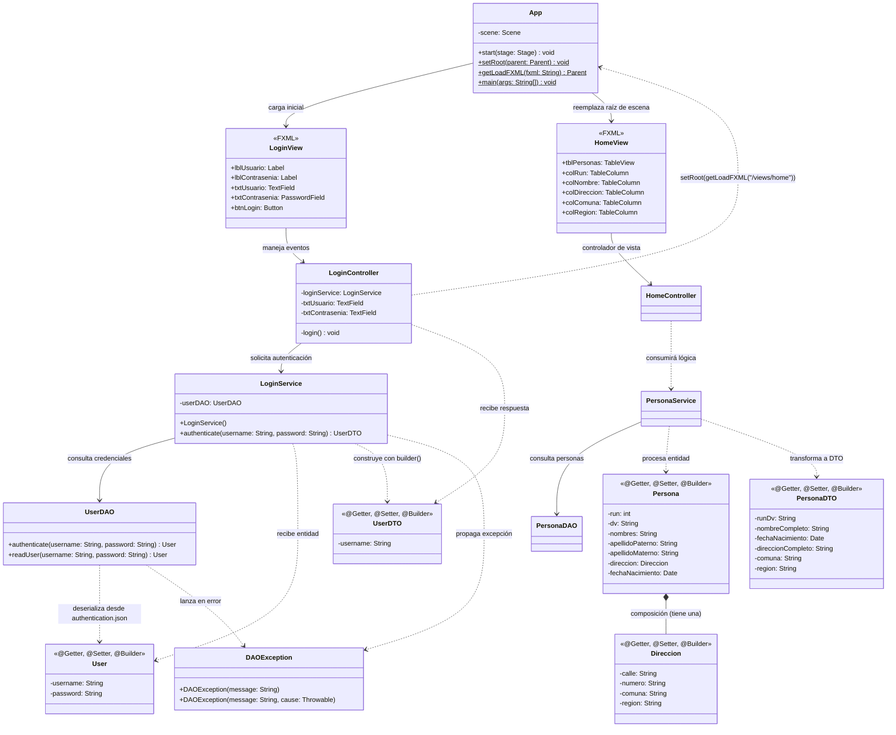

# Proyecto 06 - poo-javafx

Este proyecto representa una evolución fundamental en la arquitectura de la aplicación JavaFX, incorporando la **navegación dinámica entre pantallas**, el **modelado de dominio con composición de objetos** y el aprovechamiento del **patrón DTO para el aplanamiento de datos** (*data flattening*) destinado a componentes de interfaz gráfica como `TableView`.

A partir de la base consolidada en el proyecto 05 (donde se integró Lombok y el patrón Builder para la autenticación), este proyecto 06 da el salto desde una aplicación de pantalla única hacia un sistema interactivo con pantalla de bienvenida/principal (`Home`) y la estructuración del módulo de **Personas** y **Direcciones**, respaldado por una fuente de datos JSON con estructuras anidadas (`data.json`).

---

## Diferencias clave respecto al Proyecto 05

| Aspecto / Componente | Proyecto 05 | Proyecto 06 | Beneficio / Justificación |
| :--- | :--- | :--- | :--- |
| **Flujo post-autenticación** | Tras el inicio de sesión exitoso, solo se imprime la confirmación por consola. La interfaz gráfica se mantiene estática en el login. | Al autenticar con éxito, la aplicación cambia dinámicamente la vista activa hacia la pantalla principal (`/views/home.fxml`). | Ofrece una experiencia de usuario natural y fluida, avanzando al área privada del sistema tras validar credenciales. |
| **Gestión de navegación en `App.java`** | Solo inicializa la escena inicial con `login.fxml`. | Incorpora métodos auxiliares estáticos: `setRoot(Parent)` y `getLoadFXML(String)`. | Centraliza la carga de vistas FXML y permite sustituir el nodo raíz (`scene.setRoot(...)`) en la misma ventana (`Stage`), evitando abrir múltiples ventanas. |
| **Nueva vista principal (`home.fxml`)** | Inexistente (única vista: `login.fxml`). | Nueva vista declarativa en FXML compuesta por un `GridPane` y un control `TableView` con columnas (`RUN`, `NOMBRE`, `DIRECCION`, `COMUNA`, `REGION`). | Prepara la interfaz para presentar colecciones y listados tabulares de registros de forma organizada. |
| **Modelado de dominio y Composición** | Solo contempla la entidad `User` (credenciales planas). | Introduce las entidades `Persona` y `Direccion`, donde `Persona` contiene una referencia a `Direccion` (relación de composición/asociación). | Modela relaciones entre clases en POO, reflejando cómo un objeto complejo está compuesto por otros objetos de dominio. |
| **Patrón DTO (`PersonaDTO`)** | Solo `UserDTO` con `username`. | Se incorpora `PersonaDTO` como objeto aplanado: `runDv`, `nombreCompleto`, `fechaNacimiento`, `direccionCompleto`, `comuna`, `region`. | Demuestra la ventaja clave del DTO: transformar estructuras anidadas complejas del dominio en un formato plano y directo para su representación visual en tablas. |
| **Escalabilidad de la Arquitectura en Capas** | Único flujo funcional (Login -> Servicio -> DAO -> Usuario). | Se extienden las capas para dar soporte al módulo de personas: `HomeController`, `PersonaService` y `PersonaDAO`. | Mantiene la separación de responsabilidades y prepara el sistema para operaciones CRUD y desacoplamiento de nuevas entidades. |
| **Fuente de datos** | Únicamente `authentication.json` (credenciales simples). | Se añade `data.json` con una colección (`personas`) que incluye objetos anidados de tipo dirección. | Introduce la lectura y procesamiento de estructuras JSON complejas y colecciones de objetos. |

---

## ¿Qué hace?

La aplicación inicia en el formulario de inicio de sesión (`/views/login.fxml`). Al ingresar credenciales y presionar el botón `LOGIN`, el flujo de ejecución desacoplado se ejecuta de la siguiente manera:

1. **Captura y Delegación**: `LoginController` toma el usuario y contraseña ingresados y llama a `LoginService.authenticate(username, password)`.
2. **Validación en DAO**: `UserDAO` lee `authentication.json` del classpath, deserializa el usuario con Gson y verifica las credenciales.
3. **Construcción DTO**: `LoginService` construye el objeto `UserDTO` mediante el Builder de Lombok y lo retorna al controlador.
4. **Navegación Dinámica**: 
   - Al recibir el `UserDTO` de forma exitosa, `LoginController` imprime en consola la confirmación del login.
   - Inmediatamente ejecuta:
     ```java
     App.setRoot(App.getLoadFXML("/views/home"));
     ```
   - El método estático `getLoadFXML("/views/home")` de `App` localiza y parsea `/views/home.fxml` mediante `FXMLLoader`.
   - `App.setRoot(...)` reemplaza el contenido raíz de la escena activa (`scene.setRoot(...)`), transformando la ventana al panel principal (`Home`) sin parpadeos ni creación de nuevas ventanas.
5. **Estructura de Datos para la Vista Principal**: La nueva pantalla `home.fxml` cuenta con una tabla (`TableView`) configurada para desplegar información de personas a través de `PersonaDTO`, que consolida los datos de `Persona` y su respectiva `Direccion`.

---

## Diagrama de clases



---

## Estructura de clases y relaciones

### Capa de Aplicación y Navegación
- **`App`**: Punto de entrada de la aplicación JavaFX (`Application`). Administra la variable estática `scene` y ofrece métodos globales de navegación:
  - `setRoot(Parent parent)`: Reemplaza dinámicamente el nodo raíz de la escena actual sin recrear el `Stage`.
  - `getLoadFXML(String fxml)`: Carga el archivo `.fxml` indicado desde la ruta relativa de recursos `/views/`.

### Capa de Presentación (Controladores y Vistas)
- **`LoginController`**: Gestiona las entradas de texto (`txtUsuario`, `txtContrasenia`) y el evento de login. Al autenticar exitosamente, utiliza `App.setRoot(App.getLoadFXML("/views/home"))` para redirigir a la vista principal.
- **`HomeController`**: Controlador asignado a la pantalla principal (`views/home.fxml`), diseñado para coordinar la interacción y visualización de la tabla de personas.
- **`login.fxml`**: Vista declarativa del formulario de acceso.
- **`home.fxml`**: Vista declarativa principal construida con `GridPane` y un componente `TableView` con columnas para `RUN`, `NOMBRE`, `DIRECCION`, `COMUNA` y `REGION`.

### Capa de Negocio (Servicios)
- **`LoginService`**: Encapsula las reglas de negocio de autenticación, validando con `UserDAO` y ensamblando el `UserDTO` con el patrón Builder.
- **`PersonaService`**: Capa de servicio preparada para orquestar la obtención de datos desde `PersonaDAO` y transformar las entidades `Persona` y `Direccion` a instancias de `PersonaDTO`.

### Capa de Acceso a Datos (DAO y Excepciones)
- **`UserDAO`**: Lee y deserializa el archivo `authentication.json` del classpath mediante Gson, validando credenciales y reportando fallas con `DAOException`.
- **`PersonaDAO`**: Componente de persistencia diseñado para leer y deserializar la colección de personas desde `data.json`.
- **`DAOException`**: Excepción comprobada personalizada para el control de errores en las operaciones de acceso a datos.

### Capa de Dominio (Entidades)
- **`User`**: Entidad que mapea las credenciales de usuario con `@SerializedName` de Gson. Utiliza anotaciones de Lombok para generar constructores y métodos de acceso.
- **`Direccion`**: Entidad de apoyo con campos `calle`, `numero`, `comuna` y `region`. Decorada con Lombok (`@Getter`, `@Setter`, `@Builder`, `@NoArgsConstructor`, `@AllArgsConstructor`).
- **`Persona`**: Entidad principal de dominio que modela el perfil de una persona (`run`, `dv`, `nombres`, `apellidoPaterno`, `apellidoMaterno`, `fechaNacimiento`) y mantiene una relación de **composición** con su respectiva `Direccion`.

### Capa de Transferencia (DTOs)
- **`UserDTO`**: Expone de manera segura el nombre de usuario autenticado hacia la vista, sin revelar la contraseña.
- **`PersonaDTO`**: Objeto de transferencia diseñado para la interfaz gráfica. Realiza un **aplanamiento de datos**:
  - Consolida el RUN y su dígito verificador en `runDv`.
  - Concatena nombres y apellidos en `nombreCompleto`.
  - Agrupa calle y número en `direccionCompleto`.
  - Mantiene `comuna`, `region` y `fechaNacimiento`.
  Esto simplifica enormemente el enlace (*binding*) de datos con las columnas del `TableView` de JavaFX.

---

## Archivos de Datos (JSON)

### 1. `authentication.json`
Almacena las credenciales de autenticación para el login:
```json
{
    "username": "admin",
    "password": "qwerty"
}
```

### 2. `data.json`
Almacena una colección de personas con direcciones anidadas, demostrando el manejo de estructuras jerárquicas:
```json
{
  "personas": [
    {
      "run" : "12345678",
      "dv": "9",
      "nombres" : "Juan",
      "apellidoPaterno" : "Perez",
      "apellidoMaterno" : "Gonzalez",
      "fechaNacimiento" : "1990-01-01",
      "direccion" : {
        "calle": "Calle Falsa 123",
        "numero": "123",
        "comuna": "Santiago",
        "region": "Metropolitana"
      }
    },
    ...
  ]
}
```

---

## Configuración Modular (`module-info.java`)

```java
module cl.elprofecarreno.app {
    requires javafx.controls;
    requires javafx.fxml;

    requires com.google.gson;
    requires static lombok;

    opens cl.elprofecarreno.app to javafx.fxml;
    opens cl.elprofecarreno.app.controller to javafx.fxml;
    opens cl.elprofecarreno.app.dao.entity to com.google.gson;
    exports cl.elprofecarreno.app;
}
```

- **`requires javafx.controls;` y `requires javafx.fxml;`**: Módulos requeridos para la interfaz gráfica y el motor de carga FXML.
- **`requires com.google.gson;`**: Para deserializar archivos JSON (`authentication.json` y `data.json`).
- **`requires static lombok;`**: Procesamiento de anotaciones en tiempo de compilación.
- **`opens ... to javafx.fxml`**: Acceso por reflexión a los controladores (`LoginController`, `HomeController`) y la clase `App`.
- **`opens ... to com.google.gson`**: Permite a Gson instanciar y asignar valores en las entidades (`User`, `Persona`, `Direccion`).

---

## Requisitos

- **Java JDK**: 11 o superior (recomendado JDK 21)
- **Apache Maven**: 3.8+
- **JavaFX**: 21
- **IDE**: IntelliJ IDEA, Visual Studio Code, Eclipse o Apache NetBeans (con soporte para Lombok habilitado)

---

## Ejecutar el proyecto

Desde la carpeta del proyecto:

```bash
cd 06/poo-javafx
mvn clean javafx:run
```

O desde la raíz del repositorio:

```bash
mvn -f 06/poo-javafx/pom.xml clean javafx:run
```

---

## Resultado esperado

### 1. Pantalla de Login inicial
Al iniciar el programa se muestra el formulario de inicio de sesión centrado.

### 2. Autenticación exitosa y Navegación
Al ingresar las credenciales registradas:
- **Usuario:** `admin`
- **Contraseña:** `qwerty`

Y pulsar **LOGIN**:
1. En la consola del sistema se confirma el acceso:
   ```text
   LOGIN CORRECTO
   admin
   ```
2. La ventana actual transiciona inmediatamente hacia la vista `/views/home.fxml`, desplegando la pantalla principal con la tabla de personas (`TableView`).

### 3. Autenticación fallida
Al ingresar credenciales no coincidentes o vacías:
- Se muestra el mensaje de error en la consola:
  ```text
  ERROR: login fallido. Usuario o contraseña incorrectos
  ```
- La aplicación permanece en la pantalla de login permitiendo nuevos intentos.

---

## Estructura del proyecto

```text
06/
└── poo-javafx/
    ├── pom.xml
    └── src/
        └── main/
            ├── java/
            │   ├── module-info.java
            │   └── cl/elprofecarreno/app/
            │       ├── App.java
            │       ├── controller/
            │       │   ├── HomeController.java
            │       │   ├── LoginController.java
            │       │   └── dto/
            │       │       ├── PersonaDTO.java
            │       │       └── UserDTO.java
            │       ├── dao/
            │       │   ├── PersonaDAO.java
            │       │   ├── UserDAO.java
            │       │   ├── entity/
            │       │   │   ├── Direccion.java
            │       │   │   ├── Persona.java
            │       │   │   └── User.java
            │       │   └── excepcion/
            │       │       └── DAOException.java
            │       └── service/
            │           ├── LoginService.java
            │           └── PersonaService.java
            └── resources/
                ├── authentication.json
                ├── data.json
                └── views/
                    ├── home.fxml
                    └── login.fxml
```

---

## Objetivo del ejercicio

Este ejercicio permite afianzar y comprender:

- **Mecanismos de Navegación en JavaFX**: Implementar transiciones de vistas limpias reemplazando el nodo raíz de la escena (`scene.setRoot(...)`) sin recrear ventanas secundarias.
- **Composición y Relaciones entre Objetos en POO**: Diseñar entidades donde una clase contiene a otra (`Persona` contiene `Direccion`), modelando relaciones de forma natural y desacoplada.
- **El Patrón DTO para Aplanamiento de Datos (*Flattening*)**: Comprender por qué las vistas no deben consumir directamente las entidades del modelo. `PersonaDTO` agrupa y formatea datos anidados en una estructura plana ideal para tablas y componentes de presentación.
- **Escalabilidad Multicapa**: Organizar un proyecto que crece en número de entidades y vistas, manteniendo la separación entre Controlador, Servicio, DAO, Entidad y DTO.
- **Persistencia en JSON con Estructuras Complejas**: Gestionar archivos JSON con colecciones de datos y subobjetos (`data.json`) integrados al sistema modular de Java.
