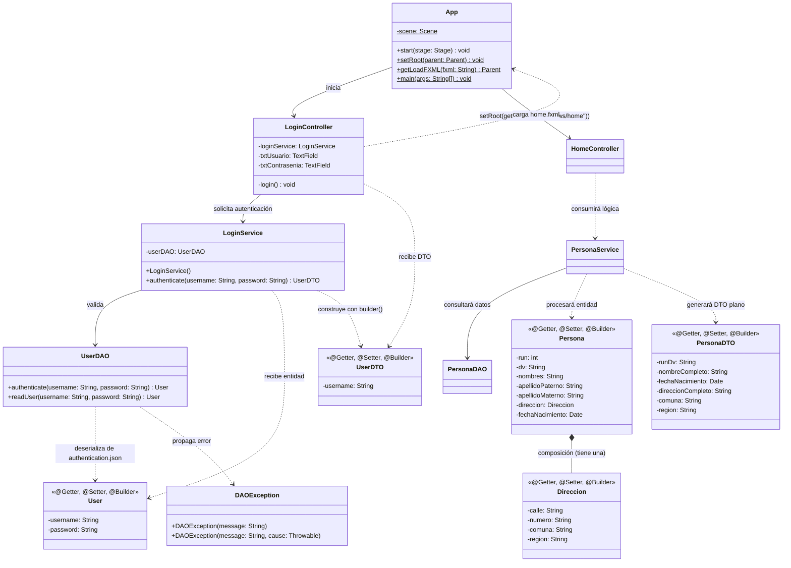
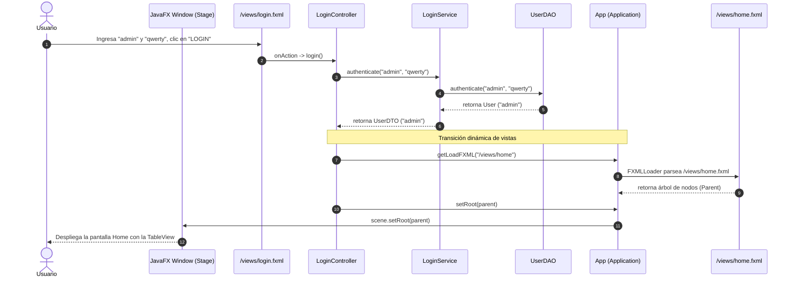
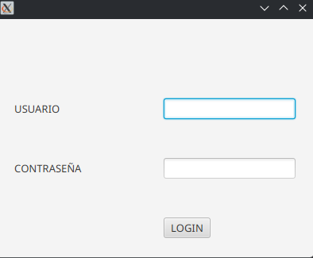
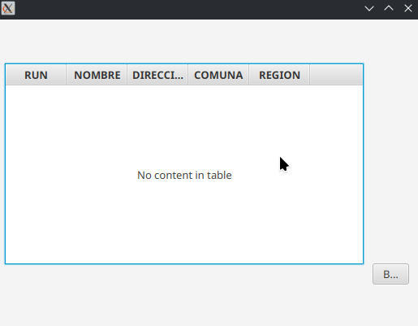

# Proyecto 06 - poo-javafx (TableView 1/3: Navegación, Composición de Dominio y Aplanamiento DTO)

Este proyecto corresponde al **sexto hito incremental** del curso. Representa una evolución fundamental en la arquitectura de la aplicación JavaFX al incorporar **navegación dinámica entre pantallas**, **modelado de dominio avanzado con relaciones de composición de objetos** y el aprovechamiento del **patrón DTO para el aplanamiento de datos (*data flattening*)** destinado a componentes tabulares (`TableView`).

A partir de la base consolidada en el Proyecto 05 (autenticación desacoplada con Lombok y Builder), este hito 06 da el salto desde una aplicación de pantalla única estática hacia un sistema interactivo con pantalla principal (`Home`) y la estructuración del módulo de **Personas y Direcciones**, respaldado por una fuente de datos JSON con estructuras anidadas (`data.json`).

---

## ¿Qué hace el proyecto?

1. La aplicación inicia desplegando el formulario de inicio de sesión (`/views/login.fxml`).
2. Al ingresar credenciales válidas (`admin` / `qwerty`) y presionar **LOGIN**:
   - `LoginController` autentica al usuario a través de `LoginService` y `UserDAO`.
   - Tras recibir el `UserDTO`, la aplicación ejecuta la transición dinámica de pantalla:
     ```java
     App.setRoot(App.getLoadFXML("/views/home"));
     ```
   - El nodo raíz de la escena actual se reemplaza por el árbol visual de `/views/home.fxml` en el mismo `Stage`, sin abrir ventanas adicionales ni provocar parpadeos visuales.
3. La nueva vista `Home` presenta un contenedor `GridPane` con un componente `TableView` estructurado con columnas para `RUN`, `NOMBRE`, `DIRECCION`, `COMUNA` y `REGION`.
4. En el modelo de dominio se estructuran las entidades `Persona` y `Direccion` (composición de objetos) y el DTO aplanado `PersonaDTO`, preparando las capas de `PersonaService` y `PersonaDAO` para la carga de datos.

---

## Diferencias Clave: Proyecto 06 vs. Proyecto 05

| Aspecto / Componente | Proyecto 05 | Proyecto 06 | Beneficio / Justificación |
| :--- | :--- | :--- | :--- |
| **Flujo post-autenticación** | Tras autenticar con éxito, solo se imprime la confirmación por consola. La UI permanece fija en el formulario de login. | Transiciona automáticamente hacia la vista principal del sistema (`/views/home.fxml`). | Experiencia de usuario (UX) realista: el acceso exitoso da paso al área privada del sistema. |
| **Navegación en `App.java`** | Métodos con visibilidad de paquete. | Métodos estáticos públicos: `setRoot(Parent)` y `getLoadFXML(String)`. | Permite a cualquier controlador solicitar el cambio de vista de la aplicación sin acoplarse al `Stage`. |
| **Nueva Vista (`home.fxml`)** | Inexistente (única vista: `login.fxml`). | Nueva vista FXML con `TableView` configurado con 5 columnas. | Prepara la interfaz gráfica para desplegar colecciones y listados de datos tabulares. |
| **Nuevo Controlador (`HomeController`)** | Inexistente. | Controlador creado para gestionar la pantalla principal y su tabla. | Separación de responsabilidades: cada vista FXML posee su propio controlador. |
| **Modelado de Dominio y Composición** | Solo entidad plana `User` (credenciales). | Incorpora entidades `Persona` y `Direccion`, donde `Persona` contiene una instancia de `Direccion` (`Persona *-- Direccion`). | Modela relaciones complejas de **composición** en POO: un objeto compuesto por otros objetos de dominio. |
| **Patrón DTO para Aplanamiento (`PersonaDTO`)** | Solo `UserDTO` con `username`. | Introduce `PersonaDTO` que unifica atributos de `Persona` y `Direccion` en una sola dimensión plana. | **Data Flattening**: Evita navegar estructuras anidadas en la UI y simplifica la vinculación con las columnas de la tabla. |
| **Escalabilidad Multicapa** | Solo capas para Login (`LoginController`, `LoginService`, `UserDAO`). | Extiende la arquitectura hacia el módulo de personas: `HomeController`, `PersonaService` y `PersonaDAO`. | Demuestra cómo la arquitectura por capas escala ordenadamente al incorporar nuevas entidades del negocio. |
| **Fuente de Datos** | Únicamente `authentication.json`. | Se incorpora `data.json` con colecciones y objetos anidados de tipo dirección. | Expone el manejo de archivos JSON con estructuras jerárquicas complejas. |

---

## Diagrama de Componentes

```mermaid
flowchart TB
    subgraph Presentation_Layer["Capa de Presentación"]
        App["App.java\n(Gestor de Escena y Navegación)"]
        LoginView["/views/login.fxml"]
        HomeView["/views/home.fxml\n(TableView de Personas)"]
        LoginCtrl["LoginController.java"]
        HomeCtrl["HomeController.java"]
        UserDTO["UserDTO.java"]
        PersonaDTO["PersonaDTO.java\n(DTO Aplanado)"]
    end

    subgraph Service_Layer["Capa de Negocio"]
        LoginSvc["LoginService.java"]
        PersonaSvc["PersonaService.java"]
    end

    subgraph DAO_Layer["Capa de Acceso a Datos (DAO)"]
        UserDAO["UserDAO.java"]
        PersonaDAO["PersonaDAO.java"]
        UserEntity["User.java"]
        PersonaEntity["Persona.java"]
        DireccionEntity["Direccion.java"]
        DAOEx["DAOException.java"]
    end

    subgraph Data_Files["Archivos de Datos (JSON)"]
        AuthJSON[("authentication.json")]
        DataJSON[("data.json\n(Colección Jerárquica)")]
    end

    App -->|Inicia escena| LoginView
    LoginView -.-> LoginCtrl
    LoginCtrl --> LoginSvc
    LoginSvc --> UserDAO
    UserDAO --> AuthJSON
    LoginCtrl -->|Exito: setRoot a /views/home| App
    App --> HomeView
    HomeView -.-> HomeCtrl
    HomeCtrl -.-> PersonaSvc
    PersonaSvc -.-> PersonaDAO
    PersonaDAO -.-> DataJSON
    PersonaEntity *-- DireccionEntity
    PersonaSvc -.-> PersonaDTO
```

---

## Diagrama de Clases



---

## Diagrama de Flujo e Interacción de Capas

El siguiente diagrama ilustra el flujo de autenticación y la posterior navegación dinámica hacia la vista principal:



---

## Paso a Paso para la Construcción Incremental (desde Proyecto 05)

Sigue estos pasos para evolucionar el Proyecto 05 al Proyecto 06:

### Paso 1: Modificar `App.java` para permitir navegación pública
Haz que los métodos `setRoot` y `getLoadFXML` sean `public static` en `src/main/java/cl/elprofecarreno/app/App.java`:

```java
package cl.elprofecarreno.app;

import javafx.application.Application;
import javafx.fxml.FXMLLoader;
import javafx.scene.Parent;
import javafx.scene.Scene;
import javafx.stage.Stage;

import java.io.IOException;

public class App extends Application {

    private static Scene scene;

    @Override
    public void start(Stage stage) throws IOException {
        scene = new Scene(getLoadFXML("/views/login"));
        stage.setScene(scene);
        stage.show();
    }

    public static void setRoot(Parent parent) throws IOException {
        scene.setRoot(parent);
    }

    public static Parent getLoadFXML(String fxml) throws IOException {
        FXMLLoader fxmlLoader = new FXMLLoader(App.class.getResource(fxml + ".fxml"));
        return fxmlLoader.load();
    }

    public static void main(String[] args) {
        launch();
    }
}
```

### Paso 2: Crear las entidades de dominio con relación de composición
1. Crea `src/main/java/cl/elprofecarreno/app/dao/entity/Direccion.java`:
   ```java
   package cl.elprofecarreno.app.dao.entity;

   import lombok.AllArgsConstructor;
   import lombok.Builder;
   import lombok.Getter;
   import lombok.NoArgsConstructor;
   import lombok.Setter;

   @Getter
   @Setter
   @Builder
   @NoArgsConstructor
   @AllArgsConstructor
   public class Direccion {
       private String calle;
       private String numero;
       private String comuna;
       private String region;
   }
   ```

2. Crea `src/main/java/cl/elprofecarreno/app/dao/entity/Persona.java` estableciendo la composición con `Direccion`:
   ```java
   package cl.elprofecarreno.app.dao.entity;

   import java.util.Date;
   import lombok.AllArgsConstructor;
   import lombok.Builder;
   import lombok.Getter;
   import lombok.NoArgsConstructor;
   import lombok.Setter;

   @Getter
   @Setter
   @Builder
   @NoArgsConstructor
   @AllArgsConstructor
   public class Persona {
       private int run;
       private String dv;
       private String nombres;
       private String apellidoPaterno;
       private String apellidoMaterno;
       private Direccion direccion;
       private Date fechaNacimiento;
   }
   ```

### Paso 3: Crear el DTO aplanado `PersonaDTO.java`
Crea `src/main/java/cl/elprofecarreno/app/controller/dto/PersonaDTO.java`:

```java
package cl.elprofecarreno.app.controller.dto;

import java.util.Date;
import lombok.AllArgsConstructor;
import lombok.Builder;
import lombok.Getter;
import lombok.NoArgsConstructor;
import lombok.Setter;

@Getter
@Setter
@Builder
@NoArgsConstructor
@AllArgsConstructor
public class PersonaDTO {
    private String runDv;
    private String nombreCompleto;
    private Date fechaNacimiento;
    private String direccionCompleto;
    private String comuna;
    private String region;
}
```

### Paso 4: Crear esqueletos de `PersonaDAO` y `PersonaService`
1. `src/main/java/cl/elprofecarreno/app/dao/PersonaDAO.java`:
   ```java
   package cl.elprofecarreno.app.dao;

   public class PersonaDAO {
   }
   ```
2. `src/main/java/cl/elprofecarreno/app/service/PersonaService.java`:
   ```java
   package cl.elprofecarreno.app.service;

   public class PersonaService {
   }
   ```

### Paso 5: Crear el archivo de datos `data.json`
Crea `src/main/resources/data.json` con la colección de personas y sus direcciones anidadas:

```json
{
  "personas": [
    {
      "run" : "12345678",
      "dv": "9",
      "nombres" : "Juan",
      "apellidoPaterno" : "Perez",
      "apellidoMaterno" : "Gonzalez",
      "fechaNacimiento" : "1990-01-01",
      "direccion" : {
        "calle": "Calle Falsa 123",
        "numero": "123",
        "comuna": "Santiago",
        "region": "Metropolitana"
      }
    },
    {
      "run" : "87654321",
      "dv": "K",
      "nombres" : "Maria",
      "apellidoPaterno" : "Lopez",
      "apellidoMaterno" : "Rodriguez",
      "fechaNacimiento" : "1995-05-15",
      "direccion" : {
        "calle": "Avenida Siempre Viva 742",
        "numero": "742",
        "comuna": "Providencia",
        "region": "Metropolitana"
      }
    }
  ]
}
```

### Paso 6: Crear la vista principal `home.fxml`
Crea `src/main/resources/views/home.fxml` con el diseño de la tabla:

```xml
<?xml version="1.0" encoding="UTF-8"?>

<?import javafx.scene.control.Button?>
<?import javafx.scene.control.TableColumn?>
<?import javafx.scene.control.TableView?>
<?import javafx.scene.layout.ColumnConstraints?>
<?import javafx.scene.layout.GridPane?>
<?import javafx.scene.layout.RowConstraints?>
<?import javafx.scene.layout.VBox?>

<VBox maxHeight="-Infinity" maxWidth="-Infinity" minHeight="-Infinity" minWidth="-Infinity" 
      prefHeight="400.0" prefWidth="600.0" 
      xmlns="http://javafx.com/javafx/21" xmlns:fx="http://javafx.com/fxml/1">
   <children>
      <GridPane prefHeight="460.0" prefWidth="600.0">
        <columnConstraints>
            <ColumnConstraints hgrow="SOMETIMES" maxWidth="143.0" minWidth="10.0" prefWidth="25.0" />
            <ColumnConstraints hgrow="SOMETIMES" maxWidth="489.0" minWidth="10.0" prefWidth="489.0" />
            <ColumnConstraints hgrow="SOMETIMES" maxWidth="223.0" minWidth="0.0" prefWidth="0.0" />
          <ColumnConstraints hgrow="SOMETIMES" maxWidth="126.0" minWidth="10.0" prefWidth="67.0" />
        </columnConstraints>
        <rowConstraints>
            <RowConstraints minHeight="10.0" prefHeight="30.0" vgrow="SOMETIMES" />
          <RowConstraints maxHeight="294.0" minHeight="10.0" prefHeight="294.0" vgrow="SOMETIMES" />
          <RowConstraints maxHeight="126.0" minHeight="10.0" prefHeight="47.0" vgrow="SOMETIMES" />
            <RowConstraints minHeight="10.0" prefHeight="30.0" vgrow="SOMETIMES" />
        </rowConstraints>
         <children>
            <TableView prefHeight="200.0" prefWidth="200.0" GridPane.columnIndex="1" GridPane.rowIndex="1">
              <columns>
                <TableColumn prefWidth="75.0" text="RUN" />
                <TableColumn prefWidth="75.0" text="NOMBRE" />
                  <TableColumn prefWidth="75.0" text="DIRECCION" />
                  <TableColumn prefWidth="75.0" text="COMUNA" />
                  <TableColumn prefWidth="75.0" text="REGION" />
              </columns>
            </TableView>
            <Button mnemonicParsing="false" text="Button" GridPane.columnIndex="3" GridPane.rowIndex="2" />
         </children>
      </GridPane>
   </children>
</VBox>
```

### Paso 7: Crear el controlador `HomeController.java`
Crea `src/main/java/cl/elprofecarreno/app/controller/HomeController.java`:

```java
package cl.elprofecarreno.app.controller;

public class HomeController {
}
```

### Paso 8: Actualizar `LoginController.java` para transicionar de vista
En `src/main/java/cl/elprofecarreno/app/controller/LoginController.java`, tras validar el login, agrega la invocación de navegación:

```java
package cl.elprofecarreno.app.controller;

import java.io.IOException;

import cl.elprofecarreno.app.App;
import cl.elprofecarreno.app.controller.dto.UserDTO;
import cl.elprofecarreno.app.service.LoginService;
import javafx.fxml.FXML;
import javafx.scene.control.TextField;

public class LoginController {

    private LoginService loginService;

    @FXML
    private TextField txtUsuario;

    @FXML
    private TextField txtContrasenia;

    @FXML
    private void login() throws IOException {
        loginService = new LoginService();
        try {
            UserDTO user = loginService.authenticate(txtUsuario.getText(), txtContrasenia.getText());
            System.out.println("LOGIN CORRECTO");
            System.out.println(user.getUsername());
            App.setRoot(App.getLoadFXML("/views/home"));
        } catch (Exception e) {
            System.err.println(e.getMessage());
        }
    }
}
```

---

## Estructura del Proyecto

```text
06/
└── poo-javafx/
    ├── pom.xml
    └── src/
        └── main/
            ├── java/
            │   ├── module-info.java
            │   └── cl/elprofecarreno/app/
            │       ├── App.java
            │       ├── controller/
            │       │   ├── HomeController.java
            │       │   ├── LoginController.java
            │       │   └── dto/
            │       │       ├── PersonaDTO.java
            │       │       └── UserDTO.java
            │       ├── dao/
            │       │   ├── PersonaDAO.java
            │       │   ├── UserDAO.java
            │       │   ├── entity/
            │       │   │   ├── Direccion.java
            │       │   │   ├── Persona.java
            │       │   │   └── User.java
            │       │   └── excepcion/
            │       │       └── DAOException.java
            │       └── service/
            │           ├── LoginService.java
            │           └── PersonaService.java
            └── resources/
                ├── authentication.json
                ├── data.json
                └── views/
                    ├── home.fxml
                    └── login.fxml
```

---

## Requisitos y Ejecución

### Requisitos
- **Java JDK**: 11 o superior (recomendado JDK 21).
- **Apache Maven**: 3.8+.
- **JavaFX**: 21.

### Ejecución
Desde la carpeta del proyecto:
```bash
cd 06/poo-javafx
mvn clean javafx:run
```

O desde la raíz del repositorio:
```bash
mvn -f 06/poo-javafx/pom.xml clean javafx:run
```

### Resultado esperado

#### 1. Vista Inicial (Login)
Al iniciar la aplicación, se despliega el formulario de inicio de sesión centrado:



#### 2. Vista Final tras Autenticación (Home con TableView)
Al ingresar las credenciales válidas (`admin` / `qwerty`) y pulsar **LOGIN**:
1. En consola se confirma el acceso:
   ```text
   LOGIN CORRECTO
   admin
   ```
2. La ventana transiciona dinámicamente hacia la vista `Home`, presentando el `TableView` con sus columnas preparadas (`RUN`, `NOMBRE`, `DIRECCION`, `COMUNA`, `REGION`):



---

## Objetivos Pedagógicos y Buenas Prácticas

- **Transiciones Dinámicas**: Comprender la mecánica de sustitución de nodos raíz (`scene.setRoot`) sin abrir nuevas ventanas.
- **Relaciones de Composición en POO**: Reconocer cómo la composición modela la realidad donde un objeto complejo contiene a otros objetos (`Persona` posee `Direccion`).
- **Aplanamiento de Datos (*Flattening*)**: Entender la necesidad del patrón DTO para adaptar datos anidados del dominio a interfaces tabulares planas.
- **Modularidad Escalable**: Preparar la estructura arquitectónica para incorporar nuevos módulos de negocio sin romper los existentes.
