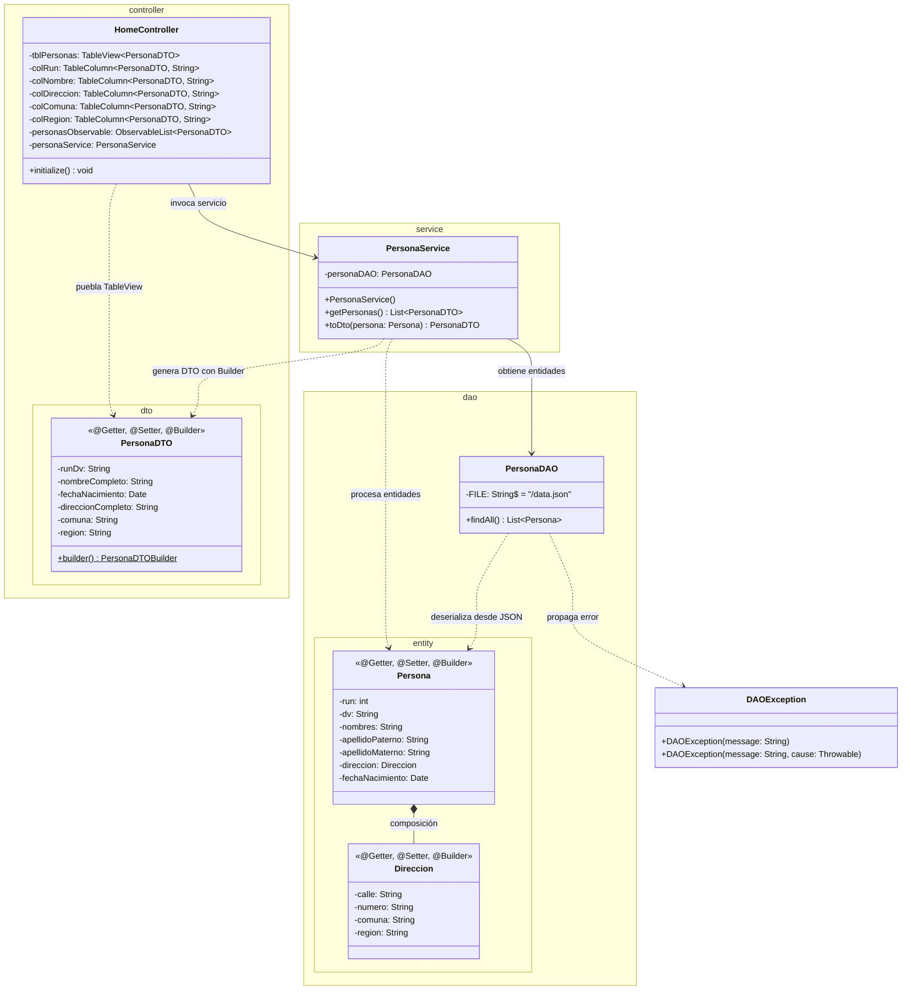
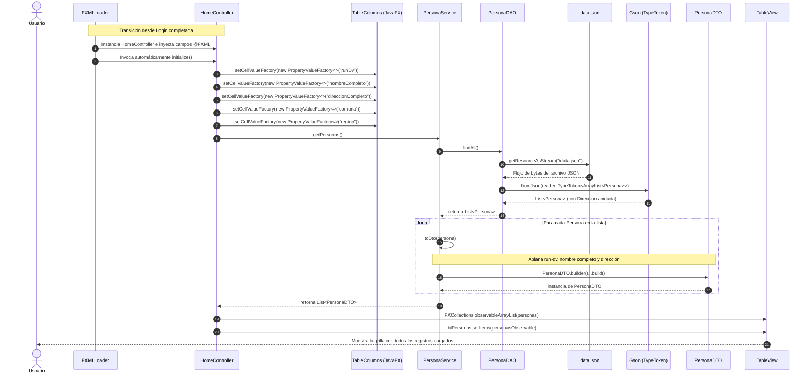
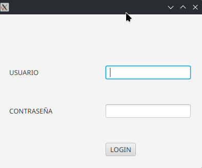
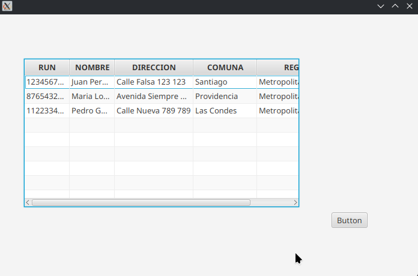

# Proyecto 07 - poo-javafx (TableView 2/3: Data Binding, PropertyValueFactory y Colecciones Gson)

Este proyecto corresponde al **séptimo hito incremental** del curso. Culmina la integración práctica entre el **modelado de dominio en capas**, la **lectura de colecciones JSON** y la **representación visual reactiva en JavaFX**, enlazando los datos procesados en la capa de negocio con las columnas de una tabla mediante el mecanismo de **Data Binding** (`PropertyValueFactory` y `ObservableList`).

---

## ¿Qué hace el proyecto?

A partir de la pantalla de bienvenida estructurada en el Proyecto 06, este hito 07 implementa la carga completa de datos desde el archivo `data.json` hacia la tabla de la interfaz:

1. Tras una autenticación exitosa en el login (`admin` / `qwerty`), la aplicación navega hacia la vista `/views/home.fxml`.
2. Al cargarse la vista, el ciclo de vida de JavaFX ejecuta automáticamente el método **`initialize()`** en `HomeController`.
3. `HomeController` configura las columnas del `TableView` mediante **`PropertyValueFactory`**, asociando cada columna al nombre de la propiedad getter de `PersonaDTO`.
4. `HomeController` invoca a `PersonaService.getPersonas()`, el cual a su vez solicita los datos a `PersonaDAO.findAll()`.
5. `PersonaDAO` lee el archivo `/data.json` como un flujo de entrada (`InputStreamReader`), lo deserializa con **Google Gson** utilizando **`TypeToken`** para listas genéricas y aplica un formato de fecha `yyyy-MM-dd`.
6. `PersonaService` recorre las entidades de dominio `Persona` (con sus objetos compuestos `Direccion`) y las transforma en una colección de **`PersonaDTO`** aplicando el patrón Builder.
7. `HomeController` encapsula la lista en un **`ObservableList`** de JavaFX y la asigna a la tabla (`tblPersonas.setItems(...)`), desplegando de inmediato todas las filas con información enriquecida y aplanada.

---

## Diferencias Clave: Proyecto 07 vs. Proyecto 06

| Componente / Aspecto | Proyecto 06 | Proyecto 07 (Enlace de Datos Completo) | Justificación Pedagógica y Técnica |
| :--- | :--- | :--- | :--- |
| **`HomeController.java`** | Clase vacía (solo declarada). | Totalmente implementada con `@FXML TableView`, `TableColumn` y método `initialize()`. | Conecta la capa visual con la capa lógica mediante el ciclo de vida de JavaFX. |
| **Enlace de Datos (*Data Binding*)** | Columnas de la tabla sin configuración. | Uso de `PropertyValueFactory` para mapear columnas con los atributos de `PersonaDTO` (`runDv`, `nombreCompleto`, etc.). | Patrón estándar de JavaFX para sincronizar modelos de datos con la interfaz de usuario. |
| **`PersonaDAO.java`** | Clase vacía. | Implementa `findAll()` usando `GsonBuilder`, `InputStreamReader`, `setDateFormat` y `TypeToken`. | Demuestra la deserialización de colecciones genéricas (`List<Persona>`) desde recursos empaquetados en el JAR. |
| **`PersonaService.java`** | Clase vacía. | Implementa `getPersonas()` y el método de transformación `toDto(Persona)` mediante Lombok Builder. | Aplica la regla de negocio de aplanamiento (*flattening*) unificando `Persona` y su `Direccion`. |
| **Descriptor Modular (`module-info.java`)** | No requería `javafx.base` ni abría los DTOs para introspección de propiedades. | Agrega `requires javafx.base;` y `opens ...dto to javafx.base;`. | **Vital en JPMS**: `PropertyValueFactory` utiliza reflexión desde el módulo `javafx.base` para invocar los getters de `PersonaDTO`. |
| **Vista `home.fxml`** | Elementos sin identificadores `fx:id` y sin atributo `fx:controller`. | Asocia `fx:controller="...HomeController"` e incorpora `fx:id` en la tabla y en cada una de sus 5 columnas. | Permite a `FXMLLoader` inyectar las referencias de la interfaz en los campos anotados con `@FXML`. |
| **Estructura de `data.json`** | Objeto contenedor `{ "personas": [...] }`. | Arreglo JSON directo `[ ... ]`. | Simplifica la deserialización como lista raíz mediante `TypeToken<ArrayList<Persona>>`. |

---

## Diagrama de Componentes

```mermaid
flowchart TB
    subgraph UI_Layer["Capa de Presentación (JavaFX)"]
        HomeFXML["/views/home.fxml\n(TableView + TableColumns)"]
        HomeCtrl["HomeController.java\n(initialize & Data Binding)"]
        ObsList["ObservableList<PersonaDTO>"]
        PersonaDTO["PersonaDTO.java\n(runDv, nombreCompleto, etc.)"]
    end

    subgraph Service_Layer["Capa de Negocio"]
        PersonaSvc["PersonaService.java\n(getPersonas & toDto)"]
    end

    subgraph DAO_Layer["Capa de Acceso a Datos (DAO)"]
        PersonaDAO["PersonaDAO.java\n(findAll con TypeToken)"]
        PersonaEntity["Persona.java\n(Entidad Dominio)"]
        DireccionEntity["Direccion.java\n(Composición)"]
        DAOEx["DAOException.java"]
    end

    subgraph Storage["Almacén de Datos"]
        DataJSON[("data.json\n(Array JSON en Classpath)")]
    end

    subgraph External["Librerías y Módulos Externos"]
        JavaFXBase["javafx.base\n(PropertyValueFactory)"]
        GsonEngine["com.google.gson\n(GsonBuilder + TypeToken)"]
    end

    HomeFXML -.->|Inyecta controles| HomeCtrl
    HomeCtrl -->|Configura enlace| JavaFXBase
    JavaFXBase -.->|Inspecciona getters por reflexión| PersonaDTO
    HomeCtrl -->|getPersonas()| PersonaSvc
    PersonaSvc -->|findAll()| PersonaDAO
    PersonaDAO -->|getResourceAsStream| DataJSON
    PersonaDAO -->|Deserializa con TypeToken| GsonEngine
    GsonEngine --> PersonaEntity
    PersonaEntity *-- DireccionEntity
    PersonaDAO -->>|List<Persona>| PersonaSvc
    PersonaSvc -->|toDto() vía Builder| PersonaDTO
    PersonaSvc -->>|List<PersonaDTO>| HomeCtrl
    HomeCtrl --> ObsList
    ObsList --> HomeFXML
```

---

## Diagrama de Clases



---

## Diagrama de Flujo e Interacción de Capas

El siguiente diagrama detalla la orquestación completa desde que la vista `Home` es instanciada hasta que la tabla queda poblada:



---

## Paso a Paso para la Construcción Incremental (desde Proyecto 06)

Sigue estos pasos para completar la implementación del enlace de datos sobre el Proyecto 06:

### Paso 1: Configurar `module-info.java` para reflexión de propiedades
En `src/main/java/module-info.java`, añade `requires javafx.base;` y abre el paquete DTO hacia dicho módulo:

```java
module cl.elprofecarreno.app {
    requires javafx.controls;
    requires javafx.fxml;

    requires com.google.gson;
    requires static lombok;
    requires javafx.base;

    opens cl.elprofecarreno.app to javafx.fxml;
    opens cl.elprofecarreno.app.controller to javafx.fxml;
    opens cl.elprofecarreno.app.controller.dto to javafx.base;
    opens cl.elprofecarreno.app.dao.entity to com.google.gson;
    exports cl.elprofecarreno.app;
}
```

> [!IMPORTANT]
> La directiva `opens cl.elprofecarreno.app.controller.dto to javafx.base;` es indispensable. Si se omite, `PropertyValueFactory` no podrá leer los métodos `getRunDv()`, `getNombreCompleto()`, etc., y la tabla permanecerá vacía sin mostrar errores evidentes.

### Paso 2: Ajustar el formato de `data.json` a un arreglo plano
Edita `src/main/resources/data.json` asegurando que la raíz sea un array `[ ... ]`:

```json
[
    {
      "run" : "12345678",
      "dv": "9",
      "nombres" : "Juan",
      "apellidoPaterno" : "Perez",
      "apellidoMaterno" : "Gonzalez",
      "fechaNacimiento" : "1990-01-01",
      "direccion" : {
        "calle": "Calle Falsa 123",
        "numero": "123",
        "comuna": "Santiago",
        "region": "Metropolitana"
      }
    },
    {
      "run" : "87654321",
      "dv": "K",
      "nombres" : "Maria",
      "apellidoPaterno" : "Lopez",
      "apellidoMaterno" : "Rodriguez",
      "fechaNacimiento" : "1995-05-15",
      "direccion" : {
        "calle": "Avenida Siempre Viva 742",
        "numero": "742",
        "comuna": "Providencia",
        "region": "Metropolitana"
      }
    }
]
```

### Paso 3: Implementar la persistencia en `PersonaDAO.java`
Edita `src/main/java/cl/elprofecarreno/app/dao/PersonaDAO.java`:

```java
package cl.elprofecarreno.app.dao;

import cl.elprofecarreno.app.dao.entity.Persona;
import com.google.gson.Gson;
import com.google.gson.GsonBuilder;
import java.io.InputStreamReader;
import java.io.Reader;
import java.util.List;
import cl.elprofecarreno.app.dao.excepcion.DAOException;
import com.google.gson.reflect.TypeToken;
import java.lang.reflect.Type;
import java.util.ArrayList;

public class PersonaDAO {
    
    private static final String FILE = "/data.json";

    public List<Persona> findAll() throws DAOException {
        Gson gson = new GsonBuilder().setDateFormat("yyyy-MM-dd").create();
        try(Reader reader = new InputStreamReader(getClass().getResourceAsStream(FILE))){
            Type listType = new TypeToken<ArrayList<Persona>>(){}.getType();
            return gson.fromJson(reader, listType);
        } catch(Exception e){
            throw new DAOException("ERROR al leer data.json", e);
        }
    }
}
```

### Paso 4: Implementar la capa de negocio en `PersonaService.java`
Edita `src/main/java/cl/elprofecarreno/app/service/PersonaService.java`:

```java
package cl.elprofecarreno.app.service;

import cl.elprofecarreno.app.dao.PersonaDAO;
import cl.elprofecarreno.app.dao.excepcion.DAOException;
import cl.elprofecarreno.app.controller.dto.PersonaDTO;
import java.util.List;
import java.util.ArrayList;
import cl.elprofecarreno.app.dao.entity.Persona;

public class PersonaService {

    private PersonaDAO personaDAO;

    public PersonaService() {
        this.personaDAO = new PersonaDAO();
    }

    public List<PersonaDTO> getPersonas(){
        List<PersonaDTO> personas = new ArrayList<>();
        try {
            List<Persona> personasEntity = personaDAO.findAll();
            for(Persona persona : personasEntity){
                personas.add(toDto(persona));
            }
        } catch(DAOException e){
            e.printStackTrace();
        }
        return personas;
    }

    public PersonaDTO toDto(Persona persona){
        return PersonaDTO.builder()
                .runDv(persona.getRun() + "-" + persona.getDv())
                .nombreCompleto(persona.getNombres() + " " + persona.getApellidoPaterno() + " " + persona.getApellidoMaterno())
                .fechaNacimiento(persona.getFechaNacimiento())
                .comuna(persona.getDireccion().getComuna())
                .region(persona.getDireccion().getRegion())
                .direccionCompleto(persona.getDireccion().getCalle() + " " + persona.getDireccion().getNumero())
                .build();
    }
}
```

### Paso 5: Asignar `fx:id` y `fx:controller` en `home.fxml`
Actualiza `src/main/resources/views/home.fxml`:

```xml
<?xml version="1.0" encoding="UTF-8"?>

<?import javafx.scene.control.Button?>
<?import javafx.scene.control.TableColumn?>
<?import javafx.scene.control.TableView?>
<?import javafx.scene.layout.ColumnConstraints?>
<?import javafx.scene.layout.GridPane?>
<?import javafx.scene.layout.RowConstraints?>
<?import javafx.scene.layout.VBox?>

<VBox maxHeight="-Infinity" maxWidth="-Infinity" minHeight="-Infinity" minWidth="-Infinity" 
      prefHeight="400.0" prefWidth="600.0" 
      xmlns="http://javafx.com/javafx/21" xmlns:fx="http://javafx.com/fxml/1" 
      fx:controller="cl.elprofecarreno.app.controller.HomeController">
   <children>
      <GridPane prefHeight="460.0" prefWidth="600.0">
        <columnConstraints>
            <ColumnConstraints hgrow="SOMETIMES" maxWidth="143.0" minWidth="10.0" prefWidth="25.0" />
            <ColumnConstraints hgrow="SOMETIMES" maxWidth="489.0" minWidth="10.0" prefWidth="489.0" />
            <ColumnConstraints hgrow="SOMETIMES" maxWidth="223.0" minWidth="0.0" prefWidth="0.0" />
          <ColumnConstraints hgrow="SOMETIMES" maxWidth="126.0" minWidth="10.0" prefWidth="67.0" />
        </columnConstraints>
        <rowConstraints>
            <RowConstraints minHeight="10.0" prefHeight="30.0" vgrow="SOMETIMES" />
          <RowConstraints maxHeight="294.0" minHeight="10.0" prefHeight="294.0" vgrow="SOMETIMES" />
          <RowConstraints maxHeight="126.0" minHeight="10.0" prefHeight="47.0" vgrow="SOMETIMES" />
            <RowConstraints minHeight="10.0" prefHeight="30.0" vgrow="SOMETIMES" />
        </rowConstraints>
         <children>
            <TableView fx:id="tblPersonas" prefHeight="200.0" prefWidth="200.0" GridPane.columnIndex="1" GridPane.rowIndex="1">
              <columns>
                <TableColumn fx:id="colRun" prefWidth="75.0" text="RUN" />
                <TableColumn fx:id="colNombre" prefWidth="75.0" text="NOMBRE" />
                  <TableColumn fx:id="colDireccion" prefWidth="75.0" text="DIRECCION" />
                  <TableColumn fx:id="colComuna" prefWidth="75.0" text="COMUNA" />
                  <TableColumn fx:id="colRegion" prefWidth="75.0" text="REGION" />
              </columns>
            </TableView>
            <Button mnemonicParsing="false" text="Button" GridPane.columnIndex="3" GridPane.rowIndex="2" />
         </children>
      </GridPane>
   </children>
</VBox>
```

### Paso 6: Implementar el controlador `HomeController.java`
Edita `src/main/java/cl/elprofecarreno/app/controller/HomeController.java`:

```java
package cl.elprofecarreno.app.controller;

import javafx.fxml.FXML;
import javafx.scene.control.TableView;
import javafx.scene.control.cell.PropertyValueFactory;
import java.util.ArrayList;
import cl.elprofecarreno.app.controller.dto.PersonaDTO;
import cl.elprofecarreno.app.service.PersonaService;
import javafx.scene.control.TableColumn;
import javafx.collections.FXCollections;
import javafx.collections.ObservableList;   
import java.util.List;

public class HomeController {
    
    @FXML 
    private TableView<PersonaDTO> tblPersonas;

    @FXML
    private TableColumn<PersonaDTO, String> colRun;

    @FXML
    private TableColumn<PersonaDTO, String> colNombre;

    @FXML
    private TableColumn<PersonaDTO, String> colDireccion;

    @FXML
    private TableColumn<PersonaDTO, String> colComuna;

    @FXML
    private TableColumn<PersonaDTO, String> colRegion;

    private ObservableList<PersonaDTO> personasObservable;
    
    private PersonaService personaService;

    @FXML
    public void initialize(){
        personaService = new PersonaService();
        List<PersonaDTO> personas = new ArrayList<>();

        colRun.setCellValueFactory(new PropertyValueFactory<>("runDv"));
        colNombre.setCellValueFactory(new PropertyValueFactory<>("nombreCompleto"));
        colDireccion.setCellValueFactory(new PropertyValueFactory<>("direccionCompleto"));
        colComuna.setCellValueFactory(new PropertyValueFactory<>("comuna"));
        colRegion.setCellValueFactory(new PropertyValueFactory<>("region"));
        
        try{
            personas = personaService.getPersonas();
        } catch(Exception e){
            System.err.println("Error al obtener las personas: " + e.getMessage());
        }

        personasObservable = FXCollections.observableArrayList(personas);
        tblPersonas.setItems(personasObservable);
    }
}
```

---

## Estructura del Proyecto

```text
07/
└── poo-javafx/
    ├── pom.xml
    └── src/
        └── main/
            ├── java/
            │   ├── module-info.java
            │   └── cl/elprofecarreno/app/
            │       ├── App.java
            │       ├── controller/
            │       │   ├── HomeController.java
            │       │   ├── LoginController.java
            │       │   └── dto/
            │       │       ├── PersonaDTO.java
            │       │       └── UserDTO.java
            │       ├── dao/
            │       │   ├── PersonaDAO.java
            │       │   ├── UserDAO.java
            │       │   ├── entity/
            │       │   │   ├── Direccion.java
            │       │   │   ├── Persona.java
            │       │   │   └── User.java
            │       │   └── excepcion/
            │       │       └── DAOException.java
            │       └── service/
            │           ├── LoginService.java
            │           └── PersonaService.java
            └── resources/
                ├── authentication.json
                ├── data.json
                └── views/
                    ├── home.fxml
                    └── login.fxml
```

---

## Requisitos y Ejecución

### Requisitos
- **Java JDK**: 11 o superior (recomendado JDK 21).
- **Apache Maven**: 3.8+.
- **JavaFX**: 21.

### Ejecución
Desde la carpeta del proyecto:
```bash
cd 07/poo-javafx
mvn clean javafx:run
```

O desde la raíz del repositorio:
```bash
mvn -f 07/poo-javafx/pom.xml clean javafx:run
```

### Resultado esperado

#### 1. Vista Inicial (Login)
Al ejecutar el proyecto, se despliega el formulario de acceso:



#### 2. Vista Final tras Autenticación y Carga de Datos (Home con TableView Poblada)
Al ingresar el usuario `admin` y la contraseña `qwerty` y pulsar **LOGIN**:
1. En consola se confirma el acceso:
   ```text
   LOGIN CORRECTO
   admin
   ```
2. La pantalla cambia de inmediato a la vista `Home`.
3. El ciclo de vida de JavaFX ejecuta `initialize()`, cargando los datos desde `data.json` a través de `PersonaService` y vinculándolos con `PropertyValueFactory`:



Los registros cargados en la tabla muestran:
- **RUN:** `12345678-9`, `87654321-K`, `11223344-5`
- **NOMBRE:** `Juan Perez Gonzalez`, `Maria Lopez Rodriguez`, `Pedro Gonzalez Lopez`
- **DIRECCION:** `Calle Falsa 123 123`, `Avenida Siempre Viva 742 742`, `Calle Nueva 789 789`
- **COMUNA:** `Santiago`, `Providencia`, `Las Condes`
- **REGION:** `Metropolitana`, `Metropolitana`, `Metropolitana`

---

## Objetivos Pedagógicos y Buenas Prácticas

- **Enlace de Datos Reactivo (*Data Binding*)**: Vincular componentes de visualización tabular (`TableView`) con modelos mediante `PropertyValueFactory` y `ObservableList`.
- **Deserialización de Colecciones Complejas con Gson**: Emplear `TypeToken` para preservar la información de tipos genéricos en tiempo de ejecución (`TypeToken<ArrayList<Persona>>`).
- **Control de Formato de Fechas en JSON**: Utilizar `GsonBuilder().setDateFormat(...)` para parsear automáticamente cadenas de texto con fechas hacia `java.util.Date`.
- **Apertura de Módulos Específica en JPMS**: Otorgar permisos de introspección reflexiva a `javafx.base` sobre los DTOs para que el motor de propiedades opere sin violar el encapsulamiento modular.
