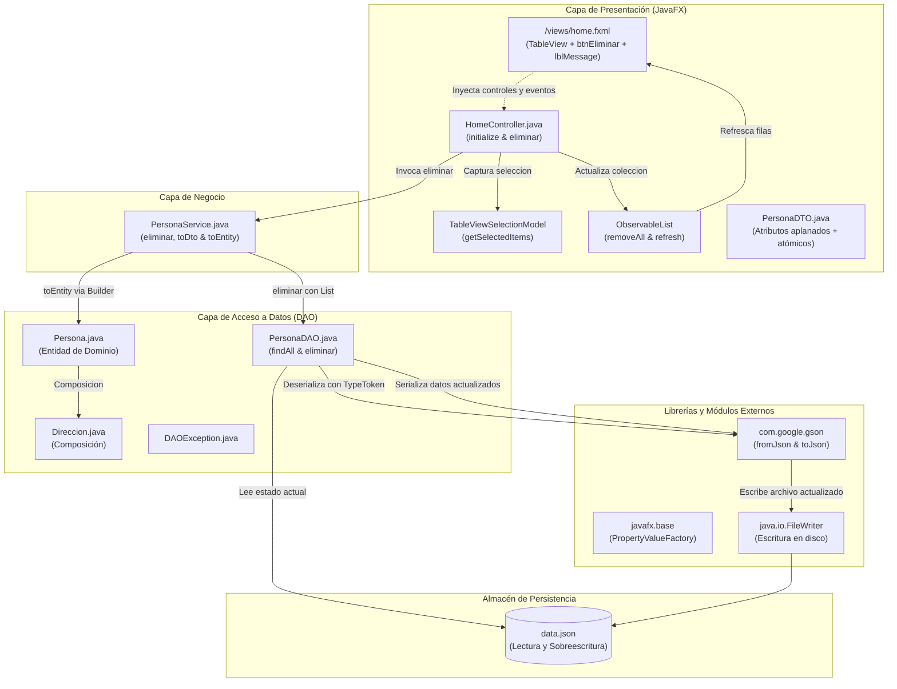
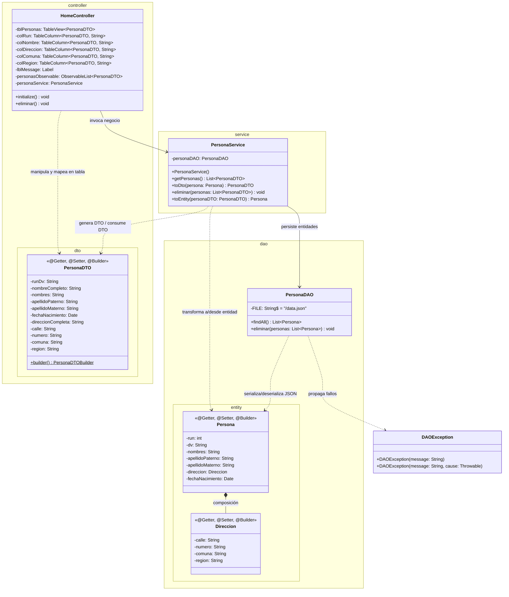
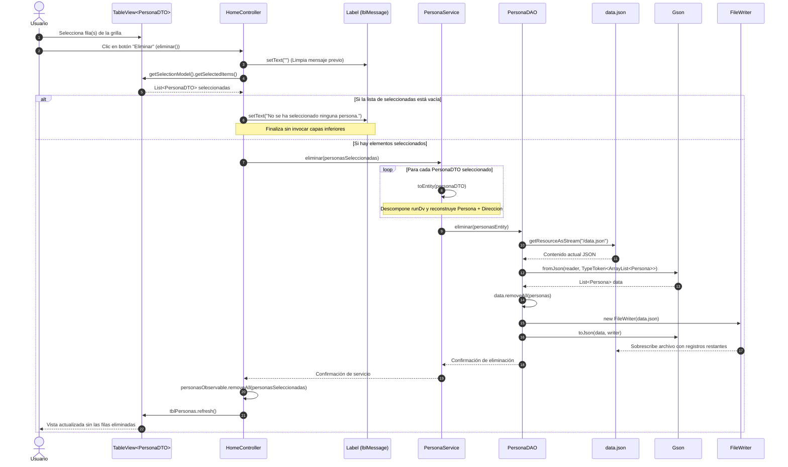
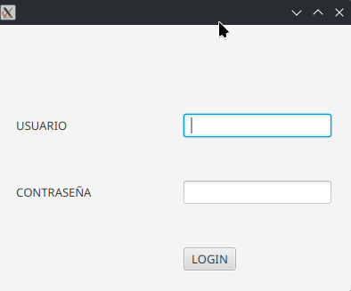
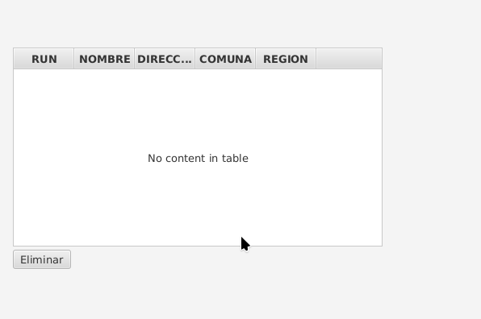

# Proyecto 08 - poo-javafx (TableView 3/3: Selección de Elementos, Eliminación en Memoria y Persistencia Bidireccional JSON)

Este proyecto corresponde al **octavo hito incremental** del curso y culmina la trilogía dedicada al componente tabular **`TableView`** en JavaFX. En este hito se completa el ciclo de interacción y manipulación de datos en la interfaz gráfica, implementando la funcionalidad de **eliminación de registros seleccionados**, la sincronización reactiva de la tabla en memoria mediante **`ObservableList`** y la **persistencia bidireccional** reescribiendo la fuente de datos en formato JSON (**Google Gson**).

Asimismo, este proyecto introduce el concepto de **mapeo bidireccional (*round-trip mapping*)**, donde el objeto de transferencia de datos (**`PersonaDTO`**) no solo transporta información aplanada hacia la vista (*flattening*), sino que preserva los atributos atómicos necesarios para reconstruir fielmente la entidad de dominio original (**`Persona`** con su objeto compuesto **`Direccion`**) mediante el método inverso **`toEntity()`**.

---

## ¿Qué hace el proyecto?

A partir de la carga y visualización de datos consolidada en el Proyecto 07, este hito 08 incorpora interactividad completa sobre la tabla de personas:

1. La aplicación inicia en la pantalla de autenticación (`/views/login.fxml`).
2. Al ingresar credenciales válidas (`admin` / `qwerty`) y presionar **LOGIN**, la aplicación navega hacia la vista principal `/views/home.fxml` mediante `App.setRoot(...)`.
3. Al inicializarse la vista, el método `initialize()` de `HomeController` configura las columnas mediante `PropertyValueFactory` (incorporando la corrección al atributo `direccionCompleta`) y puebla la tabla con los registros leídos desde `data.json`.
4. El usuario puede interactuar con la tabla seleccionando una fila (o conjunto de filas).
5. Debajo del `TableView` se dispone el botón **"Eliminar"** (`btnEliminar`), vinculado al método controlador `eliminar()`.
6. Al presionar **Eliminar**:
   - `HomeController` consulta el modelo de selección de la tabla: `tblPersonas.getSelectionModel().getSelectedItems()`.
   - **Validación defensiva:** Si el usuario no seleccionó ningún elemento, se emite una advertencia en consola y se despliega un mensaje informativo en la interfaz gráfica a través del componente `Label` (`lblMessage.setText("No se ha seleccionado ninguna persona.")`).
   - Si existen elementos seleccionados:
     1. Se invoca a `PersonaService.eliminar(personasSeleccionadas)`.
     2. `PersonaService` ejecuta el mapeo inverso `toEntity(personaDTO)` para cada elemento, descomponiendo el RUN compuesto y reconstruyendo las entidades `Persona` y `Direccion` mediante el patrón Builder.
     3. `PersonaDAO.eliminar(personasEntity)` carga el contenido actual de `data.json`, remueve los elementos coincidentes mediante `data.removeAll(personas)` y reescribe físicamente el archivo en disco utilizando `FileWriter` y `Gson.toJson(data, writer)`.
     4. `HomeController` actualiza la colección reactiva en memoria ejecutando `personasObservable.removeAll(personasSeleccionadas)`.
     5. Se invoca `tblPersonas.refresh()`, actualizando de inmediato la grilla visual sin necesidad de recargar la escena. Si se eliminan todos los registros, el `TableView` despliega su estado por defecto *"No content in table"*.

---

## Diferencias Clave: Proyecto 08 vs. Proyecto 07

| Componente / Aspecto | Proyecto 07 | Proyecto 08 (Manipulación y Persistencia Bidireccional) | Justificación Pedagógica y Técnica |
| :--- | :--- | :--- | :--- |
| **Interactividad en `TableView`** | Componente de solo lectura (*read-only*). | Selección activa de filas mediante `getSelectionModel().getSelectedItems()`. | Permite al usuario designar qué registros específicos del modelo visual desea operar. |
| **Acción de Eliminación en UI** | Botón genérico sin identificador ni acción (`<Button text="Button"/>`). | Botón configurado `<Button fx:id="btnEliminar" onAction="#eliminar" text="Eliminar"/>`. | Conecta el evento de acción de la interfaz (`onAction`) con la lógica del controlador JavaFX. |
| **Retroalimentación al Usuario** | Sin componentes de mensajes de validación en la vista `Home`. | Se incorpora `<Label fx:id="lblMessage"/>` en la vista y en el controlador. | Mejora la experiencia de usuario (UX) comunicando estados de validación ("No se ha seleccionado ninguna persona"). |
| **Corrección de Mapeo en Columna** | `colDireccion` enlazaba a `"direccionCompleto"`. | `colDireccion` enlaza a `"direccionCompleta"`. | Corrige la concordancia gramatical y sincroniza el nombre de la propiedad con el getter `getDireccionCompleta()` de `PersonaDTO`. |
| **Estructura de `PersonaDTO`** | Solo atributos aplanados (`runDv`, `nombreCompleto`, `direccionCompleto`, `comuna`, `region`). | Añade atributos atómicos: `nombres`, `apellidoPaterno`, `apellidoMaterno`, `calle`, `numero`, y renombra a `direccionCompleta`. | **Mapeo Bidireccional:** El DTO debe contener los datos elementales para poder reconstruir la entidad de dominio al persistir cambios. |
| **Capa de Negocio (`PersonaService`)** | Solo lectura (`getPersonas()` y `toDto()`). | Añade `eliminar(List<PersonaDTO>)` y el método inverso de desaplanamiento **`toEntity(PersonaDTO)`**. | Separa la lógica de transformación y coordina la eliminación antes de llegar a la capa de persistencia. |
| **Capa de Acceso a Datos (`PersonaDAO`)** | Solo lectura (`findAll()`). | Añade `eliminar(List<Persona>)` con lectura, remoción (`removeAll`) y reescritura en disco con `FileWriter` y `Gson.toJson()`. | Demuestra cómo persistir mutaciones de estado sobre archivos planos JSON empaquetados en recursos. |
| **Sincronización Reactiva** | Solo asignación inicial de `personasObservable`. | Remoción en memoria `personasObservable.removeAll(...)` y refresco explícito `tblPersonas.refresh()`. | Mantiene coherente la memoria de la interfaz gráfica con el archivo de persistencia física en tiempo real. |

---

## Diagrama de Componentes



---

## Diagrama de Clases



---

## Diagrama de Secuencia: Flujo de Eliminación y Persistencia

El siguiente diagrama detalla la interacción paso a paso al momento de eliminar registros seleccionados:



---

## Paso a Paso para la Construcción Incremental (desde Proyecto 07)

Sigue estos pasos para integrar la funcionalidad de eliminación y sincronización bidireccional sobre la base del Proyecto 07:

### Paso 1: Extender `PersonaDTO.java` para admitir mapeo inverso
Edita `src/main/java/cl/elprofecarreno/app/controller/dto/PersonaDTO.java`. Agrega los atributos atómicos individuales y corrige la propiedad `direccionCompleta`:

```java
package cl.elprofecarreno.app.controller.dto;

import java.util.Date;
import lombok.AllArgsConstructor;
import lombok.Builder;
import lombok.NoArgsConstructor;
import lombok.Setter;
import lombok.Getter;       

@Getter
@Setter
@Builder
@AllArgsConstructor
@NoArgsConstructor
public class PersonaDTO {
    
    private String runDv;
    private String nombreCompleto;
    private String nombres;
    private String apellidoPaterno;
    private String apellidoMaterno;
    private Date fechaNacimiento;
    private String direccionCompleta;
    private String calle;
    private String numero;
    private String comuna;
    private String region;

}
```

> [!NOTE]
> Conservar los campos `nombres`, `apellidoPaterno`, `apellidoMaterno`, `calle` y `numero` dentro del DTO permite ejecutar una reconstrucción fidedigna de las entidades `Persona` y `Direccion` sin perder atomicidad al transformar de regreso al dominio.

### Paso 2: Actualizar la vista `home.fxml` con botón y etiqueta
Modifica `src/main/resources/views/home.fxml` para reemplazar el botón genérico por `btnEliminar` con su acción `onAction="#eliminar"` e incorporar `lblMessage`:

```xml
<?xml version="1.0" encoding="UTF-8"?>

<?import javafx.scene.control.Button?>
<?import javafx.scene.control.Label?>
<?import javafx.scene.control.TableColumn?>
<?import javafx.scene.control.TableView?>
<?import javafx.scene.layout.ColumnConstraints?>
<?import javafx.scene.layout.GridPane?>
<?import javafx.scene.layout.RowConstraints?>
<?import javafx.scene.layout.VBox?>

<VBox maxHeight="-Infinity" maxWidth="-Infinity" minHeight="-Infinity" minWidth="-Infinity" 
      prefHeight="400.0" prefWidth="600.0" 
      xmlns="http://javafx.com/javafx/21" xmlns:fx="http://javafx.com/fxml/1" 
      fx:controller="cl.elprofecarreno.app.controller.HomeController">
   <children>
      <GridPane prefHeight="460.0" prefWidth="600.0">
        <columnConstraints>
          <ColumnConstraints hgrow="SOMETIMES" maxWidth="98.0" minWidth="10.0" prefWidth="13.0" />
            <ColumnConstraints hgrow="SOMETIMES" maxWidth="458.0" minWidth="10.0" prefWidth="458.0" />
            <ColumnConstraints hgrow="SOMETIMES" maxWidth="162.0" minWidth="0.0" prefWidth="26.0" />
            <ColumnConstraints hgrow="SOMETIMES" maxWidth="196.0" minWidth="10.0" prefWidth="60.0" />
          <ColumnConstraints hgrow="SOMETIMES" maxWidth="105.0" minWidth="10.0" prefWidth="28.0" />
        </columnConstraints>
        <rowConstraints>
          <RowConstraints minHeight="10.0" prefHeight="30.0" vgrow="SOMETIMES" />
          <RowConstraints maxHeight="247.0" minHeight="10.0" prefHeight="247.0" vgrow="SOMETIMES" />
          <RowConstraints maxHeight="94.0" minHeight="0.0" prefHeight="0.0" vgrow="SOMETIMES" />
            <RowConstraints minHeight="10.0" prefHeight="30.0" vgrow="SOMETIMES" />
        </rowConstraints>
         <children>
            <TableView fx:id="tblPersonas" prefHeight="200.0" prefWidth="200.0" GridPane.columnIndex="1" GridPane.rowIndex="1">
              <columns>
                <TableColumn fx:id="colRun" prefWidth="75.0" text="RUN" />
                <TableColumn fx:id="colNombre" prefWidth="75.0" text="NOMBRE" />
                  <TableColumn fx:id="colDireccion" prefWidth="75.0" text="DIRECCION" />
                  <TableColumn fx:id="colComuna" prefWidth="75.0" text="COMUNA" />
                  <TableColumn fx:id="colRegion" prefWidth="75.0" text="REGION" />
              </columns>
            </TableView>
            <Button fx:id="btnEliminar" mnemonicParsing="false" onAction="#eliminar" text="Eliminar" GridPane.columnIndex="1" GridPane.rowIndex="2" />
            <Label fx:id="lblMessage" disable="true" prefHeight="16.0" prefWidth="449.0" GridPane.columnIndex="1" GridPane.rowIndex="3" />
         </children>
      </GridPane>
   </children>
</VBox>
```

### Paso 3: Implementar la persistencia de eliminación en `PersonaDAO.java`
Edita `src/main/java/cl/elprofecarreno/app/dao/PersonaDAO.java` e incorpora el método `eliminar(List<Persona> personas)`:

```java
package cl.elprofecarreno.app.dao;

import cl.elprofecarreno.app.dao.entity.Persona;
import com.google.gson.Gson;
import com.google.gson.GsonBuilder;

import java.io.InputStreamReader;
import java.io.Reader;
import java.util.List;
import cl.elprofecarreno.app.dao.excepcion.DAOException;
import com.google.gson.reflect.TypeToken;
import java.lang.reflect.Type;
import java.util.ArrayList;

public class PersonaDAO {
    
    private static final String FILE = "/data.json";

    public List<Persona> findAll() throws DAOException {
        Gson gson = new GsonBuilder().setDateFormat("yyyy-MM-dd").create();
        try(Reader reader = new InputStreamReader(getClass().getResourceAsStream(FILE))){
            Type listType = new TypeToken<ArrayList<Persona>>(){}.getType();
            return gson.fromJson(reader, listType);
        }catch(Exception e){
            throw new DAOException("ERROR al leer data.json", e);
        }
    }

    public void eliminar(List<Persona> personas) throws DAOException {
        Gson gson = new GsonBuilder().setDateFormat("yyyy-MM-dd").create();
        // Linea para leer archivo de texto plano en formato .json
        try(Reader reader = new InputStreamReader(getClass().getResourceAsStream(FILE))){
            // Creando estructura de tipo Lista de Persona
            Type listType = new TypeToken<ArrayList<Persona>>(){}.getType();
            // Transformando el contenido JSON (texto) en una estructura de tipo Lista de Persona
            List<Persona> data = gson.fromJson(reader, listType);
            // Eliminar de la lista obtenida del archivo json (data.json) los elementos seleccionados
            data.removeAll(personas);
            // Reescribir archivo con la información actual del listado data
            try (java.io.Writer writer = new java.io.FileWriter(getClass().getResource(FILE).getFile())) {
                gson.toJson(data, writer);
            }
        }catch(Exception e){
            throw new DAOException("ERROR al leer data.json", e);
        }
    }
}
```

### Paso 4: Implementar desaplanamiento y eliminación en `PersonaService.java`
Edita `src/main/java/cl/elprofecarreno/app/service/PersonaService.java` para agregar `eliminar()`, `toEntity()` y actualizar `toDto()`:

```java
package cl.elprofecarreno.app.service;

import cl.elprofecarreno.app.dao.PersonaDAO;
import cl.elprofecarreno.app.dao.excepcion.DAOException;
import cl.elprofecarreno.app.controller.dto.PersonaDTO;
import java.util.List;
import java.util.ArrayList;

import cl.elprofecarreno.app.dao.entity.Direccion;
import cl.elprofecarreno.app.dao.entity.Persona;

public class PersonaService {

    private PersonaDAO personaDAO;

    public PersonaService() {
        this.personaDAO = new PersonaDAO();
    }

    public List<PersonaDTO> getPersonas(){
        List<PersonaDTO> personas = new ArrayList<>();
        try{
            List<Persona> personasEntity = personaDAO.findAll();
            for(Persona persona : personasEntity){
                personas.add(toDto(persona));
            }
        }catch(DAOException e){
            e.printStackTrace();
        }
        return personas;
    }

    public PersonaDTO toDto(Persona persona){
        return PersonaDTO.builder()
                .runDv(persona.getRun() + "-" + persona.getDv())
                .nombreCompleto(persona.getNombres() + " " + persona.getApellidoPaterno() + " " + persona.getApellidoMaterno())
                .fechaNacimiento(persona.getFechaNacimiento())
                .comuna(persona.getDireccion().getComuna())
                .region(persona.getDireccion().getRegion())
                .nombres(persona.getNombres())
                .apellidoPaterno(persona.getApellidoPaterno())
                .apellidoMaterno(persona.getApellidoMaterno())
                .calle(persona.getDireccion().getCalle())
                .numero(persona.getDireccion().getNumero())
                .direccionCompleta(persona.getDireccion().getCalle() + " " + persona.getDireccion().getNumero())
                .build();
    }

    public void eliminar(List<PersonaDTO> personas) throws DAOException{
        // Creando lista de Persona Entity
        List<Persona> personasEntity = new ArrayList<>();
        // Transformando cada PersonaDTO en Persona Entity
        for(PersonaDTO personaDTO : personas){
            // Agregando Persona Entity a la lista
            personasEntity.add(toEntity(personaDTO));
        }
        // Llamando al método eliminar del DAO
        personaDAO.eliminar(personasEntity);
    }

    public Persona toEntity(PersonaDTO personaDTO){
        // Encargado de transformar un PersonaDTO en Persona Entity
        String[] run = personaDTO.getRunDv().split("-");
        Persona persona = Persona.builder()
                .run(Integer.valueOf(run[0]))
                .dv(run[1])
                .nombres(personaDTO.getNombres())
                .apellidoPaterno(personaDTO.getApellidoPaterno())
                .apellidoMaterno(personaDTO.getApellidoMaterno())
                .fechaNacimiento(personaDTO.getFechaNacimiento())
                .direccion(
                    Direccion.builder()
                        .calle(personaDTO.getCalle())
                        .numero(personaDTO.getNumero())
                        .comuna(personaDTO.getComuna())
                        .region(personaDTO.getRegion())
                        .build()
                )
                .build();
        return persona;
    }
}
```

### Paso 5: Implementar la gestión de selección y refresco en `HomeController.java`
Edita `src/main/java/cl/elprofecarreno/app/controller/HomeController.java`:

```java
package cl.elprofecarreno.app.controller;

import javafx.fxml.FXML;
import javafx.scene.control.TableView;
import javafx.scene.control.cell.PropertyValueFactory;

import java.util.ArrayList;

import cl.elprofecarreno.app.controller.dto.PersonaDTO;
import cl.elprofecarreno.app.service.PersonaService;
import javafx.scene.control.Label;
import javafx.scene.control.TableColumn;
import javafx.collections.FXCollections;
import javafx.collections.ObservableList;   
import java.util.List;

public class HomeController {
    
    @FXML 
    private TableView<PersonaDTO> tblPersonas;

    @FXML
    private TableColumn<PersonaDTO, String> colRun;

    @FXML
    private TableColumn<PersonaDTO, String> colNombre;

    @FXML
    private TableColumn<PersonaDTO, String> colDireccion;

    @FXML
    private TableColumn<PersonaDTO, String> colComuna;

    @FXML
    private TableColumn<PersonaDTO, String> colRegion;

    private ObservableList<PersonaDTO> personasObservable;
    
    private PersonaService personaService;

    @FXML 
    private Label lblMessage;

    @FXML
    public void initialize(){
        // Inicializar el servicio de personas
        personaService = new PersonaService();
        // Inicializar la lista de personas observable
        List<PersonaDTO> personas = new ArrayList<>();

        // Configurar las columnas de la tabla con las propiedades de PersonaDTO (Mapeo columnas de la tabla)
        colRun.setCellValueFactory(new PropertyValueFactory<>("runDv"));
        colNombre.setCellValueFactory(new PropertyValueFactory<>("nombreCompleto"));
        colDireccion.setCellValueFactory(new PropertyValueFactory<>("direccionCompleta"));
        colComuna.setCellValueFactory(new PropertyValueFactory<>("comuna"));
        colRegion.setCellValueFactory(new PropertyValueFactory<>("region"));
        
        try{
            // Obtener la lista de personas desde el servicio
            personas = personaService.getPersonas();
        }catch(Exception e){
            // Mostrar mensaje de error en la consola
            System.err.println("Error al obtener las personas: " + e.getMessage());
        }
        // Crear la lista observable a partir de la lista de personas obtenida
        personasObservable = FXCollections.observableArrayList(personas);
        // Asignar la lista observable a la tabla de personas
        tblPersonas.setItems(personasObservable);
    }

    @FXML 
    public void eliminar(){
        lblMessage.setText("");
        // Obtener elementos seleccionados en la tabla
        List<PersonaDTO> personasSeleccionadas = tblPersonas.getSelectionModel().getSelectedItems();
        // Validando que se haya seleccionado elementos de la tabla para borrar 
        if(personasSeleccionadas.isEmpty()){
            System.err.println("No se ha seleccionado ninguna persona.");
            // Mostrar mensaje de error en la etiqueta
            lblMessage.setText("No se ha seleccionado ninguna persona.");
        }else {
            try{
                // Eliminar personas seleccionadas del servicio y actualizar la tabla (data.json)
                personaService.eliminar(personasSeleccionadas);
                // Eliminar personas seleccionadas de la tabla observable
                personasObservable.removeAll(personasSeleccionadas);
                // Refrescar la tabla para reflejar los cambios
                tblPersonas.refresh();
            }catch(Exception e){
                System.err.println("Error al eliminar las personas: " + e.getMessage());
                e.printStackTrace();
            }
        }
    }
}
```

---

## Estructura del Proyecto

```text
08/
├── 08.png
├── 08_02.png
├── README.md
└── poo-javafx/
    ├── pom.xml
    └── src/
        └── main/
            ├── java/
            │   ├── module-info.java
            │   └── cl/elprofecarreno/app/
            │       ├── App.java
            │       ├── controller/
            │       │   ├── HomeController.java
            │       │   ├── LoginController.java
            │       │   └── dto/
            │       │       ├── PersonaDTO.java
            │       │       └── UserDTO.java
            │       ├── dao/
            │       │   ├── PersonaDAO.java
            │       │   ├── UserDAO.java
            │       │   ├── entity/
            │       │   │   ├── Direccion.java
            │       │   │   ├── Persona.java
            │       │   │   └── User.java
            │       │   └── excepcion/
            │       │       └── DAOException.java
            │       └── service/
            │           ├── LoginService.java
            │           └── PersonaService.java
            └── resources/
                ├── authentication.json
                ├── data.json
                └── views/
                    ├── home.fxml
                    └── login.fxml
```

---

## Requisitos y Ejecución

### Requisitos
- **Java JDK**: 11 o superior (recomendado JDK 21).
- **Apache Maven**: 3.8+.
- **JavaFX**: 21.

### Ejecución
Desde la carpeta del proyecto:
```bash
cd 08/poo-javafx
mvn clean javafx:run
```

O desde la raíz del repositorio:
```bash
mvn -f 08/poo-javafx/pom.xml clean javafx:run
```

---

## Resultado esperado

### 1. Vista Inicial (Login)
Al ejecutar el proyecto se presenta el formulario de acceso:



### 2. Vista Final tras Autenticación y Eliminación de Registros
1. Se ingresan las credenciales `admin` / `qwerty` y se hace clic en **LOGIN**.
2. La aplicación transiciona a la vista `Home`, poblando la tabla con los registros iniciales.
3. Si el usuario pulsa **Eliminar** sin haber seleccionado ninguna fila, se despliega en la parte inferior el mensaje:
   ```text
   No se ha seleccionado ninguna persona.
   ```
4. Al seleccionar una o varias filas y presionar **Eliminar**:
   - Los registros se remueven de `data.json` físicamente.
   - La lista reactiva en memoria (`personasObservable`) se actualiza y la tabla se redibuja de inmediato.
   - Al eliminar todas las filas, la tabla muestra su estado vacío por defecto:



---

## Objetivos Pedagógicos y Buenas Prácticas

- **Manipulación Interactiva de Componentes Gráficos**: Utilizar `TableViewSelectionModel` (`tblPersonas.getSelectionModel().getSelectedItems()`) para capturar la selección del usuario.
- **Validación y Programación Defensiva en UI**: Verificar siempre la presencia de elementos seleccionados antes de delegar tareas destructivas a capas inferiores, ofreciendo retroalimentación visual amigable mediante componentes `Label`.
- **Mapeo Bidireccional (Round-Trip Mapping)**: Comprender la necesidad de que los DTOs preserven datos atómicos cuando se requiere reconstruir entidades del modelo de dominio (`toEntity`) para persistencia o actualización.
- **Patrón Builder en Transformaciones Inversas**: Aplicar el patrón creacional Builder tanto al aplanar entidades hacia DTOs (`toDto`) como al desaplanar DTOs hacia entidades compuestas (`toEntity`).
- **Persistencia en Archivos Planos JSON (Escritura)**: Gestionar la modificación física de archivos en el sistema local utilizando `java.io.FileWriter` y `Gson.toJson(...)`.
- **Sincronización Reactiva de la Interfaz**: Mantener sincronizado el estado visual de la tabla (`ObservableList` y `refresh()`) con la capa de persistencia subyacente sin necesidad de reiniciar la aplicación ni recargar la ventana.
