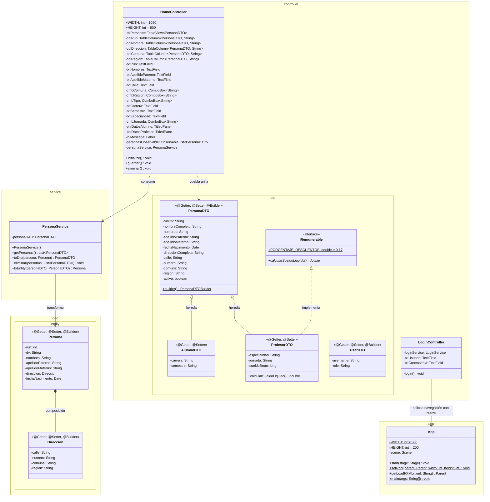
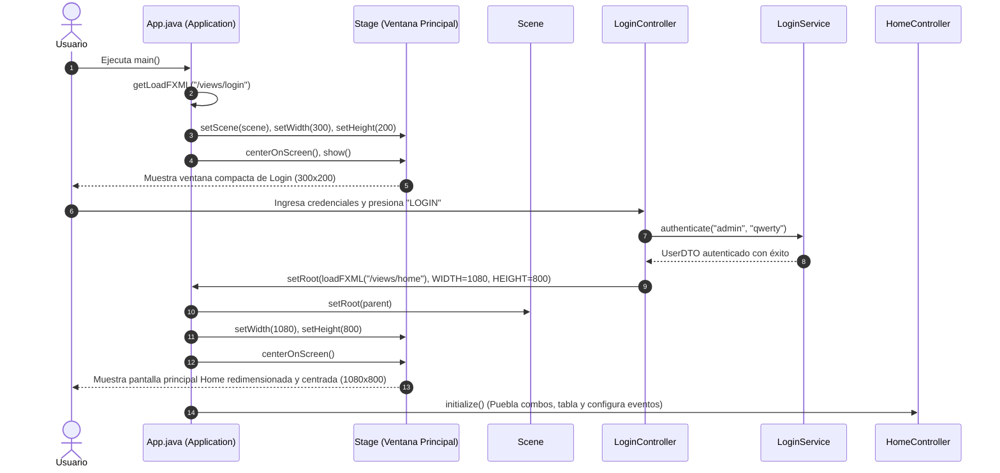
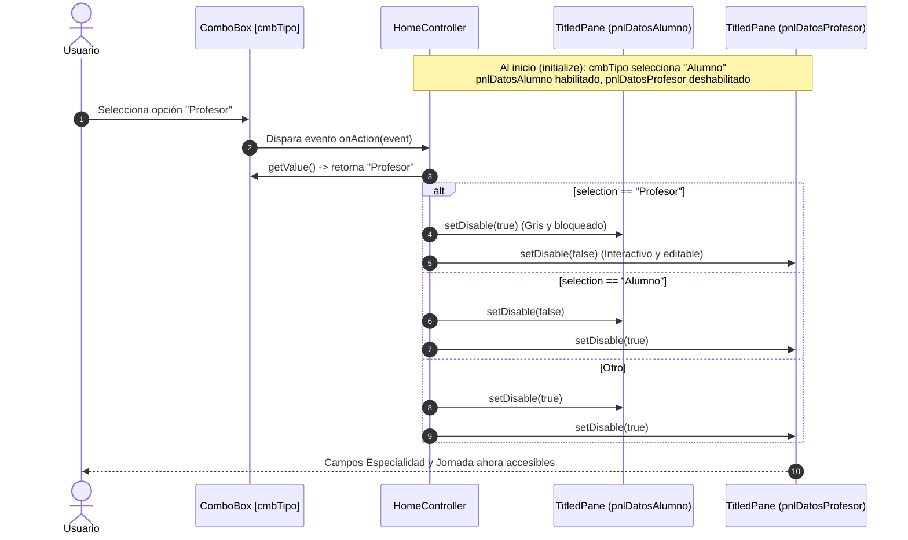
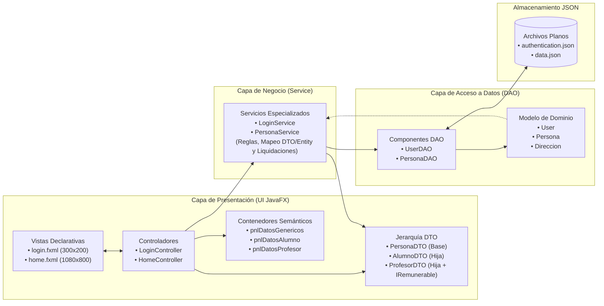

# Proyecto 09 - poo-javafx (TableView 4/4: Formulario Maestro, Herencia en DTOs, Interfaces y Controles Dinámicos JavaFX)

Este proyecto corresponde al **noveno hito incremental** del curso y completa la serie dedicada al componente tabular **`TableView`** y la gestión de interfaces gráficas empresariales con JavaFX. En este hito se evoluciona desde una vista centrada exclusivamente en la tabla y eliminación hacia un **espacio de trabajo maestro-detalle (*Master-Detail*)**, incorporando un **formulario integral de captura de datos** organizado con paneles semánticos colapsables (**`TitledPane`**), controles interactivos avanzados (**`ComboBox`**, **`CheckBox`**, **`TextField`**) y **comportamiento reactivo dinámico** en la interfaz.

En el ámbito de la **Programación Orientada a Objetos (POO)**, este proyecto introduce dos pilares fundamentales:
1. **Herencia de Clases**: Especialización del modelo de datos extendiendo la clase base **`PersonaDTO`** en dos subtipos concretos: **`AlumnoDTO`** (con atributos `carrera` y `semestre`) y **`ProfesorDTO`** (con atributos `especialidad`, `jornada` y `sueldoBruto`).
2. **Interfaces y Polimorfismo**: Definición del contrato **`IRemunerable`** con constantes fiscales y el método `calcularSueldoLiquido()`, implementado por `ProfesorDTO` para aplicar cálculos de compensación económica de forma desacoplada y polimórfica.

Asimismo, se perfecciona la **gestión del escenario y ventanas (*Windowing*) en JavaFX**, parametrizando el método `App.setRoot(...)` con dimensiones dinámicas (`width` y `height`) y recentrando automáticamente la ventana en la pantalla (`centerOnScreen()`) al transicionar desde la pantalla de autenticación pequeña (`300x200`) hacia el tablero maestro principal (`1080x800`).

---

## ¿Qué hace el proyecto?

A partir de la manipulación y eliminación bidireccional consolidada en el Proyecto 08, este hito 09 expande las capacidades del sistema hacia una aplicación de gestión completa:

1. **Autenticación Inicial Compacta**: La aplicación arranca en la pantalla de inicio de sesión (`/views/login.fxml`) con dimensiones compactas de `300x200` píxeles, perfectamente centrada en el monitor del usuario (`stage.centerOnScreen()`).
2. **Navegación Adaptativa y Redimensionamiento**: Al validar credenciales válidas (`admin` / `qwerty`) en `LoginController`, se invoca la nueva sobrecarga `App.setRoot(App.getLoadFXML("/views/home"), HomeController.WIDTH, HomeController.HEIGHT)`. La ventana se expande suavemente a `1080x800` píxeles y se vuelve a centrar en la pantalla antes de exhibir la vista principal.
3. **Distribución Maestro-Detalle con GridPane**: La vista `home.fxml` se divide en dos columnas principales:
   - **Columna Izquierda (Formulario Maestro):** Agrupa los campos de entrada mediante paneles temáticos `TitledPane`:
     - **Datos Genéricos (`pnlDatosGenericos`):** Entradas para RUN, Nombres, Apellidos, Dirección (Calle, Número), lista desplegable de Comuna (`cmbComuna`), lista desplegable de Región (`cmbRegion`), selector de Tipo de persona (`cmbTipo`) y estado de habilitación mediante casilla de verificación (`chkActivo`).
     - **Datos Alumno (`pnlDatosAlumno`):** Campos exclusivos para la formación académica del estudiante: Carrera (`txtCarrera`) y Semestre (`txtSemestre`).
     - **Datos Profesor (`pnlDatosProfesor`):** Campos exclusivos de la docencia: Especialidad (`txtEspecialidad`) y selector de Jornada (`cmbJornada`: Diurna o Vespertina).
     - **Acción Guardar:** Botón `btnGuardar` vinculado al método `guardar()`, preparado para capturar la información ingresada en el formulario.
   - **Columna Derecha (Grilla de Visualización y Gestión):** Contiene la tabla `TableView<PersonaDTO>` (`tblPersonas`) configurada con 5 columnas (`colRun`, `colNombre`, `colDireccion`, `colComuna`, `colRegion`), el botón de eliminación `btnEliminar` y la etiqueta de retroalimentación defensiva `lblMessage`.
4. **Comportamiento Dinámico y Reactivo según Tipo de Persona**:
   - Al cargar la vista en `initialize()`, los desplegables se inicializan con colecciones predefinidas y seleccionan su primer elemento por defecto (`selectFirst()`).
   - Por defecto, el tipo seleccionado es **"Alumno"**, dejando activo el panel `pnlDatosAlumno` y deshabilitado `pnlDatosProfesor` (`setDisable(true)`).
   - Mediante un escucha de eventos sobre el combo de tipo (`cmbTipo.setOnAction(...)`), la interfaz reacciona inmediatamente ante cambios del usuario:
     - Si selecciona **"Alumno"**: habilita `pnlDatosAlumno` y deshabilita `pnlDatosProfesor`.
     - Si selecciona **"Profesor"**: deshabilita `pnlDatosAlumno` y habilita `pnlDatosProfesor`.
     - Si selecciona cualquier otro valor: deshabilita ambos paneles especializados.
5. **Carga y Eliminación Reactiva**: Mantiene la lectura automática de registros desde `data.json` mediante `PersonaService` y la remoción sincronizada en memoria (`ObservableList`) y en almacenamiento físico con persistencia JSON.

---

## Diferencias Clave: Proyecto 09 vs. Proyecto 08

| Componente / Aspecto | Proyecto 08 (Manipulación y Persistencia) | Proyecto 09 (Formulario Maestro, Herencia e Interfaces) | Justificación Pedagógica y Técnica |
| :--- | :--- | :--- | :--- |
| **Jerarquía de Clases (POO Herencia)** | Modelo plano con una única clase DTO (`PersonaDTO`). | Introduce **Herencia**: `AlumnoDTO` y `ProfesorDTO` extienden de `PersonaDTO`. | Demuestra la reutilización de atributos comunes y la especialización de dominio mediante relaciones *"es un"* (*is-a*). |
| **Interfaces y Polimorfismo** | Sin interfaces de negocio en el paquete DTO. | Introduce la interfaz **`IRemunerable`** implementada por `ProfesorDTO`. | Modela comportamientos contractuales desacoplados (cálculo de liquidación con descuento previsional/tributario del 17%). |
| **Atributo de Estado en Dominio** | Atributos descriptivos de identificación y residencia. | Se agrega el atributo booleano `activo` en `PersonaDTO` y la casilla `chkActivo`. | Modela el ciclo de vida o estado lógico del registro dentro del sistema. |
| **Arquitectura de Interfaz Gráfica** | Ventana simple de 600x400 enfocada únicamente en la tabla y botón de borrado. | Tablero maestro-detalle de 1080x800 con división en 2 columnas principales. | Escala la aplicación hacia interfaces de gestión empresarial donde conviven la captura y la visualización. |
| **Contenedores Semánticos (`TitledPane`)** | Sin agrupación de paneles colapsables. | Se incorporan 3 paneles `TitledPane`: `pnlDatosGenericos`, `pnlDatosAlumno` y `pnlDatosProfesor`. | Organiza visualmente grandes cantidades de campos en categorías conceptualmente coherentes. |
| **Controles de Entrada Avanzados** | Solo entradas simples de texto en Login y botones de acción. | Incorpora **`ComboBox`** (Comuna, Región, Tipo, Jornada), **`CheckBox`** (Activo) y múltiples `TextField`. | Restringe valores a listas cerradas de opciones válidas, mejorando la integridad de datos y UX. |
| **Reactividad Dinámica en Formulario** | Sin conmutación condicional de componentes en UI. | Evento `cmbTipo.setOnAction` que conmuta `pnlDatosAlumno.setDisable(...)` y `pnlDatosProfesor.setDisable(...)`. | Demuestra cómo gobernar el estado de los controles de la interfaz según las selecciones del usuario en tiempo real. |
| **Gestión Adaptativa de Ventanas (`Stage`)** | `App.setRoot(parent)` con tamaño de ventana fijo heredado del arranque. | Sobrecarga `App.setRoot(parent, width, height)` con centrado automático `centerOnScreen()`. | Adapta el tamaño del escenario de forma dinámica y fluida según los requerimientos visuales de cada pantalla. |
| **Operación de Captura / Guardado** | Únicamente método `eliminar()` en el controlador. | Incorpora el método controlador `@FXML public void guardar()`. | Establece la base para el flujo de inserción de nuevos registros en el sistema. |

---

## Diagrama de Componentes

```mermaid
flowchart TB
    subgraph UI_Layer["Capa de Presentación (JavaFX)"]
        LoginFXML["/views/login.fxml\n(Ventana 300x200)"]
        LoginCtrl["LoginController.java\n(login & resize)"]
        HomeFXML["/views/home.fxml\n(Ventana 1080x800)"]
        HomeCtrl["HomeController.java\n(initialize, guardar, eliminar)"]
        
        subgraph Master_Form["Formulario Maestro"]
            PnlGen["TitledPane: pnlDatosGenericos\n(RUN, Nombres, Apellidos, Calle, ComboBoxes, CheckBox)"]
            PnlAlu["TitledPane: pnlDatosAlumno\n(Carrera, Semestre)"]
            PnlProf["TitledPane: pnlDatosProfesor\n(Especialidad, Jornada)"]
        end
        
        subgraph Detail_Table["Grilla y Acciones"]
            TblView["TableView<PersonaDTO>\n(colRun, colNombre, colDireccion, colComuna, colRegion)"]
            BtnDel["Button: btnEliminar"]
            BtnSave["Button: btnGuardar"]
            LblMsg["Label: lblMessage"]
        end
    end

    subgraph DTO_Model["Capa de Objetos de Transferencia (DTOs & POO)"]
        PersonaDTO["PersonaDTO.java\n(Clase Base: runDv, nombres, activo, etc.)"]
        AlumnoDTO["AlumnoDTO.java\n(extends PersonaDTO: carrera, semestre)"]
        ProfesorDTO["ProfesorDTO.java\n(extends PersonaDTO: especialidad, jornada, sueldoBruto)"]
        IRemun["<<interface>>\nIRemunerable\n(calcularSueldoLiquido)"]
        UserDTO["UserDTO.java"]
    end

    subgraph Service_Layer["Capa de Negocio"]
        LoginSvc["LoginService.java\n(authenticate)"]
        PersonaSvc["PersonaService.java\n(getPersonas, eliminar, toDto, toEntity)"]
    end

    subgraph DAO_Layer["Capa de Acceso a Datos (DAO)"]
        UserDAO["UserDAO.java\n(authenticate)"]
        PersonaDAO["PersonaDAO.java\n(findAll, eliminar)"]
        PersonaEntity["Persona.java\n(Entidad Dominio)"]
        DireccionEntity["Direccion.java\n(Composición)"]
        DAOEx["DAOException.java"]
    end

    subgraph Storage["Almacenamiento Físico"]
        AuthJSON[("authentication.json")]
        DataJSON[("data.json")]
    end

    LoginFXML -.->|Inyecta controles y acción| LoginCtrl
    LoginCtrl -->|Autentica| LoginSvc
    LoginSvc --> UserDAO
    UserDAO --> AuthJSON
    LoginCtrl -->|Transiciona con 1080x800| HomeFXML
    HomeFXML -.->|Vincula componentes| HomeCtrl

    HomeCtrl --> PnlGen
    HomeCtrl --> PnlAlu
    HomeCtrl --> PnlProf
    HomeCtrl --> TblView
    HomeCtrl --> BtnSave
    HomeCtrl --> BtnDel
    HomeCtrl --> LblMsg

    AlumnoDTO -->|Hereda de| PersonaDTO
    ProfesorDTO -->|Hereda de| PersonaDTO
    ProfesorDTO -.->|Implementa| IRemun

    HomeCtrl -->|Consulta y elimina DTOs| PersonaSvc
    PersonaSvc -->|Mapeo inverso / directo| PersonaEntity
    PersonaEntity -->|Composicion| DireccionEntity
    PersonaSvc --> PersonaDAO
    PersonaDAO --> DataJSON
    PersonaDAO ..> DAOEx
```

---

## Diagrama de Clases



---

## Diagramas de Secuencia y Flujo de Interacción

### 1. Autenticación, Transición y Redimensionamiento Dinámico de Ventana

Este diagrama ilustra cómo la aplicación arranca en modo compacto y ajusta su tamaño y centrado en la pantalla al navegar hacia el formulario principal:



### 2. Comportamiento Reactivo Dinámico del Formulario (Conmutación de Paneles)

Este diagrama muestra el flujo interactivo cuando el usuario conmuta entre los tipos de persona en el control `ComboBox`:



---

## Arquitectura por Capas y Flujo de Información



---

## Paso a Paso para la Construcción Incremental (desde Proyecto 08)

Sigue estos pasos detallados para construir las funcionalidades añadidas en el Proyecto 09 sobre la base del Proyecto 08:

### Paso 1: Definir la interfaz de negocio `IRemunerable.java`
Crea el archivo `src/main/java/cl/elprofecarreno/app/controller/dto/IRemunerable.java`. Define la constante para el descuento previsional e impuestos y el método contractual de cálculo:

```java
package cl.elprofecarreno.app.controller.dto;

public interface IRemunerable {
    
    double PORCENTAJE_DESCUENTOS = 0.17;
    double calcularSueldoLiquido();
}
```

> [!TIP]
> En Java, los atributos declarados dentro de una interfaz son implícitamente `public static final`, lo que permite centralizar constantes de cálculo de negocio compartidas sin recurrir a clases de utilidades estáticas redundantes.

### Paso 2: Actualizar `PersonaDTO.java` incorporando el atributo de estado `activo`
Edita `src/main/java/cl/elprofecarreno/app/controller/dto/PersonaDTO.java` y agrega el atributo booleano `activo`:

```java
package cl.elprofecarreno.app.controller.dto;
import java.util.Date;

import lombok.AllArgsConstructor;
import lombok.Builder;
import lombok.NoArgsConstructor;
import lombok.Setter;
import lombok.Getter;       

@Getter
@Setter
@Builder
@AllArgsConstructor
@NoArgsConstructor
public class PersonaDTO {
    
    private String runDv;
    private String nombreCompleto;
    private String nombres;
    private String apellidoPaterno;
    private String apellidoMaterno;
    private Date fechaNacimiento;
    private String direccionCompleta;
    private String calle;
    private String numero;
    private String comuna;
    private String region;
    private boolean activo;

}
```

### Paso 3: Crear el DTO especializado `AlumnoDTO.java` aplicando Herencia
Crea el archivo `src/main/java/cl/elprofecarreno/app/controller/dto/AlumnoDTO.java`. Esta clase extiende de `PersonaDTO` e incorpora los atributos académicos:

```java
package cl.elprofecarreno.app.controller.dto;

import lombok.AllArgsConstructor;
import lombok.Getter;
import lombok.NoArgsConstructor;
import lombok.Setter;

@Getter 
@Setter 
@AllArgsConstructor 
@NoArgsConstructor 
public class AlumnoDTO extends PersonaDTO {
    
    private String carrera;
    private String semestre;
}
```

### Paso 4: Crear el DTO especializado `ProfesorDTO.java` con Herencia e Implementación de Interfaz
Crea el archivo `src/main/java/cl/elprofecarreno/app/controller/dto/ProfesorDTO.java`. Hereda los atributos personales de `PersonaDTO`, implementa `IRemunerable` y sobreescribe `calcularSueldoLiquido()` aplicando el descuento:

```java
package cl.elprofecarreno.app.controller.dto;

import lombok.AllArgsConstructor;
import lombok.Getter;
import lombok.NoArgsConstructor;
import lombok.Setter;

@Getter 
@Setter 
@AllArgsConstructor 
@NoArgsConstructor 
public class ProfesorDTO extends PersonaDTO implements IRemunerable {
    
    private String especialidad;
    private String jornada;
    private long sueldoBruto;

    @Override
    public double calcularSueldoLiquido() {
        return this.sueldoBruto * (1 - PORCENTAJE_DESCUENTOS);
    }

}
```

### Paso 5: Modificar `App.java` para soportar redimensionamiento y centrado dinámico de ventanas
Edita `src/main/java/cl/elprofecarreno/app/App.java`. Define constantes de tamaño inicial y sobrecarga `setRoot` para ajustar el tamaño del `Window` y recentrarlo en pantalla:

```java
package cl.elprofecarreno.app;

import javafx.application.Application;
import javafx.fxml.FXMLLoader;
import javafx.scene.Parent;
import javafx.scene.Scene;
import javafx.stage.Stage;

import java.io.IOException;

public class App extends Application {

    private final static int WIDTH = 300;
    private final static int HEIGHT = 200;

    private static Scene scene;

    @Override
    public void start(Stage stage) throws IOException {
        scene = new Scene(getLoadFXML("/views/login"));
        stage.setScene(scene);
        stage.setWidth(WIDTH);
        stage.setHeight(HEIGHT);
        stage.centerOnScreen();
        stage.show();
    }

    public static void setRoot(Parent parent, int width, int height) throws IOException {
        scene.setRoot(parent);
        scene.getWindow().setWidth(width);
        scene.getWindow().setHeight(height);
        scene.getWindow().centerOnScreen();
    }

    public static Parent getLoadFXML(String fxml) throws IOException {
        FXMLLoader fxmlLoader = new FXMLLoader(App.class.getResource(fxml + ".fxml"));
        return fxmlLoader.load();
    }

    public static void main(String[] args) {
        launch();
    }

}
```

### Paso 6: Actualizar `LoginController.java` para transicionar enviando las dimensiones del Home
Edita `src/main/java/cl/elprofecarreno/app/controller/LoginController.java`. Al autenticar exitosamente, invoca la sobrecarga de `setRoot` pasando `HomeController.WIDTH` y `HomeController.HEIGHT`:

```java
package cl.elprofecarreno.app.controller;

import java.io.IOException;

import cl.elprofecarreno.app.App;
import cl.elprofecarreno.app.controller.dto.UserDTO;
import cl.elprofecarreno.app.service.LoginService;
import javafx.fxml.FXML;
import javafx.scene.control.TextField;

public class LoginController {

    private LoginService loginService;

    @FXML
    private TextField txtUsuario;

    @FXML
    private TextField txtContrasenia;

    @FXML
    private void login() throws IOException {
        loginService = new LoginService();
        try {
            UserDTO user = loginService.authenticate(txtUsuario.getText(), txtContrasenia.getText());
            System.out.println("LOGIN CORRECTO");
            System.out.println(user.getUsername());
            App.setRoot(App.getLoadFXML("/views/home"), HomeController.WIDTH, HomeController.HEIGHT);
        } catch (Exception e) {
            System.err.println(e.getMessage());
        }
    }
}
```

### Paso 7: Rediseñar `home.fxml` con el Formulario Maestro y Paneles `TitledPane`
Edita `src/main/resources/views/home.fxml` estructurando un `VBox` de `1080x800` con un `GridPane` que separa el panel de formularios del `TableView`:

```xml
<?xml version="1.0" encoding="UTF-8"?>

<?import javafx.scene.control.Button?>
<?import javafx.scene.control.CheckBox?>
<?import javafx.scene.control.ComboBox?>
<?import javafx.scene.control.Label?>
<?import javafx.scene.control.TableColumn?>
<?import javafx.scene.control.TableView?>
<?import javafx.scene.control.TextField?>
<?import javafx.scene.control.TitledPane?>
<?import javafx.scene.layout.AnchorPane?>
<?import javafx.scene.layout.ColumnConstraints?>
<?import javafx.scene.layout.GridPane?>
<?import javafx.scene.layout.Pane?>
<?import javafx.scene.layout.RowConstraints?>
<?import javafx.scene.layout.VBox?>

<VBox maxHeight="-Infinity" maxWidth="-Infinity" minHeight="-Infinity" minWidth="-Infinity" 
      prefHeight="800.0" prefWidth="1080.0" 
      xmlns="http://javafx.com/javafx/21" xmlns:fx="http://javafx.com/fxml/1" 
      fx:controller="cl.elprofecarreno.app.controller.HomeController">
   <children>
      <GridPane prefHeight="806.0" prefWidth="1051.0">
        <columnConstraints>
          <ColumnConstraints hgrow="SOMETIMES" maxWidth="303.0" minWidth="10.0" prefWidth="303.0" />
          <ColumnConstraints hgrow="SOMETIMES" maxWidth="938.0" minWidth="10.0" prefWidth="691.0" />
        </columnConstraints>
        <rowConstraints>
          <RowConstraints maxHeight="223.0" minHeight="0.0" prefHeight="0.0" vgrow="SOMETIMES" />
          <RowConstraints maxHeight="685.0" minHeight="10.0" prefHeight="516.0" vgrow="SOMETIMES" />
          <RowConstraints maxHeight="308.0" minHeight="0.0" prefHeight="216.0" vgrow="SOMETIMES" />
          <RowConstraints minHeight="10.0" prefHeight="30.0" vgrow="SOMETIMES" />
        </rowConstraints>
         <children>
            <!-- Tabla de Personas -->
            <TableView fx:id="tblPersonas" prefHeight="512.0" prefWidth="720.0" GridPane.columnIndex="1" GridPane.rowIndex="1">
              <columns>
                <TableColumn fx:id="colRun" prefWidth="75.0" text="RUN" />
                <TableColumn fx:id="colNombre" prefWidth="114.0" text="NOMBRE" />
                <TableColumn fx:id="colDireccion" prefWidth="115.0" text="DIRECCION" />
                <TableColumn fx:id="colComuna" prefWidth="160.0" text="COMUNA" />
                <TableColumn fx:id="colRegion" prefWidth="254.0" text="REGION" />
              </columns>
            </TableView>
            <Label fx:id="lblMessage" disable="true" prefHeight="16.0" prefWidth="449.0" GridPane.columnIndex="1" GridPane.rowIndex="3" />
            
            <!-- Paneles Izquierdos: Datos Genéricos y Datos Alumno -->
            <Pane prefHeight="200.0" prefWidth="200.0" GridPane.rowIndex="1">
               <children>
                  <TitledPane fx:id="pnlDatosGenericos" animated="false" prefHeight="366.0" prefWidth="293.0" text="Datos Genericos">
                    <content>
                      <AnchorPane minHeight="0.0" minWidth="0.0" prefHeight="328.0" prefWidth="291.0">
                           <children>
                              <Label fx:id="lblRun" layoutX="14.0" layoutY="22.0" text="RUN" />
                              <TextField fx:id="txtRun" layoutX="111.0" layoutY="18.0" />
                              <Label fx:id="lblNombres" layoutX="13.0" layoutY="53.0" text="NOMBRES" />
                              <TextField fx:id="txtNombres" layoutX="110.0" layoutY="49.0" />
                              <Label fx:id="lblApellidoPaterno" layoutX="13.0" layoutY="85.0" text="AP. PATERNO" />
                              <TextField fx:id="txtApellidoPaterno" layoutX="110.0" layoutY="81.0" />
                              <Label fx:id="lblApellidoMaterno" layoutX="13.0" layoutY="118.0" text="AP. MATERNO" />
                              <TextField fx:id="txtApellidoMaterno" layoutX="110.0" layoutY="114.0" />
                              <Label fx:id="lblCalle" layoutX="13.0" layoutY="152.0" text="CALLE" />
                              <TextField fx:id="txtCalle" layoutX="110.0" layoutY="148.0" />
                              <Label fx:id="lblNumeroCalle" layoutX="13.0" layoutY="185.0" text="Nº CALLE" />
                              <TextField fx:id="txtNumeroCalle" layoutX="110.0" layoutY="181.0" />
                              <Label fx:id="lblComuna" layoutX="12.0" layoutY="215.0" text="COMUNA" />
                              <ComboBox fx:id="cmbComuna" layoutX="110.0" layoutY="211.0" prefHeight="24.0" prefWidth="170.0" />
                              <Label fx:id="lblRegion" layoutX="12.0" layoutY="249.0" text="REGION" />
                              <ComboBox fx:id="cmbRegion" layoutX="110.0" layoutY="245.0" prefHeight="24.0" prefWidth="170.0" />
                              <CheckBox fx:id="chkActivo" layoutX="113.0" layoutY="309.0" mnemonicParsing="false" text="Activo" />
                              <Label fx:id="lblTipo" layoutX="12.0" layoutY="283.0" text="TIPO" />
                              <ComboBox fx:id="cmbTipo" layoutX="110.0" layoutY="279.0" prefHeight="24.0" prefWidth="170.0" />
                           </children>
                        </AnchorPane>
                    </content>
                  </TitledPane>
                  <TitledPane fx:id="pnlDatosAlumno" animated="false" disable="true" layoutY="369.0" prefHeight="122.0" prefWidth="293.0" text="Datos Alumno">
                    <content>
                      <AnchorPane minHeight="0.0" minWidth="0.0" prefHeight="91.0" prefWidth="291.0">
                           <children>
                              <Label fx:id="lblCarrera" layoutX="14.0" layoutY="23.0" text="CARRERA" />
                              <TextField fx:id="txtCarrera" layoutX="106.0" layoutY="19.0" />
                              <Label fx:id="lblSemestre" layoutX="14.0" layoutY="55.0" text="SEMESTRE" />
                              <TextField fx:id="txtSemestre" layoutX="106.0" layoutY="51.0" />
                           </children>
                      </AnchorPane>
                    </content>
                  </TitledPane>
               </children>
            </Pane>
            
            <!-- Botón Eliminar debajo de la tabla -->
            <Pane prefHeight="200.0" prefWidth="200.0" GridPane.columnIndex="1" GridPane.rowIndex="2">
               <children>
                  <Button fx:id="btnEliminar" layoutX="6.0" layoutY="14.0" mnemonicParsing="false" onAction="#eliminar" text="Eliminar" />
               </children>
            </Pane>

            <!-- Panel Datos Profesor y Botón Guardar -->
            <Pane prefHeight="200.0" prefWidth="200.0" GridPane.rowIndex="2">
               <children>
                  <TitledPane fx:id="pnlDatosProfesor" animated="false" disable="true" layoutX="7.0" layoutY="10.0" prefHeight="103.0" prefWidth="286.0" text="Datos Profesor">
                    <content>
                      <AnchorPane minHeight="0.0" minWidth="0.0" prefHeight="76.0" prefWidth="284.0">
                           <children>
                              <Label fx:id="lblEspecialidad" layoutX="6.0" layoutY="14.0" text="ESPECIALIDAD" />
                              <TextField fx:id="txtEspecialidad" layoutX="106.0" layoutY="10.0" />
                              <Label fx:id="lblJornada" layoutX="6.0" layoutY="42.0" text="JORNADA" />
                              <ComboBox fx:id="cmbJornada" layoutX="106.0" layoutY="38.0" prefHeight="24.0" prefWidth="172.0" />
                           </children>
                        </AnchorPane>
                    </content>
                  </TitledPane>
                  <Button fx:id="btnGuardar" layoutX="227.0" layoutY="124.0" mnemonicParsing="false" onAction="#guardar" text="Guardar" />
               </children>
            </Pane>
         </children>
      </GridPane>
   </children>
</VBox>
```

### Paso 8: Implementar la reactividad y poblamiento en `HomeController.java`
Edita `src/main/java/cl/elprofecarreno/app/controller/HomeController.java`. Incorpora la inyección de los nuevos componentes, la inicialización de listas en `ComboBox`, la acción reactiva de `cmbTipo` y el método `guardar()`:

```java
package cl.elprofecarreno.app.controller;

import javafx.fxml.FXML;
import javafx.scene.control.TableView;
import javafx.scene.control.TextField;
import javafx.scene.control.TitledPane;
import javafx.scene.control.cell.PropertyValueFactory;

import java.util.ArrayList;

import cl.elprofecarreno.app.controller.dto.PersonaDTO;
import cl.elprofecarreno.app.service.PersonaService;
import javafx.scene.control.ComboBox;
import javafx.scene.control.Label;
import javafx.scene.control.TableColumn;
import javafx.collections.FXCollections;
import javafx.collections.ObservableList;   
import java.util.List;

public class HomeController {

    public final static int WIDTH = 1080;
    public final static int HEIGHT = 800;

    @FXML 
    private TableView<PersonaDTO> tblPersonas;
    @FXML
    private TableColumn<PersonaDTO, String> colRun;
    @FXML
    private TableColumn<PersonaDTO, String> colNombre;
    @FXML
    private TableColumn<PersonaDTO, String> colDireccion;
    @FXML
    private TableColumn<PersonaDTO, String> colComuna;
    @FXML
    private TableColumn<PersonaDTO, String> colRegion;

    private ObservableList<PersonaDTO> personasObservable;
    private PersonaService personaService;

    @FXML 
    private TextField txtRun;
    @FXML 
    private TextField txtNombres;
    @FXML 
    private TextField txtApellidoPaterno;
    @FXML 
    private TextField txtApellidoMaterno;
    @FXML 
    private TextField txtCalle;
    @FXML 
    private ComboBox<String> cmbComuna;
    @FXML 
    private ComboBox<String> cmbRegion;
    @FXML 
    private ComboBox<String> cmbTipo;
    @FXML 
    private TextField txtCarrera;
    @FXML 
    private TextField txtSemestre;
    @FXML 
    private TextField txtEspecialidad;
    @FXML 
    private ComboBox<String> cmbJornada;
    @FXML
    private TitledPane pnlDatosAlumno;
    @FXML
    private TitledPane pnlDatosProfesor;
    @FXML 
    private Label lblMessage;

    @FXML
    public void initialize(){
        personaService = new PersonaService();
        List<PersonaDTO> personas = new ArrayList<>();

        // Configuración de columnas del TableView
        colRun.setCellValueFactory(new PropertyValueFactory<>("runDv"));
        colNombre.setCellValueFactory(new PropertyValueFactory<>("nombreCompleto"));
        colDireccion.setCellValueFactory(new PropertyValueFactory<>("direccionCompleta"));
        colComuna.setCellValueFactory(new PropertyValueFactory<>("comuna"));
        colRegion.setCellValueFactory(new PropertyValueFactory<>("region"));
        
        try {
            personas = personaService.getPersonas();
        } catch(Exception e) {
            System.err.println("Error al obtener las personas: " + e.getMessage());
        }
        personasObservable = FXCollections.observableArrayList(personas);
        tblPersonas.setItems(personasObservable);

        // Población y selección por defecto de Comunas
        ObservableList<String> comunas = FXCollections.observableArrayList(
            "Maipú", "Cerrillos", "Pedro Aguirre Cerda", "Santiago", "Pudahuel", "Padre Hurtado"
        );
        cmbComuna.setItems(comunas);
        cmbComuna.getSelectionModel().selectFirst();

        // Población y selección por defecto de Jornadas
        ObservableList<String> jornadas = FXCollections.observableArrayList("Diurna", "Vespertina");
        cmbJornada.setItems(jornadas);
        cmbJornada.getSelectionModel().selectFirst();

        // Población y selección por defecto de Regiones
        ObservableList<String> regiones = FXCollections.observableArrayList(
            "Metropolitana", "Valparaíso", "Biobío", "Araucanía"
        );
        cmbRegion.setItems(regiones);
        cmbRegion.getSelectionModel().selectFirst();

        // Población y selección por defecto de Tipos
        ObservableList<String> tipos = FXCollections.observableArrayList("Alumno", "Profesor");
        cmbTipo.setItems(tipos);
        cmbTipo.getSelectionModel().selectFirst();
        
        // Estado inicial de paneles
        pnlDatosAlumno.setDisable(false);
        pnlDatosProfesor.setDisable(true);

        // Listener reactivo sobre el cambio de selección de tipo
        cmbTipo.setOnAction(event -> {
            String selection = cmbTipo.getValue();
            if ("Alumno".equals(selection)) {
                pnlDatosAlumno.setDisable(false);
                pnlDatosProfesor.setDisable(true);
            } else if ("Profesor".equals(selection)) {
                pnlDatosAlumno.setDisable(true);
                pnlDatosProfesor.setDisable(false);
            } else {
                pnlDatosAlumno.setDisable(true);
                pnlDatosProfesor.setDisable(true);
            }
        });
    }

    @FXML
    public void guardar(){
        System.out.println("RUN ingresado: " + txtRun.getText());
        System.out.println("Nombres ingresados: " + txtNombres.getText());
    }

    @FXML 
    public void eliminar(){
        lblMessage.setText("");
        List<PersonaDTO> personasSeleccionadas = tblPersonas.getSelectionModel().getSelectedItems();
        if (personasSeleccionadas.isEmpty()){
            System.err.println("No se ha seleccionado ninguna persona.");
            lblMessage.setText("No se ha seleccionado ninguna persona.");
        } else {
            try {
                personaService.eliminar(personasSeleccionadas);
                personasObservable.removeAll(personasSeleccionadas);
                tblPersonas.refresh();
            } catch(Exception e) {
                System.err.println("Error al eliminar las personas: " + e.getMessage());
                e.printStackTrace();
            }
        }
    }
}
```

---

## Estructura del Proyecto

```text
09/
├── 09.png                                                 # Captura de pantalla: Vista Login inicial (300x200)
├── 09_02.png                                              # Captura de pantalla: Vista Home Maestro-Detalle (1080x800)
├── README.md                                              # Documentación exhaustiva del Proyecto 09
└── poo-javafx/
    ├── pom.xml                                            # POM Maven con JavaFX 21, Gson 2.14.0 y Lombok 1.18.36
    └── src/
        └── main/
            ├── java/
            │   ├── module-info.java                       # Configuración JPMS (opens a javafx.base, fxml y gson)
            │   └── cl/
            │       └── elprofecarreno/
            │           └── app/
            │               ├── App.java                   # Punto de entrada con setRoot dinámico y centrado
            │               ├── controller/
            │               │   ├── HomeController.java    # Controlador maestro con interacción reactiva
            │               │   ├── LoginController.java   # Controlador de autenticación y navegación con resize
            │               │   └── dto/
            │               │       ├── AlumnoDTO.java     # Subtipo especializado (extends PersonaDTO)
            │               │       ├── IRemunerable.java  # Interfaz contractual para liquidaciones
            │               │       ├── PersonaDTO.java    # Clase DTO base enriquecida con 'activo'
            │               │       ├── ProfesorDTO.java   # Subtipo especializado (extends PersonaDTO implements IRemunerable)
            │               │       └── UserDTO.java       # DTO para credenciales de usuario
            │               ├── dao/
            │               │   ├── PersonaDAO.java        # Acceso a datos con lectura y borrado JSON
            │               │   ├── UserDAO.java           # Acceso a datos de autenticación
            │               │   ├── entity/
            │               │   │   ├── Direccion.java     # Entidad compuesta de dirección
            │               │   │   ├── Persona.java       # Entidad de dominio Persona
            │               │   │   └── User.java          # Entidad de credenciales de usuario
            │               │   └── excepcion/
            │               │       └── DAOException.java  # Excepción técnica comprobada
            │               └── service/
            │                   ├── LoginService.java      # Servicio de autenticación
            │                   └── PersonaService.java    # Servicio de negocio, mapeos y eliminación
            └── resources/
                ├── authentication.json                    # Almacén de usuarios y claves
                ├── data.json                              # Almacén de personas y direcciones anidadas
                └── views/
                    ├── home.fxml                          # Vista maestro-detalle con TitledPane y TableView
                    └── login.fxml                         # Vista compacta de autenticación
```

---

## Requisitos y Ejecución

### Requisitos Previos
- **Java JDK**: 11 o superior (recomendado JDK 21).
- **Apache Maven**: 3.8 o superior.
- **IDE**: Visual Studio Code, IntelliJ IDEA, Eclipse o NetBeans con soporte de Lombok habilitado.

### Ejecución del Proyecto

Desde el directorio del proyecto:
```bash
cd 09/poo-javafx
mvn clean javafx:run
```

O directamente desde la raíz del repositorio:
```bash
mvn -f 09/poo-javafx/pom.xml clean javafx:run
```

---

## Resultado esperado

### 1. Vista Inicial de Autenticación (Login)
Al ejecutar la aplicación se despliega una ventana compacta de `300x200` píxeles, centrada automáticamente en la pantalla del usuario:


### 2. Vista Principal de Trabajo (Home: Maestro-Detalle)
Tras ingresar las credenciales válidas (`admin` / `qwerty`) y pulsar **LOGIN**:
1. La ventana se expande armónicamente a `1080x800` píxeles y se vuelve a centrar en la pantalla.
2. Se despliega el formulario maestro a la izquierda con los paneles `TitledPane`:
   - El desplegable **TIPO** inicia con **"Alumno"** seleccionado, habilitando `pnlDatosAlumno` y deshabilitando `pnlDatosProfesor`.
   - Si el usuario cambia **TIPO** a **"Profesor"**, la interfaz conmuta al instante habilitando el panel docente y bloqueando el de alumno.
3. A la derecha, el `TableView` carga y exhibe los registros almacenados en `data.json`.
4. El botón **Eliminar** permite remover las filas seleccionadas manteniendo la sincronización en memoria y en disco, mientras que el botón **Guardar** permite capturar los datos del nuevo formulario:


---

## Objetivos Pedagógicos y Buenas Prácticas

- **Herencia de Clases en Modelos de Transferencia**: Comprender el principio de especialización en POO (*is-a*), permitiendo que `AlumnoDTO` y `ProfesorDTO` reutilicen todos los atributos y métodos de `PersonaDTO` sin duplicación de código.
- **Diseño Contractual con Interfaces**: Implementar `IRemunerable` para modelar capacidades transversales de cálculo de liquidación (`calcularSueldoLiquido()`) garantizando polimorfismo y desacoplamiento.
- **Encapsulamiento y Constantes de Negocio**: Aprovechar constantes en interfaces (`double PORCENTAJE_DESCUENTOS = 0.17`) para evitar la dispersión de valores mágicos (*magic numbers*) en la lógica de negocio.
- **Diseño de Interfaces Complejas con Scene Builder**: Estructurar layouts avanzados con `GridPane`, dividiendo armónicamente formularios de entrada y componentes tabulares de presentación.
- **Agrupación Semántica mediante `TitledPane`**: Facilitar la usabilidad (UX) categorizando los campos en paneles conceptuales colapsables.
- **Restricción de Entrada mediante `ComboBox` y `CheckBox`**: Limitar errores de usuario canalizando opciones hacia catálogos cerrados (comunas, regiones, jornadas y tipos) y valores booleanos claros.
- **Reactividad de Interfaz Basada en Eventos**: Implementar escuchas de acción (`setOnAction`) sobre controles de selección para gobernar el estado de habilitación/deshabilitación (`setDisable(boolean)`) de secciones completas del formulario.
- **Gestión Responsiva y Dinámica de Ventanas**: Desacoplar el tamaño del escenario mediante métodos flexibles como `App.setRoot(parent, width, height)` acompañados de recentrado inteligente en monitor (`centerOnScreen()`).
