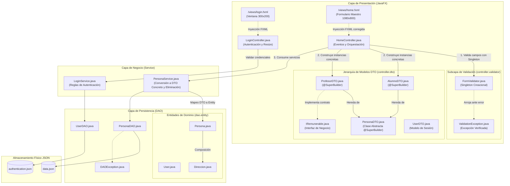
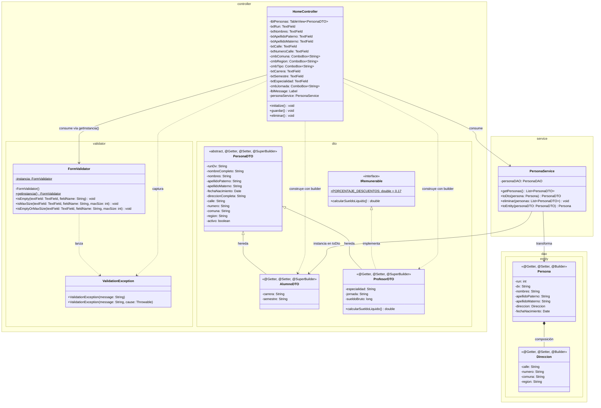
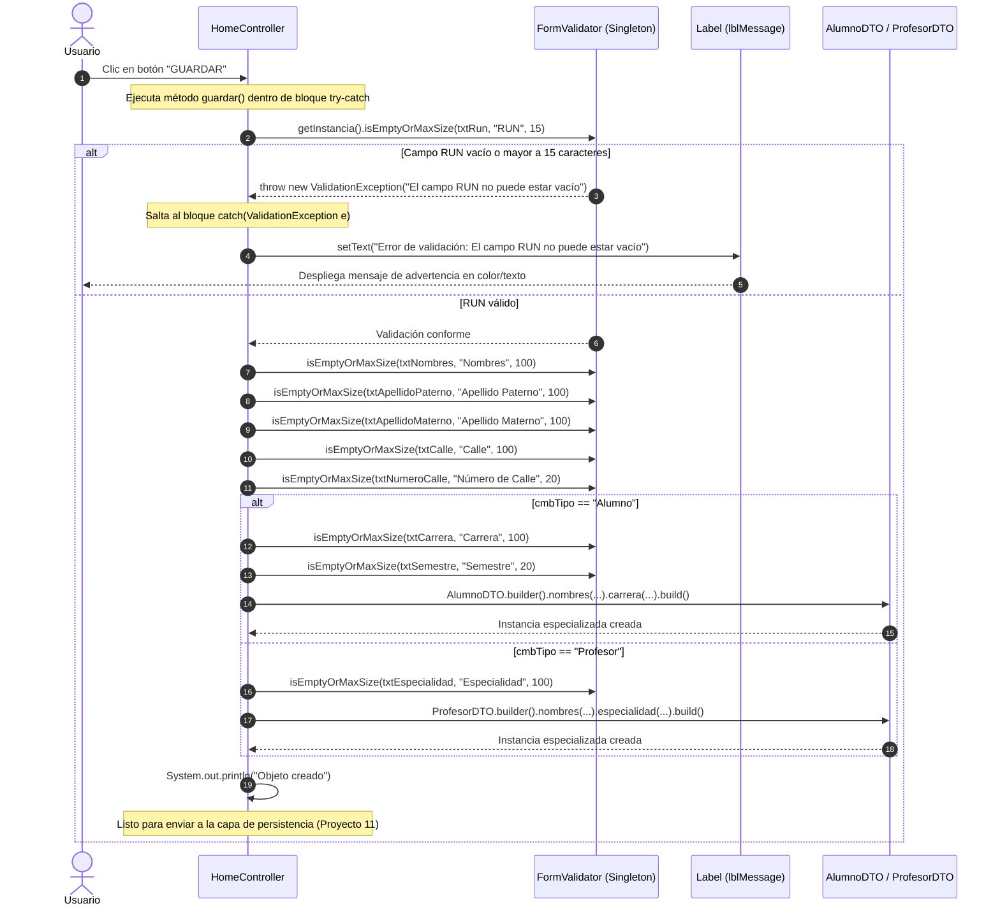
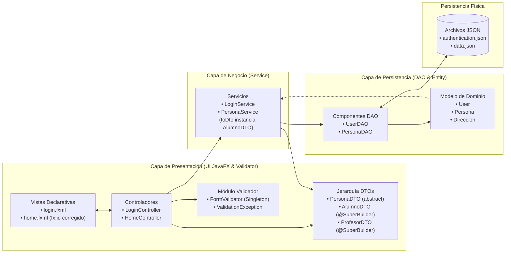

# Proyecto 10 - poo-javafx (Validación Centralizada, Patrón Singleton, Jerarquía Abstracta con @SuperBuilder y Manejo de Excepciones)

## Índice
1. [¿Qué hace el proyecto?](#qué-hace-el-proyecto)
2. [Diferencias Clave: Proyecto 10 vs. Proyecto 09](#diferencias-clave-proyecto-10-vs-proyecto-09)
3. [Diagrama de Componentes](#diagrama-de-componentes)
4. [Diagrama de Clases](#diagrama-de-clases)
5. [Diagramas de Secuencia y Flujo de Interacción](#diagramas-de-secuencia-y-flujo-de-interacción)
   - [1. Flujo de Validación e Instanciación en Guardar (Happy Path vs. Error)](#1-flujo-de-validación-e-instanciación-en-guardar-happy-path-vs-error)
6. [Arquitectura por Capas y Flujo de Información](#arquitectura-por-capas-y-flujo-de-información)
7. [Paso a Paso para la Construcción Incremental (desde Proyecto 09)](#paso-a-paso-para-la-construcción-incremental-desde-proyecto-09)
8. [Estructura del Proyecto](#estructura-del-proyecto)
9. [Requisitos y Ejecución](#requisitos-y-ejecución)
10. [Resultado esperado y Capturas de Pantalla](#resultado-esperado-y-capturas-de-pantalla)
11. [Objetivos Pedagógicos y Buenas Prácticas](#objetivos-pedagógicos-y-buenas-prácticas)

---

## ¿Qué hace el proyecto?

El **Proyecto 10** introduce una **capa de validación formal y desacoplada** para la interfaz gráfica, implementando el **Patrón de Diseño Creacional Singleton**, el uso de **excepciones personalizadas verificadas** (`ValidationException`), y una importante refactorización orientada a objetos en los Data Transfer Objects (DTO): la conversión de `PersonaDTO` en una **clase abstracta** apoyada por el generador jerárquico `@SuperBuilder` de Lombok.

En las versiones anteriores, los datos ingresados en el formulario de la vista `home.fxml` no contaban con validaciones de longitud ni de presencia obligatoria antes de ser procesados, y la clase base `PersonaDTO` permitía instanciarse de forma genérica. Con este proyecto se alcanzan los siguientes hitos:

1. **Patrón Singleton para Validación (`FormValidator`)**: Se crea un servicio centralizado de validación con constructor privado y método de acceso global estático (`getInstancia()`), garantizando la existencia de una única instancia en memoria para toda la aplicación.
2. **Validaciones de Reglas de Negocio en UI**: Provee métodos reutilizables para verificar que los campos de texto no estén vacíos (`isEmpty`), no superen longitudes máximas permitidas (`isMaxSize`) y la composición combinada de ambas comprobaciones (`isEmptyOrMaxSize`).
3. **Manejo Estructurado de Excepciones (`ValidationException`)**: Cuando una entrada incumple las reglas requeridas, el validador interrumpe el flujo arrojando una excepción verificada de dominio que es capturada por el controlador (`HomeController`), informando de inmediato al usuario a través del componente visual `lblMessage`.
4. **Jerarquía Abstracta en DTOs y Lombok `@SuperBuilder`**:
   - `PersonaDTO` se define como `public abstract class PersonaDTO`, impidiendo que se creen entidades de persona que no sean estrictamente un `AlumnoDTO` o un `ProfesorDTO`.
   - Se reemplaza la anotación `@Builder` tradicional por `@SuperBuilder` de Lombok en la clase padre y en sus hijas (`AlumnoDTO` y `ProfesorDTO`), permitiendo que el patrón constructor herede y configure fluidamente los campos de la superclase y de las subclases.
5. **Captura y Construcción Polimórfica en `guardar()`**: Se implementa la lógica completa del evento de guardado en `HomeController`: validación de campos comunes (RUN, Nombres, Apellidos, Calle, Número), validación condicional de campos específicos según el tipo seleccionado en el combo (Carrera/Semestre para Alumno, Especialidad para Profesor), y construcción del DTO correspondiente mediante su builder especializado.
6. **Corrección de Mapeos FXML**: Se corrige el identificador duplicado en `home.fxml` (`txtApellidoPaterno` por `txtApellidoMaterno`) y se vincula el campo `txtNumeroCalle` con `@FXML private TextField txtNumeroCalle`.

---

## Diferencias Clave: Proyecto 10 vs. Proyecto 09

| Componente / Aspecto | Proyecto 09 (Formulario Maestro e Interfaces) | Proyecto 10 (Validación Centralizada, Singleton y SuperBuilder) | Justificación Pedagógica y Técnica |
| :--- | :--- | :--- | :--- |
| **Capa de Validación** | No existe paquete ni clase de validación; método `guardar()` solo imprime campos por consola. | Introduce el paquete `controller.validator` con la clase centralizada `FormValidator`. | Desacopla la lógica de validación de entradas de los controladores, promoviendo reutilización y código limpio (DRY). |
| **Patrón Creacional Singleton** | Sin implementación explícita de patrones creacionales de instancia única. | `FormValidator` implementa **Singleton**: constructor privado, atributo estático privado y `getInstancia()`. | Evita la sobrecarga de instanciar objetos validadores efímeros y centraliza las políticas de validación en un único punto de acceso. |
| **Manejo de Errores de Entrada** | Sin control de excepciones ante datos vacíos o inconsistentes en el formulario. | Se define la excepción verificada **`ValidationException`** (hereda de `Exception`). | Permite detener el flujo de ejecución de forma limpia y propagar mensajes explicativos directamente a la interfaz de usuario. |
| **Abstracción del Modelo DTO** | `PersonaDTO` es una clase concreta instanciable mediante `@Builder`. | `PersonaDTO` se transforma en **clase abstracta** (`public abstract class`). | Aplica el principio de abstracción de POO: no existen "personas genéricas" en el dominio escolar, solo alumnos o profesores. |
| **Patrón Builder en Jerarquías** | Lombok `@Builder` estándar (no hereda atributos de la superclase en constructores derivados). | Se adopta Lombok **`@SuperBuilder`** en `PersonaDTO`, `AlumnoDTO` y `ProfesorDTO`. | Resuelve la limitación clásica del patrón Builder ante relaciones de herencia, permitiendo inicializar atributos padre e hijos en una única llamada fluida. |
| **Lógica del Método `guardar()`** | Solo realizaba `System.out.println` de dos campos de texto sin validación. | Validación integral de campos comunes y específicos de rol, captura de `ValidationException` y reporte en `lblMessage`. | Formaliza la fase previa a la persistencia garantizando que únicamente ingresen a la capa de negocio objetos íntegros y válidos. |
| **Mapeo FXML y Controles UI** | `home.fxml` presentaba una duplicidad en el id del apellido materno y faltaba vincular el número de calle. | Se corrige `fx:id="txtApellidoMaterno"` y se agrega la vinculación `@FXML private TextField txtNumeroCalle`. | Elimina ambigüedades en la inyección de controles JavaFX y asegura la integridad del formulario de captura. |
| **Transformación en `PersonaService`** | `toDto(Persona)` retornaba `PersonaDTO.builder()...build()`. | `toDto(Persona)` retorna `AlumnoDTO.builder()...build()`. | Se ajusta la creación de DTOs al nuevo contrato de `PersonaDTO` abstracta, instanciando una clase concreta especializada. |

---

## Diagrama de Componentes

El siguiente diagrama ilustra la arquitectura de componentes del Proyecto 10, destacando la nueva capa de validación desacoplada y la jerarquía de DTOs con `@SuperBuilder`:



---

## Diagrama de Clases

El diagrama de clases muestra la estructura de las nuevas clases de validación, la implementación del patrón Singleton, la naturaleza abstracta de `PersonaDTO` y la herencia soportada por `@SuperBuilder`:



---

## Diagramas de Secuencia y Flujo de Interacción

### 1. Flujo de Validación e Instanciación en Guardar (Happy Path vs. Error)

El siguiente diagrama detalla cómo interactúa `HomeController` con el validador Singleton `FormValidator`, cómo se gestiona una falla de validación frente a un ingreso exitoso y cómo se reporta al usuario:



---

## Arquitectura por Capas y Flujo de Información



---

## Paso a Paso para la Construcción Incremental (desde Proyecto 09)

Si estás siguiendo el avance del curso de forma incremental a partir del [Proyecto 09](../09/README.md), sigue estos pasos ordenados para incorporar la validación centralizada y la refactorización `@SuperBuilder`:

### Paso 1: Crear la Excepción de Negocio `ValidationException.java`
Dentro del paquete de controladores, crea un nuevo subpaquete `validator` y define la excepción verificada:

- **Archivo**: `src/main/java/cl/elprofecarreno/app/controller/validator/ValidationException.java`
```java
package cl.elprofecarreno.app.controller.validator;

public class ValidationException extends Exception {
    
    public ValidationException(String message) {
        super(message);
    }

    public ValidationException(String message, Throwable cause) {
        super(message, cause);
    }
}
```

---

### Paso 2: Crear el Validador Centralizado con Patrón Singleton `FormValidator.java`
Implementa las reglas de validación comunes para controles `TextField` de JavaFX:

- **Archivo**: `src/main/java/cl/elprofecarreno/app/controller/validator/FormValidator.java`
```java
package cl.elprofecarreno.app.controller.validator;

import javafx.scene.control.TextField;

public class FormValidator {
    
    // 1. Instancia estática privada
    private static FormValidator instancia;

    // 2. Constructor privado para evitar la instanciación externa
    private FormValidator() {
    }

    // 3. Método público estático para obtener la instancia única
    public static FormValidator getInstancia() {
        if (instancia == null) {
            instancia = new FormValidator();
        }
        return instancia;
    }

    public void isEmpty(TextField textField, String fieldName) throws ValidationException {
        if (textField.getText() == null || textField.getText().trim().isEmpty()) {
            throw new ValidationException("El campo " + fieldName + " no puede estar vacío");
        }
    }

    public void isMaxSize(TextField textField, String fieldName, int maxSize) throws ValidationException {
        if (textField.getText() != null && textField.getText().trim().length() > maxSize) {
            throw new ValidationException("El campo " + fieldName + " no puede exceder " + maxSize + " caracteres");
        }
    }

    public void isEmptyOrMaxSize(TextField textField, String fieldName, int maxSize) throws ValidationException {
        isEmpty(textField, fieldName);
        isMaxSize(textField, fieldName, maxSize);
    }
}
```

---

### Paso 3: Refactorizar `PersonaDTO.java` como Clase Abstracta con `@SuperBuilder`
Convierte la clase en abstracta e incorpora `@SuperBuilder` para soportar herencia en el builder:

- **Archivo**: `src/main/java/cl/elprofecarreno/app/controller/dto/PersonaDTO.java`
```java
package cl.elprofecarreno.app.controller.dto;

import java.util.Date;
import lombok.AllArgsConstructor;
import lombok.NoArgsConstructor;
import lombok.Setter;
import lombok.Getter;
import lombok.experimental.SuperBuilder;

@Getter
@Setter
@SuperBuilder
@AllArgsConstructor
@NoArgsConstructor
public abstract class PersonaDTO {
    
    private String runDv;
    private String nombreCompleto;
    private String nombres;
    private String apellidoPaterno;
    private String apellidoMaterno;
    private Date fechaNacimiento;
    private String direccionCompleta;
    private String calle;
    private String numero;
    private String comuna;
    private String region;
    private boolean activo;
}
```

---

### Paso 4: Actualizar `AlumnoDTO.java` y `ProfesorDTO.java` con `@SuperBuilder`
Permite que ambas subclases hereden el mecanismo constructor de la superclase abstracta:

- **Archivo**: `src/main/java/cl/elprofecarreno/app/controller/dto/AlumnoDTO.java`
```java
package cl.elprofecarreno.app.controller.dto;

import lombok.AllArgsConstructor;
import lombok.Getter;
import lombok.NoArgsConstructor;
import lombok.Setter;
import lombok.experimental.SuperBuilder;

@Getter 
@Setter 
@AllArgsConstructor 
@NoArgsConstructor 
@SuperBuilder 
public class AlumnoDTO extends PersonaDTO {
    
    private String carrera;
    private String semestre;
}
```

- **Archivo**: `src/main/java/cl/elprofecarreno/app/controller/dto/ProfesorDTO.java`
```java
package cl.elprofecarreno.app.controller.dto;

import lombok.AllArgsConstructor;
import lombok.Getter;
import lombok.NoArgsConstructor;
import lombok.Setter;
import lombok.experimental.SuperBuilder;

@Getter 
@Setter 
@AllArgsConstructor 
@NoArgsConstructor 
@SuperBuilder 
public class ProfesorDTO extends PersonaDTO implements IRemunerable {
    
    private String especialidad;
    private String jornada;
    private long sueldoBruto;

    @Override
    public double calcularSueldoLiquido() {
        return sueldoBruto * (1 - PORCENTAJE_DESCUENTOS);
    }
}
```

---

### Paso 5: Actualizar `PersonaService.java` para Retornar Subclase Concreta
Dado que `PersonaDTO` ahora es abstracta, el método `toDto` debe devolver una instancia concreta (por ejemplo, `AlumnoDTO`):

- **Archivo**: `src/main/java/cl/elprofecarreno/app/service/PersonaService.java`
```java
    public PersonaDTO toDto(Persona persona){
        return AlumnoDTO.builder()
                .runDv(persona.getRun() + "-" + persona.getDv())
                .nombreCompleto(persona.getNombres() + " " + persona.getApellidoPaterno() + " " + persona.getApellidoMaterno())
                .fechaNacimiento(persona.getFechaNacimiento())
                .direccionCompleta(persona.getDireccion().getCalle() + " " + persona.getDireccion().getNumero())
                .comuna(persona.getDireccion().getComuna())
                .region(persona.getDireccion().getRegion())
                .nombres(persona.getNombres())
                .apellidoPaterno(persona.getApellidoPaterno())
                .apellidoMaterno(persona.getApellidoMaterno())
                .calle(persona.getDireccion().getCalle())
                .numero(persona.getDireccion().getNumero())
                .build();
    }
```

---

### Paso 6: Corregir `home.fxml` y Vincular `txtNumeroCalle`
En el archivo de interfaz de usuario `src/main/resources/views/home.fxml`:
1. Asegúrate de que el campo de texto correspondiente a "AP. MATERNO" posea el identificador único `fx:id="txtApellidoMaterno"` (reemplazando la duplicidad previa de `txtApellidoPaterno`).
2. Verifica que el campo de "Nº CALLE" posea `fx:id="txtNumeroCalle"`.

---

### Paso 7: Implementar la Validación en `HomeController.java`
Inyecta el nuevo campo de número de calle e implementa la validación dentro del método `@FXML public void guardar()`:

- **Archivo**: `src/main/java/cl/elprofecarreno/app/controller/HomeController.java`
```java
    @FXML 
    private TextField txtNumeroCalle;

    @FXML
    public void guardar(){
        try {
            // Validaciones de presencia y longitud máxima en campos comunes
            FormValidator.getInstancia().isEmptyOrMaxSize(txtRun, "RUN", 15);
            FormValidator.getInstancia().isEmptyOrMaxSize(txtNombres, "Nombres", 100);
            FormValidator.getInstancia().isEmptyOrMaxSize(txtApellidoPaterno, "Apellido Paterno", 100);
            FormValidator.getInstancia().isEmptyOrMaxSize(txtApellidoMaterno, "Apellido Materno", 100);
            FormValidator.getInstancia().isEmptyOrMaxSize(txtCalle, "Calle", 100);
            FormValidator.getInstancia().isEmptyOrMaxSize(txtNumeroCalle, "Número de Calle", 20);

            String run = txtRun.getText();
            String nombres = txtNombres.getText();
            String apellidoPaterno = txtApellidoPaterno.getText();
            String apellidoMaterno = txtApellidoMaterno.getText();
            String calle = txtCalle.getText();
            String numeroCalle = txtNumeroCalle.getText();
            String tipo = cmbTipo.getValue();

            PersonaDTO persona;

            // Validación condicional según el rol seleccionado
            if ("Alumno".equals(tipo)) {
                FormValidator.getInstancia().isEmptyOrMaxSize(txtCarrera, "Carrera", 100);
                FormValidator.getInstancia().isEmptyOrMaxSize(txtSemestre, "Semestre", 20);
                String carrera = txtCarrera.getText();
                String semestre = txtSemestre.getText();
                persona = AlumnoDTO.builder()
                        .nombres(nombres)
                        .apellidoPaterno(apellidoPaterno)
                        .apellidoMaterno(apellidoMaterno)
                        .calle(calle)
                        .numero(numeroCalle)
                        .carrera(carrera)
                        .semestre(semestre)
                        .build();
            } else if ("Profesor".equals(tipo)) {
                FormValidator.getInstancia().isEmptyOrMaxSize(txtEspecialidad, "Especialidad", 100);
                String especialidad = txtEspecialidad.getText();
                persona = ProfesorDTO.builder()
                        .nombres(nombres)
                        .apellidoPaterno(apellidoPaterno)
                        .apellidoMaterno(apellidoMaterno)
                        .calle(calle)
                        .numero(numeroCalle)
                        .especialidad(especialidad)
                        .build();
            }

            System.out.println("Objeto creado");
            
        } catch (ValidationException e) {
            System.err.println("Error de validación: " + e.getMessage());
            lblMessage.setText("Error de validación: " + e.getMessage());
        }
    }
```

---

## Estructura del Proyecto

```text
10/
├── 10.png                                                 # Captura de pantalla: Login inicial
├── 10_02.png                                              # Captura de pantalla: Vista Home y Formulario
├── README.md                                              # Documentación técnica completa del Proyecto 10
└── poo-javafx/
    ├── pom.xml                                            # Descriptor de dependencias Maven (JavaFX, Lombok, Gson)
    └── src/
        └── main/
            ├── java/
            │   ├── module-info.java                       # Configuración modular (exporta/abre controller, dto, validator)
            │   └── cl/elprofecarreno/app/
            │       ├── App.java                           # Clase principal JavaFX con setRoot adaptativo
            │       ├── controller/
            │       │   ├── HomeController.java            # Controlador principal con validación Singleton
            │       │   ├── LoginController.java           # Controlador de acceso y transición a Home
            │       │   ├── dto/
            │       │   │   ├── AlumnoDTO.java             # Subclase DTO con @SuperBuilder
            │       │   │   ├── IRemunerable.java          # Interfaz de liquidación previsional
            │       │   │   ├── PersonaDTO.java            # Clase base abstracta con @SuperBuilder
            │       │   │   ├── ProfesorDTO.java           # Subclase DTO con @SuperBuilder e IRemunerable
            │       │   │   └── UserDTO.java               # DTO de usuario autenticado
            │       │   └── validator/
            │       │       ├── FormValidator.java         # Validador centralizado (Patrón Singleton)
            │       │       └── ValidationException.java   # Excepción verificada para fallas de validación
            │       ├── dao/
            │       │   ├── PersonaDAO.java                # Persistencia JSON de personas
            │       │   ├── UserDAO.java                   # Persistencia JSON de credenciales
            │       │   ├── entity/
            │       │   │   ├── Direccion.java             # Entidad de dirección
            │       │   │   ├── Persona.java               # Entidad de persona
            │       │   └── entity/
            │       │       └── User.java                  # Entidad de usuario
            │       │   └── excepcion/
            │       │       └── DAOException.java          # Excepción de la capa DAO
            │       └── service/
            │           ├── LoginService.java              # Reglas de negocio de autenticación
            │           └── PersonaService.java            # Mapeo a DTOs concretos y orquestación
            └── resources/
                ├── authentication.json                    # Base de datos de credenciales
                ├── data.json                              # Base de datos de personas
                └── views/
                    ├── home.fxml                          # Formulario maestro-detalle con corrección de IDs
                    └── login.fxml                         # Vista compacta de acceso
```

---

## Requisitos y Ejecución

### Requisitos Previos
- **Java Development Kit (JDK)**: Versión 11 o superior (recomendado OpenJDK 21).
- **Apache Maven**: Versión 3.8 o superior instalada y en PATH.

### Ejecución del Proyecto
Para compilar y ejecutar el proyecto 10 directamente desde la terminal:

```bash
cd 10/poo-javafx
mvn clean compile javafx:run
```

---

## Resultado esperado y Capturas de Pantalla

### 1. Estado Inicial (Login)
La aplicación inicia en una ventana compacta y centrada de 300x200 píxeles solicitando credenciales de acceso:
- **Usuario**: `admin`
- **Contraseña**: `qwerty`


### 2. Formulario Maestro con Validación Centralizada
Tras iniciar sesión, la ventana se expande a 1080x800 píxeles. Si el usuario presiona el botón **GUARDAR** sin ingresar datos o con datos que superen las longitudes permitidas, el validador Singleton interrumpe el proceso y despliega el mensaje de error en la etiqueta inferior (`lblMessage`):


---

## Objetivos Pedagógicos y Buenas Prácticas

1. **Patrón Creacional Singleton**:
   - Comprensión práctica de por qué y cuándo usar un Singleton: componentes sin estado mutable que prestan servicios universales a múltiples controladores o vistas.
2. **Excepciones de Aplicación vs. Runtime**:
   - Uso de una clase que extiende de `Exception` para forzar al desarrollador a anticipar y controlar escenarios donde el usuario ingresa información deficiente.
3. **Jerarquías Abstractas**:
   - Evitar la instanciación de clases base que carecen de semántica autónoma en el negocio mediante la palabra clave `abstract`.
4. **Lombok `@SuperBuilder`**:
   - Aprender cómo Lombok supera el problema del patrón Builder tradicional en jerarquías de herencia complejas en Java.
5. **Separación de Responsabilidades (SRP)**:
   - El controlador no asume la lógica algorítmica de validar strings; delega en `FormValidator`, manteniendo métodos cortos, limpios y testeables.
