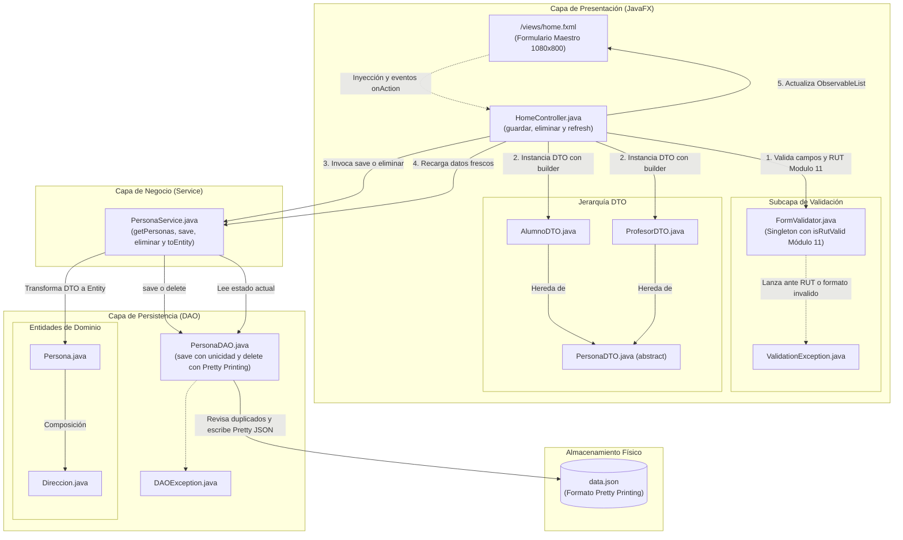
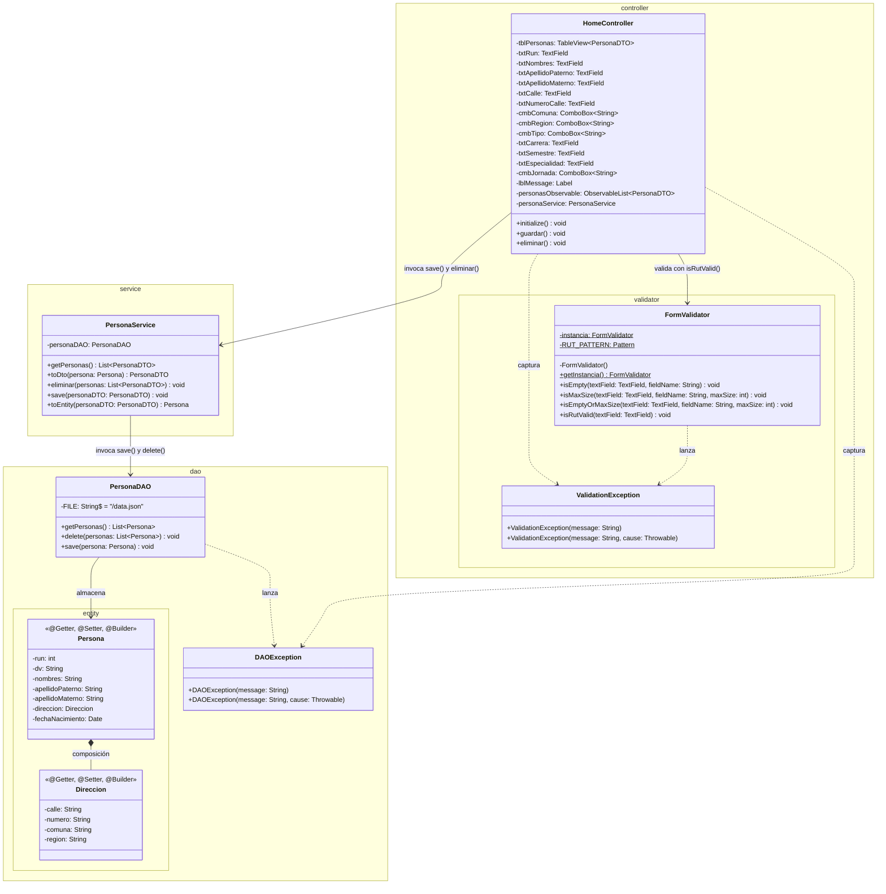
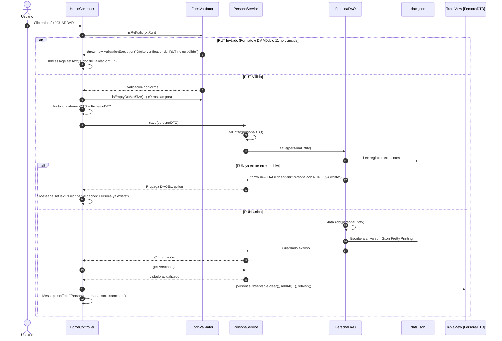
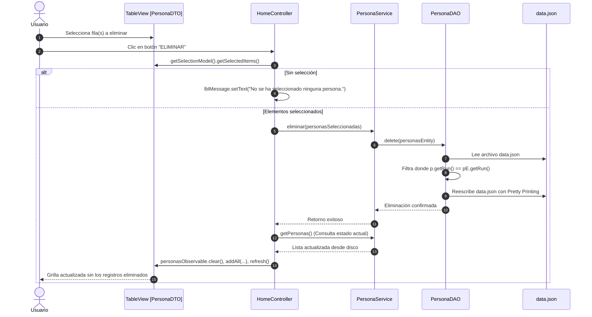
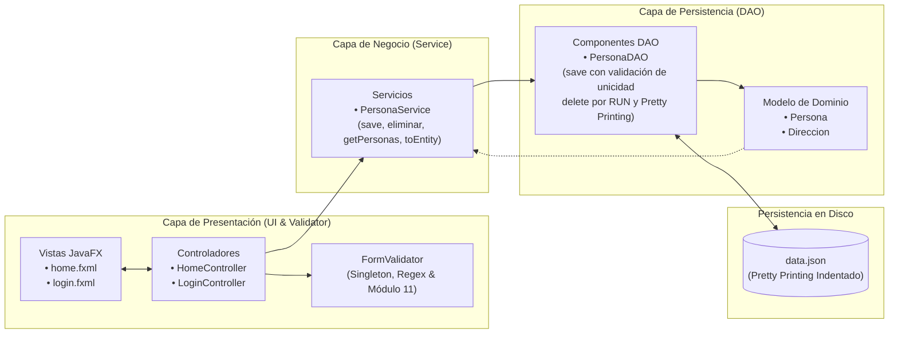
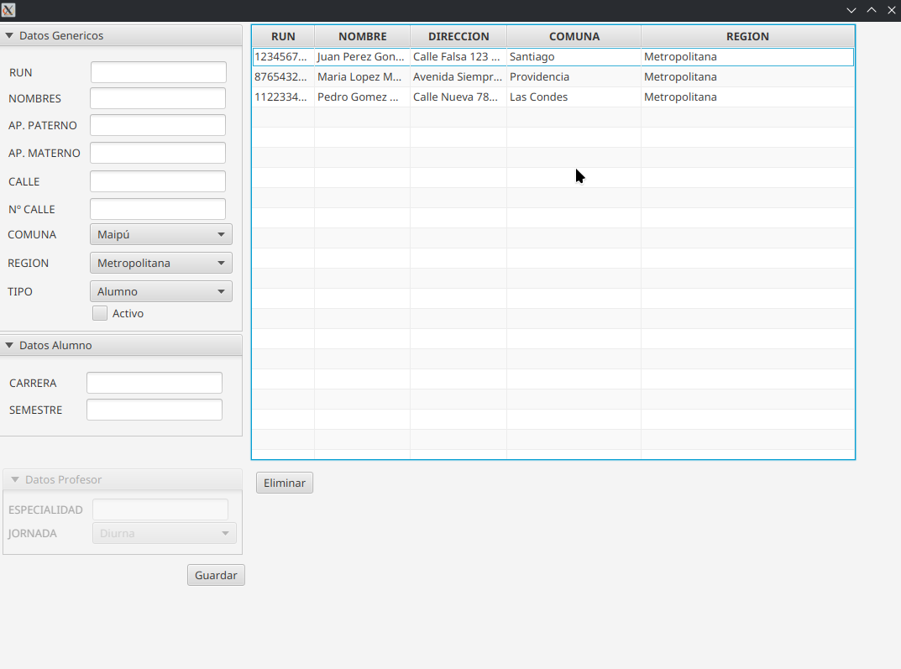

# Proyecto 11 - poo-javafx (Validación de RUT con Módulo 11, Ciclo CRUD Completo y Persistencia Pretty JSON)

## Índice
1. [¿Qué hace el proyecto?](#qué-hace-el-proyecto)
2. [Diferencias Clave: Proyecto 11 vs. Proyecto 10](#diferencias-clave-proyecto-11-vs-proyecto-10)
3. [Diagrama de Componentes](#diagrama-de-componentes)
4. [Diagrama de Clases](#diagrama-de-clases)
5. [Diagramas de Secuencia y Flujo de Interacción](#diagramas-de-secuencia-y-flujo-de-interacción)
   - [1. Flujo de Guardado: Validación de RUT (Módulo 11) y Persistencia JSON](#1-flujo-de-guardado-validación-de-rut-módulo-11-y-persistencia-json)
   - [2. Flujo de Eliminación: Búsqueda por RUN y Recarga Reactiva](#2-flujo-de-eliminación-búsqueda-por-run-y-recarga-reactiva)
6. [Arquitectura por Capas y Flujo de Información](#arquitectura-por-capas-y-flujo-de-información)
7. [Paso a Paso para la Construcción Incremental (desde Proyecto 10)](#paso-a-paso-para-la-construcción-incremental-desde-proyecto-10)
8. [Estructura del Proyecto](#estructura-del-proyecto)
9. [Requisitos y Ejecución](#requisitos-y-ejecución)
10. [Resultado esperado y Capturas de Pantalla](#resultado-esperado-y-capturas-de-pantalla)
11. [Objetivos Pedagógicos y Buenas Prácticas](#objetivos-pedagógicos-y-buenas-prácticas)

---

## ¿Qué hace el proyecto?

El **Proyecto 11** corona la serie de proyectos de JavaFX y Programación Orientada a Objetos culminando el **ciclo CRUD completo (Create, Read, Update/Refresh, Delete)** con persistencia en disco en formato JSON, integrando el **algoritmo de validación de RUT chileno (Módulo 11)** mediante expresiones regulares y lógica matemática, y optimizando la manipulación de datos en la capa DAO con **Pretty Printing**.

En el Proyecto 10, el formulario de captura contaba con validaciones de longitud y presencia vacía, y construía instancias polimórficas de DTO en memoria, pero no llegaba a persistirlas en el archivo `data.json`. Con el Proyecto 11 se completan los siguientes aspectos de arquitectura y negocio:

1. **Algoritmo de Validación de RUT Chileno (Módulo 11)**:
   - Implementado en `FormValidator.getInstancia().isRutValid(TextField)` utilizando la expresión regular `^(\\d{1,3}(?:\\.\\d{3}){2}|\\d{7,8})-?[\\dkK]$` para verificar el formato con o sin puntos y con guion.
   - Limpieza y sanitización de caracteres separadores.
   - Descomposición en cuerpo numérico y dígito verificador ingresado.
   - Cálculo aritmético del dígito verificador mediante el algoritmo estándar de **Módulo 11** (ponderadores cíclicos 2..7). Si el dígito calculado no coincide con el ingresado, se lanza `ValidationException`.
2. **Ciclo Completo de Inserción y Persistencia (`save`)**:
   - Se crea el método `PersonaDAO.save(Persona persona)` que lee `data.json`, verifica la regla de negocio de **no duplicidad de RUN** (lanzando `DAOException` si ya existe), agrega el nuevo registro y reescribe físicamente el archivo en disco.
   - Se expone `personaService.save(PersonaDTO personaDTO)` transformando el DTO a la entidad de dominio `Persona`.
3. **Formateo Legible en Disco (`Gson Pretty Printing`)**:
   - Tanto la operación de guardado como la de eliminación utilizan `new GsonBuilder().setPrettyPrinting().setDateFormat("yyyy-MM-dd").create()`, garantizando que el archivo `data.json` se guarde indentado y legible para inspección humana o auditoría técnica.
4. **Eliminación Robusta por Identificador (`delete`)**:
   - Se refactoriza el método del DAO a `delete(List<Persona> personas)`, reemplazando la remoción ciega `removeAll` por una búsqueda explícita de coincidencia por RUN (`p.getRun() == pE.getRun()`).
5. **Sincronización Reactiva de la Vista**:
   - Tanto tras un guardado exitoso como tras una eliminación, `HomeController` vacía la lista observable y la repuebla directamente consultando a `personaService.getPersonas()`, asegurando que la tabla `tblPersonas` refleje con fidelidad absoluta el estado persistido en el disco.
   - Notificación de retroalimentación inmediata al usuario en la etiqueta `lblMessage` ("Persona guardada correctamente." o reporte de errores de validación/DAO).

---

## Diferencias Clave: Proyecto 11 vs. Proyecto 10

| Componente / Aspecto | Proyecto 10 (Validación Básica y SuperBuilder) | Proyecto 11 (Módulo 11, CRUD Completo y Pretty JSON) | Justificación Pedagógica y Técnica |
| :--- | :--- | :--- | :--- |
| **Validación de Identificador Único (RUT)** | Solo valida que el campo no esté vacío y no supere 15 caracteres (`isEmptyOrMaxSize`). | Incorpora **`isRutValid`** con Regex y algoritmo matemático de **Módulo 11**. | Enseña a implementar algoritmos de validación de identidad nacional y expresiones regulares avanzadas en la capa de validación. |
| **Operación de Creación (Create / Save)** | `guardar()` validaba campos y creaba el DTO en memoria (`System.out.println`), sin persistir. | Flujo de persistencia completo: `HomeController -> PersonaService -> PersonaDAO -> data.json`. | Cierra el ciclo CRUD permitiendo la persistencia permanente de nuevos registros desde la interfaz gráfica. |
| **Control de Integridad y Duplicados** | Sin verificación de duplicidad de registros en almacenamiento. | `PersonaDAO.save` comprueba si ya existe una persona con el mismo RUN y arroja `DAOException`. | Implementa integridad referencial y de dominio a nivel de almacenamiento físico. |
| **Formateo de Persistencia JSON** | Serialización compacta en una sola línea o formato no indentado. | Serialización configurada con **`setPrettyPrinting()`** en Gson. | Facilita la depuración, auditoría y lectura humana del archivo de datos `data.json`. |
| **Algoritmo de Eliminación en DAO** | Llamaba a `eliminar()` con `data.removeAll(personas)` basado en igualdad referencial. | Renombrado a **`delete()`**, busca coincidencias explícitas por RUN (`p.getRun() == pE.getRun()`). | Asegura la eliminación certera independientemente de discrepancias de punteros o serialización en memoria. |
| **Sincronización de Estado en UI** | Solo modificaba la colección local en memoria (`personasObservable.removeAll(...)`). | Limpia y recarga desde el servicio (`clear() + addAll(getPersonas()) + refresh()`). | Garantiza el principio de *"única fuente de la verdad"* consultando el estado real persistido tras cada mutación. |
| **Mapeo Completo de Campos en Guardar** | Solo asignaba nombres, apellidos, calle y número básico; `runDv` estaba comentado. | Mapea RUN con DV, nombres, apellidos, nombre completo, calle, número, dirección completa, comuna y región. | Asegura que la entidad resultante contenga todos los atributos normalizados y derivados del formulario. |

---

## Diagrama de Componentes

El siguiente diagrama ilustra el flujo de componentes completo del Proyecto 11, desde la validación del RUT en la interfaz hasta la serialización Pretty JSON en disco:



---

## Diagrama de Clases

El siguiente diagrama de clases expone los nuevos métodos y atributos incorporados en `FormValidator`, `PersonaDAO`, `PersonaService` y `HomeController`:



---

## Diagramas de Secuencia y Flujo de Interacción

### 1. Flujo de Guardado: Validación de RUT (Módulo 11) y Persistencia JSON

Este diagrama muestra paso a paso la validación del RUT, la construcción del DTO, la verificación de duplicados en DAO, la reescritura en disco con formato Pretty JSON y la actualización reactiva de la grilla:



---

### 2. Flujo de Eliminación: Búsqueda por RUN y Recarga Reactiva



---

## Arquitectura por Capas y Flujo de Información



---

## Paso a Paso para la Construcción Incremental (desde Proyecto 10)

Si vienes avanzando de forma incremental desde el [Proyecto 10](../10/README.md), realiza las siguientes modificaciones y extensiones:

### Paso 1: Extender `FormValidator.java` con el Algoritmo de Módulo 11
Agrega la expresión regular de formato de RUT chileno y el método `isRutValid`:

- **Archivo**: `src/main/java/cl/elprofecarreno/app/controller/validator/FormValidator.java`
```java
package cl.elprofecarreno.app.controller.validator;

import java.util.regex.Pattern;
import javafx.scene.control.TextField;

public class FormValidator {
    
    private static FormValidator instancia;

    // Patrón Regex para RUT: con o sin puntos y con guion opcional
    private static final Pattern RUT_PATTERN = Pattern.compile("^(\\d{1,3}(?:\\.\\d{3}){2}|\\d{7,8})-?[\\dkK]$");

    private FormValidator() {
    }

    public static FormValidator getInstancia() {
        if (instancia == null) {
            instancia = new FormValidator();
        }
        return instancia;
    }

    public void isEmpty(TextField textField, String fieldName) throws ValidationException {
        if (textField.getText() == null || textField.getText().trim().isEmpty()) {
            throw new ValidationException("El campo " + fieldName + " no puede estar vacío");
        }
    }

    public void isMaxSize(TextField textField, String fieldName, int maxSize) throws ValidationException {
        if (textField.getText() != null && textField.getText().trim().length() > maxSize) {
            throw new ValidationException("El campo " + fieldName + " no puede exceder " + maxSize + " caracteres");
        }
    }

    public void isEmptyOrMaxSize(TextField textField, String fieldName, int maxSize) throws ValidationException {
        isEmpty(textField, fieldName);
        isMaxSize(textField, fieldName, maxSize);
    }

    public void isRutValid(TextField textField) throws ValidationException {
        isEmpty(textField, "RUT");
        String rutInput = textField.getText();
        String rutLimpiar = rutInput.trim().toUpperCase();

        // 1. Validar formato con expresión regular
        if (!RUT_PATTERN.matcher(rutLimpiar).matches()) {
            throw new ValidationException("El campo RUT no tiene un formato válido");
        }

        try {
            // 2. Limpiar puntos y guion
            String rutSinPuntosNiGuion = rutLimpiar.replace(".", "").replace("-", "");
            String cuerpo = rutSinPuntosNiGuion.substring(0, rutSinPuntosNiGuion.length() - 1);
            char dvIngresado = rutSinPuntosNiGuion.charAt(rutSinPuntosNiGuion.length() - 1);

            // 3. Calcular dígito verificador por Módulo 11
            int rutAux = Integer.parseInt(cuerpo);
            int m = 0, s = 1;
            for (; rutAux != 0; rutAux /= 10) {
                s = (s + rutAux % 10 * (9 - m++ % 6)) % 11;
            }
            char dvEsperado = (char) (s != 0 ? s + 47 : 75); // ASCII 75 es 'K'

            if (dvIngresado != dvEsperado) {
                throw new ValidationException("Dígito verificador del RUT no es válido");
            }
        } catch (NumberFormatException e) {
            throw new ValidationException("El campo RUT no tiene un formato válido");
        }
    }
}
```

---

### Paso 2: Implementar `save` y Mejorar `delete` en `PersonaDAO.java`
Incorpora comprobación de duplicados, comparación estricta por RUN y serialización con `setPrettyPrinting()`:

- **Archivo**: `src/main/java/cl/elprofecarreno/app/dao/PersonaDAO.java`
```java
    public void delete(List<Persona> personas) throws DAOException {
        // Gson configurado con indentación legible (Pretty Printing)
        Gson gson = new GsonBuilder().setPrettyPrinting().setDateFormat("yyyy-MM-dd").create();
        try (Reader reader = new InputStreamReader(getClass().getResourceAsStream(FILE))) {
            Type listType = new TypeToken<ArrayList<Persona>>(){}.getType();
            List<Persona> data = gson.fromJson(reader, listType);

            // Búsqueda explícita por RUN
            List<Persona> personasAEliminar = new ArrayList<>();
            for (Persona p : data) {
                for (Persona pE : personas) {
                    if (p.getRun() == pE.getRun()) {
                        personasAEliminar.add(p);
                    }
                }
            }
            data.removeAll(personasAEliminar);

            // Reescribir archivo data.json con formato indentado
            try (java.io.Writer writer = new java.io.FileWriter(getClass().getResource(FILE).getFile())) {
                gson.toJson(data, writer);
            }
        } catch (Exception e) {
            throw new DAOException("ERROR al leer data.json", e);
        }
    }

    public void save(Persona persona) throws DAOException {
        Gson gson = new GsonBuilder().setPrettyPrinting().setDateFormat("yyyy-MM-dd").create();
        try (Reader reader = new InputStreamReader(getClass().getResourceAsStream(FILE))) {
            Type listType = new TypeToken<ArrayList<Persona>>(){}.getType();
            List<Persona> data = gson.fromJson(reader, listType);

            // Verificación de unicidad de llave primaria (RUN)
            for (Persona p : data) {
                if (p.getRun() == persona.getRun()) {
                    throw new DAOException("Persona con RUN " + persona.getRun() + " ya existe");
                }
            }
            data.add(persona);

            // Persistencia física en disco
            try (java.io.Writer writer = new java.io.FileWriter(getClass().getResource(FILE).getFile())) {
                gson.toJson(data, writer);
            }
        } catch (DAOException e) {
            throw e;
        } catch (Exception e) {
            throw new DAOException("ERROR al leer data.json", e);
        }
    }
```

---

### Paso 3: Agregar `save` en `PersonaService.java`
Conecta el método del servicio con la transformación a entidad y la llamada al DAO:

- **Archivo**: `src/main/java/cl/elprofecarreno/app/service/PersonaService.java`
```java
    public void eliminar(List<PersonaDTO> personas) throws DAOException {
        List<Persona> personasEntity = new ArrayList<>();
        for (PersonaDTO personaDTO : personas) {
            personasEntity.add(toEntity(personaDTO));
        }
        // Invoca el nuevo método delete del DAO
        personaDAO.delete(personasEntity);
    }

    public void save(PersonaDTO personaDTO) throws DAOException {
        personaDAO.save(toEntity(personaDTO));
    }
```

---

### Paso 4: Implementar la Lógica Completa de `guardar()` y `eliminar()` en `HomeController.java`
Vincula la validación del RUT, el mapeo completo de campos, la persistencia y la sincronización reactiva de la grilla:

- **Archivo**: `src/main/java/cl/elprofecarreno/app/controller/HomeController.java`
```java
    @FXML
    public void guardar(){
        try {
            // 1. Validaciones de presencia, longitud y cálculo de RUT
            FormValidator.getInstancia().isEmptyOrMaxSize(txtRun, "RUN", 15);
            FormValidator.getInstancia().isRutValid(txtRun);
            FormValidator.getInstancia().isEmptyOrMaxSize(txtNombres, "Nombres", 100);
            FormValidator.getInstancia().isEmptyOrMaxSize(txtApellidoPaterno, "Apellido Paterno", 100);
            FormValidator.getInstancia().isEmptyOrMaxSize(txtApellidoMaterno, "Apellido Materno", 100);
            FormValidator.getInstancia().isEmptyOrMaxSize(txtCalle, "Calle", 100);
            FormValidator.getInstancia().isEmptyOrMaxSize(txtNumeroCalle, "Número de Calle", 20);

            // 2. Extracción de valores
            String runDv = txtRun.getText();
            String nombres = txtNombres.getText();
            String apellidoPaterno = txtApellidoPaterno.getText();
            String apellidoMaterno = txtApellidoMaterno.getText();
            String nombreCompleto = nombres + " " + apellidoPaterno + " " + apellidoMaterno;
            String calle = txtCalle.getText();
            String numeroCalle = txtNumeroCalle.getText();
            String tipo = cmbTipo.getValue();
            String comuna = cmbComuna.getValue();
            String region = cmbRegion.getValue();

            PersonaDTO persona;

            // 3. Validación y construcción condicional según rol
            if ("Alumno".equals(tipo)) {
                FormValidator.getInstancia().isEmptyOrMaxSize(txtCarrera, "Carrera", 100);
                FormValidator.getInstancia().isEmptyOrMaxSize(txtSemestre, "Semestre", 20);
                String carrera = txtCarrera.getText();
                String semestre = txtSemestre.getText();
                persona = AlumnoDTO.builder()
                        .runDv(runDv)
                        .nombreCompleto(nombreCompleto)
                        .nombres(nombres)
                        .apellidoPaterno(apellidoPaterno)
                        .apellidoMaterno(apellidoMaterno)
                        .calle(calle)
                        .numero(numeroCalle)
                        .carrera(carrera)
                        .semestre(semestre)
                        .comuna(comuna)
                        .region(region)
                        .direccionCompleta(calle + " " + numeroCalle)
                        .build();
            } else if ("Profesor".equals(tipo)) {
                FormValidator.getInstancia().isEmptyOrMaxSize(txtEspecialidad, "Especialidad", 100);
                String especialidad = txtEspecialidad.getText();
                persona = ProfesorDTO.builder()
                        .runDv(runDv)
                        .nombreCompleto(nombreCompleto)
                        .nombres(nombres)
                        .apellidoPaterno(apellidoPaterno)
                        .apellidoMaterno(apellidoMaterno)
                        .calle(calle)
                        .numero(numeroCalle)
                        .comuna(comuna)
                        .region(region)
                        .especialidad(especialidad)
                        .direccionCompleta(calle + " " + numeroCalle)
                        .build();
            } else {
                throw new ValidationException("Tipo de persona no válido");
            }

            // 4. Persistir registro a través del servicio
            personaService.save(persona);

            // 5. Refrescar estado de la tabla consultando los datos frescos
            personasObservable.clear();
            personasObservable.addAll(personaService.getPersonas());
            tblPersonas.refresh();
            lblMessage.setText("Persona guardada correctamente.");

        } catch (DAOException e) {
            System.err.println("Error de validación: " + e.getMessage());
            lblMessage.setText("Error de validación: " + e.getMessage());
        } catch (ValidationException e) {
            System.err.println("Error de validación: " + e.getMessage());
            lblMessage.setText("Error de validación: " + e.getMessage());
        }
    }

    @FXML 
    public void eliminar(){
        ObservableList<PersonaDTO> personasSeleccionadas = tblPersonas.getSelectionModel().getSelectedItems();
        if (personasSeleccionadas.isEmpty()) {
            lblMessage.setText("No se ha seleccionado ninguna persona.");
        } else {
            try {
                // Eliminar en la capa de persistencia
                personaService.eliminar(personasSeleccionadas);
                // Sincronizar grilla recargando desde la fuente de verdad
                personasObservable.clear();
                personasObservable.addAll(personaService.getPersonas());
                tblPersonas.refresh();
            } catch (Exception e) {
                lblMessage.setText("ERROR al eliminar persona seleccionada");
            }
        }
    }
```

---

## Estructura del Proyecto

```text
11/
├── 11.png                                                 # Captura de pantalla: Login inicial
├── 11_02.png                                              # Captura de pantalla: Formulario Maestro y Persistencia
├── README.md                                              # Documentación técnica completa del Proyecto 11
└── poo-javafx/
    ├── pom.xml                                            # Descriptor de dependencias Maven
    └── src/
        └── main/
            ├── java/
            │   ├── module-info.java                       # Configuración modular de paquetes y exportaciones
            │   └── cl/elprofecarreno/app/
            │       ├── App.java                           # Arranque JavaFX con redimensionamiento dinámico
            │       ├── controller/
            │       │   ├── HomeController.java            # Controlador con ciclo CRUD completo y refresh
            │       │   ├── LoginController.java           # Controlador de acceso y transición
            │       │   ├── dto/
            │       │   │   ├── AlumnoDTO.java             # DTO Alumno con @SuperBuilder
            │       │   │   ├── IRemunerable.java          # Interfaz de liquidación previsional
            │       │   │   ├── PersonaDTO.java            # DTO base abstracto con @SuperBuilder
            │       │   │   ├── ProfesorDTO.java           # DTO Profesor con @SuperBuilder
            │       │   │   └── UserDTO.java               # DTO de usuario de sesión
            │       │   └── validator/
            │       │       ├── FormValidator.java         # Singleton con Regex y Módulo 11 (isRutValid)
            │       │       └── ValidationException.java   # Excepción verificada de validación
            │       ├── dao/
            │       │   ├── PersonaDAO.java                # DAO con save (unicidad), delete y Pretty JSON
            │       │   ├── UserDAO.java                   # DAO de usuarios
            │       │   ├── entity/
            │       │   │   ├── Direccion.java             # Entidad de dirección
            │       │   │   ├── Persona.java               # Entidad de persona
            │       │   │   └── User.java                  # Entidad de usuario
            │       │   └── excepcion/
            │       │       └── DAOException.java          # Excepción de la capa DAO
            │       └── service/
            │           ├── LoginService.java              # Lógica de autenticación
            │           └── PersonaService.java            # Orquestación de guardado, borrado y mapeo DTO
            └── resources/
                ├── authentication.json                    # Base de datos de credenciales
                ├── data.json                              # Base de datos JSON con Pretty Printing
                └── views/
                    ├── home.fxml                          # Vista del formulario maestro-detalle
                    └── login.fxml                         # Vista compacta de acceso
```

---

## Requisitos y Ejecución

### Requisitos Previos
- **Java Development Kit (JDK)**: Versión 11 o superior (recomendado OpenJDK 21).
- **Apache Maven**: Versión 3.8 o superior instalada y en PATH.

### Ejecución del Proyecto
Para compilar y ejecutar el proyecto 11 directamente desde la terminal:

```bash
cd 11/poo-javafx
mvn clean compile javafx:run
```

---

## Resultado esperado y Capturas de Pantalla

### 1. Estado Inicial (Login)
La aplicación inicia en una ventana compacta de 300x200 píxeles solicitando credenciales de acceso:
- **Usuario**: `admin`
- **Contraseña**: `qwerty`


### 2. Formulario Maestro, Validación de RUT y Persistencia
Al ingresar credenciales válidas, se abre el formulario de 1080x800 píxeles. Si el usuario ingresa un RUT con dígito verificador incorrecto (por ejemplo `12345678-5`), el sistema detiene el proceso y muestra:
`Error de validación: Dígito verificador del RUT no es válido`.

Al ingresar un RUT correcto (por ejemplo `11223344-1` o un nuevo RUT válido), los campos completos y presionar **GUARDAR**, el nuevo registro es persistido en `data.json` con formato Pretty Printing y se añade de inmediato a la grilla inferior:



---

## Objetivos Pedagógicos y Buenas Prácticas

1. **Algoritmos Criptográficos y de Identidad**:
   - Implementación práctica del algoritmo Módulo 11 para la verificación de integridad de identificadores nacionales (RUT).
2. **Ciclo CRUD Integral en Arquitectura en Capas**:
   - Comprensión completa de cómo viaja un dato desde un control JavaFX (`TextField`) -> Controller -> Service -> DAO -> Archivo Físico (`data.json`), y viceversa.
3. **Manejo de Integridad y Llave Primaria en Archivos Planos**:
   - Simulación de restricciones de unicidad (`UNIQUE / PRIMARY KEY`) en almacenes NoSQL/JSON mediante verificación iterativa en la capa DAO.
4. **Pretty Printing y Mantenibilidad de Datos**:
   - Importancia de formatear archivos de intercambio de datos para facilitar inspecciones manuales y pruebas unitarias.
5. **Sincronización Reactiva Fiable**:
   - Adoptar el patrón de recarga fresca desde la fuente de la verdad (`clear() + addAll(getPersonas())`) para prevenir desincronizaciones entre la memoria volátil de la vista y el disco duro.
