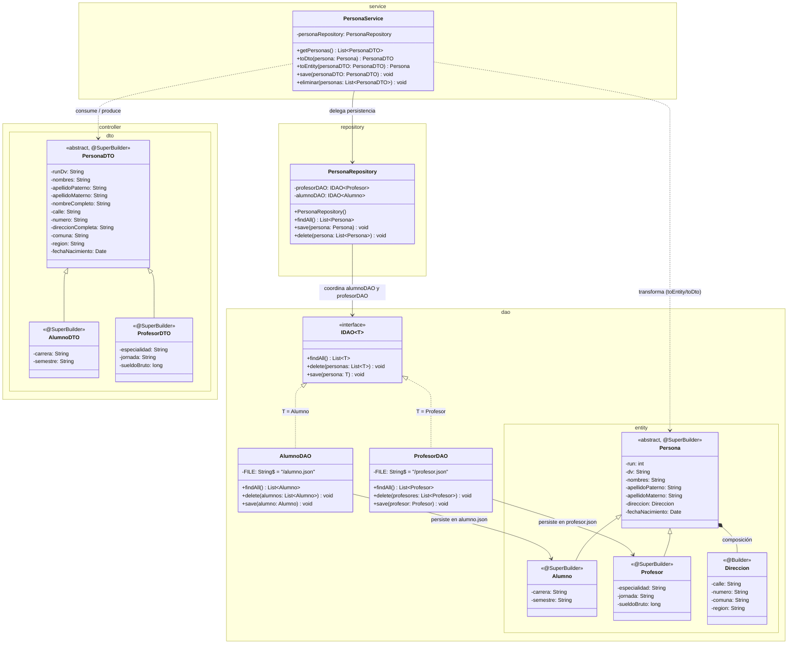
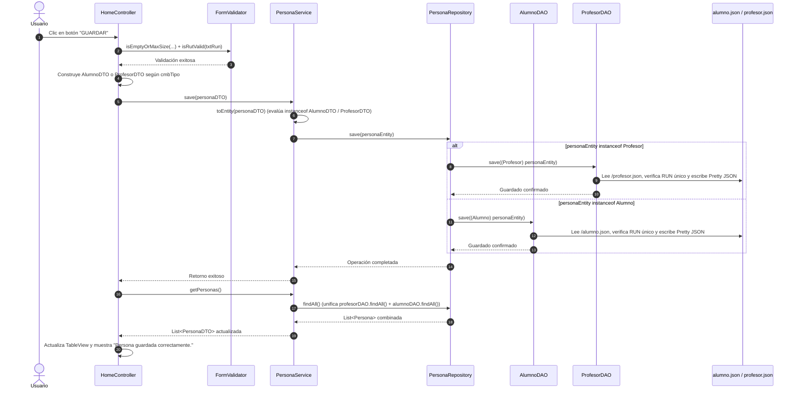
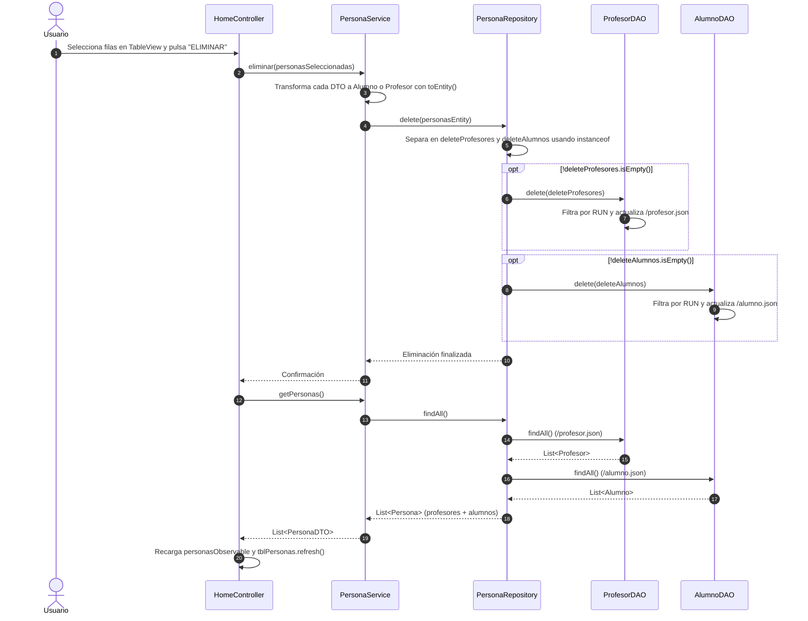

# Proyecto 12 - poo-javafx (Patrón Repository, Interfaz Genérica IDAO<T>, Herencia en Entidades y Persistencia JSON Segregada)

## Índice
1. [¿Qué hace el proyecto?](#qué-hace-el-proyecto)
2. [Diferencias Clave: Proyecto 12 vs. Proyecto 11](#diferencias-clave-proyecto-12-vs-proyecto-11)
3. [Diagrama de Componentes](#diagrama-de-componentes)
4. [Diagrama de Clases](#diagrama-de-clases)
5. [Diagramas de Secuencia y Flujo de Interacción](#diagramas-de-secuencia-y-flujo-de-interacción)
   - [1. Flujo de Guardado Polimórfico: Servicio -> Repository -> DAO Especializado](#1-flujo-de-guardado-polimórfico-servicio---repository---dao-especializado)
   - [2. Flujo de Consulta Unificada (`findAll`) y Eliminación Segregada (`delete`)](#2-flujo-de-consulta-unificada-findall-y-eliminación-segregada-delete)
6. [Arquitectura por Capas y Flujo de Información](#arquitectura-por-capas-y-flujo-de-información)
7. [Paso a Paso para la Construcción Incremental (desde Proyecto 11)](#paso-a-paso-para-la-construcción-incremental-desde-proyecto-11)
8. [Estructura del Proyecto](#estructura-del-proyecto)
9. [Requisitos y Ejecución](#requisitos-y-ejecución)
10. [Resultado esperado y Capturas de Pantalla](#resultado-esperado-y-capturas-de-pantalla)
11. [Objetivos Pedagógicos y Buenas Prácticas](#objetivos-pedagógicos-y-buenas-prácticas)

---

## ¿Qué hace el proyecto?

El **Proyecto 12** evoluciona la arquitectura de persistencia y dominio del sistema introduciendo el **Patrón Repository (`PersonaRepository`)**, la programación genérica mediante la interfaz **`IDAO<T>`**, la **herencia en la capa de entidades de dominio** (`Persona` abstracta extendida por `Alumno` y `Profesor` con `@SuperBuilder`) y la **segregación física del almacenamiento JSON** en archivos especializados (`alumno.json` y `profesor.json`).

En el Proyecto 11, aunque la capa de presentación y los DTOs ya diferenciaban polimórficamente entre `AlumnoDTO` y `ProfesorDTO`, la capa de persistencia convertía ambos objetos a una única entidad plana `Persona` y los guardaba en un solo archivo `data.json`, perdiendo en el disco los atributos específicos de cada rol (como `carrera`, `semestre`, `especialidad`, `jornada` o `sueldoBruto`). Con el Proyecto 12 se resuelve esta limitación arquitectónica mediante los siguientes pilares:

1. **Jerarquía de Herencia en Entidades de Dominio (`dao.entity`)**:
   - `Persona` se declara como **clase abstracta** (`public abstract class Persona`) y reemplaza `@Builder` por **`@SuperBuilder`** de Lombok.
   - Se crean las entidades concretas **`Alumno`** (`carrera`, `semestre`, con soporte `@SerializedName` de Gson) y **`Profesor`** (`especialidad`, `jornada`, `sueldoBruto`), ambas extendiendo `Persona` y anotadas con `@SuperBuilder`.
2. **Contrato Genérico de Acceso a Datos (`IDAO<T>`)**:
   - Se define la interfaz genérica `IDAO<T>` que estandariza las operaciones de persistencia para cualquier tipo de entidad `T`: `findAll()`, `delete(List<T>)` y `save(T)`.
   - Favorece el principio de **Inversión de Dependencias (DIP)** y el polimorfismo paramétrico (Generics) en Java.
3. **DAOs Especializados y Almacenamiento Físico Segregado**:
   - **`AlumnoDAO implements IDAO<Alumno>`**: gestiona exclusivamente la lectura, inserción con validación de RUN único y eliminación sobre el archivo `/alumno.json`.
   - **`ProfesorDAO implements IDAO<Profesor>`**: gestiona exclusivamente la lectura, inserción con validación de RUN único y eliminación sobre el archivo `/profesor.json`.
4. **Patrón Repository como Orquestador Polimórfico (`PersonaRepository`)**:
   - Introduce el paquete `cl.elprofecarreno.app.repository` con la clase `PersonaRepository`, la cual encapsula referencias a `IDAO<Profesor>` e `IDAO<Alumno>`.
   - Unifica la consulta (`findAll()`) combinando los registros de `profesor.json` y `alumno.json` en una sola `List<Persona>`.
   - Enruta dinámicamente el guardado (`save`) y la eliminación por lotes (`delete`) inspeccionando el tipo concreto en tiempo de ejecución mediante el operador `instanceof`.
5. **Mapeo Polimórfico en la Capa de Negocio (`PersonaService.toEntity`)**:
   - `PersonaService` delega el acceso a datos a `PersonaRepository` y actualiza `toEntity(PersonaDTO)` para construir instancias de `Alumno` o `Profesor` según corresponda a la subclase del DTO recibido (`AlumnoDTO` o `ProfesorDTO`).

---

## Diferencias Clave: Proyecto 12 vs. Proyecto 11

| Componente / Aspecto | Proyecto 11 (DAO Único y Entidad Plana) | Proyecto 12 (Patrón Repository, `IDAO<T>` y Herencia en Entidades) | Justificación Pedagógica y Técnica |
| :--- | :--- | :--- | :--- |
| **Entidad `Persona`** | Clase concreta instanciada con `@Builder`; solo contenía datos básicos y dirección. | **Clase abstracta** (`abstract class Persona`) anotada con **`@SuperBuilder`**. | Impide instanciar personas genéricas sin rol en el dominio y habilita constructores fluidos heredados en las sub-entidades. |
| **Sub-entidades de Dominio** | No existían en el paquete `dao.entity` (solo existían `AlumnoDTO` y `ProfesorDTO`). | Nuevas clases **`Alumno`** y **`Profesor`** en `dao.entity` que heredan de `Persona`. | Alinea el modelo de dominio persistente con la jerarquía de DTOs, preservando los atributos propios de cada rol en disco. |
| **Contrato de Acceso a Datos** | `PersonaDAO` era una clase concreta sin interfaz formal. | Nueva interfaz genérica **`IDAO<T>`** (`findAll`, `delete`, `save`). | Introduce **Java Generics** e interfaces en la capa DAO para desacoplar el contrato de su implementación concreta. |
| **Implementaciones DAO** | Un único `PersonaDAO` que operaba sobre `/data.json`. | **`AlumnoDAO`** (`IDAO<Alumno>`) y **`ProfesorDAO`** (`IDAO<Profesor>`). | Aplica el **Principio de Responsabilidad Única (SRP)**: cada DAO serializa y deserializa un único tipo concreto sin conflictos de tipos en Gson. |
| **Almacenamiento JSON** | Archivo único `/data.json`. | Archivos dedicados **`/alumno.json`** y **`/profesor.json`**. | Emula el diseño de tablas separadas por subtipo (*Table per Concrete Class*) en bases de datos documentales/relacionales. |
| **Capa Repository** | No existía; `PersonaService` llamaba directamente a `PersonaDAO`. | Nueva clase **`PersonaRepository`** en el paquete `repository`. | Abstrae para el servicio la existencia de múltiples fuentes de datos, agregando consultas y clasificando escrituras/borrados polimórficamente. |
| **Transformación `toEntity()`** | Construía siempre un objeto `Persona` base ignorando los campos de Alumno/Profesor. | Evalúa `instanceof AlumnoDTO` o `instanceof ProfesorDTO` y retorna un `Alumno` o `Profesor` completo. | Garantiza el mapeo polimórfico extremo a extremo desde el formulario JavaFX hasta el archivo JSON específico. |

---

## Diagrama de Componentes

El siguiente diagrama muestra cómo interactúan las capas de Presentación, Negocio, Repositorio y Persistencia segregada en el Proyecto 12:

```mermaid
flowchart TB
    subgraph UI_Layer["Capa de Presentación (JavaFX)"]
        HomeFXML["/views/home.fxml\n(Formulario Maestro 1080x800)"]
        HomeCtrl["HomeController.java\n(guardar, eliminar y refresh)"]

        subgraph Validation_Sublayer["Subcapa de Validación"]
            FormVal["FormValidator.java\n(Singleton con isRutValid Módulo 11)"]
            ValEx["ValidationException.java"]
        end

        subgraph DTO_Hierarchy["Jerarquía DTO"]
            PersonaDTO["PersonaDTO.java (abstract)"]
            AlumnoDTO["AlumnoDTO.java"]
            ProfesorDTO["ProfesorDTO.java"]
        end
    end

    subgraph Service_Layer["Capa de Negocio (Service)"]
        PersonaSvc["PersonaService.java\n(getPersonas, save, eliminar y toEntity polimórfico)"]
    end

    subgraph Repository_Layer["Capa de Repositorio (Repository)"]
        PersonaRepo["PersonaRepository.java\n(Agregador findAll y enrutador save/delete por instanceof)"]
    end

    subgraph Persistence_Layer["Capa de Persistencia (DAO & Entities)"]
        IDAO["<<interface>>\nIDAO<T>"]
        AlumnoDAO["AlumnoDAO.java\n(IDAO<Alumno>)"]
        ProfesorDAO["ProfesorDAO.java\n(IDAO<Profesor>)"]
        DAOEx["DAOException.java"]

        subgraph Domain_Entities["Jerarquía de Entidades de Dominio"]
            PersonaEntity["Persona.java (abstract)"]
            AlumnoEntity["Alumno.java"]
            ProfesorEntity["Profesor.java"]
            DireccionEntity["Direccion.java"]
        end
    end

    subgraph Storage["Almacenamiento Físico Segregado"]
        AlumnoJSON[("alumno.json\n(Pretty Printing)")]
        ProfesorJSON[("profesor.json\n(Pretty Printing)")]
    end

    HomeFXML -.->|Eventos UI| HomeCtrl
    HomeCtrl -->|1. Valida campos y RUT| FormVal
    FormVal -.->|Lanza| ValEx
    HomeCtrl -->|2. Construye DTO| AlumnoDTO
    HomeCtrl -->|2. Construye DTO| ProfesorDTO
    AlumnoDTO -->|extends| PersonaDTO
    ProfesorDTO -->|extends| PersonaDTO

    HomeCtrl -->|3. Operaciones CRUD| PersonaSvc
    PersonaSvc -->|toEntity polimórfico| AlumnoEntity
    PersonaSvc -->|toEntity polimórfico| ProfesorEntity
    AlumnoEntity -->|extends| PersonaEntity
    ProfesorEntity -->|extends| PersonaEntity
    PersonaEntity -->|Composición| DireccionEntity

    PersonaSvc -->|4. Delega a| PersonaRepo
    PersonaRepo -->|Usa contrato| IDAO
    AlumnoDAO -.->|implements| IDAO
    ProfesorDAO -.->|implements| IDAO
    PersonaRepo -->|Enruta Alumno| AlumnoDAO
    PersonaRepo -->|Enruta Profesor| ProfesorDAO

    AlumnoDAO <-->|Lee / Escribe| AlumnoJSON
    ProfesorDAO <-->|Lee / Escribe| ProfesorJSON
    AlumnoDAO ..> DAOEx
    ProfesorDAO ..> DAOEx
```

---

## Diagrama de Clases

El siguiente diagrama UML detalla la nueva interfaz genérica `IDAO<T>`, las implementaciones `AlumnoDAO` y `ProfesorDAO`, el orquestador `PersonaRepository` y la jerarquía de herencia en `dao.entity`:



---

## Diagramas de Secuencia y Flujo de Interacción

### 1. Flujo de Guardado Polimórfico: Servicio -> Repository -> DAO Especializado

Este diagrama ilustra cómo un registro ingresado en la interfaz se valida, se convierte en la entidad hija correspondiente (`Alumno` o `Profesor`) y es enrutado por `PersonaRepository` hacia su archivo JSON específico:



---

### 2. Flujo de Consulta Unificada (`findAll`) y Eliminación Segregada (`delete`)



---

## Arquitectura por Capas y Flujo de Información

Con la incorporación del **Patrón Repository**, la arquitectura del sistema evoluciona a **4 niveles de responsabilidad bien diferenciados**:

```mermaid
flowchart LR
    subgraph Presentacion["1. Capa de Presentación (UI, DTO & Validator)"]
        Vistas["Vistas FXML\n• home.fxml\n• login.fxml"]
        Controladores["Controladores\n• HomeController\n• LoginController"]
        Validador["FormValidator\n(Singleton & Módulo 11)"]
        DTOs["Jerarquía DTO\n• PersonaDTO (abstract)\n• AlumnoDTO\n• ProfesorDTO"]
    end

    subgraph Negocio["2. Capa de Negocio (Service)"]
        Servicios["Servicios\n• PersonaService\n• LoginService\n(Mapeo polimórfico DTO <-> Entity)"]
    end

    subgraph Repositorio["3. Capa de Repositorio (Repository)"]
        Repo["PersonaRepository\n• Agregación polimórfica (findAll)\n• Clasificación y ruteo (save/delete)"]
    end

    subgraph Persistencia["4. Capa de Acceso a Datos (DAO & Entities)"]
        Contrato["Interfaz Genérica\n• IDAO<T>"]
        DAOs["DAOs Especializados\n• AlumnoDAO\n• ProfesorDAO\n• UserDAO"]
        Entidades["Jerarquía de Entidades\n• Persona (abstract)\n• Alumno / Profesor\n• Direccion / User"]
    end

    subgraph Almacen["Almacenamiento JSON"]
        Archivos[("• alumno.json\n• profesor.json\n• authentication.json")]
    end

    Vistas <--> Controladores
    Controladores --> Validador
    Controladores --> DTOs
    Controladores --> Servicios
    Servicios --> Repo
    Repo --> Contrato
    Contrato <|.. DAOs
    DAOs <--> Archivos
    DAOs --> Entidades
    Entidades -.-> Repo
```

---

## Paso a Paso para la Construcción Incremental (desde Proyecto 11)

Si vienes trabajando sobre la base del [Proyecto 11](../11/README.md), sigue estos pasos para evolucionar la arquitectura al Proyecto 12:

### Paso 1: Convertir la Entidad `Persona` en Abstracta con `@SuperBuilder`
Modifica `Persona.java` para que sea `abstract` y utilice `@SuperBuilder`, permitiendo que sus clases hijas hereden el builder fluido:

- **Archivo**: `src/main/java/cl/elprofecarreno/app/dao/entity/Persona.java`
```java
package cl.elprofecarreno.app.dao.entity;

import java.util.Date;
import lombok.AllArgsConstructor;
import lombok.NoArgsConstructor;
import lombok.Setter;
import lombok.Getter;
import lombok.experimental.SuperBuilder;

@Getter
@Setter
@SuperBuilder
@AllArgsConstructor
@NoArgsConstructor
public abstract class Persona {

    private int run;
    private String dv;
    private String nombres;
    private String apellidoPaterno;
    private String apellidoMaterno;
    private Direccion direccion;
    private Date fechaNacimiento;

}
```

---

### Paso 2: Crear las Entidades Hijas `Alumno` y `Profesor`
Crea las entidades concretas dentro del paquete `cl.elprofecarreno.app.dao.entity`:

- **Archivo**: `src/main/java/cl/elprofecarreno/app/dao/entity/Alumno.java`
```java
package cl.elprofecarreno.app.dao.entity;

import com.google.gson.annotations.SerializedName;

import lombok.AllArgsConstructor;
import lombok.Getter;
import lombok.NoArgsConstructor;
import lombok.Setter;
import lombok.experimental.SuperBuilder;

@Getter 
@Setter 
@NoArgsConstructor
@AllArgsConstructor 
@SuperBuilder 
public class Alumno extends Persona {
    
    @SerializedName("carrera")
    private String carrera;

    @SerializedName("semestre")
    private String semestre;

}
```

- **Archivo**: `src/main/java/cl/elprofecarreno/app/dao/entity/Profesor.java`
```java
package cl.elprofecarreno.app.dao.entity;

import lombok.AllArgsConstructor;
import lombok.Getter;
import lombok.NoArgsConstructor;
import lombok.Setter;
import lombok.experimental.SuperBuilder;

@Getter 
@Setter 
@NoArgsConstructor
@AllArgsConstructor 
@SuperBuilder 
public class Profesor extends Persona {
    
    private String especialidad;
    private String jornada;
    private long sueldoBruto;
}
```

---

### Paso 3: Definir la Interfaz Genérica `IDAO<T>`
Crea el contrato genérico para estandarizar todas las operaciones de acceso a datos:

- **Archivo**: `src/main/java/cl/elprofecarreno/app/dao/IDAO.java`
```java
package cl.elprofecarreno.app.dao;

import java.util.List;
import cl.elprofecarreno.app.dao.excepcion.DAOException;

public interface IDAO<T> {
    
    // Obtener listado de registros desde un json o una tabla de la base de datos.
    public List<T> findAll() throws DAOException;

    // Eliminar registros existentes de un json o una tabla de la base de datos.
    public void delete(List<T> personas) throws DAOException;

    // Guardar un nuevo registro en un json o una tabla de la base de datos.
    public void save(T persona) throws DAOException;
}
```

---

### Paso 4: Implementar `AlumnoDAO` y `ProfesorDAO` y Crear los Archivos JSON
Crea las implementaciones especializadas de `IDAO<Alumno>` e `IDAO<Profesor>` apuntando a `/alumno.json` y `/profesor.json`:

- **Archivo**: `src/main/java/cl/elprofecarreno/app/dao/AlumnoDAO.java`
```java
package cl.elprofecarreno.app.dao;

import cl.elprofecarreno.app.dao.entity.Alumno;
import cl.elprofecarreno.app.dao.excepcion.DAOException;
import com.google.gson.Gson;
import com.google.gson.GsonBuilder;
import com.google.gson.reflect.TypeToken;
import java.io.InputStreamReader;
import java.io.Reader;
import java.lang.reflect.Type;
import java.util.ArrayList;
import java.util.List;

public class AlumnoDAO implements IDAO<Alumno> {
    
    private static final String FILE = "/alumno.json";

    @Override
    public List<Alumno> findAll() throws DAOException {
        Gson gson = new GsonBuilder().setDateFormat("yyyy-MM-dd").create();
        try (Reader reader = new InputStreamReader(getClass().getResourceAsStream(FILE))) {
            Type listType = new TypeToken<ArrayList<Alumno>>(){}.getType();
            return gson.fromJson(reader, listType);
        } catch (Exception e) {
            throw new DAOException("ERROR al leer data.json", e);
        }
    }

    @Override
    public void delete(List<Alumno> alumnos) throws DAOException {
        Gson gson = new GsonBuilder().setPrettyPrinting().setDateFormat("yyyy-MM-dd").create();
        try (Reader reader = new InputStreamReader(getClass().getResourceAsStream(FILE))) {
            Type listType = new TypeToken<ArrayList<Alumno>>(){}.getType();
            List<Alumno> data = gson.fromJson(reader, listType);
            List<Alumno> alumnosAEliminar = new ArrayList<>();
            for (Alumno p : data) {
                for (Alumno pE : alumnos) {
                    if (p.getRun() == pE.getRun()) {
                        alumnosAEliminar.add(p);
                    }
                }
            }
            data.removeAll(alumnosAEliminar);
            try (java.io.Writer writer = new java.io.FileWriter(getClass().getResource(FILE).getFile())) {
                gson.toJson(data, writer);
            }
        } catch (Exception e) {
            throw new DAOException("ERROR al leer data.json", e);
        }
    }

    @Override
    public void save(Alumno alumno) throws DAOException {
        Gson gson = new GsonBuilder().setPrettyPrinting().setDateFormat("yyyy-MM-dd").create();
        try (Reader reader = new InputStreamReader(getClass().getResourceAsStream(FILE))) {
            Type listType = new TypeToken<ArrayList<Alumno>>(){}.getType();
            List<Alumno> data = gson.fromJson(reader, listType);
            for (Alumno p : data) {
                if (p.getRun() == alumno.getRun()) {
                    throw new DAOException("Alumno con RUN " + alumno.getRun() + " ya existe");
                }
            }
            data.add(alumno);
            try (java.io.Writer writer = new java.io.FileWriter(getClass().getResource(FILE).getFile())) {
                gson.toJson(data, writer);
            }
        } catch (DAOException e) {
            throw e;
        } catch (Exception e) {
            throw new DAOException("ERROR al leer data.json", e);
        }
    }
}
```

- **Archivo**: `src/main/java/cl/elprofecarreno/app/dao/ProfesorDAO.java`
  Sigue la misma estructura que `AlumnoDAO`, implementando `IDAO<Profesor>` y operando sobre `private static final String FILE = "/profesor.json";`.

- **Archivos de recursos JSON iniciales**:
  Crea `src/main/resources/alumno.json` y `src/main/resources/profesor.json` inicializados con un arreglo JSON vacío:
  ```json
  []
  ```

---

### Paso 5: Construir la Clase `PersonaRepository`
Crea el paquete `cl.elprofecarreno.app.repository` y la clase `PersonaRepository` encargada de coordinar los DAOs especializados:

- **Archivo**: `src/main/java/cl/elprofecarreno/app/repository/PersonaRepository.java`
```java
package cl.elprofecarreno.app.repository;

import cl.elprofecarreno.app.dao.IDAO;
import cl.elprofecarreno.app.dao.AlumnoDAO;
import cl.elprofecarreno.app.dao.ProfesorDAO;
import cl.elprofecarreno.app.dao.entity.Alumno;
import cl.elprofecarreno.app.dao.entity.Persona;
import cl.elprofecarreno.app.dao.entity.Profesor;
import cl.elprofecarreno.app.dao.excepcion.DAOException;

import java.util.ArrayList;
import java.util.List;

public class PersonaRepository {
    
    private IDAO<Profesor> profesorDAO;
    private IDAO<Alumno> alumnoDAO;

    public PersonaRepository() {
        this.profesorDAO = new ProfesorDAO();
        this.alumnoDAO = new AlumnoDAO();
    }

    public List<Persona> findAll() throws DAOException {
        List<Persona> personas = new ArrayList<>();
        personas.addAll(profesorDAO.findAll());
        personas.addAll(alumnoDAO.findAll());
        return personas;
    }

    public void delete(List<Persona> persona) throws DAOException {
        List<Profesor> deleteProfesores = new ArrayList<>();
        List<Alumno> deleteAlumnos = new ArrayList<>();
        for (Persona p : persona) {
            if (p instanceof Profesor) {
                deleteProfesores.add((Profesor) p);
            } else if (p instanceof Alumno) {
                deleteAlumnos.add((Alumno) p);
            }
        }
        if (!deleteProfesores.isEmpty()) {
            profesorDAO.delete(deleteProfesores);
        }
        if (!deleteAlumnos.isEmpty()) {
            alumnoDAO.delete(deleteAlumnos);
        }
    }

    public void save(Persona persona) throws DAOException {
        if (persona instanceof Profesor) {
            profesorDAO.save((Profesor) persona);
        } else if (persona instanceof Alumno) {
            alumnoDAO.save((Alumno) persona);
        }
    }
}
```

---

### Paso 6: Actualizar `PersonaService` con `PersonaRepository` y Mapeo Polimórfico
Conecta `PersonaService` con `PersonaRepository` y actualiza `toEntity(PersonaDTO)` para instanciar `Alumno` o `Profesor`:

- **Archivo**: `src/main/java/cl/elprofecarreno/app/service/PersonaService.java`
```java
    private PersonaRepository personaRepository;
    
    public PersonaService() {
        personaRepository = new PersonaRepository();
    }

    public Persona toEntity(PersonaDTO personaDTO) {
        String[] run = personaDTO.getRunDv().split("-");
        Persona persona = null;
        if (personaDTO instanceof AlumnoDTO) {
            AlumnoDTO alumnoDTO = (AlumnoDTO) personaDTO;
            persona = Alumno.builder()
                    .run(Integer.valueOf(run[0]))
                    .dv(run[1])
                    .nombres(alumnoDTO.getNombres())
                    .apellidoPaterno(alumnoDTO.getApellidoPaterno())
                    .apellidoMaterno(alumnoDTO.getApellidoMaterno())
                    .fechaNacimiento(alumnoDTO.getFechaNacimiento())
                    .direccion(
                        Direccion.builder()
                            .calle(alumnoDTO.getCalle())
                            .numero(alumnoDTO.getNumero())
                            .comuna(alumnoDTO.getComuna())
                            .region(alumnoDTO.getRegion())
                            .build()
                    )
                    .semestre(alumnoDTO.getSemestre())
                    .carrera(alumnoDTO.getCarrera())
                    .build();
        } else if (personaDTO instanceof ProfesorDTO) {
            ProfesorDTO profesorDTO = (ProfesorDTO) personaDTO;
            persona = Profesor.builder()
                    .run(Integer.valueOf(run[0]))
                    .dv(run[1])
                    .nombres(profesorDTO.getNombres())
                    .apellidoPaterno(profesorDTO.getApellidoPaterno())
                    .apellidoMaterno(profesorDTO.getApellidoMaterno())
                    .fechaNacimiento(profesorDTO.getFechaNacimiento())
                    .direccion(
                        Direccion.builder()
                            .calle(profesorDTO.getCalle())
                            .numero(profesorDTO.getNumero())
                            .comuna(profesorDTO.getComuna())
                            .region(profesorDTO.getRegion())
                            .build()
                    )
                    .jornada(profesorDTO.getJornada())
                    .sueldoBruto(profesorDTO.getSueldoBruto())
                    .build();
        }
        return persona;
    }
```

---

## Estructura del Proyecto

```text
12/
├── 12.png                                                 # Captura de pantalla: Login inicial
├── 12_02.png                                              # Captura de pantalla: Formulario Maestro y Persistencia Segregada
├── README.md                                              # Documentación técnica completa del Proyecto 12
└── poo-javafx/
    ├── pom.xml                                            # Descriptor de dependencias Maven
    └── src/
        └── main/
            ├── java/
            │   ├── module-info.java                       # Configuración modular JPMS
            │   └── cl/elprofecarreno/app/
            │       ├── App.java                           # Arranque JavaFX con redimensionamiento dinámico
            │       ├── controller/
            │       │   ├── HomeController.java            # Controlador de la vista principal (CRUD y validaciones)
            │       │   ├── LoginController.java           # Controlador de acceso y transición
            │       │   ├── dto/
            │       │   │   ├── AlumnoDTO.java             # DTO Alumno con @SuperBuilder
            │       │   │   ├── IRemunerable.java          # Interfaz de liquidación previsional
            │       │   │   ├── PersonaDTO.java            # DTO base abstracto con @SuperBuilder
            │       │   │   ├── ProfesorDTO.java           # DTO Profesor con @SuperBuilder
            │       │   │   └── UserDTO.java               # DTO de usuario de sesión
            │       │   └── validator/
            │       │       ├── FormValidator.java         # Singleton con Regex y Módulo 11 (isRutValid)
            │       │       └── ValidationException.java   # Excepción verificada de validación
            │       ├── dao/
            │       │   ├── IDAO.java                      # Interfaz genérica IDAO<T> (findAll, delete, save)
            │       │   ├── AlumnoDAO.java                 # Implementación IDAO<Alumno> sobre /alumno.json
            │       │   ├── ProfesorDAO.java               # Implementación IDAO<Profesor> sobre /profesor.json
            │       │   ├── PersonaDAO.java                # DAO legado de referencia (/data.json)
            │       │   ├── UserDAO.java                   # DAO de autenticación de usuarios
            │       │   ├── entity/
            │       │   │   ├── Alumno.java                # Entidad Alumno que extiende Persona (@SuperBuilder)
            │       │   │   ├── Direccion.java             # Entidad de dirección (@Builder)
            │       │   │   ├── Persona.java               # Entidad abstracta base Persona (@SuperBuilder)
            │       │   │   ├── Profesor.java              # Entidad Profesor que extiende Persona (@SuperBuilder)
            │       │   │   └── User.java                  # Entidad de usuario
            │       │   └── excepcion/
            │       │       └── DAOException.java          # Excepción comprobada de la capa DAO
            │       ├── repository/
            │       │   └── PersonaRepository.java         # Orquestador polimórfico de AlumnoDAO y ProfesorDAO
            │       └── service/
            │           ├── LoginService.java              # Lógica de autenticación
            │           └── PersonaService.java            # Servicio de negocio conectado a PersonaRepository
            └── resources/
                ├── alumno.json                            # Almacén JSON exclusivo para entidades Alumno
                ├── authentication.json                    # Base de datos de credenciales de acceso
                ├── data.json                              # Archivo JSON general de referencia
                ├── profesor.json                          # Almacén JSON exclusivo para entidades Profesor
                └── views/
                    ├── home.fxml                          # Vista del formulario maestro-detalle
                    └── login.fxml                         # Vista compacta de inicio de sesión
```

---

## Requisitos y Ejecución

### Requisitos Previos
- **Java Development Kit (JDK)**: Versión 11 o superior (recomendado OpenJDK 21).
- **Apache Maven**: Versión 3.8 o superior instalada y en PATH.

### Ejecución del Proyecto
Para compilar y ejecutar el proyecto 12 directamente desde la terminal:

```bash
cd 12/poo-javafx
mvn clean compile javafx:run
```

---

## Resultado esperado y Capturas de Pantalla

### 1. Estado Inicial (Login)
La aplicación inicia en una ventana compacta de 300x200 píxeles solicitando credenciales de acceso:
- **Usuario**: `admin`
- **Contraseña**: `qwerty`


### 2. Formulario Maestro y Persistencia Polimórfica en Archivos Segregados
Al autenticarse, se despliega el formulario maestro de 1080x800 píxeles. Cuando el usuario selecciona el tipo **Alumno** o **Profesor**, ingresa un RUT válido (verificado con Módulo 11) y presiona **GUARDAR**:
- Si es **Alumno**, `PersonaRepository` delega la persistencia a `AlumnoDAO`, almacenando el registro con su `carrera` y `semestre` en `alumno.json`.
- Si es **Profesor**, `PersonaRepository` delega la persistencia a `ProfesorDAO`, almacenando el registro con su `jornada` y `sueldoBruto` en `profesor.json`.
- La tabla `tblPersonas` se actualiza automáticamente unificando ambas fuentes de datos mediante `personaRepository.findAll()`:


---

## Objetivos Pedagógicos y Buenas Prácticas

1. **Patrón de Diseño Repository**:
   - Comprender la diferencia entre un **DAO** (acceso directo a una tabla o archivo de una entidad específica) y un **Repository** (abstracción orientada al dominio que puede coordinar múltiples DAOs para ofrecer una vista unificada a la capa de servicio).
2. **Programación Genérica con Interfaces (`IDAO<T>`)**:
   - Uso de parámetros de tipo (`<T>`) para definir contratos reutilizables y programar hacia interfaces (`private IDAO<Profesor> profesorDAO;`) en lugar de implementaciones concretas.
3. **Simetría de Herencia entre Capas (DTO <-> Entity)**:
   - Reflejar la jerarquía polimórfica tanto en la capa de presentación (`PersonaDTO` -> `AlumnoDTO` / `ProfesorDTO`) como en la capa de dominio (`Persona` -> `Alumno` / `Profesor`) apoyándose en `@SuperBuilder`.
4. **Polimorfismo, `instanceof` y Downcasting Seguro**:
   - Aplicación práctica de inspección de tipos en tiempo de ejecución para serializar, clasificar y persistir subtipos sin perder atributos especializados.
5. **Estrategia *Table per Concrete Class* en JSON**:
   - Separación del almacenamiento en archivos independientes (`alumno.json` y `profesor.json`) para evitar colisiones de esquema y mantener estructuras JSON limpias y cohesivas.
