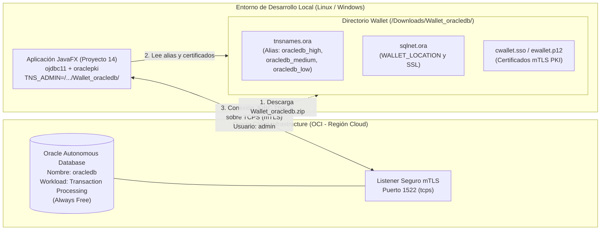
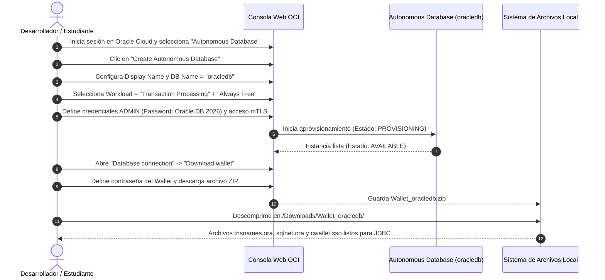

# Proyecto 13 - poo-javafx (Aprovisionamiento de Oracle Cloud Autonomous Database y Configuración de Wallet mTLS)

> **Video de la clase:** [JavaFX - Oracle Cloud Database](https://youtu.be/eQZgz-wNO74)

## Índice
1. [¿Qué hace esta clase?](#qué-hace-esta-clase)
2. [Diferencias Clave: Clase 13 vs. Proyecto 12](#diferencias-clave-clase-13-vs-proyecto-12)
3. [Diagrama de Arquitectura de Aprovisionamiento y Seguridad (OCI + Wallet)](#diagrama-de-arquitectura-de-aprovisionamiento-y-seguridad-oci--wallet)
4. [Flujo de Aprovisionamiento y Descarga de Credenciales](#flujo-de-aprovisionamiento-y-descarga-de-credenciales)
5. [Paso a Paso: Creación de la Base de Datos en Oracle Cloud (OCI)](#paso-a-paso-creación-de-la-base-de-datos-en-oracle-cloud-oci)
   - [Paso 1: Ingresar a la Consola de Oracle Cloud Infrastructure (OCI)](#paso-1-ingresar-a-la-consola-de-oracle-cloud-infrastructure-oci)
   - [Paso 2: Configurar la Instancia Autonomous Database (`oracledb`)](#paso-2-configurar-la-instancia-autonomous-database-oracledb)
   - [Paso 3: Configurar Credenciales de Administrador (`ADMIN`) y Red](#paso-3-configurar-credenciales-de-administrador-admin-y-red)
   - [Paso 4: Descargar la Billetera de Seguridad (`Wallet_oracledb.zip`)](#paso-4-descargar-la-billetera-de-seguridad-wallet_oracledbzip)
   - [Paso 5: Descomprimir el Wallet y Analizar su Contenido](#paso-5-descomprimir-el-wallet-y-analizar-su-contenido)
   - [Paso 6: Probar la Conexión con SQL Developer / Database Actions](#paso-6-probar-la-conexión-con-sql-developer--database-actions)
6. [Estructura de Archivos del Wallet](#estructura-de-archivos-del-wallet)
7. [Objetivos Pedagógicos y Buenas Prácticas](#objetivos-pedagógicos-y-buenas-prácticas)

---

## ¿Qué hace esta clase?

La **Clase 13** constituye el puente de infraestructura entre la persistencia local en archivos planos JSON (desarrollada entre los Proyectos 04 y 12) y la persistencia relacional empresarial en la nube que se conecta en el [Proyecto 14](../14/README.md).

A partir del video tutorial [**JavaFX - Oracle Cloud Database**](https://youtu.be/eQZgz-wNO74), en esta sesión se realiza el aprovisionamiento paso a paso de una instancia de base de datos relacional autónoma (**Oracle Autonomous Database - Always Free**) dentro de **Oracle Cloud Infrastructure (OCI)**, junto con la generación y descarga de la billetera criptográfica de cliente (**Oracle Wallet**) necesaria para establecer conexiones seguras mediante **mTLS (Mutual Transport Layer Security)** desde aplicaciones Java/JavaFX.

Los hitos principales que se completan en esta etapa son:
1. **Creación de una instancia Oracle Autonomous Transaction Processing (ATP)** bajo la capa gratuita (*Always Free*) con nombre de base de datos `oracledb`.
2. **Configuración de las credenciales maestras** del usuario `ADMIN` y políticas de acceso seguro desde cualquier ubicación mediante mTLS.
3. **Generación y descarga del paquete de credenciales (`Wallet_oracledb.zip`)** desde la consola de OCI.
4. **Descompresión y preparación del directorio local del Wallet** (por ejemplo, `/home/ccarreno/Downloads/Wallet_oracledb/`), identificando los descriptores de red (`tnsnames.ora`, `sqlnet.ora`) y el almacén de certificados de inicio de sesión único (`cwallet.sso`).

---

## Diferencias Clave: Clase 13 vs. Proyecto 12

| Aspecto | Proyecto 12 (Persistencia Local JSON) | Clase 13 (Infraestructura Oracle Cloud Database) | Propósito Pedagógico y Técnico |
| :--- | :--- | :--- | :--- |
| **Motor de Almacenamiento** | Archivos planos locales (`alumno.json`, `profesor.json`, `authentication.json`). | **Oracle Autonomous Database (ATP)** alojada en **Oracle Cloud (OCI)**. | Migrar desde archivos locales hacia un motor de base de datos relacional transaccional en la nube. |
| **Seguridad y Transporte** | Lectura/escritura directa en sistema de archivos (`FileWriter` / `InputStreamReader`). | Cifrado de extremo a extremo con **mTLS** y certificados X.509 en **Oracle Wallet**. | Comprender los estándares modernos de seguridad en bases de datos cloud (autenticación mutua por certificados + credenciales). |
| **Resolución de Nombres de Servicio** | Rutas relativas en el classpath (`/alumno.json`). | Alias de red TNS (`oracledb_high`, `oracledb_medium`, `oracledb_low`) definidos en `tnsnames.ora`. | Aprender cómo Oracle Net Services resuelve cadenas de conexión mediante el parámetro `TNS_ADMIN`. |
| **Impacto en la Arquitectura JavaFX** | `PersonaRepository` e `IDAO<T>` desacoplan la capa de negocio. | Se prepara la infraestructura externa sin tocar una sola línea de la UI ni de `PersonaService`. | Demostrar en la práctica por qué diseñamos `IDAO<T>` y `PersonaRepository` en el Proyecto 12: preparar el sistema para cambiar a SQL. |

---

## Diagrama de Arquitectura de Aprovisionamiento y Seguridad (OCI + Wallet)

El siguiente diagrama ilustra los componentes aprovisionados en **Oracle Cloud Infrastructure (OCI)** y los artefactos descargados en la máquina de desarrollo local que serán utilizados por el driver JDBC en el Proyecto 14:



---

## Flujo de Aprovisionamiento y Descarga de Credenciales



---

## Paso a Paso: Creación de la Base de Datos en Oracle Cloud (OCI)

Sigue estos pasos detallados (explicados en el video [JavaFX - Oracle Cloud Database](https://youtu.be/eQZgz-wNO74)) para crear y dejar operativa tu base de datos en Oracle Cloud antes de pasar al Proyecto 14:

### Paso 1: Ingresar a la Consola de Oracle Cloud Infrastructure (OCI)
1. Accede a [https://cloud.oracle.com](https://cloud.oracle.com) e inicia sesión con tu cuenta de Oracle Cloud (Free Tier / Always Free).
2. Abre el **menú de navegación** (ícono de tres líneas horizontales en la esquina superior izquierda).
3. Selecciona **Oracle Database** y luego haz clic en **Autonomous Database** (o *Autonomous Transaction Processing*).
4. Asegúrate de elegir tu **Compartment** (compartimento raíz o de trabajo) en el panel izquierdo y haz clic en el botón azul **Create Autonomous Database** (*Crear base de datos autónoma*).

---

### Paso 2: Configurar la Instancia Autonomous Database (`oracledb`)
En el formulario de creación de la base de datos, completa la información básica:

1. **Compartment**: Verifica que esté seleccionado tu compartimento activo.
2. **Display name** (*Nombre de visualización*): Ingresa `oracledb`.
3. **Database name** (*Nombre de la base de datos*): Ingresa `oracledb` (este nombre dará origen a los alias de conexión como `oracledb_high`).
4. **Workload type** (*Tipo de carga de trabajo*): Selecciona **Transaction Processing** (*Procesamiento de transacciones* - ATP), ideal para aplicaciones CRUD transaccionales como nuestro sistema en JavaFX.
5. **Deployment type** (*Tipo de despliegue*): Selecciona **Serverless** (*Sin servidor*).
6. **Configure the database**:
   - Activa el conmutador **Always Free** (*Siempre gratis*) para utilizar los recursos gratuitos permanentes de OCI sin costo.
   - Selecciona la versión de base de datos disponible (19c o 23ai).

---

### Paso 3: Configurar Credenciales de Administrador (`ADMIN`) y Red
Desplázate hacia la sección de credenciales y red del formulario:

1. **Create administrator credentials**:
   - **Username**: Viene predefinido como `ADMIN` (en JDBC se puede utilizar `admin`).
   - **Password** y **Confirm password**: Ingresa una contraseña que cumpla las reglas de seguridad de Oracle (entre 12 y 30 caracteres, al menos una letra mayúscula, una minúscula y un número, sin contener la palabra `admin`).  
     En el proyecto de clase se utiliza:
     ```text
     Oracle.DB.2026
     ```
2. **Choose network access** (*Elegir acceso de red*):
   - Selecciona **Secure access from everywhere** (*Acceso seguro desde cualquier lugar*).
   - Asegúrate de que la opción **Require mutual TLS (mTLS) authentication** esté marcada (permite conectarse de forma segura desde cualquier red utilizando la billetera criptográfica **Wallet**).
3. **Choose a license type**:
   - Selecciona **License Included** (*Licencia incluida*).
4. Haz clic en **Create Autonomous Database** en la parte inferior.
5. Espera unos minutos mientras el estado cambia de **PROVISIONING** (color naranja) a **AVAILABLE** (color verde).

---

### Paso 4: Descargar la Billetera de Seguridad (`Wallet_oracledb.zip`)
Una vez que la base de datos se encuentre en estado **AVAILABLE**:

1. Dentro de la página de detalles de la base de datos `oracledb`, haz clic en el botón **Database connection** (*Conexión de base de datos*).
2. En la ventana emergente:
   - En **Wallet type** (*Tipo de wallet*), deja seleccionado **Instance Wallet** (*Wallet de instancia*).
   - Haz clic en el botón **Download wallet** (*Descargar wallet*).
3. El sistema te solicitará una contraseña para proteger la billetera descargada:
   - Ingresa la contraseña (por ejemplo, `Oracle.DB.2026`), confírmala y haz clic en **Download**.
4. Se descargará en tu equipo el archivo comprimido:
   ```text
   Wallet_oracledb.zip
   ```

---

### Paso 5: Descomprimir el Wallet y Analizar su Contenido
Para que el driver JDBC de Java (`ojdbc11` + `oraclepki`) pueda utilizar la billetera en el Proyecto 14, debes descomprimir el archivo `.zip` en una carpeta fija de tu sistema operativo:

```bash
# Ejemplo en Linux (creando la carpeta Wallet_oracledb en Downloads)
mkdir -p ~/Downloads/Wallet_oracledb
unzip ~/Downloads/Wallet_oracledb.zip -d ~/Downloads/Wallet_oracledb/
```

> [!IMPORTANT]
> Anota la ruta absoluta donde descomprimiste el Wallet (por ejemplo `/home/ccarreno/Downloads/Wallet_oracledb/` en Linux o `C:/Users/tu_usuario/Downloads/Wallet_oracledb/` en Windows), ya que se pasará como parámetro `?TNS_ADMIN=...` en la URL de conexión JDBC del Proyecto 14.

En la misma ventana **Database connection** de OCI podrás observar la sección **Connection Strings** con los nombres de servicio TNS generados en tu archivo `tnsnames.ora`:
- **`oracledb_high`**: Mayor prioridad de recursos por consulta. Es el alias utilizado en nuestro proyecto:
  ```text
  jdbc:oracle:thin:@oracledb_high?TNS_ADMIN=/home/ccarreno/Downloads/Wallet_oracledb/
  ```
- **`oracledb_medium`**: Menor uso individual de CPU y mayor concurrencia.
- **`oracledb_low`**: Máxima concurrencia con menor costo de CPU por sentencia.

---

### Paso 6: Probar la Conexión con SQL Developer / Database Actions
Antes de programar la conexión en JavaFX, puedes verificar el acceso a la base de datos:
1. **Desde el navegador (Database Actions)**: En la consola de OCI, haz clic en **Database actions** -> **SQL** e ingresa con el usuario `ADMIN` y la contraseña `Oracle.DB.2026` para abrir una hoja de trabajo SQL interactiva.
2. **Desde Oracle SQL Developer o extensión de IDE**:
   - Tipo de conexión: **Cloud Wallet**.
   - Usuario: `admin`
   - Contraseña: `Oracle.DB.2026`
   - Archivo de configuración: Selecciona `Wallet_oracledb.zip`.
   - Servicio: `oracledb_high`.

---

## Estructura de Archivos del Wallet

Al descomprimir `Wallet_oracledb.zip`, obtendrás la siguiente estructura de archivos de configuración y seguridad:

```text
Wallet_oracledb/
├── README                 # Instrucciones y fechas de expiración de certificados del Wallet
├── cwallet.sso            # Auto-login Wallet (utilizado por oraclepki para conectar sin clave adicional)
├── ewallet.p12            # Billetera en formato estándar PKCS#12 protegida por contraseña
├── ewallet.pem            # Certificados en formato PEM
├── keystore.jks           # Java KeyStore (alternativa para configuración SSL manual)
├── ojdbc.properties       # Propiedades de conexión para el driver JDBC de Oracle
├── sqlnet.ora             # Configuración de red que apunta a WALLET_LOCATION y exige SSL
└── tnsnames.ora           # Descriptores de red para oracledb_high, oracledb_medium, oracledb_low, etc.
```

---

## Objetivos Pedagógicos y Buenas Prácticas

1. **Infraestructura Cloud (DBaaS)**:
   - Aprender a aprovisionar y administrar una base de datos relacional autónoma en **Oracle Cloud Infrastructure (OCI)** aprovechando la capa **Always Free**.
2. **Seguridad mediante Mutual TLS (mTLS) y Oracle Wallet**:
   - Comprender por qué las bases de datos en la nube no exponen puertos planos sin cifrar y cómo una billetera PKI (`cwallet.sso`) autentica tanto al servidor como al cliente.
3. **Resolución de Servicios mediante `TNS_ADMIN` y `tnsnames.ora`**:
   - Entender cómo el driver JDBC de Oracle localiza automáticamente el host, puerto, protocolo (`tcps`) y distinguido (`DN`) del certificado usando únicamente el alias `oracledb_high` y la ruta del directorio del Wallet.

