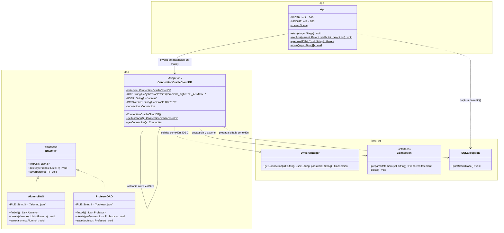
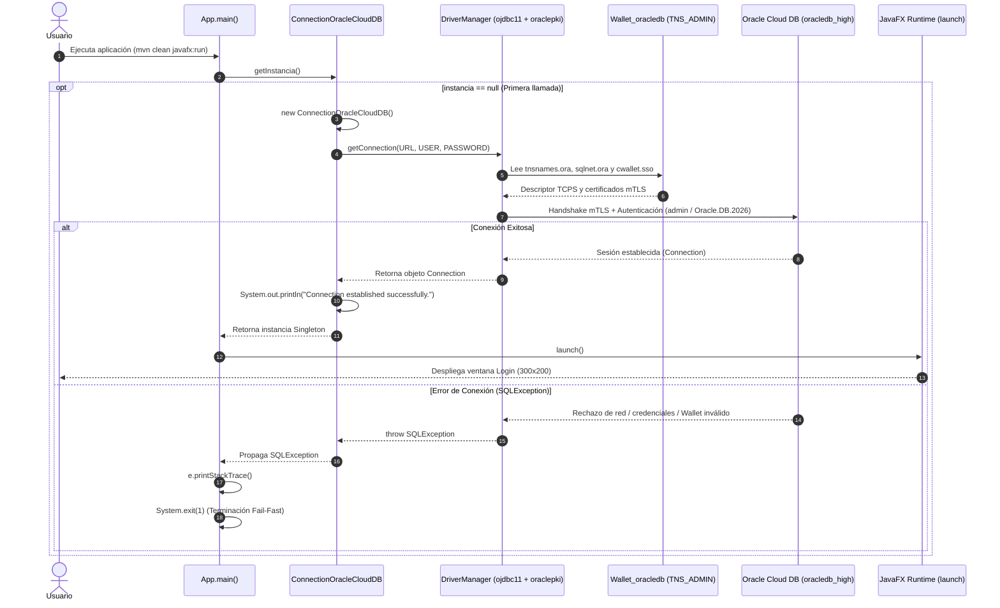
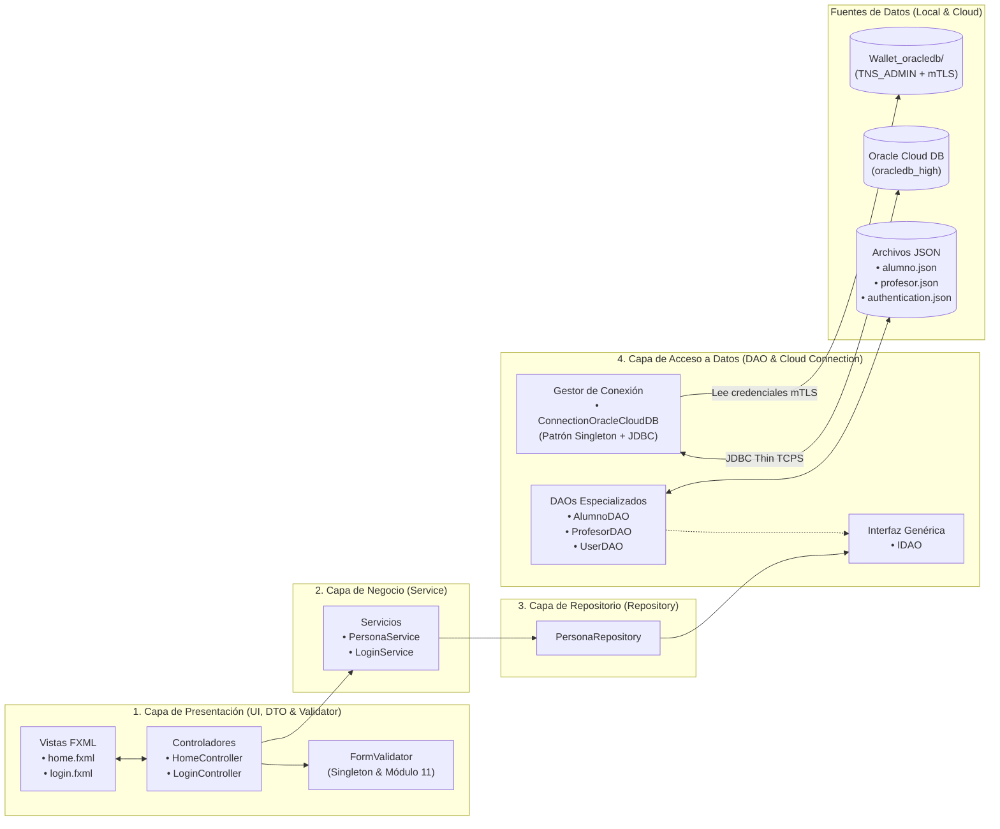
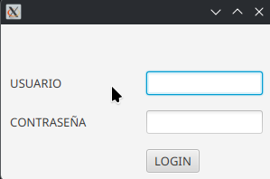

# Proyecto 14 - poo-javafx (Conexión a Oracle Cloud Database con JDBC Thin, Oracle Wallet mTLS y Patrón Singleton)

> **Video de la clase:** [JavaFX - Oracle Database Connection](https://youtu.be/XLmGSSM-YbE)  
> **Prerrequisito de infraestructura:** [Clase 13 - Creación de Oracle Cloud Autonomous Database y Wallet](../13/README.md) ([Video](https://youtu.be/eQZgz-wNO74))

## Índice
1. [¿Qué hace el proyecto?](#qué-hace-el-proyecto)
2. [Diferencias Clave: Proyecto 14 vs. Proyecto 12](#diferencias-clave-proyecto-14-vs-proyecto-12)
3. [Diagrama de Componentes](#diagrama-de-componentes)
4. [Diagrama de Clases](#diagrama-de-clases)
5. [Diagramas de Secuencia y Flujo de Interacción](#diagramas-de-secuencia-y-flujo-de-interacción)
   - [1. Flujo de Arranque y Conexión Segura (Singleton + Fail-Fast en `App.main`)](#1-flujo-de-arranque-y-conexión-segura-singleton--fail-fast-en-appmain)
6. [Arquitectura por Capas y Flujo de Información](#arquitectura-por-capas-y-flujo-de-información)
7. [Paso a Paso para la Construcción Incremental (desde Proyecto 12)](#paso-a-paso-para-la-construcción-incremental-desde-proyecto-12)
8. [Estructura del Proyecto](#estructura-del-proyecto)
9. [Requisitos y Ejecución](#requisitos-y-ejecución)
10. [Resultado esperado y Capturas de Pantalla](#resultado-esperado-y-capturas-de-pantalla)
11. [Objetivos Pedagógicos y Buenas Prácticas](#objetivos-pedagógicos-y-buenas-prácticas)

---

## ¿Qué hace el proyecto?

El **Proyecto 14** integra la conectividad real hacia la base de datos relacional en la nube **Oracle Cloud Autonomous Database** (aprovisionada en la [Clase 13](../13/README.md)) dentro de nuestra arquitectura JavaFX + Maven + JPMS desarrollada hasta el [Proyecto 12](../12/README.md).

Para conectar de manera eficiente, segura y desacoplada con la instancia `oracledb` en **Oracle Cloud Infrastructure (OCI)**, el proyecto implementa los siguientes componentes técnicos y patrones de diseño:

1. **Integración de Drivers Oficiales de Oracle y PKI en Maven (`pom.xml`)**:
   - Se incorpora **`ojdbc11` (`23.26.4.0.0`)**, el driver JDBC Thin oficial de Oracle compatible con JDK 11 y superior.
   - Se incorpora **`oraclepki` (`23.26.4.0.0`)**, el proveedor criptográfico de infraestructura de clave pública de Oracle que permite al driver JDBC abrir automáticamente el archivo `cwallet.sso` de la billetera descargada (`Wallet_oracledb`) para establecer el túnel **mTLS (Mutual TLS)** sin requerir configuración manual de KeyStore/TrustStore en la JVM.
2. **Habilitación del Módulo JDBC en JPMS (`module-info.java`)**:
   - Se declara `requires java.sql;` en el descriptor modular para exponer las APIs estándar de conectividad relacional (`Connection`, `DriverManager`, `SQLException`).
3. **Gestor de Conexión con Patrón Creacional Singleton (`ConnectionOracleCloudDB.java`)**:
   - Ubicado en el paquete `cl.elprofecarreno.app.dao`, encapsula la creación y mantenimiento de una **única instancia de conexión JDBC** hacia Oracle Cloud durante el ciclo de vida de la aplicación.
   - Configura la cadena de conexión JDBC Thin utilizando el alias de alto rendimiento `oracledb_high` y el parámetro **`TNS_ADMIN`** apuntando a la ruta local donde se descomprimió el Wallet en la Clase 13:
     ```text
     jdbc:oracle:thin:@oracledb_high?TNS_ADMIN=/home/ccarreno/Downloads/Wallet_oracledb/
     ```
   - Establece la sesión mediante `DriverManager.getConnection(URL, USER, PASSWORD)` en su constructor privado y confirma el enlace imprimiendo `"Connection established successfully."`.
4. **Verificación Temprana en el Punto de Entrada (*Fail-Fast* en `App.java`)**:
   - El método `main(String[] args)` invoca `ConnectionOracleCloudDB.getInstancia()` antes de iniciar el entorno gráfico de JavaFX (`launch()`).
   - Si la conexión a Oracle Cloud falla (por credenciales inválidas, falta de internet o ruta incorrecta del Wallet), se captura la excepción `SQLException`, se registra la traza de error y se detiene inmediatamente el proceso con `System.exit(1)`, evitando que el usuario opere sobre una interfaz sin respaldo de base de datos.

---

## Diferencias Clave: Proyecto 14 vs. Proyecto 12

| Componente / Aspecto | Proyecto 12 (Persistencia JSON con Repository) | Proyecto 14 (Conexión a Oracle Cloud Database con JDBC y Singleton) | Justificación Pedagógica y Técnica |
| :--- | :--- | :--- | :--- |
| **Dependencias en `pom.xml`** | Solo incluye `javafx-controls`, `javafx-fxml`, `lombok` y `gson`. | Agrega **`com.oracle.database.jdbc:ojdbc11`** y **`com.oracle.database.security:oraclepki`** (`23.26.4.0.0`). | Dota al proyecto del driver JDBC Thin de Oracle y del lector nativo de billeteras criptográficas (`cwallet.sso`) para conexiones mTLS. |
| **Descriptor Modular (`module-info.java`)** | Solo requiere módulos de JavaFX, Gson y Lombok. | Incorpora **`requires java.sql;`** al inicio del módulo. | Cumple con el encapsulamiento de JPMS habilitando el paquete `java.sql` (`Connection`, `DriverManager`, `SQLException`). |
| **Gestión de Conexión a Base de Datos** | No existe conexión a motor de base de datos relacional. | Nueva clase **`ConnectionOracleCloudDB`** en el paquete `dao` aplicando el **Patrón Singleton**. | Centraliza las credenciales, la URL con `TNS_ADMIN` y el objeto `Connection`, evitando abrir múltiples conexiones costosas hacia la nube. |
| **Autenticación Segura con Wallet** | No aplica (archivos locales en `resources/`). | Cadena JDBC con `?TNS_ADMIN=/.../Wallet_oracledb/` sobre el servicio `oracledb_high`. | Enseña a conectar aplicaciones Java reales con bases de datos autónomas en Oracle Cloud utilizando configuración TNS y certificados mTLS. |
| **Inicialización en `App.java` (`main`)** | Invoca directamente `launch()` para abrir la ventana de Login. | Ejecuta **`ConnectionOracleCloudDB.getInstancia()`** en un bloque `try-catch (SQLException)` antes de `launch()`. | Aplica el principio **Fail-Fast**: valida la disponibilidad de la infraestructura crítica en el arranque y aborta con `System.exit(1)` ante fallos. |

---

## Diagrama de Componentes

El siguiente diagrama muestra cómo se integra el componente `ConnectionOracleCloudDB` junto con los artefactos de Oracle JDBC/PKI y el directorio local del Wallet dentro de la arquitectura del Proyecto 14:

```mermaid
flowchart TB
    subgraph Boot_Layer["Arranque de Aplicación"]
        AppMain["App.java\n(main verifica conexión antes de launch)"]
    end

    subgraph UI_Layer["Capa de Presentación (JavaFX)"]
        Views["Vistas FXML\n(/views/login.fxml, /views/home.fxml)"]
        Controllers["Controladores\n(LoginController, HomeController)"]
        FormVal["FormValidator\n(Singleton)"]
    end

    subgraph Service_Layer["Capa de Negocio (Service)"]
        Services["Servicios\n(PersonaService, LoginService)"]
    end

    subgraph Repository_Layer["Capa de Repositorio (Repository)"]
        PersonaRepo["PersonaRepository.java"]
    end

    subgraph Persistence_Layer["Capa de Acceso a Datos (DAO & Conexión Cloud)"]
        ConnDB["ConnectionOracleCloudDB.java\n(Singleton JDBC Connection)"]
        IDAO["<<interface>>\nIDAO<T>"]
        DAOs["AlumnoDAO / ProfesorDAO / UserDAO"]

        subgraph JDBC_Drivers["Librerías Maven Oracle (23.26.4.0.0)"]
            OJDBC["ojdbc11\n(Driver JDBC Thin)"]
            PKI["oraclepki\n(Proveedor Seguridad Wallet)"]
        end
    end

    subgraph External_Infra["Infraestructura Externa (Clase 13)"]
        WalletDir[("Wallet_oracledb/\n(tnsnames.ora, sqlnet.ora, cwallet.sso)")]
        OracleCloud[("Oracle Cloud Autonomous DB\nServicio: oracledb_high\nUsuario: admin")]
    end

    AppMain -->|1. Inicializa Singleton| ConnDB
    AppMain -->|2. Si conecta OK: launch()| Views
    Views <--> Controllers
    Controllers --> FormVal
    Controllers --> Services
    Services --> PersonaRepo
    PersonaRepo --> IDAO
    DAOs -.-> IDAO

    ConnDB -->|DriverManager.getConnection| OJDBC
    OJDBC -->|Autenticación mTLS| PKI
    OJDBC -->|Lee TNS_ADMIN| WalletDir
    PKI -->|Lee cwallet.sso| WalletDir
    OJDBC <-->|Túnel Seguro TCPS : 1522| OracleCloud
```

---

## Diagrama de Clases

El siguiente diagrama UML detalla la estructura de la nueva clase `ConnectionOracleCloudDB` (implementando el Patrón Singleton) y su relación con `App`, `DriverManager` y la capa `dao`:



---

## Diagramas de Secuencia y Flujo de Interacción

### 1. Flujo de Arranque y Conexión Segura (Singleton + Fail-Fast en `App.main`)

Este diagrama de secuencia detalla el proceso de arranque en `App.main()`, la lectura de la billetera `Wallet_oracledb` por parte del driver `ojdbc11` + `oraclepki` y la apertura de la conexión hacia **Oracle Cloud Autonomous Database**:



---

## Arquitectura por Capas y Flujo de Información



---

## Paso a Paso para la Construcción Incremental (desde Proyecto 12)

Si ya aprovisionaste tu base de datos autónoma y descargaste tu Wallet siguiendo la [Clase 13](../13/README.md), aplica estos 4 pasos sobre el código del [Proyecto 12](../12/README.md) para construir el Proyecto 14:

### Paso 1: Agregar las Dependencias `ojdbc11` y `oraclepki` en `pom.xml`
Abre el archivo `pom.xml` y añade las dos dependencias oficiales de Oracle Database (`23.26.4.0.0`) dentro de la sección `<dependencies>`:

- **Archivo**: `pom.xml`
```xml
        <!-- Driver JDBC Thin oficial de Oracle para Java 11+ -->
        <dependency>
            <groupId>com.oracle.database.jdbc</groupId>
            <artifactId>ojdbc11</artifactId>
            <version>23.26.4.0.0</version>
            <scope>compile</scope>
        </dependency>
        <!-- Proveedor de seguridad Oracle PKI para leer cwallet.sso (mTLS) -->
        <dependency>
            <groupId>com.oracle.database.security</groupId>
            <artifactId>oraclepki</artifactId>
            <version>23.26.4.0.0</version>
            <scope>compile</scope>
        </dependency>
```

---

### Paso 2: Declarar el Módulo `java.sql` en `module-info.java`
Modifica `src/main/java/module-info.java` agregando `requires java.sql;` para permitir el uso de `Connection`, `DriverManager` y `SQLException`:

- **Archivo**: `src/main/java/module-info.java`
```java
module cl.elprofecarreno.app {
    requires java.sql;
    requires javafx.controls;
    requires javafx.fxml;

    requires com.google.gson;
    requires static lombok;
    requires javafx.base;

    opens cl.elprofecarreno.app to javafx.fxml;
    opens cl.elprofecarreno.app.controller to javafx.fxml;
    opens cl.elprofecarreno.app.controller.dto to javafx.base;
    opens cl.elprofecarreno.app.dao.entity to com.google.gson;
    exports cl.elprofecarreno.app;
}
```

---

### Paso 3: Crear la Clase Singleton `ConnectionOracleCloudDB.java`
Crea la clase `ConnectionOracleCloudDB` dentro del paquete `cl.elprofecarreno.app.dao`. Asegúrate de ajustar la ruta de `TNS_ADMIN` en la constante `URL` para que apunte al directorio donde descomprimiste tu archivo `Wallet_oracledb.zip`:

- **Archivo**: `src/main/java/cl/elprofecarreno/app/dao/ConnectionOracleCloudDB.java`
```java
package cl.elprofecarreno.app.dao;

import java.sql.Connection;
import java.sql.DriverManager;
import java.sql.SQLException;

public class ConnectionOracleCloudDB {
    
    private static ConnectionOracleCloudDB instancia;
    private final static String URL = "jdbc:oracle:thin:@oracledb_high?TNS_ADMIN=/home/ccarreno/Downloads/Wallet_oracledb/";
    private final static String USER = "admin";
    private final static String PASSWORD = "Oracle.DB.2026";
    private Connection connection;

    private ConnectionOracleCloudDB() throws SQLException {
        this.connection = DriverManager.getConnection(URL, USER, PASSWORD);
        System.out.println("Connection established successfully.");
    }

    public static ConnectionOracleCloudDB getInstancia() throws SQLException {
        if (instancia == null) {
            instancia = new ConnectionOracleCloudDB();
        }
        return instancia;
    }

    public Connection getConnection() {
        return this.connection;
    }
}
```

> [!IMPORTANT]
> Si estás en Windows, recuerda usar barras normales (`/`) o dobles barras invertidas (`\\`) en la ruta de `TNS_ADMIN`, por ejemplo:  
> `jdbc:oracle:thin:@oracledb_high?TNS_ADMIN=C:/Users/tu_usuario/Downloads/Wallet_oracledb/`

---

### Paso 4: Inicializar la Conexión en `App.java` antes de Lanzar la Interfaz
Actualiza el método `main(String[] args)` en `src/main/java/cl/elprofecarreno/app/App.java` para comprobar la conexión al iniciar la aplicación:

- **Archivo**: `src/main/java/cl/elprofecarreno/app/App.java`
```java
package cl.elprofecarreno.app;

import javafx.application.Application;
import javafx.fxml.FXMLLoader;
import javafx.scene.Parent;
import javafx.scene.Scene;
import javafx.stage.Stage;

import java.io.IOException;
import java.sql.SQLException;

import cl.elprofecarreno.app.dao.ConnectionOracleCloudDB;

public class App extends Application {

    private final static int WIDTH = 300;
    private final static int HEIGHT = 200;

    private static Scene scene;

    @Override
    public void start(Stage stage) throws IOException {
        scene = new Scene(getLoadFXML("/views/login"));
        stage.setScene(scene);
        stage.setWidth(WIDTH);
        stage.setHeight(HEIGHT);
        stage.centerOnScreen();
        stage.show();
    }

    public static void setRoot(Parent parent, int width, int height) throws IOException {
        scene.setRoot(parent);
        scene.getWindow().setWidth(width);
        scene.getWindow().setHeight(height);
        scene.getWindow().centerOnScreen();
    }

    public static Parent getLoadFXML(String fxml) throws IOException {
        FXMLLoader fxmlLoader = new FXMLLoader(App.class.getResource(fxml + ".fxml"));
        return fxmlLoader.load();
    }

    public static void main(String[] args) {
        try {
            ConnectionOracleCloudDB.getInstancia();
        } catch (SQLException e) {
            e.printStackTrace();
            System.exit(1);
        }
        // Iniciar la aplicación JavaFX
        launch();
    }

}
```

---

## Estructura del Proyecto

```text
14/
├── 14.png                                                 # Captura de pantalla: Login inicial tras conectar a Oracle Cloud
├── 14_02.png                                              # Captura de pantalla: Formulario Maestro-Detalle
├── README.md                                              # Documentación técnica completa del Proyecto 14
└── poo-javafx/
    ├── README.md                                          # Guía paso a paso del Proyecto 14
    ├── pom.xml                                            # Descriptor Maven con ojdbc11 y oraclepki (23.26.4.0.0)
    └── src/
        └── main/
            ├── java/
            │   ├── module-info.java                       # Configuración JPMS (incluye requires java.sql)
            │   └── cl/elprofecarreno/app/
            │       ├── App.java                           # Arranque con validación Fail-Fast de conexión a Oracle Cloud
            │       ├── controller/
            │       │   ├── HomeController.java            # Controlador de la vista principal
            │       │   ├── LoginController.java           # Controlador de acceso y transición
            │       │   ├── dto/
            │       │   │   ├── AlumnoDTO.java             # DTO Alumno con @SuperBuilder
            │       │   │   ├── IRemunerable.java          # Interfaz de liquidación previsional
            │       │   │   ├── PersonaDTO.java            # DTO base abstracto con @SuperBuilder
            │       │   │   ├── ProfesorDTO.java           # DTO Profesor con @SuperBuilder
            │       │   │   └── UserDTO.java               # DTO de usuario de sesión
            │       │   └── validator/
            │       │       ├── FormValidator.java         # Singleton con Regex y Módulo 11 (isRutValid)
            │       │       └── ValidationException.java   # Excepción verificada de validación
            │       ├── dao/
            │       │   ├── ConnectionOracleCloudDB.java   # Gestor Singleton de conexión JDBC con Oracle Wallet
            │       │   ├── IDAO.java                      # Interfaz genérica IDAO<T>
            │       │   ├── AlumnoDAO.java                 # Implementación IDAO<Alumno>
            │       │   ├── ProfesorDAO.java               # Implementación IDAO<Profesor>
            │       │   ├── PersonaDAO.java                # DAO de referencia
            │       │   ├── UserDAO.java                   # DAO de autenticación de usuarios
            │       │   ├── entity/
            │       │   │   ├── Alumno.java                # Entidad Alumno (@SuperBuilder)
            │       │   │   ├── Direccion.java             # Entidad Direccion (@Builder)
            │       │   │   ├── Persona.java               # Entidad abstracta Persona (@SuperBuilder)
            │       │   │   ├── Profesor.java              # Entidad Profesor (@SuperBuilder)
            │       │   │   └── User.java                  # Entidad User
            │       │   └── excepcion/
            │       │       └── DAOException.java          # Excepción comprobada de la capa DAO
            │       ├── repository/
            │       │   └── PersonaRepository.java         # Orquestador polimórfico de AlumnoDAO y ProfesorDAO
            │       └── service/
            │           ├── LoginService.java              # Lógica de autenticación
            │           └── PersonaService.java            # Servicio de negocio conectado a PersonaRepository
            └── resources/
                ├── alumno.json                            # Almacén JSON para entidades Alumno
                ├── authentication.json                    # Base de datos de credenciales de acceso
                ├── data.json                              # Archivo JSON general de referencia
                ├── profesor.json                          # Almacén JSON para entidades Profesor
                └── views/
                    ├── home.fxml                          # Vista del formulario maestro-detalle
                    └── login.fxml                         # Vista compacta de inicio de sesión
```

---

## Requisitos y Ejecución

### Requisitos Previos
- **Java Development Kit (JDK)**: Versión 11 o superior (recomendado OpenJDK 21).
- **Apache Maven**: Versión 3.8 o superior.
- **Oracle Cloud Autonomous Database + Wallet**: Instancia activa en OCI y carpeta `Wallet_oracledb` descargada y descomprimida según el tutorial de la [Clase 13](../13/README.md).

### Ejecución del Proyecto
Para compilar, descargar las dependencias de Oracle JDBC y ejecutar el proyecto 14:

```bash
cd 14/poo-javafx
mvn clean compile javafx:run
```

---

## Resultado esperado y Capturas de Pantalla

### 1. Verificación de Conexión en Consola y Estado Inicial (Login)
Al ejecutar `mvn clean javafx:run`, la aplicación establece primero el túnel seguro mTLS con Oracle Cloud e imprime en la consola:

```text
Connection established successfully.
```

Inmediatamente después se abre la ventana de inicio de sesión (300x200 píxeles):
- **Usuario**: `admin`
- **Contraseña**: `qwerty`



### 2. Formulario Maestro en Ejecución
Tras autenticarse, se despliega el formulario maestro-detalle de 1080x800 píxeles con la sesión JDBC activa en segundo plano:


---

## Objetivos Pedagógicos y Buenas Prácticas

1. **Patrón Singleton Aplicado a Conexiones de Base de Datos**:
   - Reutilizar el patrón creacional **Singleton** (visto previamente en `FormValidator` en el Proyecto 10) en un nuevo contexto de infraestructura: garantizar que exista una única instancia de conexión JDBC compartida en memoria.
2. **Conectividad Segura en la Nube con JDBC Thin y `oraclepki`**:
   - Comprender cómo `ojdbc11` y `oraclepki` colaboran para negociar conexiones cifradas **mTLS** leyendo automáticamente `tnsnames.ora`, `sqlnet.ora` y `cwallet.sso` mediante el parámetro `TNS_ADMIN`.
3. **Estrategia de Arranque *Fail-Fast***:
   - Validar los recursos críticos (como la conectividad a la base de datos en `App.main()`) antes de levantar la interfaz de usuario, deteniendo la aplicación tempranamente (`System.exit(1)`) si el entorno no es válido.
4. **Modularidad JPMS con JDBC**:
   - Reconocer la importancia de declarar explícitamente `requires java.sql;` en `module-info.java` al integrar motores de bases de datos relacionales en proyectos Java modulares.

