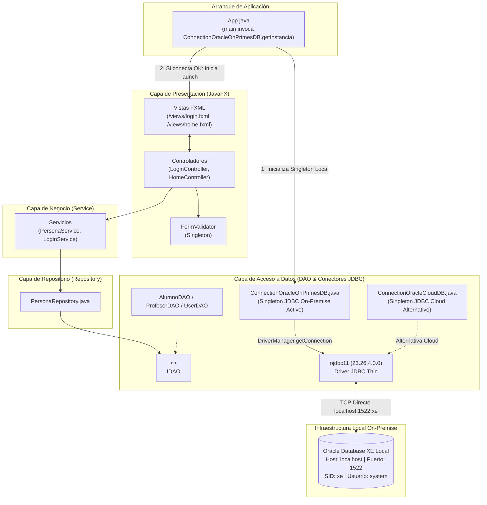
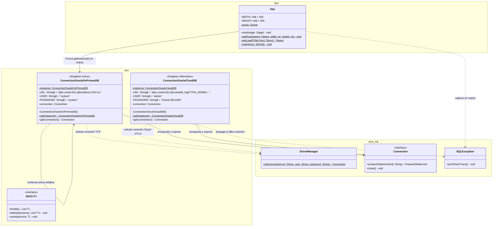
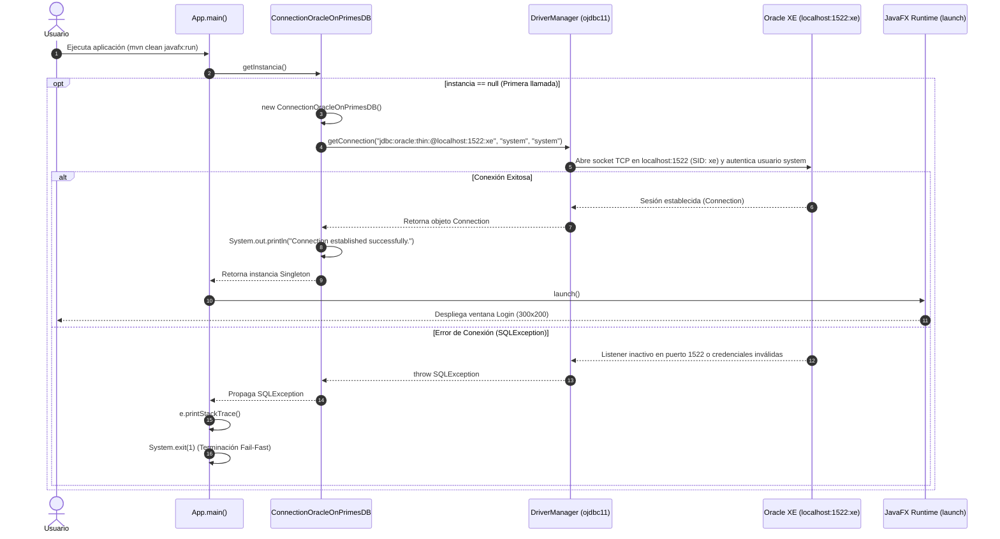
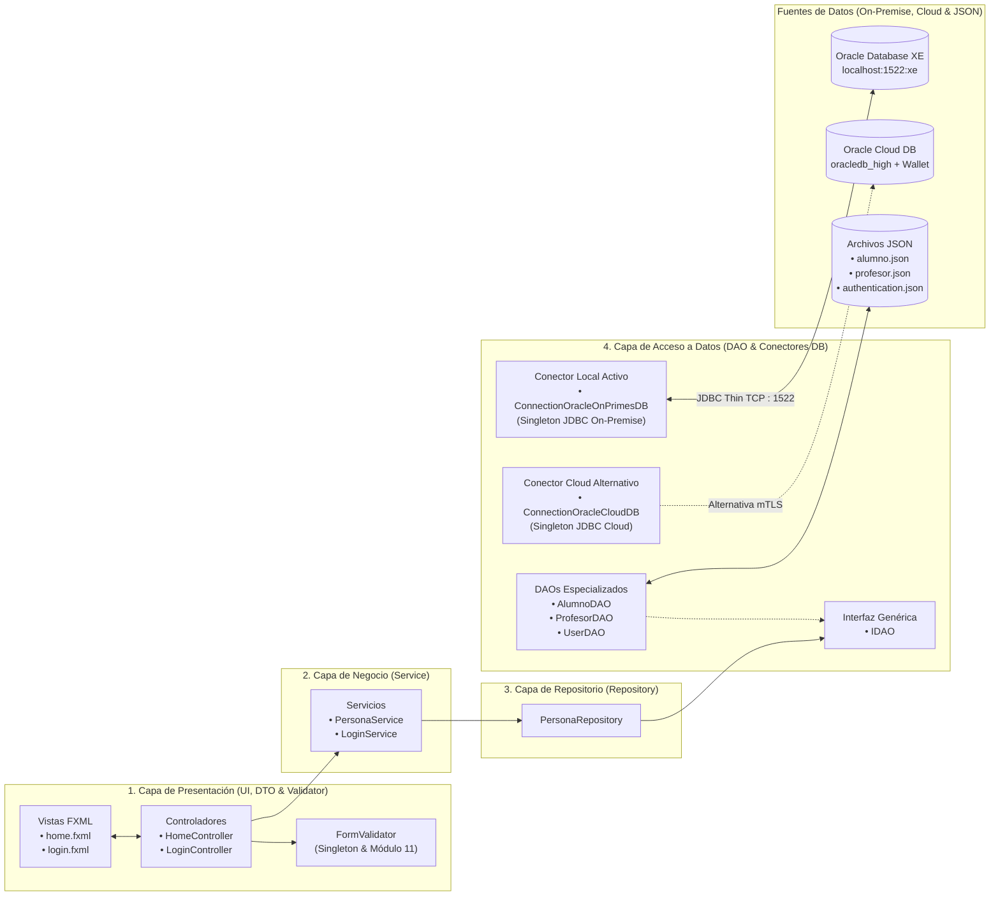

# Proyecto 15 - poo-javafx (Conexión a Oracle Database On-Premise / Local XE con JDBC Thin y Patrón Singleton)

> **Video de la clase:** [JavaFX - Oracle Database Connection OnPremise](https://youtu.be/G4DC8spE0jY)

## Índice
1. [¿Qué hace el proyecto?](#qué-hace-el-proyecto)
2. [Diferencias Clave: Proyecto 15 (On-Premise) vs. Proyecto 14 (Oracle Cloud)](#diferencias-clave-proyecto-15-on-premise-vs-proyecto-14-oracle-cloud)
3. [Diagrama de Componentes](#diagrama-de-componentes)
4. [Diagrama de Clases](#diagrama-de-clases)
5. [Diagramas de Secuencia y Flujo de Interacción](#diagramas-de-secuencia-y-flujo-de-interacción)
   - [1. Flujo de Arranque y Conexión JDBC Directa a Oracle XE (`App.main`)](#1-flujo-de-arranque-y-conexión-jdbc-directa-a-oracle-xe-appmain)
6. [Arquitectura por Capas y Flujo de Información](#arquitectura-por-capas-y-flujo-de-información)
7. [Paso a Paso para la Construcción Incremental (desde Proyecto 14)](#paso-a-paso-para-la-construcción-incremental-desde-proyecto-14)
8. [Estructura del Proyecto](#estructura-del-proyecto)
9. [Requisitos y Ejecución](#requisitos-y-ejecución)
10. [Resultado esperado y Capturas de Pantalla](#resultado-esperado-y-capturas-de-pantalla)
11. [Objetivos Pedagógicos y Buenas Prácticas](#objetivos-pedagógicos-y-buenas-prácticas)

---

## ¿Qué hace el proyecto?

El **Proyecto 15** incorpora la conexión hacia un servidor de base de datos relacional **Oracle Database On-Premise (Local / Docker / Express Edition - XE)** utilizando el driver **JDBC Thin (`ojdbc11`)** y el **Patrón Creacional Singleton**, ofreciendo una alternativa local e independiente de la nube frente a la conexión con **Oracle Cloud Autonomous Database** implementada en el [Proyecto 14](../14/README.md).

En entornos académicos, de desarrollo sin acceso a internet o en despliegues corporativos *On-Premise* (servidores locales o contenedores Docker con Oracle Database XE), la conexión no requiere una billetera criptográfica mTLS (`Wallet_oracledb`), sino una cadena de conexión TCP directa indicando **host, puerto y SID/Service Name**. Con el Proyecto 15 se implementan los siguientes elementos:

1. **Gestor de Conexión Local con Patrón Singleton (`ConnectionOracleOnPrimesDB.java`)**:
   - Nueva clase dentro del paquete `cl.elprofecarreno.app.dao` que implementa el **Patrón Creacional Singleton** (`instancia` estática privada, constructor privado y método `getInstancia()`).
   - Utiliza el formato clásico de URL **JDBC Thin por Host:Puerto:SID**:
     ```text
     jdbc:oracle:thin:@localhost:1522:xe
     ```
   - Configura las credenciales administrativas locales (`USER = "system"`, `PASSWORD = "system"`) y abre la sesión mediante `DriverManager.getConnection(URL, USER, PASSWORD)`, confirmando por consola `"Connection established successfully."`.
2. **Coexistencia de Conectores Cloud y On-Premise en la Capa DAO**:
   - El paquete `dao` conserva tanto `ConnectionOracleCloudDB` (para Oracle Cloud con Wallet) como `ConnectionOracleOnPrimesDB` (para Oracle XE local), permitiendo alternar entre entornos de nube y servidores locales con un cambio mínimo.
3. **Conmutación e Inicialización *Fail-Fast* en `App.java`**:
   - En `App.main(String[] args)`, se conmuta la verificación inicial de arranque hacia `ConnectionOracleOnPrimesDB.getInstancia()`.
   - Si el motor local de Oracle XE en `localhost:1522` no está iniciado o las credenciales fallan, captura `SQLException`, imprime la traza de error y detiene la aplicación de inmediato con `System.exit(1)` antes de levantar la interfaz JavaFX.

---

## Diferencias Clave: Proyecto 15 (On-Premise) vs. Proyecto 14 (Oracle Cloud)

| Componente / Aspecto | Proyecto 14 (Oracle Cloud Autonomous DB) | Proyecto 15 (Oracle Database On-Premise / XE) | Justificación Pedagógica y Técnica |
| :--- | :--- | :--- | :--- |
| **Clase Gestora de Conexión** | `ConnectionOracleCloudDB` (Singleton). | Nueva clase **`ConnectionOracleOnPrimesDB`** (Singleton), manteniendo `ConnectionOracleCloudDB` disponible. | Permite contrastar ambas modalidades de conexión empresarial (Cloud DBaaS vs. Servidor Local On-Premise) bajo el mismo patrón de diseño. |
| **Formato de URL JDBC Thin** | Alias TNS + directorio de Wallet:<br>`jdbc:oracle:thin:@oracledb_high?TNS_ADMIN=/.../Wallet_oracledb/` | Dirección directa TCP (`host:puerto:SID`):<br>**`jdbc:oracle:thin:@localhost:1522:xe`** | Enseña la sintaxis directa del driver JDBC Thin cuando nos conectamos a una instancia Oracle dentro de nuestra propia red o máquina local (`localhost`). |
| **Mecanismo de Seguridad / Transporte** | Requiere billetera **Oracle Wallet (`cwallet.sso`)**, `tnsnames.ora` y `oraclepki` sobre protocolo `tcps`. | Conexión TCP directa al listener local de Oracle (puerto `1522`, SID `xe`) sin necesidad de archivos Wallet externos. | Simplifica el desarrollo local (por ejemplo, con Oracle XE instalado o en contenedor Docker) sin depender de certificados cloud. |
| **Credenciales de Acceso** | Usuario de nube: `admin` / `Oracle.DB.2026`. | Usuario de instancia local: **`system`** / **`system`**. | Utiliza la cuenta administrativa predeterminada de instalaciones locales de Oracle Database Express Edition (XE). |
| **Verificación de Arranque en `App.java`** | Llama a `ConnectionOracleCloudDB.getInstancia()` en `main()`. | Llama a **`ConnectionOracleOnPrimesDB.getInstancia()`** en `main()`. | Demuestra la facilidad para cambiar el proveedor de conexión sin alterar controladores, vistas FXML, servicios ni repositorios. |

---

## Diagrama de Componentes

El siguiente diagrama ilustra la arquitectura del Proyecto 15, destacando el conector `ConnectionOracleOnPrimesDB` hacia el motor local **Oracle Database XE (`localhost:1522:xe`)** y la coexistencia con `ConnectionOracleCloudDB`:



---

## Diagrama de Clases

El siguiente diagrama UML muestra la clase `ConnectionOracleOnPrimesDB` junto a `ConnectionOracleCloudDB` y su integración con `App` y la API `java.sql`:



---

## Diagramas de Secuencia y Flujo de Interacción

### 1. Flujo de Arranque y Conexión JDBC Directa a Oracle XE (`App.main`)



---

## Arquitectura por Capas y Flujo de Información



---

## Paso a Paso para la Construcción Incremental (desde Proyecto 14)

Si vienes avanzando desde el [Proyecto 14](../14/README.md), sigue estos pasos para agregar el soporte de conexión a una base de datos **Oracle On-Premise (Local XE)** en el Proyecto 15:

### Paso 1: Verificar las Dependencias JDBC y el Módulo `java.sql`
Asegúrate de mantener en `pom.xml` la dependencia `ojdbc11` (`23.26.4.0.0`) y en `src/main/java/module-info.java` la directiva `requires java.sql;` (configuradas en el Proyecto 14):

- **Archivo**: `src/main/java/module-info.java`
```java
module cl.elprofecarreno.app {
    requires java.sql;
    requires javafx.controls;
    requires javafx.fxml;

    requires com.google.gson;
    requires static lombok;
    requires javafx.base;

    opens cl.elprofecarreno.app to javafx.fxml;
    opens cl.elprofecarreno.app.controller to javafx.fxml;
    opens cl.elprofecarreno.app.controller.dto to javafx.base;
    opens cl.elprofecarreno.app.dao.entity to com.google.gson;
    exports cl.elprofecarreno.app;
}
```

---

### Paso 2: Crear la Clase Singleton `ConnectionOracleOnPrimesDB.java`
Crea la nueva clase `ConnectionOracleOnPrimesDB` dentro del paquete `cl.elprofecarreno.app.dao` apuntando a tu instancia local de Oracle (`jdbc:oracle:thin:@localhost:1522:xe`) con el usuario `system`:

- **Archivo**: `src/main/java/cl/elprofecarreno/app/dao/ConnectionOracleOnPrimesDB.java`
```java
package cl.elprofecarreno.app.dao;

import java.sql.Connection;
import java.sql.DriverManager;
import java.sql.SQLException;

public class ConnectionOracleOnPrimesDB {
   
    private static ConnectionOracleOnPrimesDB instancia;
    private final static String URL = "jdbc:oracle:thin:@localhost:1522:xe";
    private final static String USER = "system";
    private final static String PASSWORD = "system";
    private Connection connection;

    private ConnectionOracleOnPrimesDB() throws SQLException {
        this.connection = DriverManager.getConnection(URL, USER, PASSWORD);
        System.out.println("Connection established successfully.");
    }

    public static ConnectionOracleOnPrimesDB getInstancia() throws SQLException {
        if (instancia == null) {
            instancia = new ConnectionOracleOnPrimesDB();
        }
        return instancia;
    }

    public Connection getConnection() {
        return this.connection;
    }
}
```

> [!TIP]
> Si tu instalación local de Oracle Database XE escucha en el puerto estándar `1521` en lugar de `1522`, o utiliza un servicio PDB (por ejemplo `//localhost:1521/XEPDB1`), solo debes ajustar la constante `URL` en esta clase sin tocar el resto del proyecto.

---

### Paso 3: Conmutar la Conexión en `App.java` hacia `ConnectionOracleOnPrimesDB`
En `src/main/java/cl/elprofecarreno/app/App.java`, reemplaza la importación e invocación de `ConnectionOracleCloudDB` por `ConnectionOracleOnPrimesDB`:

- **Archivo**: `src/main/java/cl/elprofecarreno/app/App.java`
```java
package cl.elprofecarreno.app;

import javafx.application.Application;
import javafx.fxml.FXMLLoader;
import javafx.scene.Parent;
import javafx.scene.Scene;
import javafx.stage.Stage;

import java.io.IOException;
import java.sql.SQLException;

import cl.elprofecarreno.app.dao.ConnectionOracleOnPrimesDB;

public class App extends Application {

    private final static int WIDTH = 300;
    private final static int HEIGHT = 200;

    private static Scene scene;

    @Override
    public void start(Stage stage) throws IOException {
        scene = new Scene(getLoadFXML("/views/login"));
        stage.setScene(scene);
        stage.setWidth(WIDTH);
        stage.setHeight(HEIGHT);
        stage.centerOnScreen();
        stage.show();
    }

    public static void setRoot(Parent parent, int width, int height) throws IOException {
        scene.setRoot(parent);
        scene.getWindow().setWidth(width);
        scene.getWindow().setHeight(height);
        scene.getWindow().centerOnScreen();
    }

    public static Parent getLoadFXML(String fxml) throws IOException {
        FXMLLoader fxmlLoader = new FXMLLoader(App.class.getResource(fxml + ".fxml"));
        return fxmlLoader.load();
    }

    public static void main(String[] args) {
        try {
            ConnectionOracleOnPrimesDB.getInstancia();
        } catch (SQLException e) {
            e.printStackTrace();
            System.exit(1);
        }
        // Iniciar la aplicación JavaFX
        launch();
    }

}
```

---

## Estructura del Proyecto

```text
15/
├── 15.png                                                 # Captura de pantalla: Login inicial tras conectar a Oracle On-Premise
├── 15_02.png                                              # Captura de pantalla: Formulario Maestro-Detalle
├── README.md                                              # Documentación técnica completa del Proyecto 15
└── poo-javafx/
    ├── README.md                                          # Guía paso a paso del Proyecto 15
    ├── pom.xml                                            # Descriptor Maven con ojdbc11 y oraclepki (23.26.4.0.0)
    └── src/
        └── main/
            ├── java/
            │   ├── module-info.java                       # Configuración JPMS (incluye requires java.sql)
            │   └── cl/elprofecarreno/app/
            │       ├── App.java                           # Arranque con validación Fail-Fast hacia ConnectionOracleOnPrimesDB
            │       ├── controller/
            │       │   ├── HomeController.java            # Controlador de la vista principal
            │       │   ├── LoginController.java           # Controlador de acceso y transición
            │       │   ├── dto/
            │       │   │   ├── AlumnoDTO.java             # DTO Alumno con @SuperBuilder
            │       │   │   ├── IRemunerable.java          # Interfaz de liquidación previsional
            │       │   │   ├── PersonaDTO.java            # DTO base abstracto con @SuperBuilder
            │       │   │   ├── ProfesorDTO.java           # DTO Profesor con @SuperBuilder
            │       │   │   └── UserDTO.java               # DTO de usuario de sesión
            │       │   └── validator/
            │       │       ├── FormValidator.java         # Singleton con Regex y Módulo 11 (isRutValid)
            │       │       └── ValidationException.java   # Excepción verificada de validación
            │       ├── dao/
            │       │   ├── ConnectionOracleOnPrimesDB.java # Gestor Singleton de conexión JDBC On-Premise (localhost:1522:xe)
            │       │   ├── ConnectionOracleCloudDB.java   # Gestor Singleton de conexión JDBC Cloud (alternativo)
            │       │   ├── IDAO.java                      # Interfaz genérica IDAO<T>
            │       │   ├── AlumnoDAO.java                 # Implementación IDAO<Alumno>
            │       │   ├── ProfesorDAO.java               # Implementación IDAO<Profesor>
            │       │   ├── PersonaDAO.java                # DAO de referencia
            │       │   ├── UserDAO.java                   # DAO de autenticación de usuarios
            │       │   ├── entity/
            │       │   │   ├── Alumno.java                # Entidad Alumno (@SuperBuilder)
            │       │   │   ├── Direccion.java             # Entidad Direccion (@Builder)
            │       │   │   ├── Persona.java               # Entidad abstracta Persona (@SuperBuilder)
            │       │   │   ├── Profesor.java              # Entidad Profesor (@SuperBuilder)
            │       │   │   └── User.java                  # Entidad User
            │       │   └── excepcion/
            │       │       └── DAOException.java          # Excepción comprobada de la capa DAO
            │       ├── repository/
            │       │   └── PersonaRepository.java         # Orquestador polimórfico de AlumnoDAO y ProfesorDAO
            │       └── service/
            │           ├── LoginService.java              # Lógica de autenticación
            │           └── PersonaService.java            # Servicio de negocio conectado a PersonaRepository
            └── resources/
                ├── alumno.json                            # Almacén JSON para entidades Alumno
                ├── authentication.json                    # Base de datos de credenciales de acceso
                ├── data.json                              # Archivo JSON general de referencia
                ├── profesor.json                          # Almacén JSON para entidades Profesor
                └── views/
                    ├── home.fxml                          # Vista del formulario maestro-detalle
                    └── login.fxml                         # Vista compacta de inicio de sesión
```

---

## Requisitos y Ejecución

### Requisitos Previos
- **Java Development Kit (JDK)**: Versión 11 o superior (recomendado OpenJDK 21).
- **Apache Maven**: Versión 3.8 o superior.
- **Oracle Database Express Edition (XE) On-Premise / Docker**: Instancia activa en `localhost:1522` (SID `xe`) con usuario `system` / contraseña `system`.

### Ejecución del Proyecto
Para compilar y ejecutar el proyecto 15 directamente desde la terminal:

```bash
cd 15/poo-javafx
mvn clean compile javafx:run
```

---

## Resultado esperado y Capturas de Pantalla

### 1. Verificación de Conexión Local en Consola y Estado Inicial (Login)
Al ejecutar `mvn clean javafx:run`, la aplicación abre la conexión TCP hacia `localhost:1522:xe` e imprime en la consola:

```text
Connection established successfully.
```

A continuación se despliega la ventana de inicio de sesión (300x200 píxeles):
- **Usuario**: `admin`
- **Contraseña**: `qwerty`


### 2. Formulario Maestro en Ejecución
Tras autenticarse, se abre la ventana principal de 1080x800 píxeles manteniendo activa la conexión Singleton con la instancia local de Oracle:


---

## Objetivos Pedagógicos y Buenas Prácticas

1. **Versatilidad de Conectividad JDBC (Cloud vs. On-Premise)**:
   - Comprender las diferencias entre conectarse a una base de datos autónoma en la nube mediante billetera mTLS (`?TNS_ADMIN=...`) y conectarse a un servidor de base de datos local o corporativo mediante cadena TCP directa (`@localhost:1522:xe`).
2. **Desacoplamiento de la Infraestructura de Conexión**:
   - Encapsular los detalles de conexión en clases Singleton dedicadas (`ConnectionOracleOnPrimesDB` y `ConnectionOracleCloudDB`), permitiendo cambiar el destino de base de datos modificando una única línea en el arranque.
3. **Validación *Fail-Fast* de Servicios Locales**:
   - Detectar de inmediato si el servicio o contenedor local de Oracle Database XE se encuentra detenido antes de presentar pantallas interactivas al usuario.
