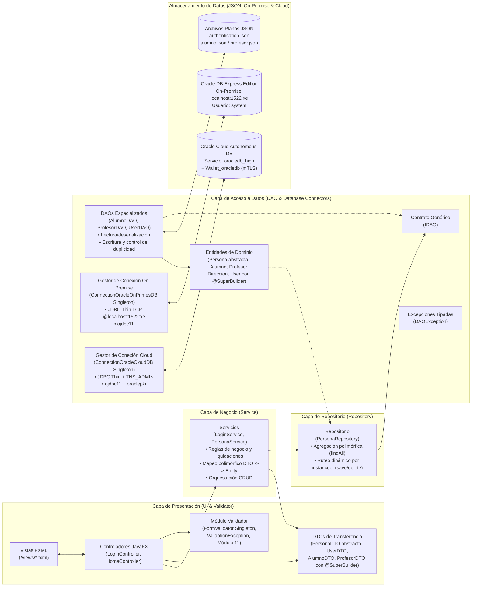

# POO Fundamentos con JavaFX, Maven y Arquitectura por Capas

Este repositorio contiene una serie de proyectos prácticos e incrementales de **Programación Orientada a Objetos en Java con JavaFX, Maven y el Sistema de Módulos de Java (JPMS)**, organizados secuencialmente desde la carpeta `01` hasta la `15`.

Cada proyecto avanza progresivamente sobre la base del anterior, abordando los fundamentos de POO, la separación de responsabilidades, la arquitectura por capas (**Presentación -> Servicio -> Repositorio -> DAO**), los patrones de diseño (**DTO, DAO, Repository, Builder, Singleton**), la programación genérica (**Java Generics con `IDAO<T>`**), el enlace de datos reactivo (**Data Binding** en `TableView`), la persistencia en archivos planos JSON segregados (**Google Gson** con **Pretty Printing**), la reducción de código repetitivo (**Project Lombok** con `@SuperBuilder`), los principios avanzados de POO (**Herencia, Clases Abstractas, Polimorfismo e Interfaces** tanto en DTOs como en Entidades de Dominio), la construcción de formularios maestros interactivos con paneles dinámicos (**TitledPane, ComboBox, CheckBox**), el manejo formal de excepciones verificadas (**ValidationException, DAOException**), algoritmos avanzados de validación nacional (**RUT con Módulo 11 y Expresiones Regulares**) y la integración con bases de datos relacionales tanto en la nube (**Oracle Cloud Autonomous Database** con **Oracle Wallet mTLS**, `ojdbc11` y `oraclepki`) como en entornos locales (**Oracle Database Express Edition On-Premise** mediante `ConnectionOracleOnPrimesDB`).

---

## Herramientas e Instalación

### Videos de instalación:
- [Instalación JDK + Maven en Windows](https://youtu.be/8gooYj4gQ-Q)
- [Gluon Scene Builder - Instalación en Windows !!!](https://youtu.be/69Bo7d2agUY)
- [Instalación JDK + Maven en Linux](https://youtu.be/X0TGKU0gBRc)
- [Gluon Scene Builder - Instalación en Linux !!!](https://youtu.be/QW46As8wLOc)

### Repositorios instaladores:
- [Visual Code Instalador en Linux !!!](https://github.com/elprofecarreno/visual-code-linux-install)

---

## Hoja de Ruta de Evolución Incremental

El siguiente diagrama ilustra cómo cada hito construye y refina las capacidades del sistema:

```mermaid
flowchart TD
    P01["01 - Entorno Base\n• Verificación JDK/Maven/JavaFX\n• Navegación primary/secondary\n• FXMLLoader & setRoot"]
    P02["02 - Login Inicial (1/3)\n• Formulario GridPane FXML\n• TextField & PasswordField\n• Captura de eventos & consola"]
    P03["03 - Modularidad y Limpieza (2/3)\n• Subpaquete controller\n• Vistas en /views/\n• Configuración JPMS opens"]
    P04["04 - Arquitectura en Capas (3/3)\n• Capas Controller -> Service -> DAO\n• DTO (UserDTO) & DAOException\n• Persistencia JSON con Gson"]
    P05["05 - Optimización con Lombok\n• Reducción de Boilerplate\n• Patrón Creacional Builder\n• Procesador de Anotaciones Maven"]
    P06["06 - Navegación y Dominio (1/3)\n• Transición de escena a Home\n• Composición: Persona posee Direccion\n• Aplanamiento DTO (PersonaDTO)"]
    P07["07 - TableView Completo (2/3)\n• Data Binding PropertyValueFactory\n• Deserialización con TypeToken\n• Carga reactiva de personas en tabla"]
    P08["08 - Eliminación y Persistencia (3/3)\n• Selección con SelectionModel\n• Mapeo bidireccional DTO <-> Entidad\n• Persistencia JSON con FileWriter"]
    P09["09 - Formulario Maestro y Herencia (4/4)\n• Herencia DTO (Alumno/Profesor)\n• Interfaz IRemunerable y Polimorfismo\n• UI dinámica con TitledPane y ComboBox\n• Redimensionamiento y centrado de Stage"]
    P10["10 - Validación Centralizada y Singleton\n• Patrón Singleton en FormValidator\n• Excepción verificada ValidationException\n• PersonaDTO abstracta y @SuperBuilder\n• Validación condicional en guardar()"]
    P11["11 - Módulo 11 y CRUD Completo\n• Validación de RUT con Módulo 11 y Regex\n• Ciclo CRUD completo en UI y persistencia\n• Control de duplicados en DAO\n• Serialización Pretty JSON con Gson"]
    P12["12 - Patrón Repository e IDAO<T>\n• Interfaz genérica IDAO<T> (Generics)\n• Persona abstracta, Alumno y Profesor\n• PersonaRepository y ruteo polimórfico\n• Almacenamiento segregado alumno/profesor.json"]
    P13["13 - Oracle Cloud Autonomous DB\n• Creación de instancia ATP Always Free\n• Configuración de usuario ADMIN y mTLS\n• Descarga de Wallet_oracledb.zip\n• Descriptores tnsnames.ora y cwallet.sso"]
    P14["14 - Conexión JDBC a Oracle Cloud\n• Dependencias ojdbc11 y oraclepki\n• Módulo java.sql en module-info.java\n• Singleton ConnectionOracleCloudDB\n• Validación Fail-Fast en App.main"]
    P15["15 - Conexión JDBC Oracle On-Premise\n• Singleton ConnectionOracleOnPrimesDB\n• URL TCP localhost:1522:xe y SID xe\n• Coexistencia Cloud y On-Premise\n• Validación Fail-Fast en App.main"]

    P01 --> P02
    P02 --> P03
    P03 --> P04
    P04 --> P05
    P05 --> P06
    P06 --> P07
    P07 --> P08
    P08 --> P09
    P09 --> P10
    P10 --> P11
    P11 --> P12
    P12 --> P13
    P13 --> P14
    P14 --> P15
```



---

## Índice de Proyectos y Documentación Detallada

Cada carpeta contiene su propio proyecto ejecutable, un `README.md` exhaustivo (con diagramas de componentes, diagramas de clases, diagramas de secuencia/flujo, capturas de pantalla y análisis de diferencias respecto al hito previo) y un `README.md` dedicado exclusivamente al **Paso a Paso** dentro de cada carpeta de proyecto (`XX/poo-javafx/README.md`):

- [**01 - JavaFX (POO)**](01/README.md) · [**Paso a Paso**](01/poo-javafx/README.md)  
  Proyecto inicial y verificación del entorno de desarrollo JavaFX con Maven. Implementa la carga básica de vistas FXML y la conmutación entre pantallas (`primary` y `secondary`) con controladores desacoplados.  
  *Video:* [JavaFX (POO)](https://youtu.be/LNzMEThVvqE)

- [**02 - JavaFX Login 1/3 - POO**](02/README.md) · [**Paso a Paso**](02/poo-javafx/README.md)  
  Construcción del formulario de inicio de sesión (Login) utilizando FXML y su controlador (`LoginController`). Captura credenciales ingresadas por el usuario mediante componentes `TextField` y gestiona el evento de acceso imprimiendo los datos por consola.  
  *Video:* [JavaFX Login 1/3 - POO](https://youtu.be/pcXH2h_e_fw)

- [**03 - JavaFX Login 2/3 - POO**](03/README.md) · [**Paso a Paso**](03/poo-javafx/README.md)  
  Refactorización y separación de responsabilidades. Se organizan los controladores en su propio paquete (`controller`), se centralizan los archivos de vista en `resources/views/`, se añade `PasswordField` para enmascarar contraseñas y se configura el sistema modular de Java (`module-info.java`) con directivas `opens ... to javafx.fxml`.  
  *Video:* [JavaFX Login 2/3 - POO](https://youtu.be/KoVUImFKGJk)

- [**04 - JavaFX Login 3/3 - POO**](04/README.md) · [**Paso a Paso**](04/poo-javafx/README.md)  
  Evolución hacia una arquitectura formal en 3 capas (Presentación -> Negocio -> Acceso a Datos). Implementa autenticación contra un almacén en archivo de texto plano JSON (`authentication.json`) usando **Google Gson**, la biblioteca **Lombok**, el patrón **DTO** (`UserDTO`), la entidad `User`, excepciones personalizadas (`DAOException`) y configuración modular con reflexión.  
  *Video:* [JavaFX Login 3/3 - POO](https://youtu.be/xijdq06FSpg)

- [**05 - JavaFX Corrección Fix Lombok - POO**](05/README.md) · [**Paso a Paso**](05/poo-javafx/README.md)  
  Aprovechamiento integral de **Lombok** y el **patrón Builder**. Se asegura el procesamiento de anotaciones en Maven (`maven-compiler-plugin` con `<annotationProcessorPaths>`) y se refactorizan las clases de modelo (`User` y `UserDTO`) con `@Getter`, `@Setter`, `@Builder`, `@NoArgsConstructor` y `@AllArgsConstructor`, eliminando código repetitivo (*boilerplate*) y utilizando el patrón Builder en la capa de negocio (`LoginService`).  
  *Video:* [JavaFX Corrección Fix Lombok - POO](https://youtu.be/620ut4c-YH0)

- [**06 - JavaFX TableView 1/6 - POO**](06/README.md) · [**Paso a Paso**](06/poo-javafx/README.md)  
  Implementa navegación dinámica entre pantallas reemplazando la raíz de la escena (`scene.setRoot`), incorporando la vista principal `Home` con un componente `TableView`. Introduce relaciones de **composición** en el dominio (`Persona` contiene `Direccion`) y el patrón **DTO** (`PersonaDTO`) para el aplanamiento de datos (*flattening*) listos para presentación, consumiendo una colección con estructuras anidadas en JSON (`data.json`).  
  *Video:* [JavaFX TableView 1/6 - POO](https://youtu.be/fuaMsaJYDHE)

- [**07 - JavaFX TableView 2/6 - POO**](07/README.md) · [**Paso a Paso**](07/poo-javafx/README.md)  
  Implementación integral del enlace de datos (*Data Binding*) sobre `TableView` mediante **`PropertyValueFactory`** y **`ObservableList`**. Desarrolla la lectura de colecciones JSON complejas en `PersonaDAO` mediante **`TypeToken`** y formatos de fecha en Gson, la transformación fluida a DTOs en `PersonaService` con Lombok Builder y la configuración de seguridad reflexiva en `module-info.java` abriendo los DTOs a `javafx.base`.  
  *Video:* [JavaFX TableView 2/6 - POO](https://youtu.be/5dQlqytwymo)

- [**08 - JavaFX TableView 3/6 - POO**](08/README.md) · [**Paso a Paso**](08/poo-javafx/README.md)  
  Culminación de la funcionalidad del `TableView` integrando interactividad de selección (`SelectionModel`), validación defensiva en UI, eliminación en memoria (`ObservableList`) y persistencia física reescribiendo el archivo plano `data.json` con **Google Gson** y `FileWriter`. Implementa el **mapeo bidireccional** (`toEntity` con Builder) para reconstruir entidades a partir de DTOs enriquecidos.  
  *Video:* [JavaFX TableView 3/6 - POO](https://youtu.be/765pQZmPnu0)

- [**09 - JavaFX TableView 4/6 - POO**](09/README.md) · [**Paso a Paso**](09/poo-javafx/README.md)  
  Evolución hacia un formulario maestro interactivo y aplicación avanzada de POO mediante **Herencia** e **Interfaces**. Modela especializaciones de dominio extendiendo `PersonaDTO` en `AlumnoDTO` y `ProfesorDTO`, e implementa la interfaz `IRemunerable` para el cálculo de sueldo líquido con polimorfismo. En la interfaz gráfica JavaFX, implementa paneles colapsables `TitledPane`, controles `ComboBox`, `CheckBox`, activación dinámica de formularios según el tipo de persona seleccionado y control dinámico del tamaño y centrado del `Stage` (`setRoot` con dimensiones y `centerOnScreen`).  
  *Video:* [JavaFX TableView 4/6 - POO](https://youtu.be/PQJw53OmQ8Q)

- [**10 - JavaFX TableView 5/6 - POO**](10/README.md) · [**Paso a Paso**](10/poo-javafx/README.md)  
  Creación de una capa desacoplada de validación de UI con el **Patrón Creacional Singleton** (`FormValidator`) y la excepción comprobada `ValidationException`. Refactorización orientada a objetos de `PersonaDTO` como **clase abstracta**, incorporando Lombok **`@SuperBuilder`** en toda la jerarquía de herencia (`AlumnoDTO`, `ProfesorDTO`) para resolver constructores fluidos en clases derivadas. Implementa validaciones de presencia y longitud máxima en el controlador con retroalimentación inmediata en pantalla.  
  *Video:* [JavaFX TableView 5/6 - POO](https://youtu.be/765pQZmPnu0)

- [**11 - JavaFX TableView 6/6 - POO**](11/README.md) · [**Paso a Paso**](11/poo-javafx/README.md)  
  Cierre del **ciclo CRUD completo** (Crear, Leer, Modificar/Refrescar, Eliminar). Integra el algoritmo de **validación de RUT chileno (Módulo 11)** mediante expresiones regulares y cálculo aritmético del dígito verificador. Extiende la capa DAO (`PersonaDAO`) con `save` y control de duplicidad por RUN, optimiza la serialización con **`setPrettyPrinting()`** en Gson para almacenamiento JSON indentado, refactoriza la eliminación (`delete`) con coincidencia de identidad y asegura la recarga reactiva de la grilla directamente desde el archivo persistido.  
  *Video:* [JavaFX TableView 6/6 - POO](https://youtu.be/fVsA8jRUMnM)

- [**12 - JavaFX TableView - Refactor DAO**](12/README.md) · [**Paso a Paso**](12/poo-javafx/README.md)  
  Evolución arquitectónica de la capa de persistencia y dominio mediante el **Patrón Repository** (`PersonaRepository`), contratos genéricos con la interfaz **`IDAO<T>`** y **herencia en entidades de dominio** convirtiendo `Persona` en clase abstracta con **`@SuperBuilder`** y creando las sub-entidades concretas **`Alumno`** y **`Profesor`**. Segrega el almacenamiento físico en archivos JSON independientes (`alumno.json` y `profesor.json`) administrados por `AlumnoDAO` y `ProfesorDAO`, mientras `PersonaRepository` unifica las consultas (`findAll`) y enruta polimórficamente las operaciones de escritura (`save`) y borrado (`delete`) mediante evaluación `instanceof`.  
  *Video:* [JavaFX TableView - Refactor DAO](https://youtu.be/GxmGi0AIyMw)

- [**13 - JavaFX - Oracle Cloud Database**](13/README.md)  
  Guía paso a paso de aprovisionamiento de una instancia de base de datos relacional autónoma (**Oracle Cloud Autonomous Database - Always Free**) en **Oracle Cloud Infrastructure (OCI)**. Cubre la configuración de la instancia `oracledb` (Transaction Processing), credenciales de administración (`ADMIN`), políticas de acceso seguro mediante **mTLS** y la generación, descarga y descompresión de la billetera criptográfica (**`Wallet_oracledb.zip`**) con sus descriptores `tnsnames.ora`, `sqlnet.ora` y `cwallet.sso`.  
  *Video:* [JavaFX - Oracle Cloud Database](https://youtu.be/eQZgz-wNO74)

- [**14 - JavaFX - Oracle Database Connection**](14/README.md) · [**Paso a Paso**](14/poo-javafx/README.md)  
  Integración de la conexión hacia **Oracle Cloud Autonomous Database** en el proyecto JavaFX mediante el driver oficial **`ojdbc11`** y el proveedor de seguridad **`oraclepki`** (`23.26.4.0.0`). Incorpora `requires java.sql;` en `module-info.java`, implementa el gestor de conexión **`ConnectionOracleCloudDB`** bajo el **Patrón Creacional Singleton** utilizando la URL JDBC Thin con `TNS_ADMIN` apuntando al directorio local del Wallet (`oracledb_high`), y añade verificación *Fail-Fast* de conectividad en `App.main()` antes de iniciar el ciclo de vida gráfico.  
  *Video:* [JavaFX - Oracle Database Connection](https://youtu.be/XLmGSSM-YbE)

- [**15 - JavaFX - Oracle Database Connection OnPremise**](15/README.md) · [**Paso a Paso**](15/poo-javafx/README.md)  
  Implementación de la conectividad hacia una base de datos local **Oracle Database Express Edition (On-Premise)** mediante el gestor **`ConnectionOracleOnPrimesDB`** bajo el **Patrón Creacional Singleton**. Utiliza la cadena JDBC Thin directa por TCP/IP (`jdbc:oracle:thin:@localhost:1522:xe`) con el usuario `system`, coexistiendo en el paquete `dao` junto a `ConnectionOracleCloudDB` y ejecutando la validación *Fail-Fast* en `App.main()` antes de iniciar la interfaz JavaFX.  
  *Video:* [JavaFX - Oracle Database Connection OnPremise](https://youtu.be/G4DC8spE0jY)

---

## Evolución Pedagógica de los Proyectos

| Proyecto | Enfoque Principal | Componentes Clave | Persistencia / Datos | Dependencias Adicionales |
| :--- | :--- | :--- | :--- | :--- |
| **01** | Entorno y navegación básica | `App`, `PrimaryController`, `SecondaryController` | N/A | JavaFX Controls & FXML |
| **02** | Formulario de Login inicial | `LoginController`, `login.fxml` | En memoria / consola | JavaFX Controls & FXML |
| **03** | Separación y modularidad | Paquete `controller`, carpeta `views/`, `PasswordField`, `module-info.java` | En memoria / consola | JavaFX Controls & FXML |
| **04** | Arquitectura en capas y patrones | Capas `controller`, `service`, `dao`, `UserDTO`, `DAOException` | Archivo plano JSON (`authentication.json`) | Gson 2.14.0, Lombok 1.18.36 |
| **05** | Integración total de Lombok y Patrón Builder | Refactorización de `User` y `UserDTO` con anotaciones Lombok; instanciación fluida con `UserDTO.builder()` | Archivo plano JSON (`authentication.json`) | Gson 2.14.0, Lombok 1.18.36 (con Annotation Processor en `maven-compiler-plugin`) |
| **06** | Navegación entre vistas, composición de entidades y aplanamiento en DTO | `App` (`setRoot`), `LoginController`, `HomeController`, `Persona`, `Direccion`, `PersonaDTO`, `TableView` en `home.fxml` | Archivos planos JSON: `authentication.json` y `data.json` (estructuras anidadas) | JavaFX Controls & FXML 21, Gson 2.14.0, Lombok 1.18.36 |
| **07** | Enlace de datos reactivo (Data Binding), colecciones genéricas y JPMS avanzado | `HomeController` (`PropertyValueFactory`, `ObservableList`), `PersonaDAO` (`TypeToken`), `PersonaService` (`toDto` con Builder) | Archivo plano JSON: `data.json` (array raíz de personas) | JavaFX Controls & FXML 21, JavaFX Base, Gson 2.14.0, Lombok 1.18.36 |
| **08** | Interacción, selección de filas, eliminación reactiva y persistencia bidireccional | `HomeController` (`getSelectionModel`, `eliminar`), `PersonaService` (`toEntity`), `PersonaDAO` (`eliminar` con `FileWriter`), `PersonaDTO` | Archivo plano JSON: `data.json` (lectura y sobreescritura) | JavaFX Controls & FXML 21, JavaFX Base, Gson 2.14.0, Lombok 1.18.36 |
| **09** | Formulario maestro, herencia en DTOs, interfaces y controles dinámicos de UI | `HomeController` (paneles dinámicos `TitledPane`, combos, guardado), `AlumnoDTO`, `ProfesorDTO`, `IRemunerable`, `App` (`setRoot` redimensionable con `centerOnScreen`) | Archivo plano JSON: `data.json` (lectura y sobreescritura) | JavaFX Controls & FXML 21, JavaFX Base, Gson 2.14.0, Lombok 1.18.36 |
| **10** | Validación centralizada, patrón Singleton, jerarquía abstracta con `@SuperBuilder` | `FormValidator` (Singleton), `ValidationException`, `PersonaDTO` (abstracta), `AlumnoDTO` y `ProfesorDTO` con `@SuperBuilder`, validación en `guardar()` | Archivo plano JSON: `data.json` (lectura y sobreescritura) | JavaFX Controls & FXML 21, JavaFX Base, Gson 2.14.0, Lombok 1.18.36 |
| **11** | Validación algorítmica de RUT (Módulo 11), ciclo CRUD completo y Pretty JSON | `FormValidator` (`isRutValid` con Regex y Módulo 11), `PersonaDAO` (`save` con unicidad, `delete`, `setPrettyPrinting`), `PersonaService` (`save`), sincronización reactiva | Archivo plano JSON: `data.json` (CRUD integral con formato Pretty Printing) | JavaFX Controls & FXML 21, JavaFX Base, Gson 2.14.0, Lombok 1.18.36 |
| **12** | Patrón Repository, interfaz genérica `IDAO<T>`, herencia en entidades y persistencia JSON segregada | `PersonaRepository`, `IDAO<T>`, `AlumnoDAO`, `ProfesorDAO`, `Persona` (abstracta con `@SuperBuilder`), `Alumno`, `Profesor`, `PersonaService` (`toEntity` polimórfico) | Archivos planos JSON segregados: `alumno.json` y `profesor.json` (Pretty Printing) | JavaFX Controls & FXML 21, JavaFX Base, Gson 2.14.0, Lombok 1.18.36 |
| **13** | Aprovisionamiento de base de datos en la nube y seguridad mTLS | Consola OCI, instancia `oracledb` (ATP Always Free), `Wallet_oracledb.zip` (`tnsnames.ora`, `sqlnet.ora`, `cwallet.sso`) | Oracle Cloud Autonomous Database (`oracledb_high`) | Oracle Cloud Infrastructure (OCI) + Oracle Wallet |
| **14** | Conexión JDBC Thin a Oracle Cloud con Wallet y Patrón Singleton | `ConnectionOracleCloudDB` (Singleton con `DriverManager` y `TNS_ADMIN`), `App.main` (verificación *Fail-Fast*), `module-info.java` (`requires java.sql`) | Oracle Cloud Autonomous Database (`oracledb_high`) + Archivos JSON | JavaFX 21, Gson 2.14.0, Lombok 1.18.36, `ojdbc11` 23.26.4.0.0, `oraclepki` 23.26.4.0.0 |
| **15** | Conexión JDBC Thin a Oracle Database On-Premise (XE) y Patrón Singleton | `ConnectionOracleOnPrimesDB` (Singleton con URL TCP `@localhost:1522:xe`), coexistencia con `ConnectionOracleCloudDB`, `App.main` (*Fail-Fast*) | Oracle Database Express Edition (`localhost:1522:xe`) + Oracle Cloud + Archivos JSON | JavaFX 21, Gson 2.14.0, Lombok 1.18.36, `ojdbc11` 23.26.4.0.0, `oraclepki` 23.26.4.0.0 |

---

## Arquitectura General por Capas

A partir del Proyecto 04 y evolucionando hasta el Proyecto 15, la arquitectura del software sigue una separación estricta en capas (Presentación -> Negocio -> Repositorio -> Acceso a Datos y Conexión a Bases de Datos Cloud / On-Premise):



---

## Objetivo General del Repositorio

El repositorio busca desarrollar competencias profesionales sólidas en el diseño e ingeniería de software orientado a objetos en Java:

- **Pilares de POO**: Encapsulamiento, abstracción, herencia, polimorfismo, modularidad, relaciones entre objetos (**asociación y composición**) y separación de responsabilidades tanto en la capa de presentación como en la de dominio.
- **Arquitectura y Patrones de Diseño**: Organización multicapa (Presentación, Servicio, Repositorio, DAO), uso de objetos de transferencia de datos (**DTO**) para el desacoplamiento y aplanamiento de datos (*data flattening*), abstracción genérica de fuentes de datos (**`IDAO<T>`**), orquestación polimórfica mediante el **Patrón Repository** (`PersonaRepository`) y patrón creacional **Singleton** tanto para validación (`FormValidator`) como para conexiones a bases de datos (`ConnectionOracleCloudDB` y `ConnectionOracleOnPrimesDB`).
- **Patrones Creacionales y Reducción de Boilerplate**: Implementación del **patrón Builder** y uso de anotaciones avanzadas de **Lombok** (`@SuperBuilder`, `@Builder`, `@Getter`, `@Setter`, `@NoArgsConstructor`, `@AllArgsConstructor`) para soportar herencia en constructores tanto de DTOs como de Entidades (`Persona` -> `Alumno` / `Profesor`) y mantener un código limpio y mantenible.
- **Manejo de Excepciones**: Creación y propagación de excepciones comprobadas personalizadas (`ValidationException`, `DAOException`) y de infraestructura (`SQLException`) para modelar y aislar errores técnicos y de validación de negocio.
- **Persistencia Híbrida (JSON Segregado, Oracle Cloud y Oracle On-Premise)**: Lectura, inserción, eliminación y serialización en archivos JSON (`alumno.json`, `profesor.json`, `authentication.json`) mediante **Google Gson** (**Pretty Printing**), conectividad empresarial hacia **Oracle Cloud Database** mediante **JDBC Thin (`ojdbc11`)**, **Oracle PKI (`oraclepki`)** y billeteras criptográficas **mTLS (`Wallet_oracledb`)**, y conectividad local hacia **Oracle Database Express Edition (On-Premise)** mediante TCP/IP (`localhost:1522:xe`).
- **Interfaces Gráficas (GUI) y Enlace de Datos**: Diseño de vistas declarativas con FXML, contenedores semánticos (`TitledPane`, `GridPane`, `VBox`), controles dinámicos (`ComboBox`, `CheckBox`), enlace de propiedades en tablas (`TableView`, `TableColumn`, `PropertyValueFactory`), recarga reactiva de datos y transición dinámica de escenarios con redimensionamiento y centrado adaptativo.
- **Algoritmos y Validación de Negocio**: Implementación de lógica de verificación nacional mediante expresiones regulares (Regex) y cálculo aritmético de verificación por **Módulo 11**.
- **Sistema de Módulos de Java (JPMS)**: Configuración rigurosa de `module-info.java`, gestionando directivas `requires` (incluyendo `java.sql`), `requires static`, `exports` y `opens ... to ...` para permitir reflexión controlada en tiempo de ejecución.

---

## Requisitos y Ejecución

### Requisitos
- **Java JDK**: 11 o superior (recomendado JDK 21).
- **Apache Maven**: 3.8+.
- **IDE**: IntelliJ IDEA, Visual Studio Code, Eclipse o NetBeans (con soporte para Lombok habilitado).
- **Oracle Cloud Wallet** (para el Proyecto 14): Instancia `oracledb` activa en OCI y carpeta `Wallet_oracledb` configurada según la [Clase 13](13/README.md).
- **Oracle Database Express Edition (XE)** (para el Proyecto 15): Instancia local On-Premise o contenedor Docker escuchando en `localhost:1522` con SID `xe`.

### Ejecutar cualquier proyecto

Puedes ejecutar cualquiera de los proyectos entrando a su respectiva carpeta:

```bash
# Ejemplo para ejecutar el proyecto 15
cd 15/poo-javafx
mvn clean javafx:run
```

O directamente desde la raíz del repositorio indicando la ruta del archivo `pom.xml`:

```bash
# Ejecutar Proyecto 01
mvn -f 01/poo-javafx/pom.xml clean javafx:run

# Ejecutar Proyecto 04
mvn -f 04/poo-javafx/pom.xml clean javafx:run

# Ejecutar Proyecto 07
mvn -f 07/poo-javafx/pom.xml clean javafx:run

# Ejecutar Proyecto 08
mvn -f 08/poo-javafx/pom.xml clean javafx:run

# Ejecutar Proyecto 09
mvn -f 09/poo-javafx/pom.xml clean javafx:run

# Ejecutar Proyecto 10
mvn -f 10/poo-javafx/pom.xml clean javafx:run

# Ejecutar Proyecto 11
mvn -f 11/poo-javafx/pom.xml clean javafx:run

# Ejecutar Proyecto 12
mvn -f 12/poo-javafx/pom.xml clean javafx:run

# Ejecutar Proyecto 14
mvn -f 14/poo-javafx/pom.xml clean javafx:run

# Ejecutar Proyecto 15
mvn -f 15/poo-javafx/pom.xml clean javafx:run
```

---

## Estructura del Repositorio

```text
poo-javafx/
├── README.md              # Documentación general y arquitectura del repositorio
├── 01/                    # 01 - JavaFX Base y Navegación
│   ├── 01.png
│   ├── README.md          # Documentación arquitectónica y diagramas del Proyecto 01
│   └── poo-javafx/
│       └── README.md      # Guía paso a paso del Proyecto 01
├── 02/                    # 02 - JavaFX Login 1/3 (Formulario y Eventos)
│   ├── 02.png
│   ├── README.md          # Documentación arquitectónica y diagramas del Proyecto 02
│   └── poo-javafx/
│       └── README.md      # Guía paso a paso del Proyecto 02
├── 03/                    # 03 - JavaFX Login 2/3 (Subpaquetes y Modularidad)
│   ├── 03.png
│   ├── README.md          # Documentación arquitectónica y diagramas del Proyecto 03
│   └── poo-javafx/
│       └── README.md      # Guía paso a paso del Proyecto 03
├── 04/                    # 04 - JavaFX Login 3/3 (Arquitectura en Capas, DAO, DTO y Gson)
│   ├── 04.png
│   ├── README.md          # Documentación arquitectónica y diagramas del Proyecto 04
│   └── poo-javafx/
│       └── README.md      # Guía paso a paso del Proyecto 04
├── 05/                    # 05 - JavaFX Fix Lombok (Patrón Builder y Procesador de Anotaciones)
│   ├── 05.png
│   ├── README.md          # Documentación arquitectónica y diagramas del Proyecto 05
│   └── poo-javafx/
│       └── README.md      # Guía paso a paso del Proyecto 05
├── 06/                    # 06 - JavaFX TableView 1/6 (Navegación y Composición de Dominio)
│   ├── 06.png
│   ├── 06_02.png
│   ├── README.md          # Documentación arquitectónica y diagramas del Proyecto 06
│   └── poo-javafx/
│       └── README.md      # Guía paso a paso del Proyecto 06
├── 07/                    # 07 - JavaFX TableView 2/6 (Data Binding y Colecciones Gson)
│   ├── 07.png
│   ├── 07_02.png
│   ├── README.md          # Documentación arquitectónica y diagramas del Proyecto 07
│   └── poo-javafx/
│       └── README.md      # Guía paso a paso del Proyecto 07
├── 08/                    # 08 - JavaFX TableView 3/6 (Selección, Eliminación y Persistencia Bidireccional)
│   ├── 08.png
│   ├── 08_02.png
│   ├── README.md          # Documentación arquitectónica y diagramas del Proyecto 08
│   └── poo-javafx/
│       └── README.md      # Guía paso a paso del Proyecto 08
├── 09/                    # 09 - JavaFX TableView 4/6 (Formulario Maestro, Herencia en DTOs, Interfaces y Controles Dinámicos)
│   ├── 09.png
│   ├── 09_02.png
│   ├── README.md          # Documentación arquitectónica y diagramas del Proyecto 09
│   └── poo-javafx/
│       └── README.md      # Guía paso a paso del Proyecto 09
├── 10/                    # 10 - Validación Centralizada, Patrón Singleton y Jerarquía Abstracta con @SuperBuilder
│   ├── 10.png
│   ├── 10_02.png
│   ├── README.md          # Documentación arquitectónica y diagramas del Proyecto 10
│   └── poo-javafx/
│       └── README.md      # Guía paso a paso del Proyecto 10
├── 11/                    # 11 - Validación de RUT (Módulo 11), Ciclo CRUD Completo y Persistencia Pretty JSON
│   ├── 11.png
│   ├── 11_02.png
│   ├── README.md          # Documentación arquitectónica y diagramas del Proyecto 11
│   └── poo-javafx/
│       └── README.md      # Guía paso a paso del Proyecto 11
├── 12/                    # 12 - Patrón Repository, Interfaz Genérica IDAO<T>, Herencia en Entidades y Persistencia Segregada
│   ├── 12.png
│   ├── 12_02.png
│   ├── README.md          # Documentación arquitectónica y diagramas del Proyecto 12
│   └── poo-javafx/
│       └── README.md      # Guía paso a paso del Proyecto 12
├── 13/                    # 13 - Aprovisionamiento de Oracle Cloud Autonomous Database y Configuración de Wallet mTLS
│   └── README.md          # Guía paso a paso de creación de BD en Oracle Cloud y descarga del Wallet
├── 14/                    # 14 - Conexión a Oracle Cloud Database con JDBC Thin, Oracle Wallet mTLS y Patrón Singleton
│   ├── 14.png
│   ├── 14_02.png
│   ├── README.md          # Documentación arquitectónica y diagramas del Proyecto 14
│   └── poo-javafx/
│       └── README.md      # Guía paso a paso del Proyecto 14
└── 15/                    # 15 - Conexión a Oracle Database On-Premise (XE) con JDBC Thin y Patrón Singleton
    ├── 15.png
    ├── 15_02.png
    ├── README.md          # Documentación arquitectónica y diagramas del Proyecto 15
    └── poo-javafx/
        └── README.md      # Guía paso a paso del Proyecto 15
```
