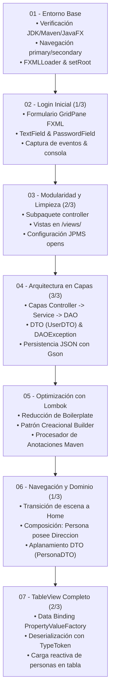
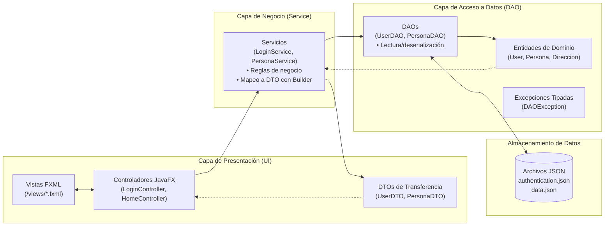

# POO Fundamentos con JavaFX, Maven y Arquitectura por Capas

Este repositorio contiene una serie de proyectos prácticos e incrementales de **Programación Orientada a Objetos en Java con JavaFX, Maven y el Sistema de Módulos de Java (JPMS)**, organizados secuencialmente desde la carpeta `01` hasta la `07`.

Cada proyecto avanza progresivamente sobre la base del anterior, abordando los fundamentos de POO, la separación de responsabilidades, la arquitectura por capas (**Presentación -> Servicio -> DAO**), los patrones de diseño (**DTO, DAO, Builder**), el enlace de datos reactivo (**Data Binding** en `TableView`), la persistencia en archivos planos JSON (**Google Gson**) y la reducción de código repetitivo (**Project Lombok**).

---

## Herramientas e Instalación

### Videos de instalación:
- [Instalación JDK + Maven en Windows](https://youtu.be/8gooYj4gQ-Q)
- [Gluon Scene Builder - Instalación en Windows !!!](https://youtu.be/69Bo7d2agUY)
- [Instalación JDK + Maven en Linux](https://youtu.be/X0TGKU0gBRc)
- [Gluon Scene Builder - Instalación en Linux !!!](https://youtu.be/QW46As8wLOc)

### Repositorios instaladores:
- [Visual Code Instalador en Linux !!!](https://github.com/elprofecarreno/visual-code-linux-install)

---

## Hoja de Ruta de Evolución Incremental

El siguiente diagrama ilustra cómo cada hito construye y refina las capacidades del sistema:



---

## Índice de Proyectos y Documentación Detallada

Cada carpeta contiene su propio proyecto ejecutable y un `README.md` exhaustivo con diagramas de componentes, diagramas de clases, diagramas de secuencia/flujo, análisis de diferencias respecto al hito previo y tutorial de construcción paso a paso:

- [**01 - JavaFX (POO)**](01/README.md)  
  Proyecto inicial y verificación del entorno de desarrollo JavaFX con Maven. Implementa la carga básica de vistas FXML y la conmutación entre pantallas (`primary` y `secondary`) con controladores desacoplados.  
  *Video:* [JavaFX (POO)](https://youtu.be/LNzMEThVvqE)

- [**02 - JavaFX Login 1/3 - POO**](02/README.md)  
  Construcción del formulario de inicio de sesión (Login) utilizando FXML y su controlador (`LoginController`). Captura credenciales ingresadas por el usuario mediante componentes `TextField` y gestiona el evento de acceso imprimiendo los datos por consola.  
  *Video:* [JavaFX Login 1/3 - POO](https://youtu.be/pcXH2h_e_fw)

- [**03 - JavaFX Login 2/3 - POO**](03/README.md)  
  Refactorización y separación de responsabilidades. Se organizan los controladores en su propio paquete (`controller`), se centralizan los archivos de vista en `resources/views/`, se añade `PasswordField` para enmascarar contraseñas y se configura el sistema modular de Java (`module-info.java`) con directivas `opens ... to javafx.fxml`.  
  *Video:* [JavaFX Login 2/3 - POO](https://youtu.be/KoVUImFKGJk)

- [**04 - JavaFX Login 3/3 - POO**](04/README.md)  
  Evolución hacia una arquitectura formal en 3 capas (Presentación -> Negocio -> Acceso a Datos). Implementa autenticación contra un almacén en archivo de texto plano JSON (`authentication.json`) usando **Google Gson**, la biblioteca **Lombok**, el patrón **DTO** (`UserDTO`), la entidad `User`, excepciones personalizadas (`DAOException`) y configuración modular con reflexión.  
  *Video:* [JavaFX Login 3/3 - POO](https://youtu.be/xijdq06FSpg)

- [**05 - JavaFX Corrección Fix Lombok - POO**](05/README.md)  
  Aprovechamiento integral de **Lombok** y el **patrón Builder**. Se asegura el procesamiento de anotaciones en Maven (`maven-compiler-plugin` con `<annotationProcessorPaths>`) y se refactorizan las clases de modelo (`User` y `UserDTO`) con `@Getter`, `@Setter`, `@Builder`, `@NoArgsConstructor` y `@AllArgsConstructor`, eliminando código repetitivo (*boilerplate*) y utilizando el patrón Builder en la capa de negocio (`LoginService`).  
  *Video:* [JavaFX Corrección Fix Lombok - POO](https://youtu.be/620ut4c-YH0)

- [**06 - JavaFX TableView 1/3 - POO**](06/README.md)  
  Implementa navegación dinámica entre pantallas reemplazando la raíz de la escena (`scene.setRoot`), incorporando la vista principal `Home` con un componente `TableView`. Introduce relaciones de **composición** en el dominio (`Persona` contiene `Direccion`) y el patrón **DTO** (`PersonaDTO`) para el aplanamiento de datos (*flattening*) listos para presentación, consumiendo una colección con estructuras anidadas en JSON (`data.json`).  
  *Video:* [JavaFX TableView 1/3 - POO](https://youtu.be/fuaMsaJYDHE)

- [**07 - JavaFX TableView 2/3 - POO**](07/README.md)  
  Implementación integral del enlace de datos (*Data Binding*) sobre `TableView` mediante **`PropertyValueFactory`** y **`ObservableList`**. Desarrolla la lectura de colecciones JSON complejas en `PersonaDAO` mediante **`TypeToken`** y formatos de fecha en Gson, la transformación fluida a DTOs en `PersonaService` con Lombok Builder y la configuración de seguridad reflexiva en `module-info.java` abriendo los DTOs a `javafx.base`.

---

## Evolución Pedagógica de los Proyectos

| Proyecto | Enfoque Principal | Componentes Clave | Persistencia / Datos | Dependencias Adicionales |
| :--- | :--- | :--- | :--- | :--- |
| **01** | Entorno y navegación básica | `App`, `PrimaryController`, `SecondaryController` | N/A | JavaFX Controls & FXML |
| **02** | Formulario de Login inicial | `LoginController`, `login.fxml` | En memoria / consola | JavaFX Controls & FXML |
| **03** | Separación y modularidad | Paquete `controller`, carpeta `views/`, `PasswordField`, `module-info.java` | En memoria / consola | JavaFX Controls & FXML |
| **04** | Arquitectura en capas y patrones | Capas `controller`, `service`, `dao`, `UserDTO`, `DAOException` | Archivo plano JSON (`authentication.json`) | Gson 2.14.0, Lombok 1.18.36 |
| **05** | Integración total de Lombok y Patrón Builder | Refactorización de `User` y `UserDTO` con anotaciones Lombok; instanciación fluida con `UserDTO.builder()` | Archivo plano JSON (`authentication.json`) | Gson 2.14.0, Lombok 1.18.36 (con Annotation Processor en `maven-compiler-plugin`) |
| **06** | Navegación entre vistas, composición de entidades y aplanamiento en DTO | `App` (`setRoot`), `LoginController`, `HomeController`, `Persona`, `Direccion`, `PersonaDTO`, `TableView` en `home.fxml` | Archivos planos JSON: `authentication.json` y `data.json` (estructuras anidadas) | JavaFX Controls & FXML 21, Gson 2.14.0, Lombok 1.18.36 |
| **07** | Enlace de datos reactivo (Data Binding), colecciones genéricas y JPMS avanzado | `HomeController` (`PropertyValueFactory`, `ObservableList`), `PersonaDAO` (`TypeToken`), `PersonaService` (`toDto` con Builder) | Archivo plano JSON: `data.json` (array raíz de personas) | JavaFX Controls & FXML 21, JavaFX Base, Gson 2.14.0, Lombok 1.18.36 |

---

## Arquitectura General por Capas

A partir del Proyecto 04 en adelante, la arquitectura del software sigue una separación estricta en capas:



---

## Objetivo General del Repositorio

El repositorio busca desarrollar competencias profesionales sólidas en el diseño e ingeniería de software orientado a objetos en Java:

- **Pilares de POO**: Encapsulamiento, abstracción, modularidad, relaciones entre objetos (**asociación y composición**) y separación de responsabilidades.
- **Arquitectura y Patrones de Diseño**: Organización en 3 capas (Presentación, Servicio, DAO), uso de objetos de transferencia de datos (**DTO**) para el desacoplamiento y aplanamiento de datos (*data flattening*), y abstracción de fuentes de datos (**DAO**).
- **Patrones Creacionales y Reducción de Boilerplate**: Implementación del **patrón Builder** y uso de anotaciones de **Lombok** (`@Builder`, `@Getter`, `@Setter`, `@NoArgsConstructor`, `@AllArgsConstructor`) para un código limpio, conciso y mantenible.
- **Manejo de Excepciones**: Creación y propagación de excepciones comprobadas personalizadas (`DAOException`) para modelar y aislar errores técnicos.
- **Persistencia y Serialización**: Lectura y deserialización de archivos de texto plano en formato JSON mediante **Google Gson**, gestionando tipos genéricos (`TypeToken`), formatos de fecha y estructuras anidadas.
- **Interfaces Gráficas (GUI) y Enlace de Datos**: Diseño de vistas declarativas con FXML, contenedores (`GridPane`, `VBox`), componentes de entrada de datos, enlace de propiedades en tablas (`TableView`, `TableColumn`, `PropertyValueFactory`) y transición dinámica entre pantallas sin recrear escenarios.
- **Sistema de Módulos de Java (JPMS)**: Configuración rigurosa de `module-info.java`, gestionando directivas `requires`, `requires static`, `exports` y `opens ... to ...` para permitir reflexión controlada en tiempo de ejecución.

---

## Requisitos y Ejecución

### Requisitos
- **Java JDK**: 11 o superior (recomendado JDK 21).
- **Apache Maven**: 3.8+.
- **IDE**: IntelliJ IDEA, Visual Studio Code, Eclipse o NetBeans (con soporte para Lombok habilitado).

### Ejecutar cualquier proyecto

Puedes ejecutar cualquiera de los proyectos entrando a su respectiva carpeta:

```bash
# Ejemplo para ejecutar el proyecto 07
cd 07/poo-javafx
mvn clean javafx:run
```

O directamente desde la raíz del repositorio indicando la ruta del archivo `pom.xml`:

```bash
# Ejecutar Proyecto 01
mvn -f 01/poo-javafx/pom.xml clean javafx:run

# Ejecutar Proyecto 04
mvn -f 04/poo-javafx/pom.xml clean javafx:run

# Ejecutar Proyecto 07
mvn -f 07/poo-javafx/pom.xml clean javafx:run
```

---

## Estructura del Repositorio

```text
poo-javafx/
├── README.md              # Documentación general y arquitectura del repositorio
├── 01/                    # 01 - JavaFX Base y Navegación
│   ├── README.md
│   └── poo-javafx/
├── 02/                    # 02 - JavaFX Login 1/3 (Formulario y Eventos)
│   ├── README.md
│   └── poo-javafx/
├── 03/                    # 03 - JavaFX Login 2/3 (Subpaquetes y Modularidad)
│   ├── README.md
│   └── poo-javafx/
├── 04/                    # 04 - JavaFX Login 3/3 (Arquitectura en Capas, DAO, DTO y Gson)
│   ├── README.md
│   └── poo-javafx/
├── 05/                    # 05 - JavaFX Fix Lombok (Patrón Builder y Procesador de Anotaciones)
│   ├── README.md
│   └── poo-javafx/
├── 06/                    # 06 - JavaFX TableView 1/3 (Navegación y Composición de Dominio)
│   ├── README.md
│   └── poo-javafx/
└── 07/                    # 07 - JavaFX TableView 2/3 (Data Binding y Colecciones Gson)
    ├── README.md
    └── poo-javafx/
```
